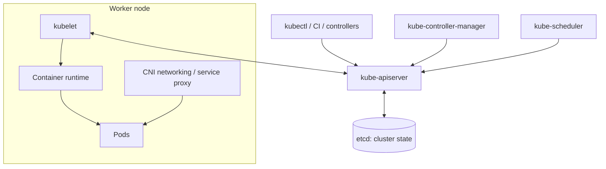
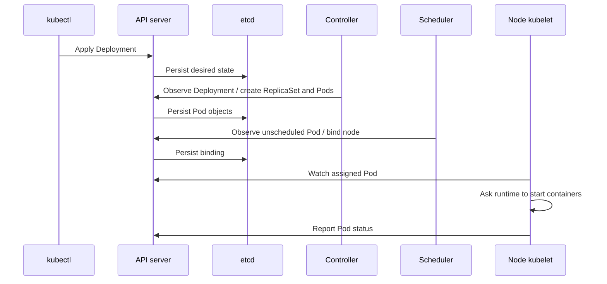
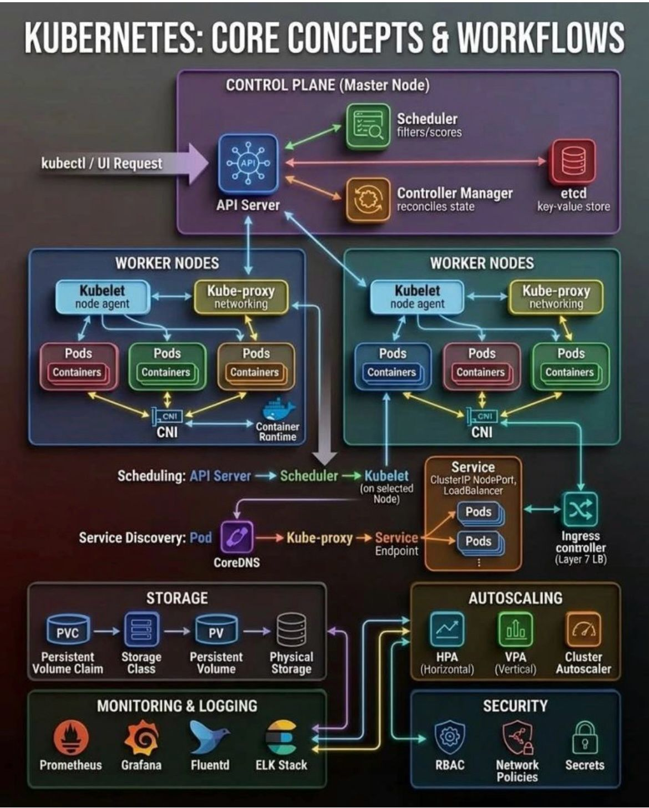

# Kubernetes Overview

Kubernetes is a **declarative orchestration system**: you submit a desired state through the API; controllers and node agents continuously reconcile observed state toward it. A cluster comprises a **control plane** and one or more **worker nodes**. A node may be a physical or virtual machine.

For practical revision, see the [Kubernetes networking lab](../../networking/labs/kubernetes-service-dns-networkpolicy.md), [Kubernetes projects](k8projects.md), and [troubleshooting reference](troubleshooting/overview.md).

## Architecture at a glance



**Important boundary:** Most components use the Kubernetes API to read or update cluster objects; **etcd is accessed through the API server**, not directly by kubelets, controllers, or schedulers. The API server is the control-plane entry point, not the packet-forwarding path for ordinary application traffic.

## Control-plane components

### etcd

etcd is the distributed key-value store backing the Kubernetes API's persistent cluster state: workloads, node objects, configuration, policies, and other API resources. It is **not** a store of running container processes or application data. Back up etcd and test restoration in self-managed clusters; managed services may provide their own control-plane backup mechanism.

### kube-apiserver

The API server authenticates and authorizes requests, applies admission controls, validates API objects, and reads or persists state through etcd. `kubectl`, controllers, and node agents communicate through this API.

### kube-controller-manager

Controllers watch current state and reconcile it with desired state. Examples include Deployment/ReplicaSet reconciliation and node lifecycle monitoring. **Reconciliation is continuous**, so a failed Pod can be replaced without a human reissuing the deployment command.

### kube-scheduler

The scheduler selects a suitable node for a **pending, unscheduled Pod** and records that binding through the API. It considers resource requests, affinity, topology constraints, taints/tolerations, and scheduling policy. The scheduler does **not** launch containers; kubelet and the container runtime handle execution on the selected node.

## Worker-node components

### kubelet

The kubelet watches Pods assigned to its node, ensures their containers are started and monitored through the container runtime, and reports status to the API server. It is **not** the sole point of contact for all Kubernetes networking or management traffic.

### Container runtime

A CRI-compatible runtime (for example, containerd) creates and manages containers as directed by kubelet.

### CNI and service networking

A CNI plugin provides Pod network connectivity; a Service provides a stable virtual destination for changing backend Pods. Depending on cluster implementation, Service forwarding may use kube-proxy or an alternative data plane such as eBPF. **kube-proxy does not itself provide the Pod network.** NetworkPolicy enforcement depends on the CNI.

## Follow one Pod from request to running state



### Verify the architecture in a real cluster

```bash
kubectl get nodes -o wide
kubectl get pods -A -o wide
kubectl get deployments,replicasets,pods -A
kubectl describe pod <pod-name> -n <namespace>
kubectl get events -A --sort-by=.lastTimestamp
```

Expected interpretation: a Deployment expresses desired replicas, its ReplicaSet owns matching Pods, the scheduler binds pending Pods to nodes, and kubelet reports running/readiness status. An event such as `FailedScheduling` points toward scheduling constraints, whereas `ImagePullBackOff` points toward image retrieval or credentials.

## Components quick reference

| Component | Primary responsibility | Example evidence |
| --- | --- | --- |
| API server | Request processing and API state | `kubectl get --raw /readyz` (subject to RBAC) |
| etcd | Durable control-plane state | Control-plane health/metrics (access depends on cluster) |
| Controller manager | Reconcile desired state | Deployment/ReplicaSet events |
| Scheduler | Bind Pods to nodes | `FailedScheduling` events |
| Kubelet | Reconcile assigned Pods on each node | Pod status and node conditions |
| CNI | Pod networking and optional policy enforcement | Pod-to-Pod connectivity tests |
| Service data plane | Forward Service traffic to endpoints | `kubectl get endpointslices` |

## Brief summary components

✨ Control Plane (The Brain)
API Server – Entry point for all requests (kubectl / UI / CI-CD)
Scheduler – Decides where Pods run
Controller Manager – Ensures desired state matches actual state
etcd – Stores cluster state (key-value store)

✨ Worker Nodes (Where workloads run)
Kubelet – Ensures containers are running as expected
Kube-proxy – Handles networking rules
Pods – Smallest deployable unit (one or more containers)
CNI + Container Runtime – Networking + container execution

✨ Traffic Flow
Service – Stable endpoint for Pods (ClusterIP / NodePort / LoadBalancer)
Ingress – Layer 7 routing (HTTP/HTTPS)
CoreDNS – Service discovery inside the cluster

✨ Storage
PVC → PV → StorageClass → Physical storage
 Decouples infrastructure from workloads.

✨ Autoscaling
HPA (Horizontal scaling)
VPA (Vertical scaling)
Cluster Autoscaler (Node scaling)

✨ Security
RBAC
Network Policies
Secrets

✨ Observability
Prometheus + Grafana
Fluentd / ELK stack


