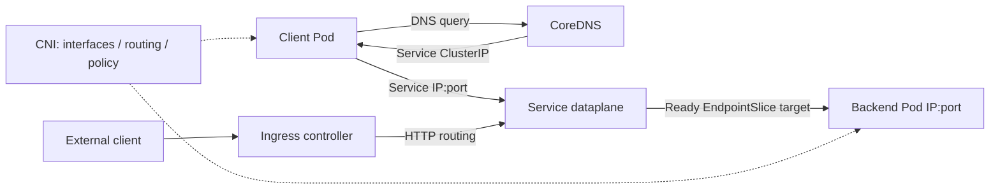

# Kubernetes Networking — Pods, Services, DNS, CNI, Ingress

> **Goal:** Follow one request through the cluster and troubleshoot each network boundary. This page expands the original network namespace and cluster-port notes; protocol fundamentals live in [Networking & Backend Engineering](../../networking/index.md).

## LEARN — The request path



**Different objects solve different problems:**

| Component | Responsibility | Diagnostic clue |
| --- | --- | --- |
| Pod IP | Address assigned to Pod network namespace | `kubectl get pods -o wide` |
| CNI | Sets up Pod interfaces/routing; policy support varies | Node/CNI agent logs, Pod reachability |
| Service | Stable virtual destination selecting backends | `kubectl get svc` |
| EndpointSlice | Ready/eligible backend IPs and ports | `kubectl get endpointslices` |
| CoreDNS | Cluster service-name resolution | `nslookup` from a Pod |
| NetworkPolicy | Intent to allow/deny ingress/egress if enforced by CNI | Check implementation and actual traffic |
| Ingress | HTTP(S) routing rules interpreted by a controller | Controller logs, address, rules |

## Network namespaces — Linux foundation

A Linux network namespace isolates interfaces, IPs, routes, neighbors and sockets. Pods commonly share one network namespace across their containers. A veth pair can connect two namespaces; a CNI plugin configures the real Pod path.

**Original lab concept preserved:** create two namespaces, connect them with a veth pair, assign IPs and ping. The fully documented, reversible version with exact commands and expected results is [Linux namespace lab](../../networking/labs/linux-routing-namespaces.md).

The original commands used `red` and `blue` namespaces and `192.168.15.1/24` / `192.168.15.2/24`. They illustrate the same direct-veth topology. The updated lab uses prefixed names to avoid collisions and a /30 point-to-point subnet.

## Pod networking and CNI

In a typical cluster, each Pod receives a cluster-routable IP; containers in the same Pod share localhost and the Pod IP. Cross-node Pod connectivity depends on the chosen CNI and underlying network (routed or overlay). Do not assume a specific implementation such as Flannel, Calico or Cilium without checking your cluster.

```bash
kubectl get nodes -o wide
kubectl get pods -A -o wide
kubectl -n kube-system get pods -o wide
```

**Observe:** Which node hosts each Pod? Which network agents are present? Are any CNI components unhealthy?

## Services and EndpointSlices

A Service's selector matches Pod labels; it does not forward traffic to an arbitrary healthy Pod. EndpointSlices publish eligible backend addresses and ports. Depending on implementation, kube-proxy or another dataplane programs the actual forwarding.

```bash
kubectl -n default get svc
kubectl -n default get endpointslices
kubectl -n default get pods --show-labels -o wide
```

If Service DNS resolves but requests fail, check selector, EndpointSlices, readiness and targetPort **before** changing DNS.

## CoreDNS and service discovery

A Service normally resolves as `service.namespace.svc.cluster.local`, although cluster domain is configurable. Pod DNS search domains allow short service names within the namespace. DNS lookup and TCP connectivity are separate tests.

```bash
kubectl -n kube-system get pods -l k8s-app=kube-dns
kubectl -n kube-system get svc kube-dns
# In the disposable Phase 2 lab:
kubectl -n netlab2 exec client -- nslookup netlab2-api.netlab2.svc.cluster.local
```

**Note:** Labels and CoreDNS deployment names differ across distributions; if the label query returns nothing, inspect `kubectl -n kube-system get pods` rather than assuming DNS is absent. For caching, TTL and resolver mechanics, use the [canonical DNS guide](../../networking/fundamentals/dns-resolution.md).

## Ingress, NodePort and LoadBalancer

Ingress defines HTTP(S) routes; a running **Ingress controller** is required to implement them. A `NodePort` Service opens a port in the cluster's configured range (commonly 30000–32767). A `LoadBalancer` Service needs a cloud controller or local load-balancer integration; on local clusters `EXTERNAL-IP` can remain `<pending>`.

```bash
kubectl get ingress -A
kubectl get ingressclass
kubectl get svc -A
kubectl -n ingress-nginx get pods,svc 2>/dev/null || true
```

**Do not assume** `http://demo.local` will work without DNS/hosts mapping, a controller, a reachable port, and matching host rules. A local NodePort or `kubectl port-forward` is often the simpler verification path.

## Cluster networking ports — verify for your distribution

The original page listed common control-plane and worker ports. These are **not universal firewall rules**. Modern Kubernetes components may use different ports or bind only locally; never blindly open ports.

| Component | Common port | Context |
| --- | --- | --- |
| API server | TCP 6443 | Client/control-plane access |
| etcd | TCP 2379–2380 | etcd client/peer, only where deployed |
| kubelet API | TCP 10250 | Control plane/node communication |
| kube-scheduler | TCP 10259 | Secure metrics/health endpoint in common setups |
| kube-controller-manager | TCP 10257 | Secure metrics/health endpoint in common setups |
| NodePort | TCP/UDP 30000–32767 | Default range; cluster-configurable |

The legacy 10251/10252 ports in the original notes correspond to older insecure component endpoints and should not be treated as current defaults. CNI overlay/encapsulation ports depend on the implementation.

## OPERATE — Diagnostic sequence

1. `kubectl get pods -o wide`: running, ready, node, Pod IP?
2. `kubectl get svc`: correct selector and port mapping?
3. `kubectl get endpointslices`: eligible backend IPs?
4. `kubectl exec ... -- nslookup ...`: DNS resolution?
5. `kubectl exec ... -- wget ...`: Service TCP/HTTP?
6. Compare Pod IP versus Service IP and inspect NetworkPolicy.
7. If cross-node only, inspect CNI health and node-to-node path.
8. If external only, inspect Ingress controller, Service type, host resolution and node access.

**Practice all steps in one self-contained environment:** [Kubernetes Service, DNS & NetworkPolicy lab](../../networking/labs/kubernetes-service-dns-networkpolicy.md).

## Useful Linux network commands (from the original notes)

```bash
ip link
ip addr
ip route
ip route get 1.1.1.1
ip neigh
ss -lntup
cat /proc/sys/net/ipv4/ip_forward
```

Changing IP addresses, routes, or `ip_forward` affects the host. The original page included commands such as `ip addr add` and `ip route add`; do **not** execute those against a working cluster node without a disposable environment and a recovery plan.

## My Architecture Review — Solutions & Doubts

- Why can DNS resolve while a Service has zero endpoints?
- How can a NetworkPolicy object exist without being enforced?
- Why does a local LoadBalancer Service show `<pending>`?
- **My commands, observations and doubts:**
