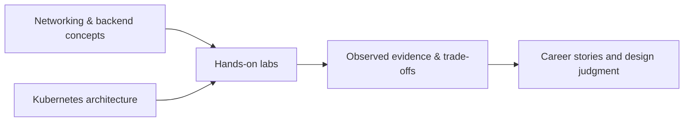
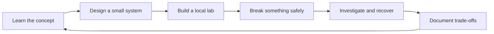

# Learn. Build. Break. Understand. Improve.

Welcome to my **SRE, DevOps & Architecture Learning Wiki** — a working engineering notebook, not just a collection of theory.

I use this space to turn experience into practical understanding: design a system, run it locally, introduce a failure, investigate it, and record what actually happened.

## Where should I start?

| My goal today | Start here |
| --- | --- |
| Grow into a higher technical role | [Career & Professional Growth](career/index.md) |
| Pick an exercise or a project to build | [Labs & Projects](labs/index.md) |
| Troubleshoot DNS, TCP and backend connectivity | [Networking & Backend Engineering](networking/index.md) |
| Refresh Kubernetes architecture | [Kubernetes Architecture](docker_k8/k8/architecture.md) |
| Strengthen production reliability knowledge | [SRE Overview](sre/overview.md) |
| Explore practical automation and pipelines | [CI/CD Overview](cicd/overview.md) |
| Practice explaining engineering work | [Technical Communication](career/communication.md) |

## Learning dashboard

This is a **navigation dashboard**, not an automatically calculated completion score. Documentation may be published while hands-on work remains unverified.

| Track | Start / browse | Progress and next action |
| --- | --- | --- |
| Networking & Backend Engineering | [Networking learning path](networking/index.md) | [Networking practice tracker](networking/learning.md) |
| Practical labs and projects | [Skill-based lab catalog](labs/index.md) | Choose one fault and record actual validation output |
| Kubernetes | [Architecture reference](docker_k8/k8/architecture.md) | [Service/DNS/NetworkPolicy lab](networking/labs/kubernetes-service-dns-networkpolicy.md) |
| Career development | [Career roadmap](career/index.md) | Capture one design decision and one explanation you can present |

### How the tracks connect

**Progress labels:** *Published* = documentation exists; *Practiced* = exercise attempted with notes; *Verified* = observed outputs and repair validated; *Planned* = not yet published or attempted. Do not infer completion from publication.

## My learning method

!!! tip "Make each session count"
    Choose **one** lesson or failure scenario. Before running commands, predict what should happen. Afterward, write down what surprised you and what you would change in production.

## Technical reference library

Browse the navigation for Python, Linux, Docker, Kubernetes, Nginx, cloud, CI/CD, monitoring, system design, security, databases, AI, and more. Use the search bar to find a command, explanation, or troubleshooting pattern quickly.

## Beyond the technical work

My [career roadmap](career/index.md) connects hands-on learning with role progression, communication, and sustainable working preferences. The goal is not to study everything; it is to develop **demonstrable technical judgment** and keep engineering enjoyable.

---

*This wiki is a living record. Practical findings, lessons learned, and updated decisions belong here.*
