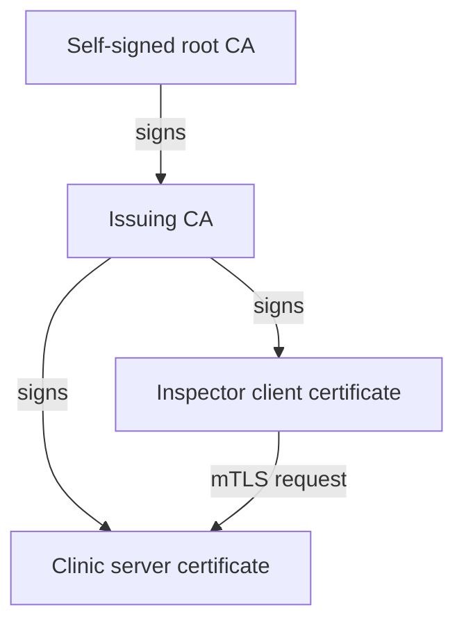

# Enterprise-style PKI on Ubuntu

In a village, the council keeps its master seal in a locked vault. It uses that seal to authorize the village registrar. The registrar uses a different seal to issue a signboard certificate for the clinic and an ID card for the inspector. A guard who already recognizes the council's seal can check that the council authorized the registrar and that the registrar issued the credentials.

| Village | PKI | In this lab |
| --- | --- | --- |
| Council's master seal in the vault | Root CA private key | Signs the issuing CA certificate |
| Council's public seal reference | Self-signed root CA certificate | Installed as a trust anchor by the client, or supplied per command |
| Authorized village registrar | Intermediate or issuing CA | Signs server and client certificates |
| Clinic's signboard | Server certificate | Binds the public key to `clinic.village.test` |
| Inspector's ID card | Client certificate | Binds the inspector's identity to a public key for mTLS |
| Application for a signboard or ID | Certificate signing request (CSR) | Carries a public key and a requested identity, signed with the corresponding private key |
| Registrar's ledger and invalid-ID list | Issuance database and certificate revocation list (CRL) | Tracks certificate serial numbers and publishes revoked ones |

Anyone can print a copy of a certificate. During TLS, each authenticated peer proves possession of its private key. The clinic also checks an inspector's credentials in mTLS. Deciding which authenticated inspectors may read a patient record would be a separate authorization decision.



An enterprise-style PKI is this combination of **delegation**, **key custody**, and **trust distribution**. The root signs the issuer during an occasional administrative ceremony. The issuer handles routine enrollments and renewals. The client starts with a trusted copy of the root certificate and verifies the path from the leaf through the issuer. The root is self-signed, and the server and client certificates are privately CA-signed. A self-signature alone conveys no trust. [Ubuntu certificate overview](https://ubuntu.com/server/docs/security-certificates/) · [OpenSSL verification options](https://docs.openssl.org/3.0/man1/openssl-verification-options/)

## Choose your topology

Use fresh Ubuntu Server 24.04 LTS VMs with a sudo-capable user and Bash. Take a snapshot before starting if you want a quick reset. Work through steps 1–9 in either layout. If you do both labs, start each with an empty lab directory and mint a fresh CA hierarchy.

| Role | Lab A — one local Ubuntu VM | Lab B — three Ubuntu VMs |
| --- | --- | --- |
| **Root** | `root/` directory on the one VM | VM 1, `pki-root`. Use the hypervisor console and disconnect the network adapter after installing packages |
| **Issuer** | `issuer/` directory on the one VM | VM 2, `pki-issuer`. Keep it on a private VM network with VM 3 |
| **Service** | `service/` directory and Nginx on loopback | VM 3, `pki-clinic`. Bind Nginx to its private IPv4 address |
| **Client** | `client/` directory and a Bash prompt on the one VM | A Bash prompt on VM 2 for this three-VM exercise, using a separate `client/` directory |

Lab A simulates offline custody by leaving the root key idle after signing. The VM and login still have access to all four directories. Lab B gives the root a real network boundary and also keeps the issuing key off the Nginx host. Running the practice client on VM 2 saves a fourth VM.

For Lab B, connect VM 2 and VM 3 to the same private virtual switch with IPv4 connectivity. Find their IPs with `ip -br -4 addr`. Use the private interface addresses throughout. If UFW is active on VM 3, allow VM 2's private IP to reach TCP ports 8443 and 9443. Use the hypervisor console on VM 1 and use a removable virtual disk, or attach a temporary hypervisor shared folder to transfer **only the named CSRs and public certificates**. Detach it after the transfer. The commands name the source and destination for each transfer. Every `.key` stays in the directory and on the machine where it was generated.

For example, if VM 2 is `192.168.56.12` and Service already has UFW enabled, run this on Service to allow the TLS tests and the SSH file transfer used below. Substitute VM 2's actual IP.

```bash
ISSUER_IP=192.168.56.12
for port in 22 8443 9443; do
  sudo ufw allow from "$ISSUER_IP" to any port "$port" proto tcp
done
```

## 1. Prepare the VMs

On each VM, install the base packages while it still has package-repository access. Run the last two lines in each new shell used for the lab.

```bash
sudo apt update
sudo apt install -y openssl ca-certificates curl

export PKI="$HOME/village-pki"
umask 077
```

On **Service**, install Nginx. The following commands unlink Ubuntu's packaged default site on the dedicated lab VM. The lab uses ports 8443 and 9443. For Lab B, also run `sudo apt install -y openssh-server` on Service now if you plan to use SCP later.

```bash
sudo apt install -y nginx
sudo unlink /etc/nginx/sites-enabled/default
```

On **Lab B Root**, disconnect the VM's network adapter now. Keep its console open. On **Lab B Service**, use `ip -br -4 addr` to find the address you will use for Nginx and for Client commands.

## 2. Create the root and the issuer's request

On **Root**, generate an encrypted RSA key and a self-signed root certificate. OpenSSL prompts for a passphrase when generating the key and again when using it. Record the root certificate's SHA-256 fingerprint from this console for later comparison.

```bash
mkdir -p "$PKI/root"
cd "$PKI/root"

openssl genpkey -algorithm RSA -pkeyopt rsa_keygen_bits:3072 \
  -aes-256-cbc -out root.key

openssl req -new -x509 -sha256 -days 3650 -key root.key \
  -subj '/CN=Village Root CA' -out root.crt \
  -addext 'basicConstraints=critical,CA:TRUE,pathlen:1' \
  -addext 'keyUsage=critical,keyCertSign,cRLSign' \
  -addext 'subjectKeyIdentifier=hash'

openssl x509 -in root.crt -noout -subject -issuer -fingerprint -sha256
```

The subject and issuer both say `Village Root CA` because the root signs its own certificate. `CA:TRUE` permits CA use and `pathlen:1` allows one intermediate below the root on these paths. `keyCertSign` and `cRLSign` describe the signing uses of its key. The ten-year root lifetime is a lab choice. [OpenSSL X.509 extensions](https://docs.openssl.org/3.0/man5/x509v3_config/)

On **Issuer**, create the issuer's own encrypted key and CSR. The root will authorize the public key in this request.

```bash
mkdir -p "$PKI/issuer"
cd "$PKI/issuer"

openssl genpkey -algorithm RSA -pkeyopt rsa_keygen_bits:3072 \
  -aes-256-cbc -out issuer.key

openssl req -new -sha256 -key issuer.key \
  -subj '/CN=Village Issuing CA' -out issuer.csr

sha256sum issuer.csr
```

Transfer `issuer/issuer.csr` from **Issuer** to `root/issuer.csr` on **Root**. For Lab A, run `cp "$PKI/issuer/issuer.csr" "$PKI/root/"`. For Lab B, use the offline transfer method from the topology section. Compare the SHA-256 sum on both consoles so you can confirm which request you are signing.

For example, if your transfer media is mounted as `/mnt/pki-transfer` and your user can write to it, run `install -m 0644 "$PKI/issuer/issuer.csr" /mnt/pki-transfer/` on Issuer. Move the media to Root and run `cp /mnt/pki-transfer/issuer.csr "$PKI/root/"`. Substitute your hypervisor's actual mount path.

## 3. Sign the issuing CA and put the root away

On **Root**, inspect and verify the CSR. Its signature confirms control of the corresponding private key. Check the subject and compare the hash with the issuer's console before authorizing the request.

```bash
cd "$PKI/root"
sha256sum issuer.csr
openssl req -in issuer.csr -noout -subject -verify

cat > issuer.ext <<'EXT'
[issuing_ca]
basicConstraints = critical,CA:TRUE,pathlen:0
keyUsage = critical,keyCertSign,cRLSign
subjectKeyIdentifier = hash
authorityKeyIdentifier = keyid:always,issuer
EXT

openssl x509 -req -in issuer.csr -CA root.crt -CAkey root.key \
  -set_serial "0x$(openssl rand -hex 16)" -days 1825 -sha256 \
  -extfile issuer.ext -extensions issuing_ca -out issuer.crt

openssl verify -CAfile root.crt issuer.crt
```

Expect `issuer.crt: OK`. The root chooses the extensions in `issuer.ext`. The issuing certificate can sign leaves, and `pathlen:0` forbids additional intermediate CAs beneath it on a valid path. The issuer lives for five years in this lab.

Send **`root.crt` and `issuer.crt`** from `root/` on Root to `issuer/` on Issuer. For Lab A, run `cp "$PKI/root/"{root,issuer}.crt "$PKI/issuer/"`. For Lab B, use the offline transfer method again, eject the transfer media, and shut down VM 1 from its console with `sudo poweroff`. All remaining steps use the issuer or the public root certificate, so the root VM can stay off.

With the example transfer mount, run `install -m 0644 "$PKI/root/"{root,issuer}.crt /mnt/pki-transfer/` on Root before ejecting. Move the media to Issuer and run `cp /mnt/pki-transfer/{root,issuer}.crt "$PKI/issuer/"`.

## 4. Generate the clinic and inspector keys and CSRs

On **Service**, create the clinic key and request. Nginx will read this key at startup. It is unencrypted on disk to permit unattended startup, and its deployed copy will be readable only by root.

```bash
mkdir -p "$PKI/service"
cd "$PKI/service"

openssl genpkey -algorithm RSA -pkeyopt rsa_keygen_bits:2048 -out clinic.key
openssl req -new -sha256 -key clinic.key -subj '/CN=clinic.village.test' \
  -addext 'subjectAltName=DNS:clinic.village.test' -out clinic.csr
```

On **Client**, generate a separate key and CSR for the inspector. The client key is unencrypted for this lab and protected by `umask 077`.

```bash
mkdir -p "$PKI/client"
cd "$PKI/client"

openssl genpkey -algorithm RSA -pkeyopt rsa_keygen_bits:2048 -out inspector.key
openssl req -new -sha256 -key inspector.key \
  -subj '/CN=village-inspector' -out inspector.csr
```

On **Issuer**, collect both requests. The client directory is local to Issuer in both layouts.

```bash
cd "$PKI/issuer"
cp "$PKI/client/inspector.csr" .
```

In Lab A, run `cp "$PKI/service/clinic.csr" .` here too. In Lab B, transfer only `clinic.csr` from Service to Issuer. The SCP example uses the private network and the OpenSSH server installed on Service in step 1. Verify the SSH host key against the Service console before accepting it. On Issuer, replace the example login name and address with your Service values and keep this variable for the later copy back.

On the Service console, `sudo ssh-keygen -lf /etc/ssh/ssh_host_ed25519_key.pub` prints the ED25519 host key fingerprint to compare with the SSH prompt. Use an existing SSH login on Service or configure your Issuer user's SSH public key there. You can also transfer the three public certificates and the CSR through the hypervisor instead of using SSH.

```bash
CLINIC_SSH='ubuntu@192.168.56.13'
scp "$CLINIC_SSH:village-pki/service/clinic.csr" .
```

## 5. Issue the leaf certificates

On **Issuer**, initialize the signing database once. `index.txt` is the issuance ledger. `serial` and `crlnumber` start two independent hexadecimal counters, and `newcerts/` holds the issued copies by serial. Keep these files for renewal and revocation. Run the signing commands one at a time.

```bash
cd "$PKI/issuer"
mkdir newcerts
touch index.txt
printf '1000\n' > serial
printf '1000\n' > crlnumber

cat > issuing.cnf <<'CNF'
[ca]
default_ca = village_issuer

[village_issuer]
database = index.txt
new_certs_dir = newcerts
serial = serial
crlnumber = crlnumber
certificate = issuer.crt
private_key = issuer.key
default_md = sha256
default_days = 90
default_crl_days = 7
policy = leaf_subject
unique_subject = no
copy_extensions = none

[leaf_subject]
commonName = supplied

[clinic_server]
basicConstraints = critical,CA:FALSE
keyUsage = critical,digitalSignature
extendedKeyUsage = serverAuth
subjectAltName = DNS:clinic.village.test
subjectKeyIdentifier = hash
authorityKeyIdentifier = keyid:always,issuer

[inspector_client]
basicConstraints = critical,CA:FALSE
keyUsage = critical,digitalSignature
extendedKeyUsage = clientAuth
subjectKeyIdentifier = hash
authorityKeyIdentifier = keyid:always,issuer
CNF

openssl x509 -in root.crt -noout -fingerprint -sha256
openssl req -in clinic.csr -noout -verify -subject
openssl req -in inspector.csr -noout -verify -subject
```

Compare the root fingerprint with the one recorded on Root. Check the expected subjects `clinic.village.test` and `village-inspector`. The issuer chooses the permitted SAN and extended key usage (EKU) from its own profiles. The clinic certificate gets the DNS SAN and `serverAuth`. The inspector certificate gets `clientAuth`. Both get `CA:FALSE` and expire after 90 days. This lab approves two known requests manually. A real issuer would authenticate the requester and authorize each requested identity before signing. [OpenSSL CA command and database](https://docs.openssl.org/3.0/man1/openssl-ca/)

```bash
openssl ca -batch -config issuing.cnf -extensions clinic_server \
  -in clinic.csr -out clinic.crt -notext
openssl ca -batch -config issuing.cnf -extensions inspector_client \
  -in inspector.csr -out inspector.crt -notext

openssl verify -show_chain -purpose sslserver -verify_hostname clinic.village.test \
  -CAfile root.crt -untrusted issuer.crt clinic.crt
openssl verify -show_chain -purpose sslclient \
  -CAfile root.crt -untrusted issuer.crt inspector.crt
openssl x509 -in clinic.crt -noout -subject -issuer -serial -dates \
  -ext basicConstraints,keyUsage,extendedKeyUsage,subjectAltName
```

Both verifications should print `OK` and show three levels. `-CAfile` supplies the trust anchor. `-untrusted` supplies a chain-building certificate whose authority must be verified. The clinic check additionally matches the DNS name and TLS server purpose.

Deliver the signed artifacts from **Issuer**. These are public files. The application and client already have their own keys.

```bash
# Both labs: Client is local to Issuer.
cp root.crt issuer.crt inspector.crt "$PKI/client/"

# Lab A only:
cp root.crt issuer.crt clinic.crt "$PKI/service/"

# Lab B only (use the same CLINIC_SSH as in step 4):
scp root.crt issuer.crt clinic.crt "$CLINIC_SSH:village-pki/service/"
```

## 6. Serve HTTPS and mTLS on Nginx

On **Service**, confirm the received root fingerprint. Then build the server's transmitted chain in leaf-first order. Install it and the private key under a dedicated configuration directory. The separate root file is what Nginx trusts to verify incoming client certificates. [Nginx TLS directives](https://nginx.org/en/docs/http/ngx_http_ssl_module.html)

```bash
cd "$PKI/service"
openssl x509 -in root.crt -noout -fingerprint -sha256
cat clinic.crt issuer.crt > clinic-fullchain.pem

sudo install -d -m 0755 /etc/nginx/village-pki
sudo install -m 0600 clinic.key /etc/nginx/village-pki/
sudo install -m 0644 clinic-fullchain.pem root.crt /etc/nginx/village-pki/
```

Set `BIND_IP` to `127.0.0.1` in Lab A. In Lab B, replace it with the private IP of VM 3. Port 8443 authenticates the server. Port 9443 also requires a valid client certificate. Nginx permits one intermediate in the client path. This endpoint authorizes any client certificate that passes its lab trust policy.

```bash
BIND_IP=127.0.0.1

sudo tee /etc/nginx/conf.d/village-pki.conf >/dev/null <<NGINX
server {
    listen ${BIND_IP}:8443 ssl;
    server_name clinic.village.test;
    ssl_certificate /etc/nginx/village-pki/clinic-fullchain.pem;
    ssl_certificate_key /etc/nginx/village-pki/clinic.key;

    location / {
        default_type text/plain;
        return 200 "Village clinic HTTPS\\n";
    }
}

server {
    listen ${BIND_IP}:9443 ssl;
    server_name clinic.village.test;
    ssl_certificate /etc/nginx/village-pki/clinic-fullchain.pem;
    ssl_certificate_key /etc/nginx/village-pki/clinic.key;
    ssl_client_certificate /etc/nginx/village-pki/root.crt;
    ssl_verify_client on;
    ssl_verify_depth 2;

    location / {
        default_type text/plain;
        return 200 "Village clinic mTLS\\n";
    }
}
NGINX

sudo nginx -t && sudo systemctl reload nginx
sudo ss -ltnp '( sport = :8443 or sport = :9443 )'
```

Expect two Nginx listeners. The live server sends the clinic leaf and its issuer. The client supplies the root independently. [Ubuntu certificate chain formats](https://ubuntu.com/server/docs/how-to/security/obtain-tls-certificates/)

## 7. Verify it from the client

On **Client**, compare the root fingerprint with the recorded value. Set `CLINIC_IP` to the same IP used for `BIND_IP`. The shell function uses `curl --resolve` so the URL, TLS server name, and hostname validation keep using `clinic.village.test` while TCP connects to the chosen lab IP. It disables proxy use and user curl configuration for reproducibility.

```bash
cd "$PKI/client"
openssl x509 -in root.crt -noout -fingerprint -sha256
CLINIC_IP=127.0.0.1

village_curl() {
  curl -q --noproxy '*' \
    --resolve "clinic.village.test:8443:$CLINIC_IP" \
    --resolve "clinic.village.test:9443:$CLINIC_IP" "$@"
}

# Expected failure on a fresh VM because Ubuntu does not trust this root yet.
village_curl https://clinic.village.test:8443/

# Expected success with per-command trust.
village_curl --cacert root.crt https://clinic.village.test:8443/

# Expected rejection without an inspector credential.
village_curl -i --cacert root.crt https://clinic.village.test:9443/

# Send the inspector leaf and issuing certificate as the client chain.
cat inspector.crt issuer.crt > inspector-fullchain.pem
village_curl --cacert root.crt --cert inspector-fullchain.pem \
  --key inspector.key https://clinic.village.test:9443/
```

The working requests print `Village clinic HTTPS` and `Village clinic mTLS`. For the no-client-cert test, expect an HTTP 400 response from Nginx or a TLS alert, depending on the handshake and software. A valid HTTPS response shows that the client authenticated the clinic. A valid mTLS response also shows that Nginx accepted the inspector's certificate and proof of key possession.

Inspect the server's transmitted certificates and enforce verification in the same command.

```bash
openssl s_client -connect "$CLINIC_IP:8443" -servername clinic.village.test \
  -showcerts -verify_hostname clinic.village.test -verify_return_error \
  -CAfile root.crt </dev/null
```

Expect two certificate PEM blocks and `Verify return code: 0 (ok)`. `-showcerts` lists what arrived on the wire. The verifier builds a path to the root from the local CA file. [OpenSSL s_client](https://docs.openssl.org/master/man1/openssl-s_client/)

To see how Ubuntu system-wide trust works, do this optional exercise on **Client** after comparing the root fingerprint. The lab root now applies to other software using Ubuntu's trust bundle. Undo the change immediately after the test.

```bash
sudo install -m 0644 root.crt /usr/local/share/ca-certificates/village-pki-root.crt
sudo update-ca-certificates
village_curl https://clinic.village.test:8443/

sudo unlink /usr/local/share/ca-certificates/village-pki-root.crt
sudo update-ca-certificates --fresh
```

Some browsers and runtimes have their own trust stores. This exercise uses Ubuntu curl and its system CA bundle. [Ubuntu root trust store](https://ubuntu.com/server/docs/how-to/security/install-a-root-ca-certificate-in-the-trust-store/)

## 8. Break and fix the trust path

On **Client**, start in `"$PKI/client"`. The first check supplies the issuer and a trusted root but asks for a different name. The second omits the issuer from the transmitted client chain. This Nginx setup trusts the root and needs the intermediate from the client.

```bash
village_curl --resolve "bakery.village.test:8443:$CLINIC_IP" \
  --cacert root.crt https://bakery.village.test:8443/

village_curl -i --cacert root.crt --cert inspector.crt \
  --key inspector.key https://clinic.village.test:9443/
```

Expect a hostname mismatch for the first command and an HTTP rejection or TLS error for the second. Fix the first by requesting `clinic.village.test` and the second by passing `--cert inspector-fullchain.pem`.

Now see what happens when the **server** omits its issuer. On **Service**, replace the deployed full chain temporarily with the leaf and reload Nginx.

```bash
cd "$PKI/service"
sudo install -m 0644 clinic.crt /etc/nginx/village-pki/clinic-fullchain.pem
sudo nginx -t && sudo systemctl reload nginx
```

On **Client**, `village_curl --cacert root.crt https://clinic.village.test:8443/` should fail with an issuer error after the Nginx reload takes effect. The root certificate lacks the issuing CA's public key, so it cannot verify the leaf directly. On **Service**, restore the chain, then repeat the curl command on Client to confirm it works.

```bash
sudo install -m 0644 clinic-fullchain.pem /etc/nginx/village-pki/
sudo nginx -t && sudo systemctl reload nginx
```

| Symptom | First check |
| --- | --- |
| Connection timeout or refusal | Use `ss -ltnp` on Service and check the private IP, network and firewall |
| Issuer error | Compare the supplied root fingerprint and inspect the transmitted chain with `s_client -showcerts` |
| Hostname mismatch | Compare the URL with the leaf's DNS SAN. If you use an IP in the URL, it needs an IP SAN |
| Certificate expired or not yet valid | Use `openssl x509 -in clinic.crt -noout -dates` and check system time on both VMs |
| Client credential rejected | Use `openssl verify -purpose sslclient -CAfile root.crt -untrusted issuer.crt inspector.crt` and check which chain curl sent |

## 9. Rotate and revoke a client certificate

Rotate the inspector credential first. On **Client**, generate a new key and CSR. On **Issuer**, sign the request, compare old and new serials, and send the new leaf to the client. The same CA chain stays trusted.

```bash
# Client
cd "$PKI/client"
openssl genpkey -algorithm RSA -pkeyopt rsa_keygen_bits:2048 -out inspector-next.key
openssl req -new -sha256 -key inspector-next.key \
  -subj '/CN=village-inspector' -out inspector-next.csr

# Issuer
cd "$PKI/issuer"
openssl req -in "$PKI/client/inspector-next.csr" -noout -subject -verify
openssl ca -batch -config issuing.cnf -extensions inspector_client \
  -in "$PKI/client/inspector-next.csr" -out inspector-next.crt -notext
openssl x509 -in inspector.crt -noout -serial
openssl x509 -in inspector-next.crt -noout -serial
cp inspector-next.crt "$PKI/client/"

# Client
cd "$PKI/client"
cat inspector-next.crt issuer.crt > inspector-next-fullchain.pem
village_curl --cacert root.crt --cert inspector-next-fullchain.pem \
  --key inspector-next.key https://clinic.village.test:9443/
```

After the new credential works, mark the old serial revoked on **Issuer** and issue a CRL. The two verification commands show the effect of applying that CRL. The first should report `certificate revoked`, and the second should print `inspector-next.crt: OK`.

```bash
cd "$PKI/issuer"
openssl ca -config issuing.cnf -revoke inspector.crt -crl_reason superseded
openssl ca -config issuing.cnf -gencrl -out issuer.crl.pem
openssl crl -in issuer.crl.pem -noout -issuer -lastupdate -nextupdate

openssl verify -purpose sslclient -CAfile root.crt -untrusted issuer.crt \
  -CRLfile issuer.crl.pem -crl_check inspector.crt
openssl verify -purpose sslclient -CAfile root.crt -untrusted issuer.crt \
  -CRLfile issuer.crl.pem -crl_check inspector-next.crt
```

The CA database records the revocation, and the CRL communicates it. The Nginx configuration in this lab has no CRL input, so the old credential can still pass the live endpoint's checks until it expires. Live enforcement requires distributing fresh revocation information and configuring the verifier to use it. A real PKI also needs a plan for intermediate compromise, including revoking or distrusting the affected issuer and reissuing its leaves under a replacement. [OpenSSL CRL verification](https://docs.openssl.org/3.0/man1/openssl-verification-options/) · [Nginx CRL directive](https://nginx.org/en/docs/http/ngx_http_ssl_module.html#ssl_crl)

## Clean up

If you installed system-wide trust, complete the removal commands in step 7. On Service, remove the lab site and reload Nginx. This assumes you started from a dedicated lab VM. Restore your pre-lab snapshots to discard the lab keys, CA database, and package and configuration changes across all VMs.

```bash
sudo unlink /etc/nginx/conf.d/village-pki.conf
sudo nginx -t && sudo systemctl reload nginx
```
