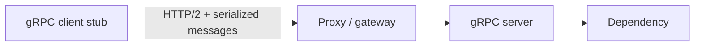

# gRPC and Protocol Buffers for Backend APIs

**Goal:** Decide when gRPC is appropriate and diagnose the transport and schema boundaries.

## LEARN — RPC over HTTP/2

gRPC commonly uses HTTP/2, Protocol Buffers as an interface/schema format, and typed service definitions. It supports unary, server-streaming, client-streaming and bidirectional-streaming calls. gRPC is not simply "HTTP made faster"; schema governance, deadlines, flow control and proxy compatibility matter.



Example schema:

```proto
syntax = "proto3";
package inventory.v1;

service Inventory {
  rpc GetItem (GetItemRequest) returns (GetItemReply);
}

message GetItemRequest { string id = 1; }
message GetItemReply { string id = 1; string status = 2; }
```

**Compatibility:** Preserve field numbers, avoid reusing removed tags, and plan schema evolution carefully. Renaming a field without changing its number is different from changing its wire type. Document API version and error contract.

## DESIGN — Four RPC styles

| Mode | Example | Risk to manage |
| --- | --- | --- |
| Unary | Get an inventory item | Deadline and retry semantics |
| Server streaming | Watch job progress | Slow consumer and cancellation |
| Client streaming | Upload a stream of telemetry | Backpressure and memory |
| Bidirectional | Live agent coordination | Long-lived connection lifecycle |

## BUILD — Inspect HTTP/2 support without extra libraries

```bash
curl --version
# Check whether your curl build lists HTTP2 among features.
```

**Expected:** `curl --version` reports supported features. If HTTP2 is absent, do not assume a gRPC endpoint will work with this curl build. For a full local gRPC lab, use a pinned `grpcio` and `grpcio-tools` virtual environment; do not install packages into the corebot production environment.

## BREAK — Production-style diagnosis

**Scenario:** A gRPC call fails with `DEADLINE_EXCEEDED` while TCP is established. Check client deadline, queueing, proxy HTTP/2 support, upstream service latency and dependency calls. Do not diagnose it as DNS without DNS evidence.

**Scenario:** Requests fail through an HTTP/1-only intermediary. Confirm whether the gateway supports native gRPC over HTTP/2, gRPC-Web, or transcoding. These are different deployment choices.

## OPERATE

- Propagate deadlines and cancellation; avoid retry storms.
- Distinguish gRPC status codes from HTTP status codes.
- Use mTLS/authorization for service identity; schema types do not provide security.
- Bound stream duration, message size and concurrent streams.
- Measure latency and error rates by RPC method and destination.

Related: [HTTP protocol](../../nginx/http_protocol.md), [connection pooling](../performance/keepalive-pooling-timeouts.md), [mTLS](../security/mtls-certificate-rotation.md).

## My Architecture Review — Solutions & Doubts

- When is REST simpler than gRPC?
- Why can a healthy TCP connection still return `DEADLINE_EXCEEDED`?
- What does HTTP/2 multiplexing change about connection pools?
- **My design notes / doubts:**
