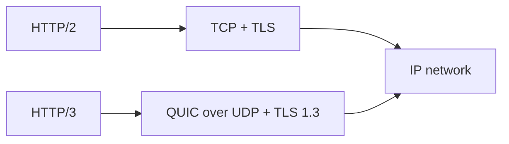

# QUIC and HTTP/3 — UDP Transport with Secure Streams

**Goal:** Understand the differences between TCP-based HTTP/2 and QUIC-based HTTP/3, and what changes in operations.

## LEARN — Different transport, same HTTP semantics

HTTP/3 maps HTTP semantics onto QUIC, which uses UDP. QUIC integrates cryptographic handshaking (TLS 1.3), stream multiplexing, loss recovery and connection migration support. HTTP/2 uses TCP and TLS for HTTPS. QUIC stream independence avoids TCP's **cross-stream transport head-of-line blocking**, though application and congestion limits still exist.



| Question | HTTP/2 | HTTP/3 |
| --- | --- | --- |
| Transport | TCP | QUIC over UDP |
| Encryption on typical public HTTPS | TLS | TLS 1.3 integrated with QUIC |
| Stream multiplexing | Yes | Yes |
| TCP-level cross-stream HOL blocking | Possible | Avoided between QUIC streams |
| Middlebox requirement | TCP/443 usually allowed | UDP/443 must be allowed |

**Caution:** HTTP/3 is not always faster. Middleboxes, UDP filtering, server support and workload characteristics matter. Many clients can fall back to HTTP/2 or HTTP/1.1.

## DESIGN — Operational decision

Evaluate browser/client support, CDN/edge termination, UDP firewall policy, telemetry, connection migration and fallback behavior. If a reverse proxy terminates HTTP/3 at the edge, the upstream connection to the backend may still use HTTP/1.1 or HTTP/2.

## BUILD — Inspect local tooling

```bash
curl --version
# Look for HTTP3 in the Features list; not all builds support it.
```

If your curl supports HTTP/3 and you have an authorized test endpoint advertising it:

```bash
# Replace the placeholder with your own HTTP/3-enabled endpoint.
curl --http3-only -I https://your-test-host.example/
```

**Expected:** success only when both client and endpoint support HTTP/3 and UDP is reachable. Otherwise a failure is an environment capability observation, not proof that HTTP/3 is universally broken.

## BREAK — Failure scenario

A client can reach TCP/443 but not UDP/443. HTTP/2 succeeds while HTTP/3-only fails. **Investigate:** client support, advertised protocol, DNS, UDP policy, firewall, NAT and server listener. **Fix:** restore authorized UDP path or retain HTTP/2 fallback; do not blindly open UDP/443 on production firewalls.

## OPERATE

- Instrument negotiated protocol and fallback rate.
- Verify UDP rate limiting and DDoS protections.
- Treat QUIC connection IDs and NAT rebinding carefully in observability.
- Test proxies/CDNs separately from backend protocols.

Related: [HTTP protocol](../../nginx/http_protocol.md), [packet capture](../troubleshooting/packet-capture-analysis.md), [flow and congestion control](../performance/flow-congestion-control.md).

## My Architecture Review — Solutions & Doubts

- Why can HTTP/3 work on mobile data but fail on a corporate network?
- Why is HTTP/3 not equivalent to "unreliable HTTP over UDP"?
- **My observations / doubts:**
