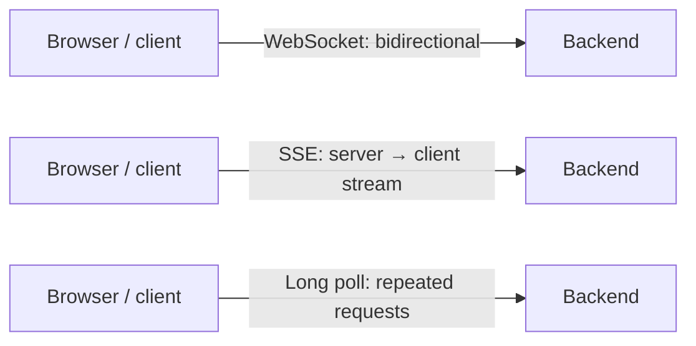

# WebSockets, Server-Sent Events and Long Polling

**Goal:** Choose a backend update mechanism based on directionality, compatibility, scaling and failure behavior.

## LEARN — Three ways to deliver updates



| Technique | Direction | Common fit | Operational cost |
| --- | --- | --- | --- |
| WebSocket | Bidirectional | Chat, interactive controls | Persistent sockets, ping/pong, reconnect |
| SSE | Server → client | Notifications, job progress | Long-lived HTTP responses, reconnect |
| Long polling | Request/response repeated | Compatibility fallback | Repeated HTTP overhead, timeout coordination |

WebSocket uses an HTTP handshake for the classic upgrade mechanism (and also has HTTP/2 and HTTP/3 mechanisms in supported stacks). SSE uses `text/event-stream`; clients reconnect and can use event IDs for resume. Long polling holds an HTTP request open until an event or timeout, then repeats.

## DESIGN — Example: automation job progress

A Python automation worker starts a long-running task. The UI needs state updates.

- **SSE:** good default when the server only pushes progress to the browser.
- **WebSocket:** useful when the browser also sends interactive control messages frequently.
- **Long polling:** reasonable when network intermediaries do not support streaming reliably.

**None of these replaces a durable job state store.** A disconnect must not erase task progress. Use a queue/database for durable state and the realtime channel for delivery.

## BUILD — Safe local SSE demonstration (Python stdlib)

Save as `sse_demo.py`:

```python
from http.server import BaseHTTPRequestHandler, ThreadingHTTPServer
import time

class Handler(BaseHTTPRequestHandler):
    def do_GET(self):
        if self.path != "/events":
            self.send_error(404)
            return
        self.send_response(200)
        self.send_header("Content-Type", "text/event-stream")
        self.send_header("Cache-Control", "no-cache")
        self.end_headers()
        for i in range(3):
            try:
                self.wfile.write(f"id: {i}\nevent: progress\ndata: step {i}\n\n".encode())
                self.wfile.flush()
                time.sleep(1)
            except (BrokenPipeError, ConnectionResetError):
                break

ThreadingHTTPServer(("127.0.0.1", 18091), Handler).serve_forever()
```

Run in Terminal A: `python3 sse_demo.py`. In Terminal B:

```bash
curl --noproxy '*' -N http://127.0.0.1:18091/events
```

**Expected:** three events arrive about one second apart, with `id`, `event` and `data` fields. The server uses HTTP/1.0 by default; this demonstration closes the connection after the three events rather than implementing an infinite production SSE stream.

## BREAK — Intermediary buffering (design experiment)

A reverse proxy buffers upstream responses, so a browser receives progress events in a batch instead of incrementally. **Investigate:** compare direct backend timing with proxy timing, check response buffering/compression, idle timeouts and flush behavior. **Fix:** configure streaming behavior on the specific proxy path after verifying its version and security policy.

## OPERATE

- Bound concurrent long-lived connections and heartbeats.
- Implement reconnection, resume tokens/event IDs and duplicate-safe consumers.
- Monitor active streams, reconnect rates, slow consumers and message lag.
- Use authorization on initial connection **and** message/action scope.
- Avoid holding long-lived connections in a worker pool sized only for short HTTP requests.

Related: [connection capacity](../performance/connection-capacity.md), [Nginx reverse proxy](../../nginx/reverse_proxy.md).

## My Architecture Review — Solutions & Doubts

- Which protocol fits a read-only progress dashboard?
- Why do WebSockets not guarantee durable delivery?
- How can a proxy make healthy SSE appear broken?
- **My observations / doubts:**
