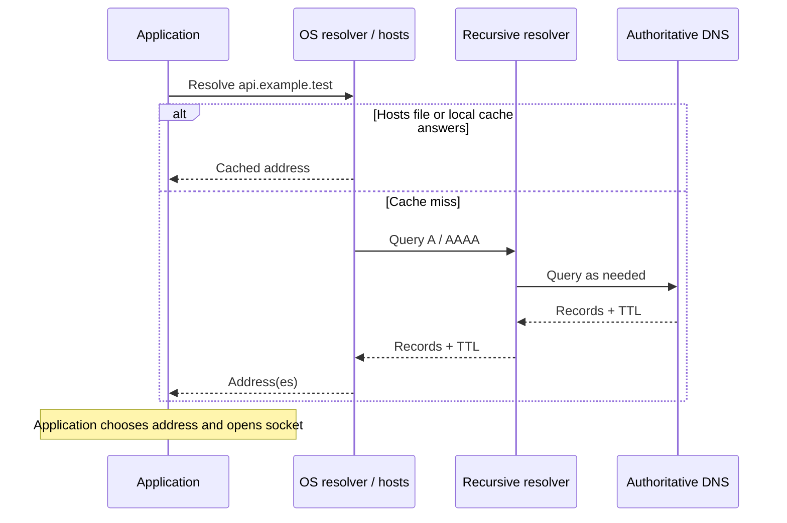

# DNS Resolution End to End

**Goal:** Explain how a hostname becomes an address used by an application, and diagnose why two clients may receive different answers.

**Source scope:** Synthesized from the uploaded Codemia chapter *DNS Resolution End to End*: resolution path, record types, TTL/negative caching, split-horizon DNS, multiple addresses, and service discovery. Lab examples are original.

## LEARN — The restaurant directory analogy

A customer knows a restaurant name, not its street address. A directory looks up the address, possibly from a cached entry. If the restaurant moves, an old directory entry can keep sending customers to the former address. DNS does not carry the HTTP request: it helps the application find the address to connect to.



**Important distinctions:**

- **Stub/system resolver:** the OS/application lookup path, including hosts-file rules, name-service configuration and possible caches.
- **Recursive resolver:** follows DNS delegation or answers from cache.
- **Authoritative server:** supplies records for its zone.
- **A/AAAA:** IPv4/IPv6 address records; **CNAME:** alias; **NS/SOA:** zone authority; **PTR:** reverse lookup.
- **TTL:** cache lifetime guidance, not a promise that every client switches instantly. Process caches, resolver overrides, connection reuse, and stale-serving behavior can extend the effective transition.
- **Negative caching:** nonexistent names can be cached too.
- **Split horizon:** the same hostname can intentionally resolve differently inside and outside a network.
- **DNS success is not TCP success:** a returned address does not prove the endpoint is reachable or healthy.

## DESIGN — What can go wrong?

| Symptom | Candidate explanation | Evidence to collect |
| --- | --- | --- |
| `dig` succeeds, app fails | Different resolver path, hosts entry, application cache, search domain | `getent hosts` (Linux), resolver settings, app logs |
| Only some clients fail | Different recursive resolvers, stale cache, split DNS | Compare answers from each client |
| IPv4 works but default connect fails | IPv6 address/path issue or address selection | Query A and AAAA separately; test `curl -4` and `-6` |
| Recently created name still fails | Negative caching | Capture exact answer and TTL |
| DNS changes but traffic hits old backend | Pooled connections or process-level cache | Connection destination, client lifecycle |

## BUILD — Safe local DNS resolution exercise

**Environment:** Ubuntu VM preferred for `getent`; macOS can run `dig` and `curl`. Use the public documentation domain `example.com`; results may vary by network.

```bash
# 1. Ask DNS directly; inspect ANSWER SECTION and TTL.
dig example.com A
dig example.com AAAA
dig example.com CNAME

# 2. On Ubuntu, use the system name-service path, which may consult /etc/hosts.
getent ahosts example.com

# 3. Show the resolver configured for the host.
cat /etc/resolv.conf

# 4. Inspect the timing of DNS, connection and TLS separately.
curl -sS -o /dev/null -w 'dns=%{time_namelookup} connect=%{time_connect} tls=%{time_appconnect} total=%{time_total}\n' https://example.com/
```

**Expected observations:** `dig` reports an answer or a meaningful DNS status; `getent` may differ because it uses the OS name-service path. `curl` timing fields are cumulative milestones, not independent durations. A network proxy or VPN can change the outcome.

## BREAK — Controlled hosts-file override (optional, Ubuntu only)

Do **not** modify corporate DNS or shared resolver settings. This test changes only the local VM's hosts file and must be reverted.

```bash
# Back up first, and choose an isolated lab-only name.
sudo cp /etc/hosts /tmp/hosts.networking-lab.backup
printf '127.0.0.1 api.networking-lab.invalid\n' | sudo tee -a /etc/hosts

# The OS resolver should find the local override.
getent ahostsv4 api.networking-lab.invalid

# DNS queries may not see /etc/hosts; this is the intended contrast.
dig api.networking-lab.invalid A

# Restore exactly the saved file after the experiment.
sudo cp /tmp/hosts.networking-lab.backup /etc/hosts
```

**Investigate:** Why can `getent` return 127.0.0.1 while `dig` does not? Which lookup path does your Python application use? How might a VPN affect the resolver?

## OPERATE — A DNS incident checklist

1. Record the failing client, namespace/container, hostname, time, and resolver.
2. Compare OS resolution with direct DNS queries; capture A/AAAA, status, TTL and server.
3. Check search domains, split DNS, negative cache and application-side caching.
4. Confirm the actual **destination IP** of the failing socket.
5. Test TCP/TLS independently before declaring DNS the root cause.
6. Verify recovery from multiple clients and through the full application request path.

For a rollout failure, work through [Architecture Lab 06](../../sysdesign/daily-architecture-lab/lesson-06-service-discovery-dns-failures.md). For interface and routing commands see [Linux networking](../../linux/admin/networking.md).

## My Architecture Review — Solutions & Doubts

- What does a successful DNS answer **not** prove?
- Why is lowering TTL immediately before a change insufficient?
- Which resolver and connection caches exist in my application stack?
- **My evidence, questions and corrections:**
