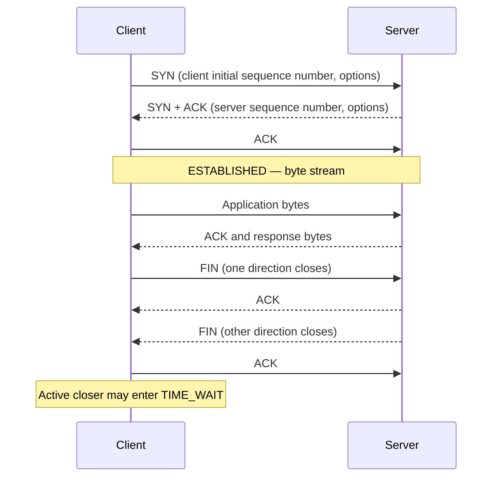

# The TCP Connection Lifecycle

**Goal:** Follow a TCP connection from SYN through data transfer and teardown, and interpret socket states without assuming every reset means the server application failed.

**Source scope:** Synthesized from Codemia *The TCP Connection Lifecycle*: handshake options, sequence numbers, accept backlogs, receive windows, retransmission, FIN/RST, TIME_WAIT, half-open connections and keepalive. The lab is original.

## LEARN — A two-way conversation

TCP is a **reliable ordered byte stream**. It does not preserve application message boundaries. Each side maintains independent send and receive directions. A TCP connection can be established while an HTTP request or application dependency still fails.



### What is negotiated or tracked?

- **SYN/SYN-ACK/ACK:** connection setup, sequence spaces, and TCP options such as MSS, window scaling, SACK permitted and timestamps when supported.
- **Sequence and ACK numbers:** track bytes, not HTTP requests or individual messages.
- **Receive window:** receiver-advertised flow-control capacity. A zero window means the receiver cannot accept more data at that moment; it does not by itself prove packet loss.
- **Congestion control:** sender behavior in response to path congestion; distinct from receive-window flow control.
- **Retransmission:** a sender resends unacknowledged bytes based on timers or ACK evidence; packet captures from a single point do not always prove the original packet was lost.
- **FIN:** orderly shutdown of one direction; **RST:** abort/reject of a connection, which can originate from an endpoint or intermediary.
- **TIME_WAIT:** normal state after an active close; useful for delayed packets and final ACK handling. High counts are a diagnostic clue, not automatically a defect.
- **Half-open/stale connection:** one side may lose state without the other knowing until it tries to send or probes.

## DESIGN — Socket-state interpretation

| Observation | Typical meaning | What it does not prove |
| --- | --- | --- |
| `LISTEN` | Local socket accepts new connection attempts | Backend is ready for real requests |
| `SYN-SENT` | Client has sent SYN and awaits progress | Firewall definitely dropped it |
| `SYN-RECV` | Server received SYN and is mid-handshake | Application accepted the request |
| `ESTAB` | TCP connection established | TLS or HTTP succeeded |
| `CLOSE-WAIT` | Peer sent FIN; local process has not closed its side | Root cause without process inspection |
| `TIME-WAIT` | Active close completed; state retained temporarily | A socket leak |

## BUILD — Observe a loopback TCP connection (Ubuntu VM)

**Terminal A:**

```bash
# Starts a disposable Python HTTP server bound to loopback only.
python3 -m http.server 18081 --bind 127.0.0.1
```

**Terminal B:**

```bash
# Confirm listener and owning process.
ss -lntp '( sport = :18081 )'

# Request content through the TCP socket.
curl -v --max-time 5 http://127.0.0.1:18081/ -o /dev/null

# Inspect connections; very short-lived states may disappear before this command.
ss -tan '( sport = :18081 or dport = :18081 )'
```

**Expected:** listener exists, curl connects, and Python returns an HTTP response (status depends on files/permissions). The command may not catch short-lived `ESTAB` or `TIME-WAIT` states. This is normal.

## BREAK — Compare refused vs timeout

Stop Terminal A with Ctrl-C, then:

```bash
# With no listener, loopback usually rejects immediately with ECONNREFUSED.
curl -v --connect-timeout 2 http://127.0.0.1:18081/
```

**Expected:** a fast *connection refused* result, not a DNS error. A remote timeout is a different symptom: it can involve filtering, routing, path loss, an unreachable host, or a slow intermediary. Do not introduce firewall drops on your host just to reproduce it.

## INVESTIGATE — What is an RST?

A reset can be generated when no listener exists, when a process aborts a connection, or by an intermediary. The application exception alone does not identify the sender. Use [packet capture analysis](../troubleshooting/packet-capture-analysis.md) to locate the reset and compare client/server capture points.

## OPERATE — Design consequences

- Use **bounded connect and request deadlines**; a successful TCP connect is not end-to-end readiness.
- Reuse connections thoughtfully; long-lived pools can retain stale endpoints.
- Check accept queue pressure, file descriptors, ephemeral ports and connection-tracking limits when scaling.
- Treat keepalive as liveness probing with a configured interval; do not assume OS defaults match application SLOs.
- Avoid blind kernel tuning before proving the bottleneck.

Related: [Nginx reverse proxy](../../nginx/reverse_proxy.md), [Linux networking](../../linux/admin/networking.md), [Architecture Lab 05](../../sysdesign/daily-architecture-lab/lesson-05-api-gateway-cascading-failures-circuit-breakers.md).

## My Architecture Review — Solutions & Doubts

- Can TCP be healthy while HTTP returns 502? Explain.
- Who may send an RST, and how would you verify?
- Why is TIME_WAIT normally expected?
- **My observations and doubts:**
