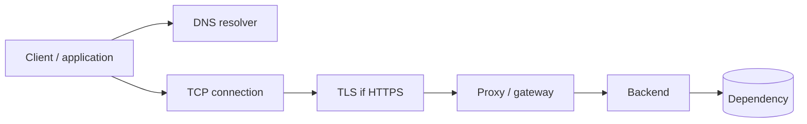

# Networking & Backend Engineering

> **Learn → Design → Build → Break → Investigate → Fix → Validate.** A practical networking track for backend engineers, SREs, and aspiring platform architects.

## Why this track exists

An API failure can begin at name resolution, routing, TCP, TLS, an intermediary, or the application itself. The goal is to **identify the failing hop using evidence**, not to memorize commands or assume every timeout is a firewall problem.

## Start here: Phase 1

| Read | What you will learn | Practice |
| --- | --- | --- |
| [DNS resolution](fundamentals/dns-resolution.md) | Resolver path, caches, TTL, negative answers, split DNS | Compare resolver answers and application resolution |
| [TCP lifecycle](fundamentals/tcp-connection-lifecycle.md) | SYN/SYN-ACK/ACK, retransmissions, close, RST, TIME_WAIT | Observe socket states and controlled refused connections |
| [Connection failure diagnosis](troubleshooting/connection-failure-diagnosis.md) | Evidence-first isolation across DNS, TCP, TLS, HTTP | Build and break a local backend |
| [Packet capture analysis](troubleshooting/packet-capture-analysis.md) | Capture vantage point, filters, SYN/RST, retransmission caveats | Capture a loopback handshake and reset |

**Recommended order:** DNS → TCP → failure diagnosis → packet capture. Complete one lab at a time; record actual findings in [learning progress](learning.md).

## How to use a lesson

1. **LEARN:** Predict what happens and identify the responsible protocol layer.
2. **DESIGN:** Draw client, DNS, network path, proxies, and backend separately.
3. **BUILD:** Use disposable localhost or Docker Desktop exercises.
4. **BREAK:** Introduce a reversible failure; never disrupt a shared environment.
5. **INVESTIGATE:** Record command, observation, hypothesis, and what the evidence *does not* prove.
6. **FIX & VALIDATE:** Restore baseline, rerun checks, and document architectural controls.

## Canonical references — no duplication

These existing pages remain authoritative for their respective implementations:

- [Linux networking: interfaces, routing and ARP](../linux/admin/networking.md)
- [Nginx reverse proxy](../nginx/reverse_proxy.md) and [load balancing](../nginx/load_balancer.md)
- [Nginx TLS and cryptography](../nginx/cryptography.md)
- [Kubernetes networking](../docker_k8/k8/networking.md)
- [SRE observability](../sre/observability.md)

This section explains protocol behavior and diagnosis. Existing technology-specific pages explain their own configurations.

## Source and editorial approach

Phase 1 is a new synthesis informed by the uploaded Codemia *Networking for Backend Engineers* chapters **DNS Resolution End to End**, **The TCP Connection Lifecycle**, **Diagnosing Connection Failures**, and **Reading a Packet Capture**. The lab commands, examples, diagrams, and wording here are independently authored; do not publish the original course PDFs.

## Phase 2 — Linux, Docker and Kubernetes practical labs

| Existing canonical reference | Practical lab |
| --- | --- |
| [Linux interfaces, routing and neighbors](../linux/admin/networking.md) | [Network namespaces, veth and routing](labs/linux-routing-namespaces.md) |
| [Docker networking](../docker_k8/docker/overview.md) | [Bridge DNS, isolation and published ports](labs/docker-bridge-dns-port-publishing.md) |
| [Kubernetes networking](../docker_k8/k8/networking.md) | [Pod → Service → CoreDNS → NetworkPolicy](labs/kubernetes-service-dns-networkpolicy.md) |

The labs are **not marked completed** until run and verified. The Kubernetes NetworkPolicy step depends on the local CNI's enforcement capability.

## Phase 3 — Backend performance and reliability

| Topic | Why it matters |
| --- | --- |
| [Keepalive, pooling and timeouts](performance/keepalive-pooling-timeouts.md) | Diagnose stale sockets, pool waits and timeout budgets |
| [TCP flow vs congestion control](performance/flow-congestion-control.md) | Separate receiver backpressure from path congestion |
| [Packet loss and tail latency](performance/packet-loss-tail-latency.md) | Understand retransmission and p99 symptoms |
| [Latency, bandwidth and BDP](performance/latency-bandwidth-bdp.md) | Calculate data-in-flight and distinguish RTT from throughput |
| [Connection limits and capacity](performance/connection-capacity.md) | Find the first saturated boundary |
| [Practical lab: backend timeouts and p99](labs/backend-timeouts-p99-capacity.md) | Build, overload, investigate, fix and validate |

These are protocol and reliability references; [Nginx load balancing](../nginx/load_balancer.md) and [SRE observability](../sre/observability.md) remain the implementation-specific guides.

## Phase 4 — Security and advanced backend protocols

| Topic | What you will learn |
| --- | --- |
| [mTLS and certificate rotation](security/mtls-certificate-rotation.md) | Service identity, CA trust, rotation overlap |
| [NAT, proxies and source addresses](security/nat-proxies-source-addresses.md) | SNAT/DNAT, trusted forwarding headers, egress boundaries |
| [gRPC and Protocol Buffers](backend-protocols/grpc-protobuf.md) | HTTP/2 RPC, schemas, streaming, deadlines |
| [QUIC and HTTP/3](backend-protocols/quic-http3.md) | UDP transport, TLS 1.3, multiplexing and fallback |
| [WebSockets, SSE and long polling](backend-protocols/realtime-communication.md) | Choosing realtime communication patterns |
| [Local mTLS identity lab](labs/mtls-local-service-identity.md) | Build, break, investigate and restore certificate verification |

These extend—not replace—the existing [Nginx cryptography](../nginx/cryptography.md), [HTTP protocol](../nginx/http_protocol.md), and [system-design components](../sysdesign/components.md) pages.

## Roadmap

- **Phase 1 — Foundations & diagnosis:** the four pages above.
- **Phase 2 — Linux/Docker/Kubernetes networking:** enhanced existing references and added three safe, disposable practical labs.
- **Phase 3 — Backend performance:** documented connection reuse, timeouts, congestion, loss, latency and capacity with a reproducible saturation lab.
- **Phase 4 — Security and advanced protocols:** documented mTLS, NAT/proxies, gRPC, QUIC/HTTP3 and realtime patterns with a disposable mTLS lab.

**Documentation is not evidence of practice.** Update [learning.md](learning.md) only after you personally execute and verify a lab.
