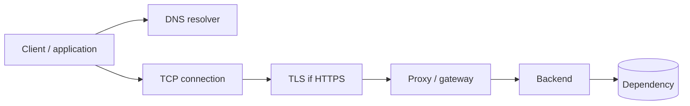

# Networking & Backend Engineering

> **Learn → Design → Build → Break → Investigate → Fix → Validate.** A practical networking track for backend engineers, SREs, and aspiring platform architects.

## Why this track exists

An API failure can begin at name resolution, routing, TCP, TLS, an intermediary, or the application itself. The goal is to **identify the failing hop using evidence**, not to memorize commands or assume every timeout is a firewall problem.

## Start here: Phase 1

| Read | What you will learn | Practice |
| --- | --- | --- |
| [DNS resolution](fundamentals/dns-resolution.md) | Resolver path, caches, TTL, negative answers, split DNS | Compare resolver answers and application resolution |
| [TCP lifecycle](fundamentals/tcp-connection-lifecycle.md) | SYN/SYN-ACK/ACK, retransmissions, close, RST, TIME_WAIT | Observe socket states and controlled refused connections |
| [Connection failure diagnosis](troubleshooting/connection-failure-diagnosis.md) | Evidence-first isolation across DNS, TCP, TLS, HTTP | Build and break a local backend |
| [Packet capture analysis](troubleshooting/packet-capture-analysis.md) | Capture vantage point, filters, SYN/RST, retransmission caveats | Capture a loopback handshake and reset |

**Recommended order:** DNS → TCP → failure diagnosis → packet capture. Complete one lab at a time; record actual findings in [learning progress](learning.md).

## How to use a lesson

1. **LEARN:** Predict what happens and identify the responsible protocol layer.
2. **DESIGN:** Draw client, DNS, network path, proxies, and backend separately.
3. **BUILD:** Use disposable localhost or Docker Desktop exercises.
4. **BREAK:** Introduce a reversible failure; never disrupt a shared environment.
5. **INVESTIGATE:** Record command, observation, hypothesis, and what the evidence *does not* prove.
6. **FIX & VALIDATE:** Restore baseline, rerun checks, and document architectural controls.

## Canonical references — no duplication

These existing pages remain authoritative for their respective implementations:

- [Linux networking: interfaces, routing and ARP](../linux/admin/networking.md)
- [Nginx reverse proxy](../nginx/reverse_proxy.md) and [load balancing](../nginx/load_balancer.md)
- [Nginx TLS and cryptography](../nginx/cryptography.md)
- [Kubernetes networking](../docker_k8/k8/networking.md)
- [Architecture Lab 05: API gateway failures](../sysdesign/daily-architecture-lab/lesson-05-api-gateway-cascading-failures-circuit-breakers.md)
- [Architecture Lab 06: DNS and service discovery failure](../sysdesign/daily-architecture-lab/lesson-06-service-discovery-dns-failures.md)
- [SRE observability](../sre/observability.md)

This section explains protocol behavior and diagnosis. Existing technology-specific pages explain their own configurations; incident lessons explain system-level failure and recovery.

## Source and editorial approach

Phase 1 is a new synthesis informed by the uploaded Codemia *Networking for Backend Engineers* chapters **DNS Resolution End to End**, **The TCP Connection Lifecycle**, **Diagnosing Connection Failures**, and **Reading a Packet Capture**. The lab commands, examples, diagrams, and wording here are independently authored; do not publish the original course PDFs.

## Roadmap

- **Phase 1 — Foundations & diagnosis:** the four pages above.
- **Phase 2 — Linux/Kubernetes networking:** expand existing Linux and Kubernetes pages rather than duplicate them.
- **Phase 3 — Backend performance:** connection reuse, timeouts, congestion, loss, latency, and capacity.
- **Phase 4 — Security and advanced protocols:** TLS/mTLS, NAT, HTTP/2–3, gRPC, and real-time protocols.

**Documentation is not evidence of practice.** Update [learning.md](learning.md) only after you personally execute and verify a lab.
