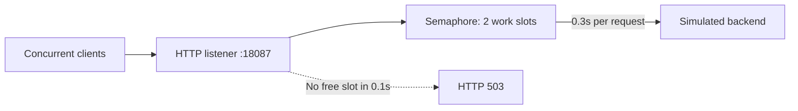

# Lab — Backend Timeouts, Concurrency Limits and p99 Latency

**Environment:** Mac or Ubuntu VM, Python 3.10+ and curl • **Time:** 45–60 minutes

**Goal:** Build a disposable HTTP service, introduce controlled backend delay and concurrency saturation, measure latency, fix the admission limit, and explain the architecture tradeoff. **No external dependencies, production systems, or firewall changes.**

## LEARN — The queueing trap

A healthy listener can return errors or time out when workers are busy. A slow dependency increases request occupancy, so the same request rate can require more concurrency.



This is a **thread-based application admission simulation**. It does not model TCP packet loss, OS accept backlog, or a real database pool.

## DESIGN — Predict the outcomes

At 6 simultaneous requests and only 2 work slots, what fraction can acquire a slot before a 100-ms deadline? How will raising the work-slot limit change the outcome? Why might raising it be dangerous with a real database?

## BUILD — Create a disposable API

Save as `backend_lab.py`:

```python
import argparse
import threading
import time
from http.server import BaseHTTPRequestHandler, ThreadingHTTPServer

parser = argparse.ArgumentParser()
parser.add_argument("--slots", type=int, default=2)
parser.add_argument("--delay", type=float, default=0.3)
args = parser.parse_args()
slots = threading.BoundedSemaphore(args.slots)

class Handler(BaseHTTPRequestHandler):
    def do_GET(self):
        if self.path == "/health":
            status, body = 200, b"ready\n"
        elif self.path == "/work":
            if not slots.acquire(timeout=0.1):
                status, body = 503, b"busy\n"
            else:
                try:
                    time.sleep(args.delay)
                    status, body = 200, b"done\n"
                finally:
                    slots.release()
        else:
            status, body = 404, b"not found\n"
        self.send_response(status)
        self.send_header("Content-Type", "text/plain")
        self.send_header("Content-Length", str(len(body)))
        self.end_headers()
        self.wfile.write(body)

ThreadingHTTPServer(("127.0.0.1", 18087), Handler).serve_forever()
```

**Terminal A:**

```bash
mkdir -p ~/networking-phase3
cd ~/networking-phase3
# Save the code above as backend_lab.py, then:
python3 backend_lab.py --slots 2 --delay 0.3
```

**Terminal B — baseline:**

```bash
curl --noproxy '*' -i http://127.0.0.1:18087/health
curl --noproxy '*' -i http://127.0.0.1:18087/work
```

**Expected:** HTTP 200 for both; `/work` takes roughly 300 ms.

## BREAK — Six concurrent requests

Save as `client_lab.py`:

```python
import concurrent.futures
import statistics
import time
import urllib.error
import urllib.request

URL = "http://127.0.0.1:18087/work"

def request(i):
    start = time.monotonic()
    try:
        with urllib.request.urlopen(URL, timeout=2) as response:
            status = response.status
            response.read()
    except urllib.error.HTTPError as exc:
        status = exc.code
    except Exception as exc:
        status = type(exc).__name__
    return i, status, time.monotonic() - start

with concurrent.futures.ThreadPoolExecutor(max_workers=6) as executor:
    results = list(executor.map(request, range(6)))
for i, status, duration in results:
    print(f"request={i} status={status} duration={duration:.3f}s")
latencies = sorted(r[2] for r in results)
p99_nearest_rank = latencies[-1]  # 99th percentile of just six samples
print("p99(nearest rank, n=6)=", round(p99_nearest_rank, 3), "s")
print("mean=", round(statistics.mean(latencies), 3), "s")
```

Run `python3 client_lab.py`.

**Expected:** usually 2 successful HTTP 200 responses and 4 HTTP 503 responses. Thread scheduling may change exact counts. **Important:** With only six samples, the nearest-rank p99 equals the maximum; it is a teaching demonstration, not a statistically reliable production p99 estimate. Failures must also be counted; latency of successful requests alone can hide overload.

## INVESTIGATE — What should you measure?

- How many requests received HTTP 503?
- Which requests waited near the 100-ms acquire timeout?
- Did the `/health` endpoint remain responsive during overload?
- How does the result compare with the simple capacity calculation in [connection capacity](../performance/connection-capacity.md)?
- Why is a TCP connection accepted while an HTTP request is rejected?

## FIX — Increase capacity only in the isolated lab

Stop Terminal A with Ctrl-C, then restart:

```bash
python3 backend_lab.py --slots 6 --delay 0.3
```

Run `python3 client_lab.py` again.

**Expected:** generally all six requests return 200, with completion around 300 ms. On a real backend, raising concurrency without downstream capacity can worsen latency or failures.

## VALIDATE & CLEANUP

Verify `/health` and `/work` return 200, stop the server with Ctrl-C, and optionally remove only `~/networking-phase3/backend_lab.py` and `client_lab.py` after saving your findings. The lab does not create Docker containers or named volumes.

## OPERATE — Production design decisions

- Use request deadlines and bounded queues; monitor both latency and rejected work.
- Track p50/p95/p99 over enough observations and segment by route, destination and status.
- Compare application queue wait, upstream pool wait, network RTT and backend duration.
- Add retries only with idempotency, bounded attempts and an end-to-end time budget.
- Test representative load before increasing worker or pool limits.

Related: [pooling and timeouts](../performance/keepalive-pooling-timeouts.md), [tail latency](../performance/packet-loss-tail-latency.md), [SRE observability](../../sre/observability.md).

## My Architecture Review — Solutions & Doubts

- What evidence shows an application admission limit rather than network congestion?
- What is the difference between HTTP 503 and a TCP connect timeout?
- How would I design a production load test to measure trustworthy p99?
- **My baseline, failure, fix and doubts:**
