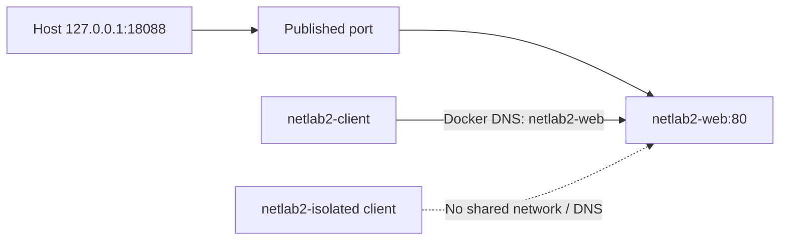

# Lab — Docker Bridge DNS, Isolation and Port Publishing

**Environment:** Mac Docker Desktop or Ubuntu Docker Engine • **Time:** 30–45 minutes

**Goal:** Prove the difference between container-name DNS, isolated networks, host-port publishing and service reachability. This is an operational extension of the existing [Docker overview](../../docker_k8/docker/overview.md) and [Docker FAQ](../../docker_k8/docker/faq.md), not a duplicate Docker tutorial.



## LEARN

A **user-defined bridge** provides container-name resolution among connected containers. A published port maps a host address/port to a container port. A container's private IP is generally not a stable public endpoint; on Docker Desktop it is inside the Linux VM.

## BUILD — Baseline

```bash
docker network create netlab2-app
docker network create netlab2-isolated

# Run a disposable Nginx server; bind published port to localhost only.
docker run -d --name netlab2-web --network netlab2-app -p 127.0.0.1:18088:80 nginx:alpine

# From another container on the same user-defined network, resolve by name.
docker run --rm --network netlab2-app curlimages/curl:latest -sS -I http://netlab2-web/

# From the host, use the published port.
curl -I http://127.0.0.1:18088/
docker network inspect netlab2-app
docker port netlab2-web
```

**Expected:** HTTP 200 headers through both paths. If host port `18088` is already occupied, stop and choose a different unused port consistently.

## BREAK 1 — Network isolation

```bash
# The isolated client has no shared user-defined network with the server.
docker run --rm --network netlab2-isolated curlimages/curl:latest --max-time 5 -v http://netlab2-web/ || true
```

**Expected:** container name cannot be resolved from the isolated network. This is an intentional isolation boundary, not evidence that Nginx crashed.

## BREAK 2 — Backend stopped

```bash
docker stop netlab2-web
curl --connect-timeout 2 --max-time 5 -I http://127.0.0.1:18088/ || true
docker ps -a --filter name=netlab2-web
```

**Expected:** host request fails; exact refusal/reset behavior can depend on Docker Desktop's port-forwarding implementation.

## FIX & VALIDATE

```bash
docker start netlab2-web
curl -fI http://127.0.0.1:18088/
docker run --rm --network netlab2-app curlimages/curl:latest -fI http://netlab2-web/
```

## CLEANUP

```bash
docker rm -f netlab2-web
docker network rm netlab2-app netlab2-isolated
```

**Safety:** This lab creates no named volumes and uses only `netlab2-` resources. Never run `docker system prune --volumes` as lab cleanup.

## INVESTIGATE — A production decision tree

1. Is the container running? `docker ps`, `docker logs`.
2. Which networks is it attached to? `docker inspect` and `docker network inspect`.
3. Does the client share a network and resolve the container name?
4. Is the process listening on the container's reachable interface (not only `127.0.0.1` inside the container)?
5. Is the port published, and to which host interface?
6. Is the issue host→container, container→container, or container→external service?

## My Architecture Review — Solutions & Doubts

- Why can two containers communicate without publishing a port?
- Why does `127.0.0.1:18088` not expose the service to the LAN by default?
- What changes if Nginx listens only on loopback **inside** its container?
- **Evidence / doubts:**
