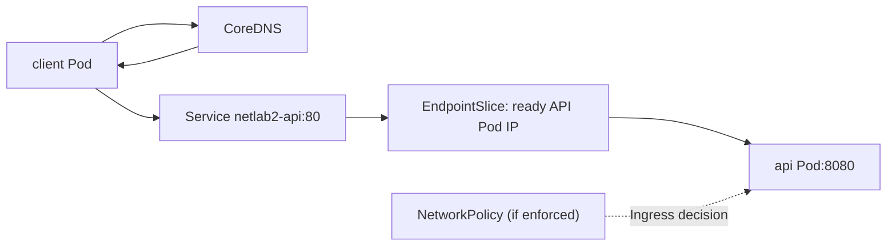

# Lab — Kubernetes Pod, Service, DNS and NetworkPolicy Troubleshooting

**Environment:** Local Kubernetes cluster with `kubectl`, such as Rancher Desktop or kind • **Time:** 50–75 minutes

**Prerequisites:** `kubectl cluster-info` succeeds; the cluster has working CoreDNS, a Service implementation, and a CNI. **NetworkPolicy enforcement depends on the installed CNI**: creating a policy resource does not guarantee traffic will be blocked. Do not assume Rancher Desktop's bundled cluster enforces NetworkPolicy. Test in an isolated local cluster, not a shared production namespace.

## LEARN — Pod address versus Service address



A Pod has an IP allocated through the CNI. A Service offers a stable virtual destination and selects ready endpoints. DNS maps `netlab2-api.netlab2.svc.cluster.local` to the Service's address. NetworkPolicy can restrict allowed traffic only if the cluster's network implementation enforces it.

## DESIGN — What must work?

1. The client Pod resolves the Service DNS name.
2. The Service exists and selects the intended Pod labels.
3. EndpointSlices list the ready backend Pod IP and port.
4. Pod-to-Pod routing and any applicable policy allow the traffic.
5. The backend process actually listens on port 8080.

## BUILD — Create a disposable namespace and workload

Save the complete manifest locally as `netlab2.yaml`:

```yaml
apiVersion: v1
kind: Namespace
metadata:
  name: netlab2
---
apiVersion: apps/v1
kind: Deployment
metadata:
  name: api
  namespace: netlab2
spec:
  replicas: 1
  selector:
    matchLabels:
      app: netlab2-api
  template:
    metadata:
      labels:
        app: netlab2-api
    spec:
      containers:
        - name: api
          image: python:3.12-alpine
          command: ["python", "-m", "http.server", "8080", "--bind", "0.0.0.0"]
          ports:
            - containerPort: 8080
          readinessProbe:
            tcpSocket:
              port: 8080
            initialDelaySeconds: 2
            periodSeconds: 3
---
apiVersion: v1
kind: Service
metadata:
  name: netlab2-api
  namespace: netlab2
spec:
  selector:
    app: netlab2-api
  ports:
    - port: 80
      targetPort: 8080
---
apiVersion: v1
kind: Pod
metadata:
  name: client
  namespace: netlab2
  labels:
    app: netlab2-client
spec:
  containers:
    - name: client
      image: busybox:1.36
      command: ["sh", "-c", "sleep 36000"]
```

Run:

```bash
kubectl apply -f netlab2.yaml
kubectl -n netlab2 rollout status deployment/api --timeout=120s
kubectl -n netlab2 wait --for=condition=Ready pod/client --timeout=120s

# Inspect the objects in the request path.
kubectl -n netlab2 get pods -o wide
kubectl -n netlab2 get svc netlab2-api
kubectl -n netlab2 get endpointslices -l kubernetes.io/service-name=netlab2-api

# Resolve DNS and make an HTTP request from inside the client Pod.
kubectl -n netlab2 exec client -- nslookup netlab2-api.netlab2.svc.cluster.local
kubectl -n netlab2 exec client -- wget -qO- -T 5 http://netlab2-api/
```

**Expected:** one ready API Pod; Service port 80; EndpointSlice with API Pod IP/port 8080; DNS returns Service IP; HTTP response is a Python directory listing (typically HTML). Images require registry access; if image pulls fail, diagnose those separately.

## BREAK 1 — Wrong Service selector

```bash
# Change only this disposable Service's selector to a label no Pod has.
kubectl -n netlab2 patch svc netlab2-api -p '{"spec":{"selector":{"app":"netlab2-missing"}}}'
kubectl -n netlab2 get endpointslices -l kubernetes.io/service-name=netlab2-api
kubectl -n netlab2 exec client -- wget -qO- -T 5 http://netlab2-api/ || true
```

**Expected:** the Service still resolves in DNS, but has no ready backend endpoints. The request fails or times out depending on cluster dataplane. **Do not diagnose this as a DNS outage.**

**Fix:**

```bash
kubectl -n netlab2 patch svc netlab2-api -p '{"spec":{"selector":{"app":"netlab2-api"}}}'
kubectl -n netlab2 get endpointslices -l kubernetes.io/service-name=netlab2-api
kubectl -n netlab2 exec client -- wget -qO- -T 5 http://netlab2-api/
```

## BREAK 2 — NetworkPolicy (only if CNI enforcement is confirmed)

Apply a policy allowing only Pods with `app: netlab2-allowed` to reach the API. The current client label is `netlab2-client`, so a compliant enforcing CNI should deny it.

```yaml
apiVersion: networking.k8s.io/v1
kind: NetworkPolicy
metadata:
  name: api-restricted-ingress
  namespace: netlab2
spec:
  podSelector:
    matchLabels:
      app: netlab2-api
  policyTypes:
    - Ingress
  ingress:
    - from:
        - podSelector:
            matchLabels:
              app: netlab2-allowed
      ports:
        - protocol: TCP
          port: 8080
```

Save as `netlab2-policy.yaml`:

```bash
kubectl apply -f netlab2-policy.yaml
kubectl -n netlab2 get networkpolicy
kubectl -n netlab2 exec client -- wget -qO- -T 5 http://netlab2-api/ || true
```

**Expected on enforcing CNI:** request fails while DNS may still resolve. **On non-enforcing CNI:** request can continue succeeding; record that as an enforcement limitation, not a failed lab. If needed, practice policy enforcement on a separate kind cluster with a supported policy-capable CNI.

**Fix and validation:**

```bash
kubectl -n netlab2 delete networkpolicy api-restricted-ingress
kubectl -n netlab2 exec client -- wget -qO- -T 5 http://netlab2-api/
```

## INVESTIGATE — Diagnose by layer

| Observation | Next evidence |
| --- | --- |
| `nslookup` fails | Pod DNS policy/config, CoreDNS Pods, resolver reachability |
| DNS works, Service fails | Service selector, EndpointSlices, targetPort, Pod readiness |
| Pod IP works, Service IP fails | Service proxy/dataplane, EndpointSlice, policy |
| Both fail only from one namespace | NetworkPolicy, namespace labels, routing/CNI |
| Some backends work, others fail | Pod readiness, node placement, endpoint membership |
| Connection established, HTTP error | Application logs, path, proxy/backend behavior |

Commands:

```bash
kubectl -n netlab2 describe svc netlab2-api
kubectl -n netlab2 get pods -o wide --show-labels
kubectl -n netlab2 get endpointslices -l kubernetes.io/service-name=netlab2-api -o yaml
kubectl -n kube-system get pods -o wide
kubectl -n netlab2 logs deployment/api --tail=50
```

## CLEANUP

```bash
kubectl delete namespace netlab2 --wait=true
```

This removes only the lab namespace and its resources; it does not touch system namespaces or cluster networking components.

## OPERATE — Architecture judgement

- A healthy Pod is not proof that a Service selects it.
- A DNS answer is not proof that the Service has endpoints.
- NetworkPolicy is an API intent that requires a supporting implementation.
- Ingress needs an ingress controller; an Ingress object alone does not provide a listening external address.
- On a local Kubernetes distribution, `LoadBalancer` external IP may remain `<pending>`; use a verified NodePort or port-forward for local testing rather than assuming cloud load-balancer integration.

Related: [Kubernetes networking reference](../../docker_k8/k8/networking.md), [DNS fundamentals](../fundamentals/dns-resolution.md), [connection diagnosis](../troubleshooting/connection-failure-diagnosis.md).

## My Architecture Review — Solutions & Doubts

- Why did Service DNS still work with zero endpoints?
- What proves that a NetworkPolicy is *enforced*, not merely created?
- Why might an Ingress object exist without an externally reachable route?
- **Actual commands, results, root cause, doubts:**
