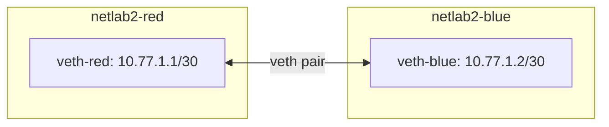

# Lab — Linux Network Namespaces, Routes and Packet Paths

**Level:** Intermediate SRE • **Environment:** Ubuntu Linux VM with `iproute2`, `ping`, `python3` • **Estimated time:** 35–50 minutes

**Learning objective:** Explain *why* two isolated Linux network namespaces can communicate only after interfaces, addresses and routes are configured. Do not run `ip netns` commands on macOS: Linux namespaces require a Linux kernel. Use your Ubuntu VM, not your Mac host.

> **Safety:** The lab creates only disposable namespace interfaces; it does not modify host default routes or firewall rules. Names are prefixed `netlab2-`. Check for existing names before running.

## LEARN — One machine, multiple independent network views

A namespace is a separate network stack with its own interfaces, addresses, routes, neighbors and sockets. A veth pair behaves like a virtual Ethernet cable connecting two endpoints.



A `/30` IPv4 subnet has four addresses: network `.0`, usable hosts `.1` and `.2`, broadcast `.3`. Both endpoints are directly connected, so no gateway is required.

## DESIGN — Before touching the machine

Predict the outcome when only one interface is UP, when both are UP, and when one address is removed. The lab deliberately avoids a Linux bridge so you can isolate the simplest possible path.

## BUILD — Create two isolated hosts

```bash
# Ubuntu VM only. Check whether the names already exist.
ip netns list
ip link show netlab2-red 2>/dev/null || true

# Create namespaces, veth pair and move each endpoint into its namespace.
sudo ip netns add netlab2-red
sudo ip netns add netlab2-blue
sudo ip link add netlab2-red type veth peer name netlab2-blue
sudo ip link set netlab2-red netns netlab2-red
sudo ip link set netlab2-blue netns netlab2-blue

# Give each endpoint an address in the same subnet.
sudo ip -n netlab2-red addr add 10.77.1.1/30 dev netlab2-red
sudo ip -n netlab2-blue addr add 10.77.1.2/30 dev netlab2-blue

# Enable loopback and the veth interfaces.
sudo ip -n netlab2-red link set lo up
sudo ip -n netlab2-blue link set lo up
sudo ip -n netlab2-red link set netlab2-red up
sudo ip -n netlab2-blue link set netlab2-blue up

# Observe addresses, directly connected routes and neighbor cache.
sudo ip -n netlab2-red -br addr
sudo ip -n netlab2-red route
sudo ip -n netlab2-red neigh
sudo ip netns exec netlab2-red ping -c 3 -W 2 10.77.1.2
sudo ip -n netlab2-red neigh
```

**Expected:** Ping succeeds and the kernel adds a directly connected route for `10.77.1.0/30`. The neighbor table can show the peer's MAC after communication. On restricted VMs, ICMP may be filtered; inspect interfaces and routes before concluding the veth is broken.

## BREAK — Simulate a failed interface

```bash
# Intentionally disable only the blue lab interface.
sudo ip -n netlab2-blue link set netlab2-blue down
sudo ip netns exec netlab2-red ping -c 3 -W 2 10.77.1.2 || true

# Gather evidence, not guesses.
sudo ip -n netlab2-red route get 10.77.1.2
sudo ip -n netlab2-red neigh
sudo ip -n netlab2-blue -br link
```

**Expected:** Ping fails while blue's interface is down. Depending on cached neighbor entries and timing, errors can differ. The route may still exist on red even though blue cannot receive traffic: *a route is not proof of reachability*.

## FIX & VALIDATE

```bash
sudo ip -n netlab2-blue link set netlab2-blue up
sudo ip netns exec netlab2-red ping -c 3 -W 2 10.77.1.2
```

Record the before/after output and explain why the fix works.

## CLEANUP — Remove only the lab resources

```bash
sudo ip netns del netlab2-red
sudo ip netns del netlab2-blue
ip netns list
```

Deleting namespaces removes their veth endpoints. If creation failed halfway through, inspect `ip netns list` and remove only resources you created.

## OPERATE — How this maps to production

Kubernetes Pods commonly have their own network namespace; the CNI configures the Pod's interfaces and routing. A container can have a healthy process while its network path is broken. When diagnosing production traffic, distinguish local interface, connected route, next-hop neighbor, overlay/underlay path, Service routing and DNS.

Related: [Linux networking](../../linux/admin/networking.md), [Kubernetes networking](../../docker_k8/k8/networking.md), [connection failure diagnosis](../troubleshooting/connection-failure-diagnosis.md).

## My Architecture Review — Solutions & Doubts

- Why is a veth pair different from a router?
- Why can `ip route get` succeed when ping fails?
- Which parts of this lab are configured by a Kubernetes CNI?
- **Actual evidence / questions:**
