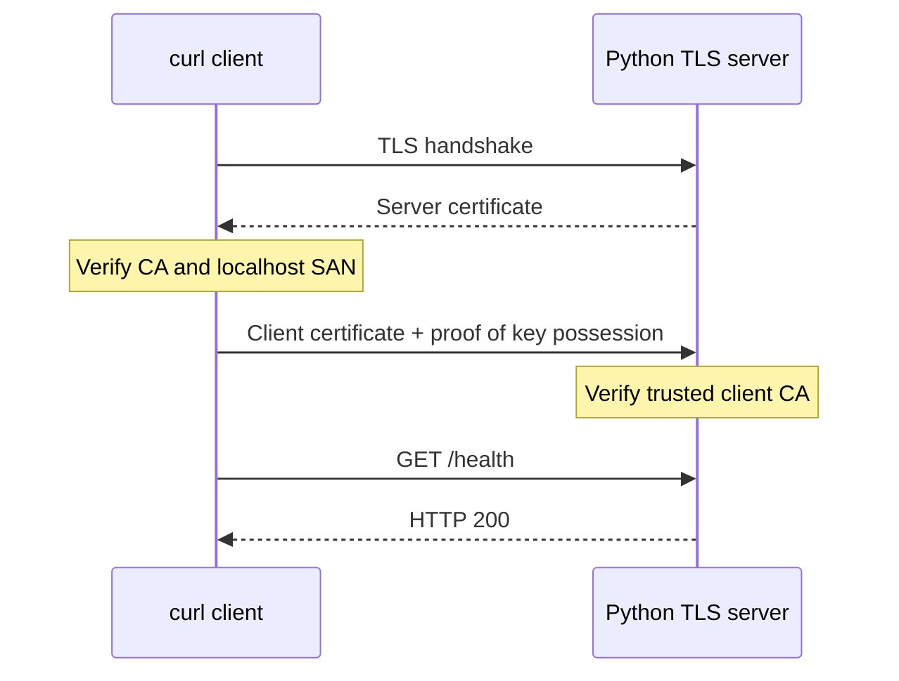

# Lab — Build, Break and Restore Local Mutual TLS

**Environment:** Mac or Ubuntu with OpenSSL 3.x (or compatible), Python 3, curl • **Time:** 40–60 minutes

**Goal:** Demonstrate server authentication, client certificate authentication, rejection of missing/untrusted identities and safe certificate replacement. All files remain under a disposable local directory. Never use these lab credentials in production.

## LEARN — Two-way identity



**Important:** This lab verifies a trusted client certificate at the TLS layer. It does **not** implement application-level authorization by certificate identity.

## DESIGN — Separate identities

- Lab CA: signs certificates; its key stays private.
- Server: certificate with SAN `DNS:localhost` and `IP:127.0.0.1`, extended key usage `serverAuth`.
- Client: distinct certificate with extended key usage `clientAuth`.
- Python HTTPS server: requires a valid client certificate signed by the lab CA.
- curl: validates the server using `--cacert` and optionally presents its client certificate/key.

## BUILD — Generate lab credentials

```bash
mkdir -p ~/networking-phase4/mtls-lab
cd ~/networking-phase4/mtls-lab
umask 077

# CA private key and self-signed CA certificate.
openssl req -x509 -newkey rsa:2048 -sha256 -nodes -days 7 \
  -keyout ca.key -out ca.crt -subj "/CN=Networking Lab CA" \
  -addext "basicConstraints=critical,CA:TRUE" \
  -addext "keyUsage=critical,keyCertSign,cRLSign"

# Server key, CSR and signed leaf certificate.
openssl req -new -newkey rsa:2048 -nodes -keyout server.key \
  -out server.csr -subj "/CN=localhost"
cat > server.ext <<'EOF'
basicConstraints=critical,CA:FALSE
keyUsage=critical,digitalSignature,keyEncipherment
extendedKeyUsage=serverAuth
subjectAltName=DNS:localhost,IP:127.0.0.1
EOF
openssl x509 -req -in server.csr -CA ca.crt -CAkey ca.key \
  -CAcreateserial -out server.crt -days 3 -sha256 -extfile server.ext

# Client key, CSR and signed client-auth certificate.
openssl req -new -newkey rsa:2048 -nodes -keyout client.key \
  -out client.csr -subj "/CN=networking-lab-client"
cat > client.ext <<'EOF'
basicConstraints=critical,CA:FALSE
keyUsage=critical,digitalSignature
extendedKeyUsage=clientAuth
EOF
openssl x509 -req -in client.csr -CA ca.crt -CAkey ca.key \
  -CAcreateserial -out client.crt -days 3 -sha256 -extfile client.ext

openssl verify -CAfile ca.crt -purpose sslserver server.crt
openssl verify -CAfile ca.crt -purpose sslclient client.crt
```

**Expected:** Both verification commands report `OK`. Certificates are short-lived, self-issued within a disposable lab CA, and not publicly trusted.

## BUILD — Start an mTLS server

Save as `server.py`:

```python
import ssl
from http.server import BaseHTTPRequestHandler, HTTPServer

class Handler(BaseHTTPRequestHandler):
    def do_GET(self):
        if self.path != "/health":
            self.send_error(404)
            return
        body = b"mtls-ok\n"
        self.send_response(200)
        self.send_header("Content-Length", str(len(body)))
        self.end_headers()
        self.wfile.write(body)

ctx = ssl.SSLContext(ssl.PROTOCOL_TLS_SERVER)
ctx.minimum_version = ssl.TLSVersion.TLSv1_2
ctx.load_cert_chain("server.crt", "server.key")
ctx.load_verify_locations(cafile="ca.crt")
ctx.verify_mode = ssl.CERT_REQUIRED

httpd = HTTPServer(("127.0.0.1", 18443), Handler)
httpd.socket = ctx.wrap_socket(httpd.socket, server_side=True)
httpd.serve_forever()
```

**Terminal A:** `python3 server.py`

**Terminal B — positive test:**

```bash
curl --noproxy '*' --cacert ca.crt --cert client.crt --key client.key \
  https://localhost:18443/health
```

**Expected:** `mtls-ok`. If localhost resolves to IPv6 first, curl can fall back to IPv4; use `https://127.0.0.1:18443/health` if necessary (the SAN includes both).

## BREAK 1 — No client identity

```bash
curl --noproxy '*' -v --cacert ca.crt https://127.0.0.1:18443/health
```

**Expected:** TLS handshake/request fails because the server requires a client certificate. The exact error varies by TLS version and curl/OpenSSL build.

## BREAK 2 — Untrusted client identity

```bash
openssl req -x509 -newkey rsa:2048 -sha256 -nodes -days 1 \
  -keyout outsider.key -out outsider.crt -subj "/CN=outsider" \
  -addext "extendedKeyUsage=clientAuth"
curl --noproxy '*' -v --cacert ca.crt --cert outsider.crt --key outsider.key \
  https://127.0.0.1:18443/health
```

**Expected:** handshake/request fails: outsider's self-signed certificate is not issued by the server's trusted lab CA. The client still trusts the server, demonstrating the *other* direction of authentication failed.

## FIX — Restore valid client certificate

```bash
curl --noproxy '*' --cacert ca.crt --cert client.crt --key client.key \
  https://127.0.0.1:18443/health
```

**Expected:** HTTP 200 and `mtls-ok`.

## VALIDATE — Expiry and identity

```bash
openssl x509 -in server.crt -noout -dates -ext subjectAltName
openssl x509 -in client.crt -noout -dates -ext extendedKeyUsage
openssl s_client -connect 127.0.0.1:18443 -servername localhost \
  -CAfile ca.crt -cert client.crt -key client.key -verify_return_error </dev/null
```

**Expected:** server SAN includes localhost and loopback; client EKU includes TLS Web Client Authentication; `s_client` verification succeeds. The connection can then close because no HTTP request was sent.

## OPERATE — Rotation thought exercise

How would you replace `ca.crt` while existing clients still use certificates signed by the old CA? Plan a **trust overlap**: first distribute old+new CA trust, then issue/deploy new leaves, verify all peers, retire old leaves and finally remove old CA trust. Replacing the CA first breaks clients that have not rotated.

## CLEANUP

Stop `server.py` with Ctrl-C. From `~/networking-phase4`, delete only the disposable `mtls-lab` directory **after** confirming it contains no personal certificates:

```bash
cd ~/networking-phase4
pwd
ls -la mtls-lab
# Only after confirming this is your disposable lab directory:
rm -rf -- mtls-lab
```

Do not commit `*.key` or the lab CA private key. Secure deletion on SSDs is not guaranteed by ordinary file removal.

Related: [mTLS and rotation design](../security/mtls-certificate-rotation.md), [Nginx cryptography](../../nginx/cryptography.md).

## My Architecture Review — Solutions & Doubts

- Which peer rejected the missing client certificate?
- What is the difference between TLS identity and application authorization?
- How would I perform zero-downtime CA rotation?
- **Actual commands, errors, fixes and doubts:**
