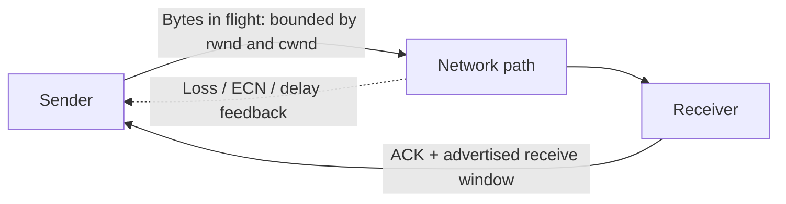

# TCP Flow Control vs Congestion Control

**Goal:** Distinguish a slow receiver from a congested network path using the correct evidence.

## LEARN — Two different speed limits

**Flow control** protects the receiver: the receiver advertises how much additional data it can buffer (receive window, `rwnd`). **Congestion control** protects the network: the sender adjusts its sending rate using a congestion window (`cwnd`) and feedback about the path. Actual flight size is constrained by both, along with other limits.



| Observation | Possible explanation | Do not conclude |
| --- | --- | --- |
| Zero receive window | Receiver is not draining buffer quickly enough | Network must be congested |
| Retransmissions | Loss, reordering, capture artifacts, path effects | Backend CPU is definitely high |
| Rising RTT under load | Queue buildup or changing path | DNS is the root cause |
| Throughput below link speed | cwnd/rwnd, application pacing, RTT, CPU, shaping | More bandwidth alone fixes it |

**TCP is a byte stream:** sequence numbers track bytes, not HTTP requests. TCP retransmission may occur below the application without any HTTP retry.

## DESIGN — The evidence path

1. Capture baseline RTT and throughput **at the same load level**.
2. Compare sender congestion metrics with receiver window and application read behavior.
3. Check for packet drops, interface errors, queue buildup and host CPU pressure.
4. Correlate retransmissions with latency; do not infer causality from one graph.

## BUILD — Observe a Linux TCP connection

**Ubuntu VM only:** `ss -ti` can show RTT, retransmission and congestion-control details for active TCP sockets, depending on kernel and connection lifetime.

```bash
# Terminal A: start a disposable HTTP service.
python3 -m http.server 18085 --bind 127.0.0.1

# Terminal B: inspect socket state while a request is active.
curl --noproxy '*' -sS http://127.0.0.1:18085/ -o /dev/null
ss -ti '( sport = :18085 or dport = :18085 )'
```

**Expected:** the HTTP request succeeds. The socket may close before `ss` runs; absence of live RTT/cwnd fields is **not** evidence of a fault. Use a sustained authorized workload to observe long-lived flows; do not flood a shared system.

## BREAK / INVESTIGATE — Thought experiment with evidence

A service's p99 latency rises from 90 ms to 900 ms. The receiver advertises a zero window while CPU is saturated, but packet loss counters remain flat. **Hypothesis:** the application is not draining its socket fast enough. What would falsify it? Compare receive queue, process CPU, application processing latency and sender behavior.

A second case has rising RTT and retransmissions only at peak network utilization. **Hypothesis:** path queueing or congestion. Confirm with interface drops, sender TCP metrics, capture timing and the network's traffic profile.

## OPERATE

- Treat receiver backpressure and network congestion as different remediation paths.
- Avoid changing kernel TCP parameters before collecting baselines.
- Instrument throughput, RTT, retransmits, drops, queueing and application latency together.
- Distinguish TCP congestion control from HTTP rate limiting and application concurrency limits.

Related: [TCP lifecycle](../fundamentals/tcp-connection-lifecycle.md), [packet capture](../troubleshooting/packet-capture-analysis.md), [SRE observability](../../sre/observability.md).

## My Architecture Review — Solutions & Doubts

- Who advertises `rwnd`? Who controls `cwnd`?
- Why might throughput be poor with zero packet loss?
- **Evidence / doubts:**
