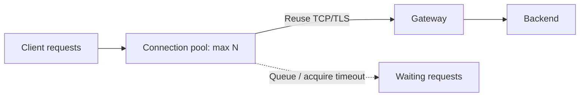

# Keepalive, Connection Pooling and Timeouts

**Goal:** Explain why connection reuse improves throughput but can also cause stale-connection errors, queueing and cascading failure.

## LEARN — Restaurant analogy

A restaurant reuses a fixed number of tables rather than constructing a new dining room for every customer. Reuse reduces setup overhead; too few tables create a waiting line. A table left reserved forever wastes capacity. A connection pool works similarly, but a TCP connection is not always equivalent to one in-flight HTTP request: HTTP/2 multiplexing changes the relationship.



## DESIGN — Distinguish four different time budgets

| Timeout | What it limits | Typical symptom |
| --- | --- | --- |
| Connect | Establishing transport connection | Connect timeout |
| TLS handshake | Negotiating TLS | Handshake timeout |
| Pool acquire | Waiting for a free connection | Pool exhaustion/queueing |
| Read/request deadline | Waiting for response after request begins | Read timeout or deadline exceeded |

**Idle timeout** closes unused connections; **keepalive** can mean HTTP connection reuse or TCP keepalive probes. They are not interchangeable. **Total deadline** should bound the entire operation, including retries and queue time.

Example budget (illustrative, not a universal recommendation): 800 ms end-to-end = 100 ms pool wait + 100 ms connect/TLS + 500 ms service response + 100 ms margin. A 1-second retry inside an 800-ms user deadline is logically inconsistent.

## BUILD — Inspect connection reuse

Use an isolated Python environment and `curl`; no production configuration changes.

```bash
# Terminal A: local backend
python3 -m http.server 18084 --bind 127.0.0.1

# Terminal B: observe one client process making multiple requests
curl -v --noproxy '*' http://127.0.0.1:18084/ http://127.0.0.1:18084/ -o /dev/null -o /dev/null
```

**Expected:** requests succeed. Python's basic `http.server` may close connections, so reuse is **not guaranteed** in this baseline. Read the `curl -v` lines to establish whether the same connection was reused; do not assume it was.

## BREAK — Simulate pool acquisition pressure with Python

The following program models a pool of two permits and four callers; it does **not** implement a real TCP pool. This isolates waiting/timeout behavior.

```python
import concurrent.futures, threading, time

pool = threading.BoundedSemaphore(2)

def request(i):
    started = time.monotonic()
    if not pool.acquire(timeout=0.15):
        return i, "POOL_ACQUIRE_TIMEOUT", round(time.monotonic()-started, 3)
    try:
        time.sleep(0.35)  # Simulated slow backend while holding a slot
        return i, "OK", round(time.monotonic()-started, 3)
    finally:
        pool.release()

with concurrent.futures.ThreadPoolExecutor(max_workers=4) as executor:
    for result in executor.map(request, range(4)):
        print(result)
```

**Expected:** approximately two OK and two POOL_ACQUIRE_TIMEOUT, with scheduling-dependent ordering and timing. Save as `pool_pressure.py` and run `python3 pool_pressure.py`. Change pool size to 4 or simulated work to 0.05 s; predict and verify the result.

## INVESTIGATE — Production checklist

1. Measure **in-flight requests**, active/idle pool connections, wait queue depth, acquire latency and acquire timeouts separately.
2. Compare client pool size with backend concurrency limits and server connection caps.
3. Look for stale pooled sockets after a backend rollout, NAT idle timeout or proxy reconfiguration.
4. Inspect retry count and total request deadline. Retries multiply offered load when a dependency is already slow.
5. Determine protocol: HTTP/1.1 reuse generally handles sequential requests per connection; HTTP/2 supports concurrent streams subject to stream limits and flow control.
6. Correlate p95/p99 latency with pool wait, DNS, connect, TLS, backend and queueing.

## OPERATE — Design choices

- Bound pool size and acquisition wait, with per-destination limits.
- Reuse connections where safe; proactively retire stale/aged connections.
- Use backpressure and bounded retries with jitter rather than unlimited concurrency.
- Set timeout hierarchy deliberately: client deadline, proxy upstream timeout and backend execution limit must be coherent.
- Do not conflate database pool exhaustion with TCP socket exhaustion.

Related: [Nginx reverse proxy](../../nginx/reverse_proxy.md), [Nginx caching/HTTP keepalive](../../nginx/caching.md), [Architecture Lab 05](../../sysdesign/daily-architecture-lab/lesson-05-api-gateway-cascading-failures-circuit-breakers.md).

## My Architecture Review — Solutions & Doubts

- Why can a large pool increase pressure on the backend?
- When does HTTP/2 multiplexing change pool sizing?
- What metric proves that a timeout occurred **before** any backend request?
- **My evidence / doubts:**
