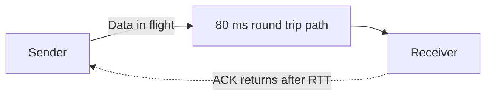

# Latency, Bandwidth and the Bandwidth–Delay Product

**Goal:** Calculate how much data can be in flight on a path and distinguish bandwidth limits from request latency.

## LEARN

**Bandwidth** is capacity per second. **Latency/RTT** is delay. A high-bandwidth connection with a long RTT may need many bytes in flight to utilize the path. The **bandwidth–delay product (BDP)** estimates that amount.

\[
\mathrm{BDP\ (bytes)} = \frac{\mathrm{bandwidth\ (bits/s)} \times \mathrm{RTT\ (s)}}{8}
\]

**Example:** 100 Mbit/s × 0.080 s ÷ 8 = **1,000,000 bytes** (approximately 0.95 MiB). This is a simplified steady-state estimate, not a recommendation to blindly set a 1 MB socket buffer.



## DESIGN — What BDP does and does not explain

- BDP helps reason about throughput ceilings from in-flight windows.
- RTT contributes to handshake and request-response latency.
- A low BDP does not guarantee low p99 latency; queueing and backend processing matter.
- TCP autotuning, congestion control, receive window, application pacing and protocol overhead affect real throughput.

## BUILD — Compute BDP and request milestones

```bash
python3 - <<'PY'
for mbps, rtt_ms in [(100, 80), (1000, 10), (20, 150)]:
    bdp_bytes = mbps * 1_000_000 * (rtt_ms / 1000) / 8
    print(f"{mbps} Mbps at {rtt_ms} ms RTT: {bdp_bytes:,.0f} bytes in flight")
PY

curl --noproxy '*' -sS -o /dev/null -w 'DNS=%{time_namelookup} TCP=%{time_connect} TLS=%{time_appconnect} TTFB=%{time_starttransfer} TOTAL=%{time_total}\n' https://example.com/
```

**Expected:** three BDP values and cumulative curl milestones. Internet/VPN access and proxy policy may affect curl; `--noproxy '*'` intentionally bypasses configured HTTP proxies, so omit it if your environment requires an approved proxy. Curl milestones are measured from start and should not be summed.

## BREAK — Diagnose a slow link (paper exercise)

A remote service has 200 ms RTT and a 10 Mbit/s path. BDP is 250,000 bytes. If effective in-flight data is capped far below that, the link may be underutilized. If the API returns a tiny 1 KB response, increasing throughput capacity is unlikely to eliminate multiple round-trip handshake costs.

**Fix:** decide whether the bottleneck is RTT, throughput, queueing or backend work *before* proposing bigger buffers or more bandwidth.

## OPERATE

Collect client-side DNS/connect/TLS/TTFB/total timings and backend request durations. Compare same region, route and payload sizes. Record median and p99 separately.

Related: [TCP flow and congestion control](flow-congestion-control.md), [connection reuse](keepalive-pooling-timeouts.md).

## My Architecture Review — Solutions & Doubts

- Why can a 1 Gbit/s inter-region API still feel slow?
- When does a larger receive window improve throughput?
- **My calculations and doubts:**
