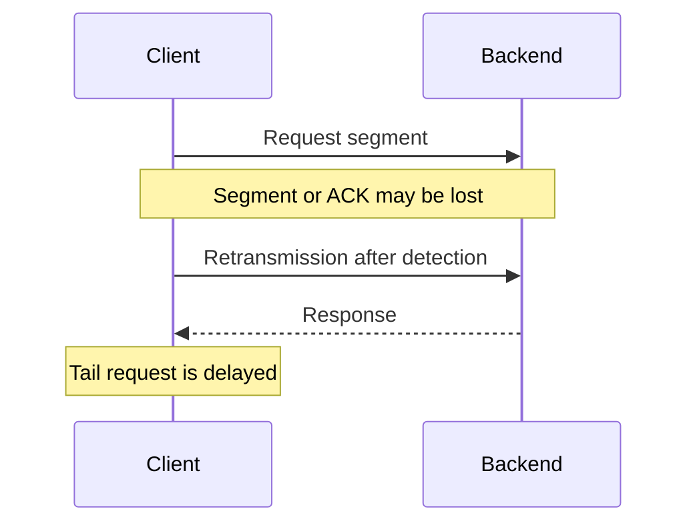

# Packet Loss, Retransmission and Tail Latency

**Goal:** Explain why a small amount of loss can produce a large p99 latency penalty and how to prove whether loss is in the critical request path.

## LEARN

A fast median does not imply healthy tail latency. A request may incur extra round trips or retransmission timeout delays when a needed TCP segment is lost. Application retries can amplify the problem, especially for non-idempotent operations.



**Important nuance:** A packet trace from one endpoint can label a retransmission even when the underlying cause is reordering or capture loss. Correlate both ends where permitted. Packet loss is one possible cause of p99 spikes; queueing, GC, database waits, scheduling and downstream retries are others.

## DESIGN — Separate metrics

| Metric | Answers |
| --- | --- |
| p50/p95/p99 end-to-end latency | How the user experience changes |
| TCP retransmits / timeouts | Whether transport needed recovery |
| RTT distribution | Whether network delay or queueing changed |
| Interface drops / errors | Whether local links/queues lost traffic |
| Backend request duration | Whether delay is inside application |
| Retry attempts | Whether clients amplified offered load |

## BUILD — Baseline without destructive loss injection

**Ubuntu VM:** start a disposable local service and measure request times.

```bash
python3 -m http.server 18086 --bind 127.0.0.1
```

In another terminal:

```bash
for i in $(seq 1 20); do
  curl --noproxy '*' -sS -o /dev/null -w '%{time_total}\n' http://127.0.0.1:18086/
done
nstat -az 2>/dev/null | grep -E 'TcpRetransSegs|TcpExtTCPLossProbes' || true
```

**Expected:** 20 timings; counters are host-wide and may reflect unrelated traffic. This is a **baseline**, not a controlled packet-loss experiment. Do not use `tc netem` on the host's main interface or a production VM.

## BREAK — Safe simulated latency distribution

Use Python to demonstrate the statistical impact of a small slow tail, without modifying the network:

```python
values = [0.050] * 98 + [0.800, 1.500]
values.sort()
def percentile_nearest_rank(p):
    import math
    return values[math.ceil(p / 100 * len(values)) - 1]
for p in (50, 95, 99, 100):
    print(f"p{p}: {percentile_nearest_rank(p):.3f}s")
```

**Expected:** p50=0.050s, p95=0.050s, p99=0.800s, p100=1.500s (nearest-rank definition). The distribution is illustrative; it does **not** prove loss caused the slow requests.

## INVESTIGATE — Incident procedure

1. Scope the affected clients, routes, nodes, regions and time windows.
2. Compare request latency histograms with TCP retransmission counters and RTT.
3. Check dependency latency and retries before attributing all tail latency to the network.
4. If permitted, capture packets at both ends and examine sequence/ACK behavior.
5. Validate recovery with p99 and error rate, not just a single successful curl.

## OPERATE

Use bounded retries, request deadlines, jitter, and idempotency for operations that may be retried. Reduce large fan-out when slowest dependency dominates response time.

Related: [packet capture](../troubleshooting/packet-capture-analysis.md), [flow/congestion control](flow-congestion-control.md), [SRE observability](../../sre/observability.md).

## My Architecture Review — Solutions & Doubts

- Why can p50 stay flat while p99 becomes unacceptable?
- What would disprove the hypothesis that retransmissions caused a latency spike?
- **Evidence / doubts:**
