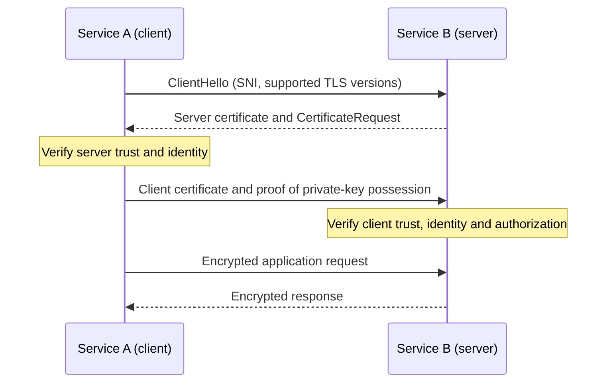
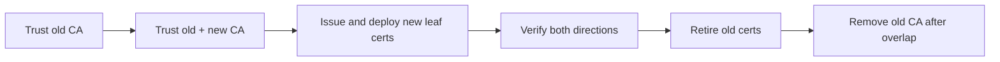

# Mutual TLS (mTLS), Identity and Certificate Rotation

**Goal:** Understand two-way certificate authentication, trust boundaries and how to rotate credentials without an outage.

## LEARN — TLS versus mTLS

In ordinary HTTPS, the **client validates the server certificate**. In mTLS, the **server also requests and validates a client certificate**. Both parties prove possession of the corresponding private key during the handshake. A certificate's identity is meaningful only when its chain, validity, name/policy and authorization are checked.

| Control | Protects against | Does not automatically solve |
| --- | --- | --- |
| Server certificate verification | Impersonating the server | Client authorization |
| Client certificate verification | Unauthenticated clients | Permission to every API |
| Short-lived certs | Long-lived exposure after compromise | Secure key distribution |
| Rotation overlap | Downtime during trust/key replacement | Revocation of a stolen key |

**Authentication is not authorization.** A trusted client certificate may identify a service, but the server still needs to decide what that identity may do. Modern identity systems often use SAN URI/DNS identities rather than relying on the certificate common name.

## DESIGN — Rotation without downtime

For a **CA rotation**, distribute new trust **before** switching certificates, then remove old trust only after all peers have migrated. For **leaf renewal under the same CA**, renew before expiration, atomically replace files/secrets and reload/restart consumers that do not hot-reload automatically. Roll back only if the old certificate is still valid and authorized.

## BUILD / BREAK / FIX

Run the [localhost mTLS lab](../labs/mtls-local-service-identity.md): create a disposable CA, server and client certificates; prove authorized access; fail with no client certificate; fail with an untrusted client; restore valid trust. No production certificate stores are modified.

## INVESTIGATE — Failure checklist

1. Which peer is failing verification: client verifying server, or server verifying client?
2. Is the chain trusted? Are SAN and hostname/SNI correct?
3. Is the certificate valid **now** and not expired/not-yet-valid?
4. Does the key match the certificate? Are EKU/key-usage constraints appropriate?
5. Did the process reload the renewed certificate and trust bundle?
6. Are authorization policies using the expected identity?
7. Are clocks synchronized? Are proxies terminating TLS and creating a separate upstream TLS session?

Do not use `curl -k` as a production fix. Never commit private keys or real credentials to Git.

## OPERATE — Architecture choices

- Keep root/intermediate CA keys protected; automate leaf issuance and renewal.
- Monitor expiry, rotation success and peer verification errors.
- Use separate server and client identities, least-privilege authorization and auditable certificate ownership.
- Design overlapping trust windows, rollback and emergency revocation procedures.
- Document whether TLS terminates at the ingress, service mesh sidecar or application.

Related: [Nginx cryptography](../../nginx/cryptography.md), [connection failure diagnosis](../troubleshooting/connection-failure-diagnosis.md).

## My Architecture Review — Solutions & Doubts

- Why can a valid certificate still be rejected?
- Why is trusting a client CA not sufficient authorization?
- How would I rotate a CA used by 500 services without an outage?
- **Evidence / doubts:**
