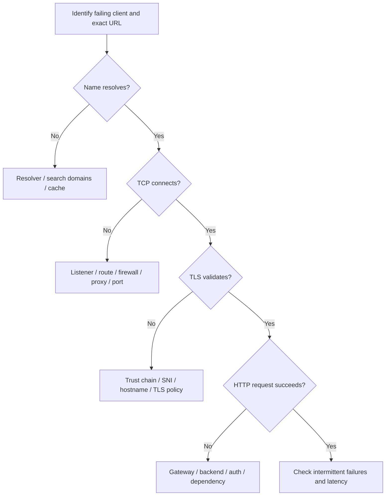
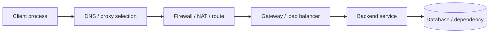

# Diagnosing Connection Failures — Evidence Before Assumptions

**Goal:** Isolate a backend connectivity failure to name resolution, path, transport, TLS, proxy, or application, and explain what each observation proves.

**Source scope:** Synthesized from Codemia *Diagnosing Connection Failures*: the elimination sequence, DNS, routing/filtering, partial failures, stale pools, client limits, and verification. Examples and lab are original.

## LEARN — The five gates

A request must pass multiple gates. Do not call a TCP failure a DNS failure, or a 502 an IP routing failure, without evidence.



| Symptom | What it establishes | What remains unknown |
| --- | --- | --- |
| `Could not resolve host` | Name resolution failed for this client/request | Whether server is healthy |
| `Connection refused` | TCP connect was actively rejected, often by RST | Whether endpoint or intermediary rejected it |
| `Connection timed out` | Connect did not finish before deadline | Drop, path, filtering, congestion, or intermediary |
| `Connection reset by peer` | Existing/attempted connection aborted | Which hop generated the reset |
| TLS verify failure | Certificate validation/trust did not succeed | Whether HTTP backend is healthy |
| HTTP 502/503/504 | HTTP-speaking intermediary returned a failure | Which upstream condition caused it |

**Always ask:** From **which machine/container** did this fail? The laptop's VPN and a cloud service's egress path can be completely different.

## DESIGN — A real backend path



Capture the hostname, resolved IP, address family, source environment, destination port, protocol, timestamps, and request ID. A single successful curl from your laptop does **not** prove a deployed Code Engine workload can reach the same endpoint.

## BUILD — Disposable localhost API

**Environment:** Mac terminal or Ubuntu VM with Python 3 and curl. All examples bind to loopback; no existing Nginx or application configuration is touched.

**Terminal A — create a tiny HTTP API:**

```bash
mkdir -p ~/networking-phase1/connection-lab
cd ~/networking-phase1/connection-lab
cat > app.py <<'PY'
from http.server import BaseHTTPRequestHandler, HTTPServer

class Handler(BaseHTTPRequestHandler):
    def do_GET(self):
        if self.path == "/health":
            body = b'{"status":"ok"}\n'
            self.send_response(200)
        else:
            body = b'{"error":"not found"}\n'
            self.send_response(404)
        self.send_header("Content-Type", "application/json")
        self.send_header("Content-Length", str(len(body)))
        self.end_headers()
        self.wfile.write(body)

HTTPServer(("127.0.0.1", 18082), Handler).serve_forever()
PY
python3 app.py
```

**Terminal B — baseline:**

```bash
# Show response and cumulative DNS/TCP/total timing.
curl -v --max-time 5 -w '\nDNS=%{time_namelookup} CONNECT=%{time_connect} TOTAL=%{time_total}\n' http://127.0.0.1:18082/health

# Observe listener (Ubuntu); macOS alternative: lsof -nP -iTCP:18082 -sTCP:LISTEN
ss -lntp '( sport = :18082 )'
```

**Expected:** HTTP 200, JSON body, and a local listening process.

## BREAK 1 — Backend stopped

Stop Terminal A with Ctrl-C, then run:

```bash
curl -v --connect-timeout 2 http://127.0.0.1:18082/health
```

**Expected:** quick connection refused on a normal loopback host. **Evidence:** no listener. **Fix:** restart `python3 app.py`, repeat baseline and confirm HTTP 200.

## BREAK 2 — Wrong endpoint and wrong path

With server running:

```bash
# A valid TCP connection does not guarantee the route exists.
curl -i http://127.0.0.1:18082/does-not-exist

# An unresolvable reserved name demonstrates a name-resolution failure.
curl -v --max-time 5 --noproxy '*' http://backend.networking-lab.invalid:18082/health
```

**Expected:** first returns HTTP 404; second usually fails name resolution. If a local hosts override or resolver behaves differently, record it rather than forcing a conclusion.

## INVESTIGATE — Production workflow

1. **Scope:** failing callers, regions, timestamps, percentage of failures, and recent changes.
2. **DNS:** `dig hostname A`, `dig hostname AAAA`, and on Linux `getent ahosts hostname`.
3. **Connect:** `curl -v --connect-timeout 3 --max-time 8 https://hostname/path`; inspect resolved IP and chosen proxy.
4. **TLS:** `openssl s_client -connect hostname:443 -servername hostname -verify_return_error </dev/null`; inspect chain and error.
5. **Listener/path:** on the destination, `ss -lntp`; check network policy, security group, NAT and route from the **actual source**.
6. **Intermediary:** compare load balancer logs, upstream status, timeouts and connection reuse.
7. **Intermittency:** group by destination IP, instance, zone, protocol family, client version and time window.
8. **Validate:** repeat from original failing client and verify success rate/latency, not merely one successful probe.

**Safety:** Do not use `curl -k` as a fix for certificate errors. Use it only as an explicitly documented diagnostic isolation step in an authorized test.

## OPERATE — Architecture decisions

- Separate connect, TLS, request and total timeout budgets.
- Limit retries and only retry safe operations when appropriate.
- Log destination hostname/IP, request ID, upstream timing and sanitized failure category; avoid leaking credentials.
- Make readiness checks test critical dependencies without making every transient optional dependency fatal.
- Avoid treating ping/traceroute failure as proof of an unreachable service: ICMP may be filtered.
- Validate from both sides of a proxy or NAT when possible; asymmetric routes and conntrack can hide faults.

Related: [DNS](../fundamentals/dns-resolution.md), [TCP](../fundamentals/tcp-connection-lifecycle.md), [packet captures](packet-capture-analysis.md), [Architecture Lab 05](../../sysdesign/daily-architecture-lab/lesson-05-api-gateway-cascading-failures-circuit-breakers.md).

## My Architecture Review — Solutions & Doubts

- Why does a successful DNS lookup not prove the API is reachable?
- How would I prove whether a reset came from the server or an intermediary?
- What evidence from the **actual workload** would I collect before blaming a VPN?
- **My commands, results, and doubts:**
