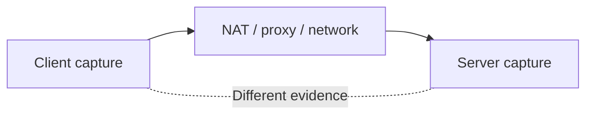

# Reading a Packet Capture — TCP Evidence

**Goal:** Capture a small, relevant packet trace; identify handshake, normal close and refused connection; avoid over-interpreting a single capture.

**Source scope:** Synthesized from Codemia *Reading a Packet Capture*: capture location, filters, SYN/SYN-ACK, RST, windows, retransmission, encrypted traffic and capture limitations. Original safe localhost lab below.

## LEARN — What a packet capture proves

A packet capture shows traffic visible **at the chosen interface and point in the path**. It does not automatically reveal what another host received. NIC offload, capture drops, NAT, proxies, encryption and sampling can change what is visible.



**Key patterns:**

| Pattern | Interpretation | Caution |
| --- | --- | --- |
| SYN → SYN/ACK → ACK | TCP handshake completed at capture point | TLS/HTTP may still fail |
| SYN → RST/ACK | Connection rejected | Identify which host/hop sent RST |
| Repeated SYN without SYN/ACK | No response observed here | Could be path, filtering, loss, or missing capture |
| Retransmitted sequence bytes | Sender resent data | Do not equate every retransmission with network congestion |
| Advertised window zero | Receiver cannot currently accept more data | Investigate receiver and application consumption |
| FIN/ACK sequence | Graceful direction close | Other direction can remain open |
| RST after established traffic | Abrupt abort | Correlate with app/proxy logs |

## DESIGN — Select capture point first

- **Client:** proves what the client sent/received on that interface.
- **Server:** proves what reached the server and what it emitted.
- **Proxy/load balancer:** traffic on each side may be separate TCP sessions.
- **Container:** capture in the right network namespace or at host interface; interface names and NAT can differ.
- **Encrypted traffic:** TLS payload is not readable without authorized keys, but timing, IPs, ports, TCP flags and some handshake metadata remain visible.

Never capture production traffic without authorization. Captures can contain tokens, cookies, personal data, and internal addressing. Store minimally, restrict access, and delete after use.

## BUILD — Loopback capture with Python and curl

**Environment:** Ubuntu VM with `tcpdump`, `python3`, `curl`; `sudo apt-get install tcpdump` only if permitted. macOS alternative: use `sudo tcpdump -i lo0` and `lsof` for sockets. Work in a disposable directory.

**Terminal A — start server:**

```bash
mkdir -p ~/networking-phase1/pcap-lab
cd ~/networking-phase1/pcap-lab
python3 -m http.server 18083 --bind 127.0.0.1
```

**Terminal B — capture the specific port:**

```bash
cd ~/networking-phase1/pcap-lab
# Ubuntu loopback. -s 96 limits bytes per packet; -c 30 bounds capture size.
sudo tcpdump -i lo -nn -s 96 -c 30 -w tcp-local.pcap 'tcp port 18083'
```

**Terminal C — generate traffic:**

```bash
curl --noproxy '*' -sS -o /dev/null http://127.0.0.1:18083/
```

Stop capture with Ctrl-C if it has not reached 30 packets. Read the saved trace:

```bash
sudo tcpdump -nn -tttt -r ~/networking-phase1/pcap-lab/tcp-local.pcap 'tcp port 18083'
```

**Expected:** SYN, SYN/ACK, ACK followed by data and normal close. The exact packet count, flags and timing depend on the OS and traffic. The `-s 96` limit may truncate headers/options or application payload; increase snapshot length only when needed and authorized.

## BREAK — Observe connection refusal

Stop the Python server in Terminal A. Start a **new** bounded capture:

```bash
sudo tcpdump -i lo -nn -s 96 -c 8 -w tcp-refused.pcap 'tcp port 18083'
```

From another terminal:

```bash
curl --noproxy '*' -v --connect-timeout 2 http://127.0.0.1:18083/
```

Read the capture:

```bash
sudo tcpdump -nn -r tcp-refused.pcap 'tcp port 18083'
```

**Expected:** typically SYN followed by RST/ACK on loopback. **Observation:** the reset establishes rejection; it does not prove a remote production server itself generated a reset.

## INVESTIGATE — Repeatable capture workflow

1. Write a hypothesis and identify client, server, port, interface and time window.
2. Capture narrowly: `host 192.0.2.10 and tcp port 443` is an example filter (documentation IP only).
3. Prefer bounded capture (`-c`, duration, rotation/size limits); check reported dropped packets.
4. Find handshake and close first, then inspect timing, retransmissions and advertised windows.
5. Compare client/server/proxy traces with clock alignment when permitted.
6. Correlate with application logs and request IDs. TLS encryption prevents reading most application content.
7. Retest after the fix, and securely remove local capture files.

For advanced inspection, Wireshark or `tshark` can display relative TCP sequence numbers, expert warnings, retransmission analysis and streams. Such labels are heuristics, not a substitute for checking packet timing and capture vantage point.

## FIX & VALIDATE — Cleanup

```bash
# Only run from the disposable pcap-lab directory.
cd ~/networking-phase1/pcap-lab
rm -f tcp-local.pcap tcp-refused.pcap
# Stop the Python HTTP server with Ctrl-C if still running.
```

Related: [TCP lifecycle](../fundamentals/tcp-connection-lifecycle.md), [connection failure workflow](connection-failure-diagnosis.md), [Linux networking](../../linux/admin/networking.md).

## My Architecture Review — Solutions & Doubts

- Why can client and server packet captures disagree?
- How do I distinguish a TCP reset from an HTTP 503?
- What can I still observe when HTTPS payloads are encrypted?
- **My captured evidence, interpretation and doubts:**
