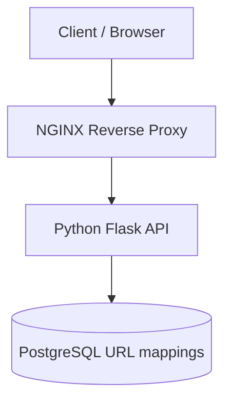
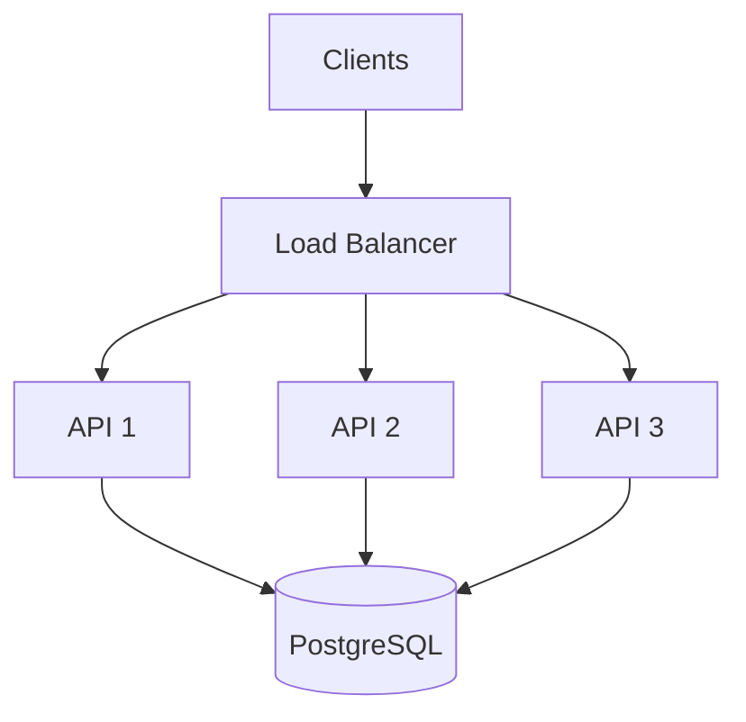
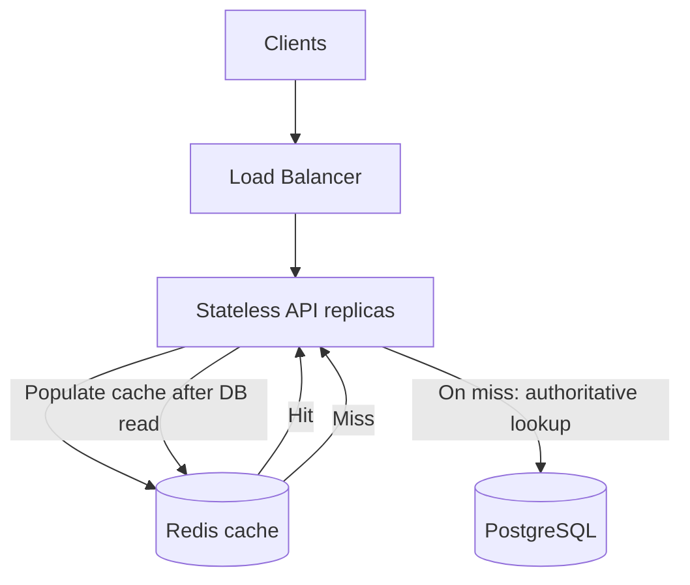
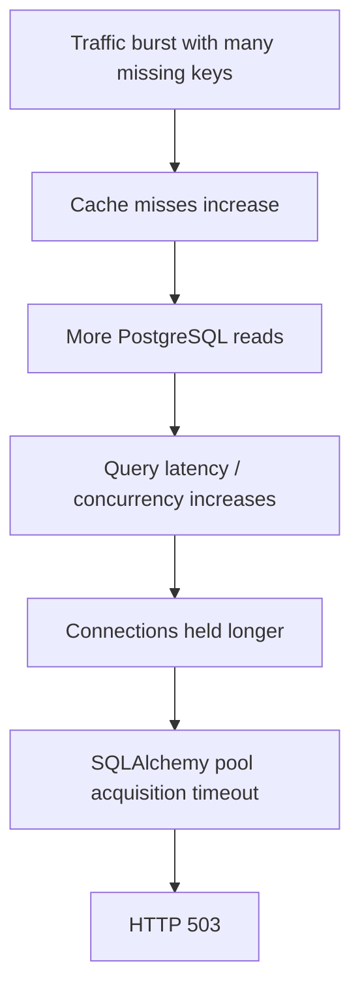
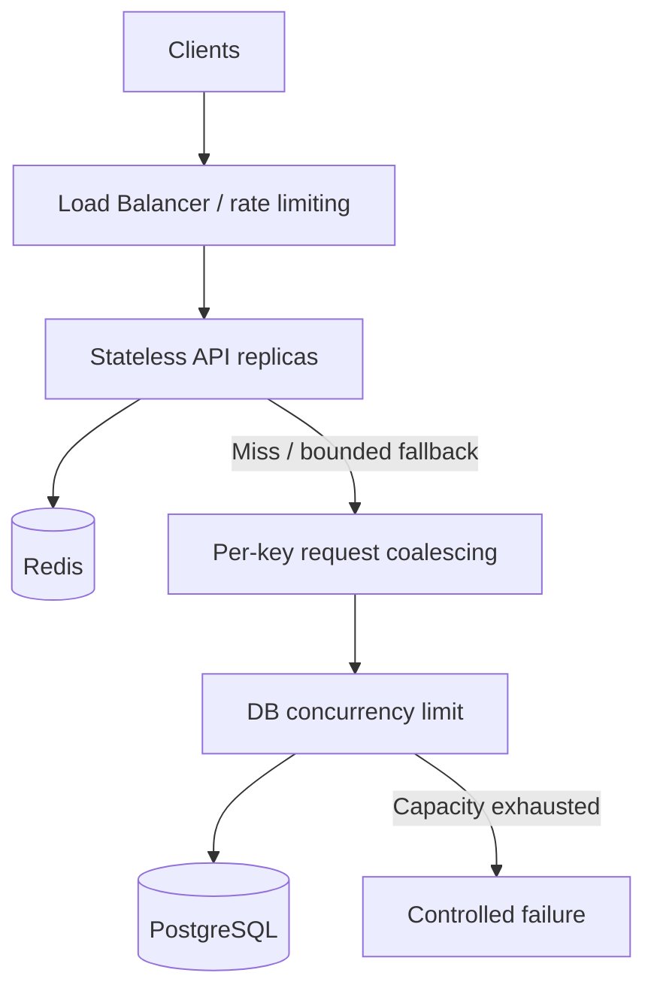
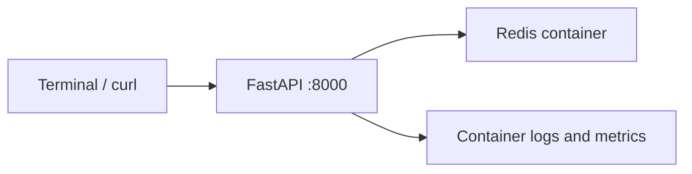

# Lesson 01 — System Design Thinking and URL Shortener Reliability

> **Daily Architecture Incident Lab** · 20–25 minutes · Foundation · 2026-11-06  
> **Scenario:** All production incidents, metrics and log entries in this lesson are **simulated**.  
> **Goal:** Move from operational troubleshooting to defensible architectural decisions.

## Learning objectives

By the end, you should be able to:

1. Translate a product request into functional and nonfunctional requirements.
2. Estimate traffic and storage before selecting technologies.
3. Design the smallest viable architecture and identify its failure modes.
4. Investigate a simulated 503 incident using evidence rather than guesses.
5. Explain the difference between a symptom, immediate cause, root cause, and architectural weakness.

**Method:** Understand → Quantify → Design → Challenge → Observe → Diagnose → Improve → Validate.

## 1. Design problem: URL shortening service (3 minutes)

A company wants a URL shortener. A customer submits a long URL and receives a short link. Visiting the short link redirects the browser to the original destination.

```text
POST /shorten {"url":"https://example.com/products/123"}
→ {"short_url":"https://sho.rt/aB92xK"}
GET /aB92xK → HTTP 302 Location: https://example.com/products/123
```

The business expects **1 million new links/day** and **100 million redirects/day**. It wants to tolerate traffic spikes without losing created mappings.

### Functional requirements

- Create a short URL from a valid HTTP/HTTPS destination.
- Resolve a short code to its destination.
- Optionally expire links.
- Reject unknown or expired codes appropriately.
- Future scope: custom aliases, click analytics, abuse detection.

### Nonfunctional requirements (initial illustrative targets)

| Dimension | Target | Architectural implication |
|---|---|---|
| Availability | 99.9% monthly | Avoid avoidable single-instance outages |
| Redirect latency | Server-side p95 < 100 ms | Keep redirect path short |
| Durability | Mapping survives application restarts | Durable primary database |
| Consistency | Newly committed link resolves immediately | Read from authoritative mapping if needed |
| Scalability | 10× average traffic burst | Capacity testing and horizontal scaling |
| Security | HTTP/HTTPS only; block abuse | Validation and rate limiting |
| Operability | Logs, metrics, traces | Observable request and dependency paths |

**Architect's question:** Which requirement, if missed, would make the product unusable? Discuss how the answer changes if the company serves internal links versus public marketing campaigns.

## 2. Back-of-the-envelope estimation (3 minutes)

Assume traffic is evenly distributed on average, with **10× peak** bursts:

| Operation | Daily | Average requests/sec | 10× peak requests/sec |
|---|---:|---:|---:|
| Create | 1,000,000 | 11.6 | 116 |
| Redirect | 100,000,000 | 1,157 | 11,574 |

```text
Average writes = 1,000,000 / 86,400 ≈ 11.6/s
Average reads  = 100,000,000 / 86,400 ≈ 1,157/s
Read/write ratio ≈ 100:1
```

Assume a mapping consumes **500 bytes** including rough metadata/index allowance:

```text
Daily logical data = 1,000,000 × 500 B ≈ 500 MB
Annual logical data ≈ 182.5 GB
Five-year logical data ≈ 912.5 GB
```

These estimates exclude backups, WAL, replication, indexes beyond the allowance, and analytics. They are **planning assumptions**, not measured capacity.

**Design insight:** This is read-heavy. First evaluate indexed PostgreSQL lookups and caching; do not jump straight to database sharding.

## 3. Design incrementally (5 minutes)

### Version 1: smallest viable architecture



**Write path:** validate URL → generate candidate short code → insert with unique constraint → commit → return HTTP 201.  
**Read path:** lookup short code → check expiry → return HTTP 302 with `Location` header.

```sql
CREATE TABLE urls (
  id BIGSERIAL PRIMARY KEY,
  short_code VARCHAR(16) NOT NULL UNIQUE,
  original_url TEXT NOT NULL,
  created_at TIMESTAMPTZ NOT NULL DEFAULT NOW(),
  expires_at TIMESTAMPTZ
);
```

A collision on `short_code` must be handled with a bounded retry. A database transaction must commit before a successful create response. A 302 is appropriate when destinations may change; permanent 301 caching can complicate updates.

**Limitations:** one API instance, one database instance, every redirect hits the database.

### Version 2: multiple stateless API instances



**Benefit:** a failed API instance need not take down the whole service.  
**New risk:** each API instance has a DB connection pool; scaling APIs may exhaust database connections.

### Version 3: cache-aside for redirects



The diagram shows the logical flow; the API makes both Redis and PostgreSQL calls.

With a **95% hit rate** at peak 11,574 redirects/sec:

```text
DB reads ≈ 11,574 × (1 - 0.95) ≈ 579 reads/sec
```

**Trade-offs:** Redis reduces database load but adds cache invalidation, cold-start misses, another dependency, and cache-stampede risk. A Redis outage should not automatically cause uncontrolled fallback traffic to PostgreSQL.

### Decision record

| Decision | Why now? | Risk / when to revisit |
|---|---|---|
| PostgreSQL | Simple durable source of truth and uniqueness | Revisit if measured throughput/availability insufficient |
| Stateless API replicas | Independent scaling and instance failure tolerance | Database connections grow with replica count |
| Redis cache-aside | High read/write ratio; hot-key reuse | Cache miss bursts and stale data |
| No sharding yet | No measured need; high operational cost | Revisit with demonstrated storage/write limits |

## 4. Simulated production incident: 503 during a traffic spike (5 minutes)

> **Simulation only:** The following timeline and logs are fabricated to teach investigation. They are not a documented outage.

| Time | Observation |
|---|---|
| 10:00 | ~1,200 redirect requests/sec; 95% cache hit ratio |
| 10:02 | Traffic increases to ~8,000 requests/sec |
| 10:03 | Cache hit ratio drops to 40% due to many recently expired/distinct keys |
| 10:04 | Database query concurrency rises; latency increases |
| 10:05 | Application pool acquisition timeouts |
| 10:06 | HTTP 503 responses rise |

**Important nuance:** A spike involving one already-cached hot key could **increase** hit ratio. The simulated drop requires the additional assumption of many missing/expired keys.

### Hypotheses before touching infrastructure

| Hypothesis | Evidence to inspect |
|---|---|
| NGINX saturation | Error log, active connections, upstream status |
| Python worker saturation | CPU, worker count, queueing latency |
| Redis outage or miss storm | Redis errors, hit/miss deltas, evictions |
| PostgreSQL contention | Active queries, wait events, locks, query plans |
| SQLAlchemy pool exhaustion | Checked-out connections, pool wait timeouts |
| Network degradation | TCP errors, latency and retransmits |

### Step 1 — confirm user-visible failure

```bash
curl -sS -o /dev/null \
  -w 'HTTP=%{http_code} TIME=%{time_total}\n' \
  https://short.example/aB92xK
```

**Simulated output:** `HTTP=503 TIME=5.012`. This confirms failure, not the failing component.

Inspect access logs (your actual log format must include upstream timing fields):

```bash
sudo tail -n 100 /var/log/nginx/access.log
sudo tail -n 100 /var/log/nginx/error.log
```

**Simulated access entry:**

```text
GET /aB92xK status=503 request_time=5.012 upstream_status=503 upstream_response_time=5.010
```

**Interpretation:** upstream returned 503. Investigate the application, while still checking whether NGINX itself has resource constraints.

### Step 2 — inspect application logs

```bash
journalctl -u url-shortener-api --since '10 minutes ago' --no-pager
```

**Simulated output:**

```text
sqlalchemy.exc.TimeoutError:
QueuePool limit of size 20 overflow 10 reached,
connection timed out, timeout 5.00
```

**Interpretation:** application cannot acquire a pooled DB connection within five seconds. In this simulation the API maps this exception to HTTP 503. The error does not yet explain *why* connections are occupied.

### Step 3 — inspect database connections and queries

```bash
psql -U appuser -d shortener
```

```sql
SHOW max_connections;

SELECT state, COUNT(*)
FROM pg_stat_activity
GROUP BY state;

SELECT pid, state, wait_event_type, wait_event,
       NOW() - query_start AS duration,
       LEFT(query, 120) AS query
FROM pg_stat_activity
WHERE state = 'active'
ORDER BY duration DESC
LIMIT 10;

EXPLAIN (ANALYZE, BUFFERS)
SELECT original_url FROM urls WHERE short_code = 'aB92xK';
```

**Possible observations:** many active sessions; increased query latency; lock or I/O waits. The `UNIQUE` constraint should create an index, but verify the query plan. **Connection count alone does not prove overload**; idle sessions and reserved connections matter.

### Step 4 — examine Redis counters

```bash
redis-cli INFO stats | grep -E 'keyspace_hits|keyspace_misses|evicted_keys'
```

Redis hit/miss counters are cumulative. Compare two snapshots over the same interval:

```text
Earlier: hits=950000  misses=50000
Later:   hits=1010000 misses=140000
Interval: hits=60000 misses=90000
Hit ratio = 60000 / (60000 + 90000) = 40%
```

These counters include all Redis key lookups; application-level cache metrics are more precise.

### Step 5 — correlate evidence



Validate the chain using aligned timelines of cache misses, query latency, checked-out pool connections, pool wait duration, and 503 rate. Check for connection leaks and locks before finalizing root cause.

## 5. Symptom, cause and architectural weakness (2 minutes)

| Layer | Finding in this simulation |
|---|---|
| Symptom | Clients see HTTP 503 |
| Immediate cause | API cannot acquire DB connection |
| Contributing condition | Cache misses increase DB lookups |
| Root cause | Demand exceeds sustainable database/pool capacity during miss burst |
| Design weakness | No effective protection against cache-miss surges |

**Why not simply increase pool size?** More concurrent connections can worsen database contention. Size pools against the database's measured concurrency budget, accounting for all API replicas and other clients.

## 6. Mitigation and redesign (3 minutes)

**Immediate response:** identify failing dependency, protect DB with bounded concurrency, shed excess load, reduce abusive traffic, restore hot cache keys when safe, and avoid uncontrolled retries. Prefer reversible changes with clear rollback criteria.

**Durable improvements:**

1. **Admission control:** bound concurrent database lookups; fail quickly and predictably rather than collapse.
2. **Single-flight coalescing:** combine concurrent lookups for the same key. Local coalescing is per process, not globally coordinated.
3. **TTL jitter:** spread expirations, e.g. `300 + random.randint(0, 60)` seconds.
4. **Cache failure strategy:** circuit breaker and *bounded* DB fallback; never unlimited fallback.
5. **Observability:** HTTP error rate, p95/p99 latency, cache hit ratio, DB query latency, pool wait, checked-out connections, PostgreSQL waits, rejection rate.
6. **Validation:** run controlled load tests with cold cache, warm cache, Redis failure, and database slowdowns; compare with SLOs and capacity budget.



## 7. Architect challenges — answer independently (3 minutes)

**Challenge 1 — Redis unavailable.** Would you fail all redirects or bypass Redis? Explain your choice using database capacity, circuit breakers, latency, and overload protection.

**Challenge 2 — Connection math.** Three API replicas each have `pool_size=20` and `max_overflow=10`. How many simultaneous DB connections can they open? What changes with ten replicas if PostgreSQL allows 200 connections? Consider connections reserved for other clients.

**Challenge 3 — Growth.** Traffic rises to 100,000 redirects/sec. Should you shard PostgreSQL immediately? State what measurements and experiments you would perform first, and what evidence would justify sharding.

## 8. Optional practical lab

Reuse your Ubuntu/Nginx/Python environment if convenient; **do not alter existing project configurations**. Create a separate local test service or port.

1. Implement a minimal `/shorten` and `/<code>` Flask API with a PostgreSQL table and unique short-code constraint.
2. Verify create, redirect, missing-code, and expiration behavior using `curl`.
3. Run a baseline load test with [k6](https://grafana.com/docs/k6/latest/) or a small Python client. Record RPS, p95 latency, and errors.
4. Add cache-aside Redis and measure hit ratio and DB query reduction.
5. Repeat with cold cache and Redis intentionally unavailable. Protect PostgreSQL with bounded fallback.
6. Record observations and your design decisions in the review section below.

**Safety:** test only against local or authorized environments. Use sample domains, not production endpoints.

## 9. Related knowledge and hands-on labs

- [System Design Framework](../framework.md)
- [System Design Components](../components.md)
- [Existing URL Shortener Case Study](../app/url_shortner.md) — a more ambitious scale scenario; compare its assumptions with this lesson.
- [SRE Observability](../../sre/observability.md)
- [Architecture Labs — NGINX Project](https://github.com/samperay/sre-devops-architecture-labs) — reference the relevant project and PR after confirming their exact paths.

## 10. Lesson recap

**Architecture is the discipline of choosing and defending trade-offs under measurable constraints.** Start with requirements and capacity. Build the simplest design that works. Investigate failures by correlating evidence, then address the failure mode—not just the error message.

**Next lesson:** Reliable notification systems: synchronous vs asynchronous delivery, durable queues, retries, duplicate notifications, and idempotency.

---

## Practical Labs

**LEARN → DESIGN → BUILD → BREAK → INVESTIGATE → FIX → VALIDATE**

> **Scope:** An additional runnable local exercise; the complete architecture lesson and original optional exercise above remain intact. Estimated hands-on time: 35–60 minutes. Run on **Mac Docker Desktop** (preferred for multi-container workloads) or **Ubuntu VM** with Docker Engine + Compose plugin installed. All services bind to loopback and use a dedicated Compose project. This is a disposable lab, never production.

### LEARN — Experiment and expected failure

**Scenario:** URL shortener hot-key and cache failure. Architect decision: fail open for redirects or fail closed? Explain impact of cache misses, database load, and hot keys.

### DESIGN — Local topology



Create a dedicated directory `architecture-lab-01`. Run all commands below from it on the **Mac terminal** or **Ubuntu VM shell**, whichever runs Docker. Do not run them inside another existing application container.

```bash
mkdir -p architecture-lab-01/app architecture-lab-01/tests
cd architecture-lab-01
touch app/__init__.py
docker compose version
```

### BUILD — Complete minimal application

Directory layout:

```text
architecture-lab-01/
├── app/
│   ├── __init__.py
│   └── main.py
├── tests/
│   └── test_health.py
├── requirements.txt
├── Dockerfile
└── compose.yaml
```

**File: `app/main.py`**

```python
import os, sqlite3, time
from fastapi import FastAPI, HTTPException
from pydantic import BaseModel
from redis import Redis
app = FastAPI()
db_path = "/data/urls.db"
cache = Redis(host="redis", port=6379, socket_connect_timeout=1, socket_timeout=1, decode_responses=True)
class Link(BaseModel):
    code: str
    target: str
@app.on_event("startup")
def init():
    with sqlite3.connect(db_path) as db:
        db.execute("CREATE TABLE IF NOT EXISTS urls(code TEXT PRIMARY KEY, target TEXT)")
@app.post("/links", status_code=201)
def create(link: Link):
    with sqlite3.connect(db_path) as db:
        db.execute("INSERT OR REPLACE INTO urls VALUES (?,?)", (link.code,link.target))
    try: cache.delete(link.code)
    except Exception: pass
    return link
@app.get("/r/{code}")
def resolve(code: str):
    try:
        cached=cache.get(code)
        if cached: return {"target":cached,"source":"cache"}
    except Exception: pass
    with sqlite3.connect(db_path) as db:
        row=db.execute("SELECT target FROM urls WHERE code=?", (code,)).fetchone()
    if not row: raise HTTPException(404,"unknown code")
    try: cache.setex(code,60,row[0])
    except Exception: pass
    return {"target":row[0],"source":"database"}
@app.get("/health")
def health(): return {"status":"ok"}
```

**File: `requirements.txt`**

```text
fastapi==0.115.12
uvicorn==0.34.2
redis==5.2.1
httpx==0.28.1
pytest==8.3.5
```

**File: `Dockerfile`**

```dockerfile
FROM python:3.11-slim
WORKDIR /code
COPY requirements.txt .
RUN pip install --no-cache-dir -r requirements.txt
COPY app ./app
COPY tests ./tests
CMD ["uvicorn","app.main:app","--host","0.0.0.0","--port","8000"]
```

**File: `compose.yaml`**

```yaml
services:
  api:
    build: .
    ports: ["127.0.0.1:18001:8000"]
    volumes: ["url_data:/data"]
    depends_on: [redis]
  redis:
    image: redis:7-alpine
volumes:
  url_data: {}
```

**File: `tests/test_health.py`**

```python
def test_health():
    from fastapi.testclient import TestClient
    from app.main import app
    assert TestClient(app).get("/health").status_code == 200
```

Start the lab and wait for the API:

```bash
docker compose -p archlab01 up -d --build
docker compose -p archlab01 ps
curl -fsS http://127.0.0.1:18001/health
```

**Expected:** the API reports `{"status":"ok"}`. On the first startup, the image build may take a few minutes. If a dependency is not ready, wait a few seconds and retry; inspect `docker compose ... logs` rather than assuming a design fault.

### VALIDATE baseline — Prove healthy operation before injecting faults

```bash
curl -s -X POST http://127.0.0.1:18001/links -H 'Content-Type: application/json' -d '{"code":"sre","target":"https://example.org"}'
curl -s http://127.0.0.1:18001/r/sre
curl -s http://127.0.0.1:18001/r/sre
```

**Expected observations:** First lookup uses database; next uses cache. When Redis stops, requests still succeed via SQLite fallback (degraded latency); restart restores caching. Compare cold versus warm response timings.

### BREAK — Introduce ONE controlled failure

Only use the dedicated `archlab01` Compose project; do not target existing databases or application containers.

```bash
docker compose -p archlab01 stop redis
curl -s http://127.0.0.1:18001/r/sre
```

### INVESTIGATE — Collect evidence before fixing

```bash
docker compose -p archlab01 ps
docker compose -p archlab01 logs --tail=30 api redis
```

**Reasoning checklist:** Which component is unavailable or slow? Is the error a connection refusal, timeout, invalid schema, queue backlog, or application exception? Which log or metric proves your hypothesis? What observation would disprove it? Separate trigger, root cause, and design weakness.

### FIX — Restore service and improve the design

```bash
docker compose -p archlab01 start redis
curl -s http://127.0.0.1:18001/r/sre
```

**Design discussion:** Architect decision: fail open for redirects or fail closed? Explain impact of cache misses, database load, and hot keys.

### VALIDATE — Automated checks and safe cleanup

Run the included API smoke test in the dedicated container:

```bash
docker compose -p archlab01 exec api python -m pytest -q tests
```

**Expected:** `1 passed`. This tests only the health endpoint, not the full failure scenario; confirm the scenario-specific response and recovery above as well.

Cleanup **only this lesson's project**. `down` preserves named volumes. `down -v` is optional and permanently removes only this lab's data volumes.

```bash
docker compose -p archlab01 down
# OPTIONAL destructive cleanup of this disposable lab's volumes:
# docker compose -p archlab01 down -v
```

**Your lab evidence:** baseline response: _..._; injected failure: _..._; commands and findings: _..._; root cause versus systemic weakness: _..._; recovery verification: _..._; improvement proposal: _..._.

## My Architecture Review — Solutions & Doubts

> Complete these sections after reading. Keep your original reasoning, even when you later revise it, so your learning remains visible in Git history.

### 1. My Understanding

**Explain the architecture in your own words:**

<!-- Your answer -->

**What assumptions did I make?**

<!-- Your answer -->

### 2. My Solutions to the Architect Challenges

**Challenge 1 — Redis failure**

- My decision:
- Why:
- Trade-offs:

**Challenge 2 — Connection math**

- Calculation:
- Capacity implications:
- Mitigation:

**Challenge 3 — 100k redirects/sec**

- My proposed approach:
- Evidence I would collect:
- Conditions for sharding:

### 3. My Troubleshooting Approach

- Initial hypotheses:
- Commands/tools I would run:
- Evidence and interpretation:
- What would falsify my hypothesis:

### 4. My Proposed Architecture Improvements

- Changes I recommend:
- Why these changes:
- Trade-offs and risks:
- How I would validate them:

### 5. My Doubts / Questions

- [ ] Question 1:
- [ ] Question 2:
- [ ] Question 3:

### 6. Lessons Learned

- Key insight:
- Mistake or assumption corrected:
- How I would apply this in production:

### 7. Mentor Review

<!-- Reserved for feedback after sharing your completed lesson for review. -->
