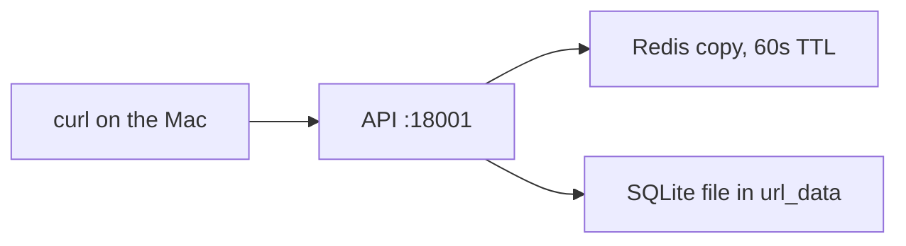
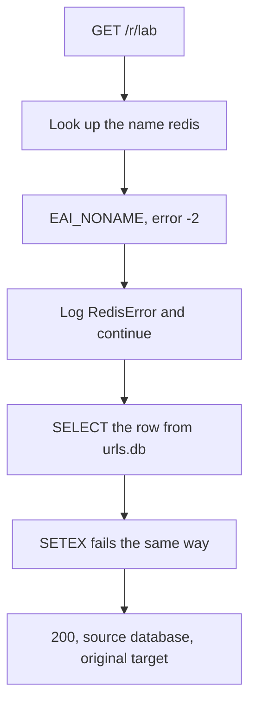

# Lesson 01 — System Design Thinking

> **Daily Architecture Incident Lab** · one sitting · Mac · Docker Desktop
> **About 45 minutes** the first time. The image build is the slow part. The break itself is a few commands and a careful look at the output.

A short link is a promise. After this service accepts `lab`, that code means `https://example.org/architecture`. This sitting puts that promise in three boxes on your laptop, proves each box while they are healthy, then stops the copy on purpose. The click still returns the original target. You will be able to point at the line that made that true, and at the requirement you gave up while the copy was dead.

The traffic numbers below are planning assumptions. The HTTP bodies, the log line, and the SQLite rows are produced by the containers you start.

## Goals

By the end you should be able to:

1. Split one product sentence into jobs, and name a command that proves each job.
2. Estimate the read/write split before you decide a copy deserves its own box.
3. Point at the smallest design and say what each box is allowed to get wrong.
4. Break one box, then separate the symptom, the dead box, and the promise that still holds.
5. Write that down in your own words, including the requirement the break suspended.

## Constraints and safety

Run this on Docker Desktop. Every box in the lab is a container, or a file inside a volume. Docker Desktop runs every step.

- Create the files under `$HOME/architecture-labs/lesson-01`. That directory sits outside this wiki, so the lab files stay out of the wiki git tree.
- Every Docker command in this lesson carries `-p archlab01`. That is the Compose project name. `stop`, `start`, `logs`, and `down` then apply to this lab.
- The API is published only on `127.0.0.1:18001`. Redis has no published port. You reach Redis through `docker compose exec`.
- Use `https://example.org/...` as the only target. This lab stores whatever URL you send it.
- Before you stop a container, `docker compose -p archlab01 ps -a` should show names that start with `archlab01-`.
- Cleanup is at the end. `down` removes this project. `down -v` also removes its volume.

If `docker info` fails, open Docker Desktop and wait until the engine is running. Then run `docker info` again.

## The product is two jobs

Someone asks the service to remember a long URL. Someone else, usually many someone elses, asks what a short code means.

Those jobs fail differently. A lost row means the promise was a lie. A slow answer means the click waited. A second meaning for the same code means you no longer know which promise you made.

| Job | Requirement | Healthy looks like |
|---|---|---|
| Remember | The row exists before the caller hears success | `POST /links` returns 201, then the row is in the file |
| One meaning | One code has one target | A second `POST` for `lab` returns 409, and the first target is still the row |
| Answer | A click returns the committed target | `GET /r/lab` echoes that exact URL |
| Refuse a guess | An unknown code is a miss | `GET /r/missing` returns 404 |
| Refuse junk | A non-URL never becomes a row | `ftp://...` returns 400, and the file grows no row |
| Answer again quickly | A repeated click may be served from a copy | The second `GET` says `"source":"cache"`, and the target string matches the row |

The business sketch that justifies the copy:

```text
1,000,000 creates / 86,400 s ≈ 12 writes/s
100,000,000 redirects / 86,400 s ≈ 1,160 reads/s
10× peak redirects ≈ 12,000 reads/s
reads : writes ≈ 100 : 1
```

Call a stored mapping 500 bytes, index included. A million creates is about 500 MB that day, and about 180 GB in a year, before backups and the indexes you forgot to count. The memory has to keep that. A copy can carry the hot mappings, so the book's read rate stays far below 12,000 per second for as long as the copy's target equals the row.

Today you run one click at a time, so you can see which box answered. SQLite is the memory for this sitting because you can print the row. The same role, at that yearly volume and with more than one API process, is a database those processes share. Redis earns its place only on the read path, and only while its value equals the row.

## Three boxes



| Box | What it is | Why it exists | What you should notice |
|---|---|---|---|
| API | One Python process. The only door. | It decides 201, 409, 400, 404, and 200, and it decides which store it asked. | The mappings live in the volume. Restart this process and the target is still right. |
| SQLite | The file `/data/urls.db` on the named volume `url_data`. | The book. `code` is the primary key, so the file itself refuses a second meaning. | The 201 is returned after `commit`. The row survives an API restart and a Redis stop. |
| Redis | The key `lab`, value equal to the target, life 60 seconds. | The photocopy. A repeated click can skip the book. | `TTL lab` is a countdown. The row has no countdown. |

A real shortener answers a click with `302 Location`. This lab answers with JSON, and the JSON names the box that produced the target. `"source"` is a window cut into the service so you can see the path. Leave it in while you are learning the path.

`/health` always uses HTTP 200 when the process is up. The body is the report: `api`, `database`, and `cache` each say `ok` or `down: ...`. A check that stored only the status code would miss the break you are about to make. Read the body.

## Build the lab

The API catches `RedisError`, writes a warning, and reads SQLite. Create never calls Redis. Those two facts are the whole design of the break. Read them in the file before you start the containers.

`database()` opens `/data/urls.db`, hands it to the request, then commits. The commit is the moment the promise exists. The table is created when the process starts. The volume keeps the file after the process exits, so that `CREATE TABLE` is a first-time act on a later start.

`create()` rejects a bad code or a non-HTTP target with 400, before either store is touched. The insert is one statement. A primary-key clash becomes 409 with the sentence `that code already has a target`. `from None` keeps that sentence as the whole response. The function returns 201 only after the commit. It does not call Redis.

`resolve()` asks Redis first. `decode_responses=True` makes the copy a string, the same type as the column. A hit returns `"source":"cache"` and does not open the file. `RedisError` is logged on the `uvicorn.error` logger, which is the logger already attached to `docker compose logs`, and the function continues as if the copy were missing. A missing row is 404. A found row is stored with `SETEX` for 60 seconds. If that store fails, the warning is logged and the caller still receives the target, because the book already answered.

The Redis client waits at most 0.3 seconds. That cap matters when the host exists and then stays silent. The failure in this lab is faster: the name is gone, and the lookup returns at once.

```bash
mkdir -p "$HOME/architecture-labs/lesson-01/app"
cd "$HOME/architecture-labs/lesson-01"
touch app/__init__.py
docker info >/dev/null
docker compose version
```

`app/__init__.py` can be empty. It makes `app` a package so `uvicorn app.main:app` has a module to import.

**`requirements.txt`**

```bash
cat > requirements.txt << 'EOF'
fastapi==0.115.12
uvicorn==0.34.2
redis==5.2.1
EOF
```

**`Dockerfile`**

```bash
cat > Dockerfile << 'EOF'
FROM python:3.12-slim
WORKDIR /code
COPY requirements.txt .
RUN pip install --no-cache-dir -r requirements.txt
COPY app ./app
CMD ["uvicorn", "app.main:app", "--host", "0.0.0.0", "--port", "8000"]
EOF
```

**`compose.yaml`**

The API port is bound to loopback. Redis is only on the Compose network, under the DNS name `redis`. The volume `url_data` is where the promise file lives. With `-p archlab01` its full name is `archlab01_url_data`.

```bash
cat > compose.yaml << 'EOF'
services:
  api:
    build: .
    ports:
      - "127.0.0.1:18001:8000"
    volumes:
      - url_data:/data
    depends_on:
      - redis
  redis:
    image: redis:7-alpine
volumes:
  url_data: {}
EOF
```

`depends_on` waits until the Redis container has started. It does not wait until Redis accepts commands. If the first health check says the cache is down, wait a second and run it again.

**`app/main.py`**

```bash
cat > app/main.py << 'EOF'
import logging
import sqlite3
from contextlib import asynccontextmanager, contextmanager
from urllib.parse import urlparse

from fastapi import FastAPI, HTTPException
from pydantic import BaseModel
from redis import Redis
from redis.exceptions import RedisError

log = logging.getLogger("uvicorn.error")

DB_PATH = "/data/urls.db"
CACHE_TTL_SECONDS = 60

cache = Redis(
    host="redis",
    port=6379,
    socket_connect_timeout=0.3,
    socket_timeout=0.3,
    decode_responses=True,
)


@contextmanager
def database():
    connection = sqlite3.connect(DB_PATH, timeout=2)
    try:
        yield connection
        connection.commit()
    finally:
        connection.close()


@asynccontextmanager
async def lifespan(_app: FastAPI):
    with database() as db:
        db.execute(
            """
            CREATE TABLE IF NOT EXISTS urls (
                code TEXT PRIMARY KEY,
                target TEXT NOT NULL
            )
            """
        )
    yield


app = FastAPI(lifespan=lifespan)


class Link(BaseModel):
    code: str
    target: str


def reject_bad_link(link: Link) -> None:
    if not link.code.isalnum() or not 1 <= len(link.code) <= 16:
        raise HTTPException(status_code=400, detail="code must be 1-16 letters or digits")
    parsed = urlparse(link.target)
    if parsed.scheme not in {"http", "https"} or not parsed.netloc:
        raise HTTPException(status_code=400, detail="target must be an http or https URL")


@app.get("/health")
def health():
    database_status = "ok"
    try:
        with database() as db:
            db.execute("SELECT 1")
    except sqlite3.Error as exc:
        database_status = f"down: {exc.__class__.__name__}"

    cache_status = "ok"
    try:
        cache.ping()
    except RedisError as exc:
        cache_status = f"down: {exc}"

    return {"api": "ok", "database": database_status, "cache": cache_status}


@app.post("/links", status_code=201)
def create(link: Link):
    reject_bad_link(link)
    try:
        with database() as db:
            db.execute(
                "INSERT INTO urls (code, target) VALUES (?, ?)",
                (link.code, link.target),
            )
    except sqlite3.IntegrityError:
        raise HTTPException(
            status_code=409,
            detail="that code already has a target",
        ) from None
    return {"code": link.code, "target": link.target}


@app.get("/r/{code}")
def resolve(code: str):
    try:
        cached = cache.get(code)
    except RedisError as exc:
        log.warning("cache read failed code=%s error=%s", code, exc)
        cached = None

    if cached is not None:
        return {"code": code, "target": cached, "source": "cache"}

    with database() as db:
        row = db.execute(
            "SELECT target FROM urls WHERE code = ?",
            (code,),
        ).fetchone()
    if row is None:
        raise HTTPException(status_code=404, detail="unknown code")

    target = row[0]
    try:
        cache.setex(code, CACHE_TTL_SECONDS, target)
    except RedisError as exc:
        log.warning("cache fill failed code=%s error=%s", code, exc)
    return {"code": code, "target": target, "source": "database"}
EOF
```

Start it. The first build downloads the Python image and the three libraries. Pip may warn that it is running as root inside the image. That warning is about the disposable image. The lines that matter are `Started` for `archlab01-redis-1` and `archlab01-api-1`.

```bash
docker compose -p archlab01 up -d --build
docker compose -p archlab01 ps
```

If Compose says the port is already allocated, another process owns `127.0.0.1:18001`. See who:

```bash
lsof -nP -iTCP:18001 -sTCP:LISTEN
```

Stop that process if it is a previous copy of this lab, then run `up` again.

## Learn — prove the promise while everything is up

Work from `$HOME/architecture-labs/lesson-01`. Stop after each command and read the body. A later step is meaningless if an earlier one lied.

**Is the door up, and are both stores answering?**

```bash
curl -sS -w '\nHTTP %{http_code}\n' http://127.0.0.1:18001/health
```

```text
{"api":"ok","database":"ok","cache":"ok"}
HTTP 200
```

Three fields, three boxes. HTTP 200 means the process answered. The fields mean the book accepted `SELECT 1` and Redis answered `PING`.

**Will it remember a code, and will it refuse a second meaning?**

```bash
curl -sS -w '\nHTTP %{http_code}\n' \
  -X POST http://127.0.0.1:18001/links \
  -H 'Content-Type: application/json' \
  -d '{"code":"lab","target":"https://example.org/architecture"}'
```

```text
{"code":"lab","target":"https://example.org/architecture"}
HTTP 201
```

The body has no `source` field. Create never spoke to Redis, so it has nothing to report about the copy.

Send the same code with a different target. The question is whether the promise can be overwritten by a second caller.

```bash
curl -sS -w '\nHTTP %{http_code}\n' \
  -X POST http://127.0.0.1:18001/links \
  -H 'Content-Type: application/json' \
  -d '{"code":"lab","target":"https://example.org/other"}'
```

```text
{"detail":"that code already has a target"}
HTTP 409
```

The primary key did that. The API translated `sqlite3.IntegrityError` into 409. The second URL was refused before it could become the row.

**Will junk stay out of the book?**

```bash
curl -sS -w '\nHTTP %{http_code}\n' \
  -X POST http://127.0.0.1:18001/links \
  -H 'Content-Type: application/json' \
  -d '{"code":"bad","target":"ftp://example.org/x"}'
```

```text
{"detail":"target must be an http or https URL"}
HTTP 400
```

**What did the file actually keep?** This question is the one the HTTP status cannot answer alone.

```bash
docker compose -p archlab01 exec api \
  python -c 'import sqlite3; print(sqlite3.connect("/data/urls.db").execute("select code, target from urls").fetchall())'
```

```text
[('lab', 'https://example.org/architecture')]
```

One row. The 409 left it alone. The 400 added nothing. The target is the first one you sent.

**Which box answers a click, the first time and the second time?**

```bash
curl -sS -w '\nHTTP %{http_code}\n' http://127.0.0.1:18001/r/lab
curl -sS -w '\nHTTP %{http_code}\n' http://127.0.0.1:18001/r/lab
```

```text
{"code":"lab","target":"https://example.org/architecture","source":"database"}
HTTP 200
{"code":"lab","target":"https://example.org/architecture","source":"cache"}
HTTP 200
```

The target string is the row both times. The first call missed, read the book, and wrote the photocopy. The second call hit the photocopy and returned before opening the file. Same promise, two boxes.

**What is an unknown code?**

```bash
curl -sS -w '\nHTTP %{http_code}\n' http://127.0.0.1:18001/r/missing
```

```text
{"detail":"unknown code"}
HTTP 404
```

A miss is a different outcome from a dead dependency. You want to have seen a real 404 before the break, so a later 200 is obviously the old row and a later 404 would mean something else.

**Can you see the photocopy itself, and does it expire?**

```bash
docker compose -p archlab01 exec redis redis-cli GET lab
docker compose -p archlab01 exec redis redis-cli TTL lab
```

```text
https://example.org/architecture
(integer) 57
```

Your integer will be somewhere from 1 to 60 if you run this within a minute of the second click. That countdown is the life of the copy. The SQLite row has no matching field. `GET` printing the same URL as the row is the healthy copy: same bytes, shorter life.

If you paused and `GET` prints `(nil)` while `TTL` prints `(integer) -2`, the copy already expired. Run `GET /r/lab` twice. The first response says `"source":"database"`, the second says `"source":"cache"`, and `GET lab` prints the URL again. Same healthy state, rebuilt.

**Does the promise live in the Python process?** Restart only the API. Redis keeps running. The volume stays mounted.

```bash
docker compose -p archlab01 restart api
curl -sS -w '\nHTTP %{http_code}\n' http://127.0.0.1:18001/r/lab
```

If curl says connection refused, the process is still booting. Run the same curl again.

The target is still `https://example.org/architecture`. `"source"` stays `"cache"` when the photocopy has seconds left, which it will if you do this immediately. The new process answered from Redis. The mappings live in the volume and, for these few seconds, in the copy. Print the row again if you want the book in front of you:

```bash
docker compose -p archlab01 exec api \
  python -c 'import sqlite3; print(sqlite3.connect("/data/urls.db").execute("select code, target from urls").fetchall())'
```

The same single row. You have now seen healthy: one meaning, a copy that matches it, a process that can die without taking the meaning with it.

## Predict

Write four lines before you stop anything. Put them in [the review](#1-my-understanding) or on paper. Guessing after you have seen the body teaches nothing.

1. HTTP status and body of `GET /health` after Redis is stopped.
2. HTTP status, `target`, and `source` of `GET /r/lab`.
3. HTTP status of a `POST` that creates a new code, `fresh`.
4. Whether the API log is quiet, or what the warning says.

You have the design in `resolve()` and in `create()`. The prediction is you, applying it.

## Break the copy

This is the only break. It stops the Redis container. It leaves the API running and leaves the volume in place.

```bash
docker compose -p archlab01 stop redis
```

Compose prints `Stopped` for `archlab01-redis-1`.

## Observe

**Which boxes does the door still claim?**

```bash
curl -sS -w '\nHTTP %{http_code}\n' http://127.0.0.1:18001/health
```

```text
{"api":"ok","database":"ok","cache":"down: Error -2 connecting to redis:6379. Name or service not known."}
HTTP 200
```

The status is 200. The process is up, which is what a load balancer would see if it stored only the status. The cache field is the symptom. `database` is still `ok`. Error `-2` is `EAI_NONAME` from the C library inside the API container: `getaddrinfo` could not find a host named `redis`. Docker's DNS drops the name when that container is stopped. The lookup fails before any TCP connection.

**Did the old promise survive?**

```bash
curl -sS -w '\nHTTP %{http_code}\n' http://127.0.0.1:18001/r/lab
curl -sS -w '\nHTTP %{http_code}\n' http://127.0.0.1:18001/r/lab
```

```text
{"code":"lab","target":"https://example.org/architecture","source":"database"}
HTTP 200
{"code":"lab","target":"https://example.org/architecture","source":"database"}
HTTP 200
```

Both clicks say `database`. The fill was attempted and could not store the copy, so the second click is another read of the book. The target is the original row, the one the 409 kept when the second POST offered `https://example.org/other`.

**Can the service remember a new code while the photocopier is unplugged?**

```bash
curl -sS -w '\nHTTP %{http_code}\n' \
  -X POST http://127.0.0.1:18001/links \
  -H 'Content-Type: application/json' \
  -d '{"code":"fresh","target":"https://example.org/fresh"}'
```

```text
{"code":"fresh","target":"https://example.org/fresh"}
HTTP 201
```

```bash
curl -sS -w '\nHTTP %{http_code}\n' http://127.0.0.1:18001/r/fresh
```

```text
{"code":"fresh","target":"https://example.org/fresh","source":"database"}
HTTP 200
```

`fresh` was born during the outage. Its first read is the book, because a copy was never written.

Compare these bodies to the four lines you wrote. Keep both. The interesting case is a prediction that diverged: that means the design and your model of it disagreed, and the next section is how you find which one is true.

## Diagnose

Three questions, three commands. Run them before you start Redis again.

**Which container is actually down?** `ps` without `-a` hides stopped containers, and an empty Redis line would look like "Redis was never here."

```bash
docker compose -p archlab01 ps -a
```

```text
archlab01-api-1     Up      127.0.0.1:18001->8000/tcp
archlab01-redis-1   Exited (0)
```

`Exited (0)` is a clean shutdown. It matches `stop`. A non-zero exit code would be a different incident. The API process is up, which is why curl still gets a body.

**What did the process believe happened?**

```bash
docker compose -p archlab01 logs --tail=40 api
```

The shape, trimmed to the `fresh` click:

```text
INFO:     172.22.0.1:... - "POST /links HTTP/1.1" 201 Created
WARNING:  cache read failed code=fresh error=Error -2 connecting to redis:6379. Name or service not known.
WARNING:  cache fill failed code=fresh error=Error -2 connecting to redis:6379. Name or service not known.
INFO:     172.22.0.1:... - "GET /r/fresh HTTP/1.1" 200 OK
```

Read it in order. The `POST` has no warning around it. Create has no Redis call, so a missing photocopier cannot appear on that line. The `GET` warns twice, then returns 200. Once for `cache.get`, once for `cache.setex`. Those are two attempts to use the same dead box, from the two `except RedisError` blocks in `resolve()`. The sentence in the warning is the same sentence `/health` put in the cache field. One fault, two views.



**Is the book intact, including the code born during the outage?**

```bash
docker compose -p archlab01 exec api \
  python -c 'import sqlite3; print(sqlite3.connect("/data/urls.db").execute("select code, target from urls").fetchall())'
```

```text
[('lab', 'https://example.org/architecture'), ('fresh', 'https://example.org/fresh')]
```

Two rows, both targets exactly what you committed. The DNS failure deleted nothing.

Put the layers in one place:

| Layer | What you just saw |
|---|---|
| Symptom | `/health` is HTTP 200 and its cache field says the name `redis` is unknown. `GET /r/lab` is HTTP 200, `"source":"database"`, original target. |
| Dead box | `archlab01-redis-1` is `Exited (0)`. The lab network has no host named `redis`. |
| Why the click still worked | `resolve()` logs `RedisError` and reads `/data/urls.db`. |
| Promise that held | A code returns the target that was committed. `fresh` could be created too. |
| Promise that was suspended | Repeated clicks are served from the copy. Every resolve read the book, and the log recorded the miss. |

The decision is the `except RedisError` block. It records the fault and answers from the book. The cost is a warning plus a SQLite read on every click until Redis answers again. One curl is cheap. The read rate from the opening estimate is the reason that cost would matter at the sketched peak, and this sitting never generated that peak. Write the measurement question in the review. Leave the design at three boxes today.

## Fix and confirm

Undo the one change.

```bash
docker compose -p archlab01 start redis
curl -sS -w '\nHTTP %{http_code}\n' http://127.0.0.1:18001/health
```

You want:

```text
{"api":"ok","database":"ok","cache":"ok"}
HTTP 200
```

If the cache field still starts with `down`, Redis is up and not ready. Run the health curl again.

Then look at the photocopy and the click together:

```bash
docker compose -p archlab01 exec redis redis-cli GET lab
docker compose -p archlab01 exec redis redis-cli TTL lab
curl -sS -w '\nHTTP %{http_code}\n' http://127.0.0.1:18001/r/lab
curl -sS -w '\nHTTP %{http_code}\n' http://127.0.0.1:18001/r/lab
curl -sS -w '\nHTTP %{http_code}\n' http://127.0.0.1:18001/r/fresh
curl -sS -w '\nHTTP %{http_code}\n' http://127.0.0.1:18001/r/fresh
```

`stop` keeps the container filesystem. `start` brings that same container back. Two healthy endings follow from that, and from the 60 second life you saw with `TTL`:

- You moved quickly. `GET lab` prints `https://example.org/architecture` and `TTL` prints a positive integer. The copy survived inside the stopped container, clock still running. The first `GET /r/lab` says `"source":"cache"`.
- A minute passed while you were reading logs. `GET lab` prints `(nil)` and `TTL` prints `(integer) -2`, which means the key is absent. Redis applies the deadline when it starts, and the deadline passed while it was stopped. The first `GET /r/lab` says `"source":"database"`. The second says `"source":"cache"`.

`fresh` had no copy at all. Its first resolve after the start says `database`. The second says `cache`. The target is `https://example.org/fresh`.

The confirmation that matters is the same in both endings. Health says `cache` is `ok`. Every target matches the row you printed during diagnosis. The copy is allowed to be missing, stale-by-expiry, or freshly rewritten. The book stays the promise.

## The architecture lesson

System design thinking, on this evidence:

You started from the promise, then gave each box one job. SQLite holds the only meaning of a code, enforced by the primary key and made visible by the 409. The API process can restart because it holds none of the mappings; the volume does. Redis holds a second copy of a target for 60 seconds so a repeated click can skip the book. Create ignores Redis, so a dead copy cannot block a new promise and cannot change an old one.

You broke one box. The caller-visible status stayed 200. The body and the log carried the real fault: Docker had withdrawn the name `redis`, and the client reported error `-2`. The row was still in the file. `"source":"database"` told you which box had answered, which a bare 200 would have hidden.

The requirement you kept is correctness of the committed target. The requirement you suspended is "repeated clicks skip the book." Both were in the goals table. The row and the 200 body still show the first. The `except RedisError` block turned the second off, on purpose, in code you can point to.

## Write it down

Fill this in after the lab. Keep the prediction you wrote before the stop, even if the bodies disagreed with it.

### 1. My Understanding

**The three boxes, and the job of each:**

<!-- Your answer -->

**What I predicted before `stop redis`, and what the bodies actually said:**

<!-- Your answer -->

### 2. My Solutions to the Architect Challenges

**Challenge 1 — the copy is gone.** Symptom, dead box, requirement that held, requirement that was suspended.

- Symptom:
- Dead box, with the log sentence:
- Held:
- Suspended:

**Challenge 2 — where the promise lives.** What did the 409 protect, and what did the API restart prove?

- 409:
- Restart:

**Challenge 3 — the 100:1 read ratio.** What would you measure on the book before you added another box in front of it? Name the number, and the result that would leave the design at three boxes.

- Measurement:
- Result that means "stop adding boxes":

### 3. My Troubleshooting Approach

- Command that showed which container was down:
- Command that showed what the process believed:
- Command that showed the rows were intact:
- What would have falsified "the book is fine":

### 4. My Proposed Architecture Improvements

The `except RedisError` path answers from the book. If a dead copy should fail the click instead, which lines change, and which requirement does the caller lose?

<!-- Your answer -->

### 5. My Doubts / Questions

- [ ] Question 1:
- [ ] Question 2:
- [ ] Question 3:

### 6. Lessons Learned

- Key insight:
- Prediction I had wrong, or assumption the lab confirmed:
- How I would use this when a dependency fails in a larger system:

### 7. Mentor Review

<!-- Reserved for feedback after you share the completed lesson. -->

## Cleanup

From the lab directory, remove this project. The first command deletes the containers and the network, and keeps the volume. The second also deletes `archlab01_url_data`, which deletes the SQLite file.

```bash
docker compose -p archlab01 down
# optional: also delete this lab's volume
# docker compose -p archlab01 down -v
```

`docker compose -p archlab01 ps -a` should then print no services. Leave every other container alone.

## Related

- [System Design Framework](../framework.md) — the longer checklist this sitting practiced on one product: jobs, numbers, a small diagram, then a trade-off you can point at.
- [System Design Components](../components.md) — names for the boxes you just ran.
- [URL Shortener case study](../app/url_shortner.md) — the same product at the sketched traffic. Read it after this sitting, and compare its memory box with the SQLite file you printed.
