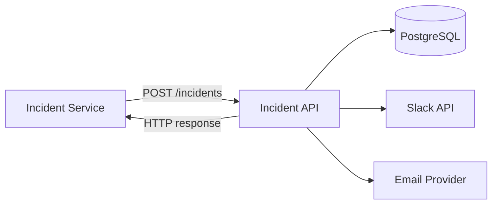
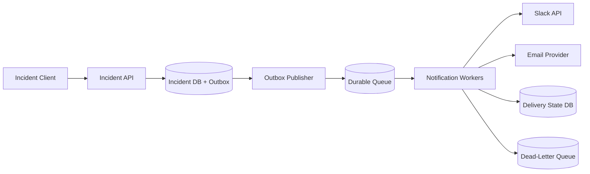
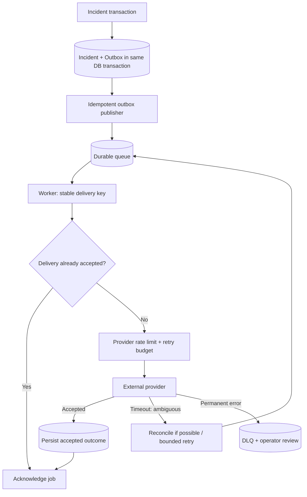
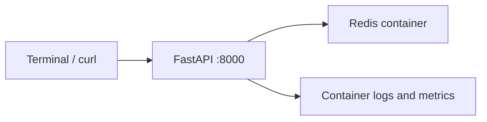

# Daily Architecture Incident Lab — Lesson 02

## Designing a Reliable Notification System: Sync vs Async, Queues, Retries, and Duplicate Delivery

**Date:** 2026-11-07  
**Duration:** 20–25 minutes (plus optional lab)  
**Level:** System-design foundations → production SRE investigation  
**Prerequisite:** Lesson 01, requirements/capacity estimation and the distinction between symptoms and design flaws  
**Scenario:** Hypothetical production incident; all logs, metrics, and numbers are illustrative, not observations from a real service.

### Learning objectives

By the end, you should be able to: (1) decide when synchronous versus asynchronous delivery is appropriate; (2) estimate peak notification traffic and queue capacity; (3) reason about at-least-once delivery, idempotency, and the impossibility of promising exactly-once external side effects without provider cooperation; (4) investigate queue backlog and duplicate notifications; and (5) justify a redesign with explicit failure and recovery behavior.

---

## 1. Start with the business problem (3 minutes)

An operations platform sends Slack and email notifications when incidents are created, assigned, or resolved. A critical incident should trigger a notification promptly; temporary Slack or email outages must not block incident creation.

**Functional requirements**

1. Accept an incident event containing `event_id`, `incident_id`, `event_type`, recipients, and timestamp.
2. Route notifications to Slack and/or email according to subscription preferences.
3. Record delivery attempts, outcomes, and provider message IDs where available.
4. Retry transient failures, but not permanent errors (for example, invalid destination).
5. Provide an operator view of pending, delivered, failed, and dead-lettered messages.

**Nonfunctional requirements (proposed, to negotiate)**

| Dimension | Design target | What must be clarified |
|---|---|---|
| API availability | 99.9% monthly | Is this incident API or notification API availability? |
| Acceptance latency | p95 < 200 ms | Measured from client to durable acceptance, not external delivery |
| Delivery latency | 99% within 60 s in healthy-provider conditions | Provider outages require separate degraded-mode SLO |
| Durability | No acknowledged event lost after one node crash | Requires durable broker/DB and tested recovery |
| Duplicate handling | No duplicate *logical* delivery for normal retries | Absolute prevention at external providers may be impossible |
| Security | Signed/authenticated ingress; scoped provider credentials | Protect incident and recipient data in logs |
| Operations | Queue age, retries, DLQ, provider errors visible | Ownership, alert routing, runbooks |

**Architect's first question:** Does “notification sent” mean accepted by our API, stored durably, accepted by Slack/email, or actually seen by a person? These are different milestones and must not share one misleading status.

**Out of scope for v1:** rich templates, campaign scheduling, multi-region active-active, user-facing analytics, and guaranteed human acknowledgement.

## 2. Capacity and queue sizing (3 minutes)

Assume **200,000 incident-related events/day**, **2 notification destinations per event**, and a **10× peak-to-average factor**.

```text
Average event rate = 200,000 / 86,400 = 2.31 events/s
Average delivery jobs = 2.31 × 2 = 4.63 jobs/s
Peak delivery jobs = 4.63 × 10 ≈ 46.3 jobs/s
```

A single event can fan out to multiple recipients. Capacity should be calculated in **delivery jobs**, not merely incoming events.

Suppose a provider is unavailable for **30 minutes** at peak arrival rate:

```text
Backlog = 46.3 jobs/s × 1,800 s ≈ 83,340 jobs
```

If workers can process **100 jobs/s** after recovery while new work still arrives at **46.3 jobs/s**, net drain rate is **53.7 jobs/s**:

```text
Drain time ≈ 83,340 / 53.7 ≈ 1,552 s ≈ 26 minutes
```

This is an optimistic estimate: it assumes successful provider throughput of 100 jobs/s, no further throttling, negligible retry overhead, and steady arrivals. If the provider permits only 30 requests/s, the backlog **cannot drain** while arrivals remain 46.3/s. The architect must negotiate quotas, priorities, and degraded-mode expectations.

**Sizing prompts:** What is the maximum retained message size? How long do we retain failed jobs? How does burst fan-out affect memory/disk? What happens when an outage lasts 24 hours rather than 30 minutes?

## 3. Design incrementally (4 minutes)

### Version A — synchronous delivery



**Benefit:** Easy to implement and understand. **Problem:** If Slack takes 8 seconds or fails, incident creation may be slow or fail despite the incident being stored. The request thread also holds resources while waiting for external services.

**Decision:** Do not make incident creation depend on external notification success. But merely spawning a Python background thread is insufficient: a process crash can lose work after the API responds.

### Version B — durable asynchronous processing



**Critical transaction boundary:** The incident row and its outbox event are inserted **in the same database transaction**. This prevents the dual-write gap in which the incident commits but publishing to the queue fails. An outbox publisher asynchronously forwards committed outbox rows to the broker and marks them published. The publisher can publish twice after a crash, so consumers must still be idempotent.

**Why each component exists**

| Component | Responsibility | Trade-off |
|---|---|---|
| Incident API + PostgreSQL | Authoritative incident and outbox state | Database availability still matters for acceptance |
| Outbox publisher | Reliably bridge DB commit to broker | Additional process and duplicate-publication possibility |
| Durable queue | Buffer bursts, decouple provider latency | Backlog, retention, broker operations |
| Workers | Control concurrency, retries, routing | Duplicate deliveries if retry semantics are careless |
| Delivery state | Audit attempts and deduplicate logical jobs | Atomicity with external API remains difficult |
| DLQ | Isolate exhausted/permanent failures | Requires triage and safe replay process |

**Queue choice:** A managed queue is attractive when operational overhead matters; RabbitMQ is useful for explicit routing/acknowledgement semantics; Kafka is attractive for replayable high-throughput event streams. Choose based on retention, ordering, throughput, replay, operating skills, and cloud constraints—not popularity. This lesson uses generic durable-queue semantics; command examples below show RabbitMQ as one possible implementation.

### State machine and acknowledgement

```mermaid
stateDiagram-v2
    [*] --> Pending
    Pending --> InFlight: worker claims job
    InFlight --> Delivered: provider accepted; persist outcome
    InFlight --> RetryScheduled: transient failure / timeout
    RetryScheduled --> InFlight: backoff elapsed
    InFlight --> DeadLettered: permanent failure or attempts exhausted
    Delivered --> [*]
    DeadLettered --> [*]
```



A worker should acknowledge the broker message **after** it durably records the outcome. If it crashes after provider acceptance but before recording/acknowledgement, the message can be redelivered. That is a fundamental duplicate-delivery window.

### Idempotency model

Create a stable logical delivery key such as:

```text
(event_id, channel, recipient_id, notification_type)
```

Use a unique constraint on that key in delivery state. Do **not** generate a fresh logical key on every retry. Maintain separate `attempt_id` values for observability. A database unique constraint prevents duplicate logical job records, but **does not guarantee** that an external provider receives only one request. If a provider supports idempotency keys, send the stable key; otherwise document at-least-once behavior and mitigate duplicates with reconciliation and provider-specific capabilities.

**Ordering:** If “resolved” arrives before “created,” do you suppress, reorder, or send both? Ordering may be required per incident, not globally. A queue with multiple consumers does not automatically preserve processing completion order.

## 4. Hypothetical production incident: duplicate Slack alerts (3 minutes)

**Observed symptoms in the simulation:** During a provider slowdown, some responders receive the same critical incident notification 3–5 times. The queue grows, yet workers appear healthy.

| Local time | Simulated observation |
|---|---|
| 09:00 | 40 jobs/s, queue age 2 s, duplicate rate near zero |
| 09:05 | Slack API latency rises from 0.3 s to 9 s |
| 09:06 | Worker HTTP timeout remains 5 s; retry attempts increase |
| 09:08 | Oldest queued message reaches 90 s |
| 09:10 | Operators report repeated Slack notifications |
| 09:12 | Worker logs show timeouts, then repeated deliveries of the same `event_id` |

**Initial hypotheses:** (H1) publisher emitted duplicate jobs; (H2) broker redelivered unacknowledged messages; (H3) provider accepted messages but the client timed out before receiving confirmation; (H4) workers generate new delivery IDs on retry; (H5) a scheduled retry mechanism races with broker redelivery. Multiple hypotheses may be true simultaneously.

### Example logs (illustrative)

```text
09:06:01 worker=notify-2 event_id=evt-742 attempt=1 channel=slack POST started
09:06:06 worker=notify-2 event_id=evt-742 attempt=1 error=ReadTimeout timeout_s=5
09:06:07 worker=notify-2 event_id=evt-742 attempt=2 channel=slack POST started
09:06:10 provider_audit event_id=evt-742 accepted_at=09:06:04 provider_message_id=msg-991
09:06:12 worker=notify-2 event_id=evt-742 attempt=2 response=200 provider_message_id=msg-997
```

The first request may have succeeded at the provider even though the worker timed out. The second request then creates a duplicate. A timeout means **unknown outcome**, not necessarily failed delivery.

## 5. Evidence-driven SRE investigation (5 minutes)

Use the following sequence in an authorized test/production environment. Command outputs are **examples**, not guaranteed values. Adjust service names and endpoints to your deployment.

### Step 1 — establish impact and timeline

```bash
# On the application host (systemd example):
journalctl -u notification-worker --since '2026-11-07 09:00:00' --until '2026-11-07 09:20:00' --no-pager \
  | grep -E 'evt-742|ReadTimeout|retry|ack'
```

Ask: Are duplicates confined to Slack? Do they coincide with provider latency? Are incident records duplicated too, or only notification deliveries? If only Slack duplicates, investigate delivery semantics before incident creation.

### Step 2 — inspect broker backlog and redelivery

```bash
# RabbitMQ example; requires management CLI access:
rabbitmqctl list_queues name messages_ready messages_unacknowledged consumers
```

Illustrative output:

```text
name                 messages_ready  messages_unacknowledged  consumers
notification.slack   8200            120                      6
notification.email   30              5                        4
```

`messages_ready` increasing suggests arrivals exceed effective processing. `messages_unacknowledged` reveals messages currently delivered to consumers but not acknowledged. These counts **do not alone prove** why duplicates occur. Inspect consumer restarts, acknowledgement behavior, and retry scheduling.

### Step 3 — inspect provider timeouts and worker configuration

```bash
systemctl show notification-worker -p NRestarts -p ActiveState
journalctl -u notification-worker --since '15 minutes ago' --no-pager | grep -c 'ReadTimeout'
ss -tan | grep ':443' | head
```

`ss` can show TCP connection states but does not identify HTTP-level provider acceptance. Compare the configured **5 s client timeout** with provider p95/p99 response times and the queue visibility/ack timeout. A too-short timeout can increase ambiguous outcomes and retries; an excessively long timeout can exhaust worker concurrency. Tune using measured distributions and a bounded end-to-end retry budget.

### Step 4 — correlate delivery state in PostgreSQL

A minimal schema could contain `delivery_key`, `event_id`, `attempt_id`, `status`, `provider_message_id`, and timestamps. Query using your actual schema:

```sql
SELECT event_id, COUNT(*) AS attempts,
       COUNT(DISTINCT provider_message_id) AS provider_messages
FROM notification_attempts
WHERE created_at >= NOW() - INTERVAL '30 minutes'
GROUP BY event_id
HAVING COUNT(*) > 1
ORDER BY attempts DESC
LIMIT 20;
```

Example:

```text
event_id  attempts  provider_messages
evt-742   3         2
```

Interpretation: multiple attempts occurred, and at least two distinct provider message IDs were recorded. This is stronger evidence of duplicate external delivery than a retry counter alone. If provider message IDs are absent, inspect provider audit logs where permitted; do not infer external delivery solely from local timeouts.

### Step 5 — inspect traces and metrics

Trace path:

```text
incident.create -> outbox.insert -> publisher.publish -> worker.consume
  -> slack.post [timeout at 5 s] -> retry.wait -> slack.post [200]
```

Useful metrics (example PromQL; metric names depend on instrumentation):

```promql
# Rate of attempted provider requests by outcome
sum by (provider, outcome) (rate(notification_provider_requests_total[5m]))

# p95 provider latency (requires histogram buckets)
histogram_quantile(0.95,
  sum by (le, provider) (rate(notification_provider_duration_seconds_bucket[5m])))

# Oldest queue message age, if exported
max by (queue) (notification_queue_oldest_age_seconds)

# Logical duplicates detected by delivery key
sum(rate(notification_duplicate_delivery_detected_total[5m]))
```

**Important:** The last metric measures duplicates *detected by your system*, not all duplicates visible to recipients. External-provider outcomes may remain uncertain without provider-side evidence.

### Step 6 — prove or reject each hypothesis

| Hypothesis | Confirming evidence | Disconfirming evidence |
|---|---|---|
| Publisher duplicates | Same outbox ID published twice | Single publish with multiple worker attempts |
| Broker redelivery | Redelivered flag, consumer restart, unacked expiry | Explicit app-scheduled retries without broker redelivery |
| Provider accepted before timeout | Provider audit timestamp/message ID precedes client timeout | Provider shows no accepted first request (if audit complete) |
| Unstable idempotency key | New delivery key on each attempt | Stable key across attempts |
| Retry race | Both scheduled retry and broker redelivery for same logical job | Only one retry mechanism active |

**Investigation principle:** Do not treat correlation as proof. Establish which boundary lost certainty and whether the provider actually performed the side effect.

## 6. Root cause and design analysis (2 minutes)

| Layer | Finding in this simulation |
|---|---|
| Symptom | Responders receive repeated Slack messages |
| Immediate mechanism | Worker retries after a 5-second read timeout |
| Root cause | Provider accepted the first request, but the worker did not receive confirmation before timeout; retry created another message |
| Design weakness | External side effect lacked provider-supported idempotency/reconciliation; system treated timeout as definite failure |
| Amplifier | Growing queue and aggressive retries increased provider pressure |

**Exactly-once warning:** A queue may deliver a job at least once, and a database can enforce one logical delivery record, but neither can atomically commit an external Slack/email side effect with your database transaction. Avoid claiming end-to-end exactly-once delivery unless the provider participates in an appropriate idempotent protocol.

## 7. Mitigation, redesign, and validation (3 minutes)

**Immediate incident actions (controlled):** Reduce retry concurrency and apply exponential backoff with jitter; honor `Retry-After` for provider throttling; pause or rate-limit low-priority notifications; preserve queue messages and delivery evidence; avoid bulk replay until duplicate behavior is understood. If available, query provider state before retrying ambiguous outcomes. Do not delete the backlog just to clear an alert.

**Durable improvements:**

1. **Stable delivery key** per event/channel/recipient; unique constraint for logical jobs.
2. **Provider idempotency key** where supported. If unavailable, accept and document residual duplicate risk; consider safe reconciliation or a “possibly delivered” state for ambiguous outcomes.
3. **Explicit retry policy:** transient 429/5xx/network failures; bounded attempts; exponential backoff and jitter; respect provider rate limits. Permanent 4xx (except rate limits and selected recoverable errors) go to DLQ.
4. **Outbox transaction:** commit incident and event atomically, with idempotent outbox publishing.
5. **Backpressure:** bounded worker concurrency, provider-specific token buckets, queue-age alerts, priority lanes for critical incidents.
6. **DLQ operations:** include reason, attempt history, original event ID, safe replay tooling, and ownership.
7. **State model:** `pending`, `in_flight`, `accepted`, `ambiguous`, `failed_permanent`, `dead_lettered`; distinguish provider acceptance from human receipt.

### Redesigned delivery flow



**Validation plan:** Inject provider delays of 1, 5, and 10 seconds; force worker termination after provider acceptance but before acknowledgement; simulate 429 with `Retry-After`; test 30-minute provider outage; replay one outbox record; assert no lost acknowledged incident events, bounded queue growth, measured recovery time, and clearly documented duplicate behavior. Observe queue age, successful deliveries, ambiguous outcomes, and provider-side duplicate messages. Do not claim “zero duplicates” unless your provider guarantees idempotency for the tested path.

**Runbook triggers:** alert on oldest critical-job age > 60 s for 5 minutes, provider error rate > 5% for 5 minutes, DLQ growth, and retry amplification (attempts / logical jobs) above an agreed threshold. Calibrate thresholds to real SLOs and baseline traffic.

---

## 8. Optional practical lab: observe duplicate side effects (10–15 extra minutes)

This small Python standard-library simulation models a provider that **accepts** a notification before the client times out. It is not a real HTTP or durable-queue implementation.

Save as `ambiguous_delivery_demo.py`:

```python
import time

provider_messages = []


def provider_send(delivery_key):
    provider_messages.append(delivery_key)  # external side effect occurs
    time.sleep(0.2)                          # response delayed
    return "accepted"


def worker_send(delivery_key, timeout_s=0.1):
    started = time.monotonic()
    result = provider_send(delivery_key)
    if time.monotonic() - started > timeout_s:
        raise TimeoutError("response exceeded client deadline")
    return result


for attempt in (1, 2):
    try:
        worker_send("evt-742:slack:oncall")
    except TimeoutError:
        print(f"attempt={attempt} outcome=unknown; retrying")

print("provider-side messages:", len(provider_messages))
```

Run:

```bash
python3 ambiguous_delivery_demo.py
```

Expected:

```text
attempt=1 outcome=unknown; retrying
attempt=2 outcome=unknown; retrying
provider-side messages: 2
```

**Observe:** The client reports timeouts while the provider side effect occurred twice. **Extension:** Modify the fake provider to maintain a `seen_delivery_keys` set and ignore repeated keys. Compare the results. In real systems, in-memory sets are not durable or cross-instance; the exercise demonstrates the concept, not a production solution.

---

## 9. Architect challenges — answer before reading any solution

**Challenge 1 — Sync or async?** A Sev-1 incident must be committed in < 300 ms, and Slack sometimes takes 8 s. Draw the transaction boundary and explain what HTTP response you return when the incident is saved but the notification is pending. What changes if the queue is unavailable?

**Challenge 2 — Backlog mathematics.** Your notification queue receives 150 jobs/s. Workers can successfully send 100 jobs/s. Starting from an empty queue, estimate backlog after 20 minutes. If you double workers but the provider quota remains 100 jobs/s, does the backlog improve? Propose two feasible remedies and their trade-offs.

**Challenge 3 — Ambiguous delivery.** A worker posts to Slack, times out, and crashes before writing delivery status. The broker redelivers the job. Design a recovery policy. What can you guarantee if the provider has no idempotency or lookup API? Which metrics would expose residual duplicates?

### Repeatable architect's decision checklist

**Requirements → Workload → Data/transaction boundaries → Baseline design → Failure modes → Backpressure/recovery → Observability → Trade-offs → Validation.** Always state what the system guarantees and what it cannot guarantee.

### Codemia connection

This lesson maps to common public system-design curriculum themes: synchronous vs asynchronous communication, message queues, reliability, consistency, and scaling. The daily lab adds operational investigation and failure-injection reasoning. No paid Codemia content is reproduced or assumed.

### Suggested GitHub location

`/tutorials/daily-architecture-lab/lesson-02-reliable-notification-system.md`

---

## Practical Labs

**LEARN → DESIGN → BUILD → BREAK → INVESTIGATE → FIX → VALIDATE**

> **Scope:** An additional runnable local exercise; the complete architecture lesson and original optional exercise above remain intact. Estimated hands-on time: 35–60 minutes. Run on **Mac Docker Desktop** (preferred for multi-container workloads) or **Ubuntu VM** with Docker Engine + Compose plugin installed. All services bind to loopback and use a dedicated Compose project. This is a disposable lab, never production.

### LEARN — Experiment and expected failure

**Scenario:** Notification worker crash and retry. A Redis LPOP followed by a process crash can lose an item. Propose Streams consumer groups, a pending-entry recovery policy, and a durable idempotency ledger.

### DESIGN — Local topology



Create a dedicated directory `architecture-lab-02`. Run all commands below from it on the **Mac terminal** or **Ubuntu VM shell**, whichever runs Docker. Do not run them inside another existing application container.

```bash
mkdir -p architecture-lab-02/app architecture-lab-02/tests
cd architecture-lab-02
touch app/__init__.py
docker compose version
```

### BUILD — Complete minimal application

Directory layout:

```text
architecture-lab-02/
├── app/
│   ├── __init__.py
│   └── main.py
├── tests/
│   └── test_health.py
├── requirements.txt
├── Dockerfile
└── compose.yaml
```

**File: `app/main.py`**

```python
from fastapi import FastAPI, HTTPException
from pydantic import BaseModel
from redis import Redis
import os
app=FastAPI()
r=Redis(host="redis",decode_responses=True)
class Notification(BaseModel):
    id: str
    message: str
@app.post("/notifications",status_code=202)
def submit(n:Notification):
    if r.set("accepted:"+n.id,"1",nx=True):
        r.rpush("queue",n.model_dump_json())
    return {"id":n.id,"status":"accepted"}
@app.post("/worker/once")
def consume():
    item=r.lpop("queue")
    if not item: return {"status":"empty"}
    n=Notification.model_validate_json(item)
    if os.getenv("FAIL_BEFORE_SEND")=="1":
        r.lpush("queue",item)
        raise HTTPException(503,"simulated downstream failure; requeued")
    if r.set("delivered:"+n.id,n.message,nx=True):
        r.incr("delivery_count")
    return {"status":"delivered","id":n.id}
@app.get("/stats")
def stats(): return {"queued":r.llen("queue"),"delivered":int(r.get("delivery_count") or 0)}
@app.get("/health")
def health(): return {"status":"ok"}
```

**File: `requirements.txt`**

```text
fastapi==0.115.12
uvicorn==0.34.2
redis==5.2.1
httpx==0.28.1
pytest==8.3.5
```

**File: `Dockerfile`**

```dockerfile
FROM python:3.11-slim
WORKDIR /code
COPY requirements.txt .
RUN pip install --no-cache-dir -r requirements.txt
COPY app ./app
CMD ["uvicorn","app.main:app","--host","0.0.0.0","--port","8000"]
```

**File: `compose.yaml`**

```yaml
services:
  api:
    build: .
    ports: ["127.0.0.1:18002:8000"]
    environment:
      FAIL_BEFORE_SEND: "${FAIL_BEFORE_SEND:-0}"
    depends_on: [redis]
  redis:
    image: redis:7-alpine
```

**File: `tests/test_health.py`**

```python
def test_health():
    from fastapi.testclient import TestClient
    from app.main import app
    assert TestClient(app).get("/health").status_code == 200
```

Start the lab and wait for the API:

```bash
docker compose -p archlab02 up -d --build
docker compose -p archlab02 ps
curl -fsS http://127.0.0.1:18002/health
```

**Expected:** the API reports `{"status":"ok"}`. On the first startup, the image build may take a few minutes. If a dependency is not ready, wait a few seconds and retry; inspect `docker compose ... logs` rather than assuming a design fault.

### VALIDATE baseline — Prove healthy operation before injecting faults

```bash
curl -s -X POST http://127.0.0.1:18002/notifications -H 'Content-Type: application/json' -d '{"id":"n1","message":"page oncall"}'
curl -s -X POST http://127.0.0.1:18002/worker/once
curl -s http://127.0.0.1:18002/stats
```

**Expected observations:** Simulated 503 requeues n2; after restoring the worker, queue reaches zero and delivered count increments. This is a teaching simulation, not a crash-atomic production queue.

### BREAK — Introduce ONE controlled failure

Only use the dedicated `archlab02` Compose project; do not target existing databases or application containers.

```bash
FAIL_BEFORE_SEND=1 docker compose -p archlab02 up -d --build --force-recreate api
curl -s -X POST http://127.0.0.1:18002/notifications -H 'Content-Type: application/json' -d '{"id":"n2","message":"alert"}'
curl -i -X POST http://127.0.0.1:18002/worker/once
```

### INVESTIGATE — Collect evidence before fixing

```bash
docker compose -p archlab02 logs --tail=40 api
curl -s http://127.0.0.1:18002/stats
```

**Reasoning checklist:** Which component is unavailable or slow? Is the error a connection refusal, timeout, invalid schema, queue backlog, or application exception? Which log or metric proves your hypothesis? What observation would disprove it? Separate trigger, root cause, and design weakness.

### FIX — Restore service and improve the design

```bash
FAIL_BEFORE_SEND=0 docker compose -p archlab02 up -d --force-recreate api
curl -s -X POST http://127.0.0.1:18002/worker/once
curl -s http://127.0.0.1:18002/stats
```

**Design discussion:** A Redis LPOP followed by a process crash can lose an item. Propose Streams consumer groups, a pending-entry recovery policy, and a durable idempotency ledger.

### VALIDATE — Automated checks and safe cleanup

To run the included lightweight API health test **inside the disposable API container**:

```bash
docker compose -p archlab02 exec api python -m pytest -q tests || true
```

**Note:** the Dockerfile above intentionally copies only `app/` into the image; to execute the test, run it on the host in a Python virtual environment instead, or copy the test directory into your local Dockerfile before rebuilding. The `|| true` command is a demonstration only; do not interpret it as a passing test. Recommended host test:

```bash
python3 -m venv .venv
. .venv/bin/activate
pip install -r requirements.txt
pytest -q tests
deactivate
```

Expected: `1 passed` (the test checks only the API health endpoint; the manual failure and recovery commands are the scenario-specific integration validation). Record actual output, not an assumed result.

Cleanup **only this lesson's project**. Use `down` to keep named data volumes; use `down -v` only if you intentionally want to delete this disposable lab's database state.

```bash
docker compose -p archlab02 down
# OPTIONAL destructive cleanup of ONLY this lab's named volumes:
# docker compose -p archlab02 down -v
```

**Your lab evidence:** baseline response: _..._; injected failure: _..._; commands and findings: _..._; root cause versus systemic weakness: _..._; recovery verification: _..._; improvement proposal: _..._.

## My Architecture Review — Solutions & Doubts

> **Learner instructions:** Fill in these sections after reading. Keep your initial reasoning, even if uncertain. Share the updated Markdown or GitHub link for mentor feedback. Do not delete the original questions; your reasoning history matters.

### 1. My Understanding

**In my own words, the design problem is:**

> [Write here]

**Why I chose sync/async and the key transaction boundary:**

> [Write here]

**What I can and cannot guarantee about notification delivery:**

> [Write here]

### 2. My Solutions to the Architect Challenges

**Challenge 1 — Sync or async?**

- My architecture / diagram: [Add Mermaid diagram or description]
- My decision and reasoning: [Write here]
- Failure behavior and API response: [Write here]

**Challenge 2 — Backlog mathematics**

- My calculations: [Show equations]
- My proposed remedies: [Write here]
- Trade-offs: [Write here]

**Challenge 3 — Ambiguous delivery**

- My recovery design: [Write here]
- Guarantees and limitations: [Write here]
- Metrics and validation tests: [Write here]

### 3. My Troubleshooting Approach

**My first three hypotheses:**

1. [Hypothesis]
2. [Hypothesis]
3. [Hypothesis]

**Commands / tools I would use, in order, and why:**

```text
[Command or query] -> [Expected evidence] -> [Decision based on result]
```

**Evidence that would change my diagnosis:**

> [Write here]

### 4. My Proposed Architecture Improvements

**Changes I would prioritize:**

1. [Change, why, and priority]
2. [Change, why, and priority]

**Trade-offs, costs, and new failure modes:**

> [Write here]

**How I would validate the redesign:**

> [Write here]

### 5. My Doubts / Questions

- [ ] [Question 1]
- [ ] [Question 2]
- [ ] [Question 3]

### 6. Lessons Learned

**Three things I learned:**

1. [Learning]
2. [Learning]
3. [Learning]

**One idea I can apply to my own SRE/automation work:**

> [Write here]

### 7. Mentor Review

**Feedback:**

> [To be completed during review]

**Corrections / misunderstandings:**

> [To be completed during review]

**Next improvements / follow-up exercise:**

> [To be completed during review]
