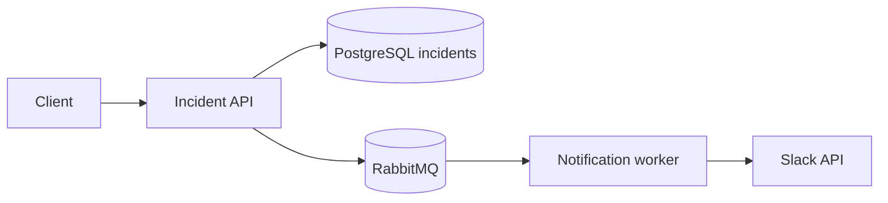
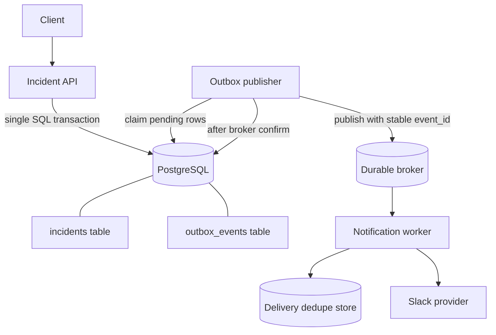
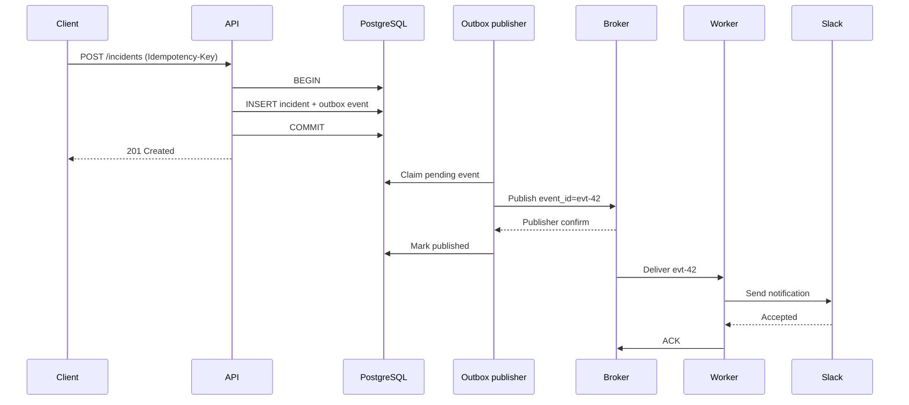
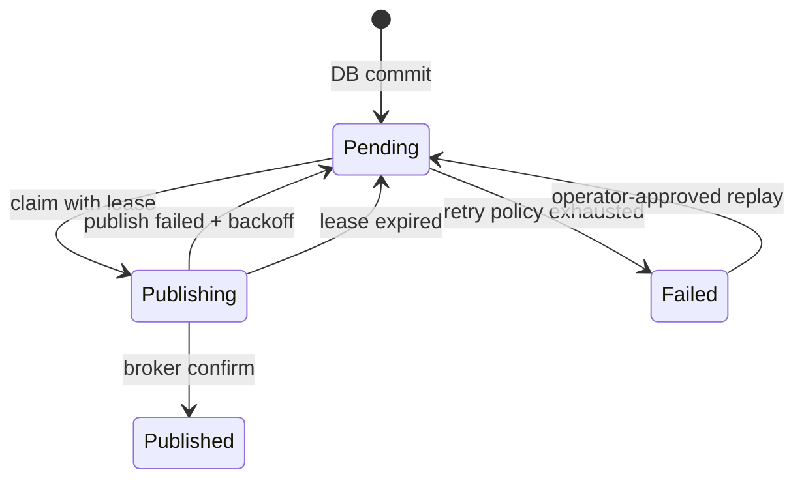
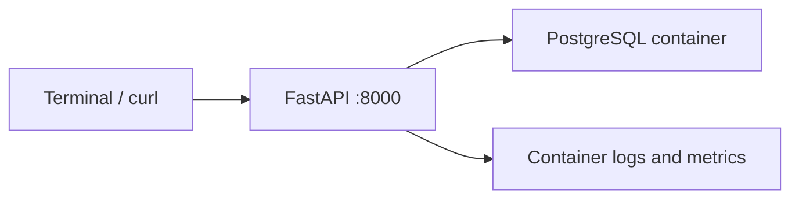

# Daily Architecture Incident Lab — Lesson 03

## Delivery Guarantees, Idempotency, and the Transactional Outbox

**Date:** 2026-11-08  
**Duration:** 20–25 minutes (optional lab adds 15–20 minutes)  
**Level:** Experienced SRE → System/Platform Architect  
**Builds on:** Lesson 02 (sync vs async notification delivery and queue retries)  
**Scenario:** **Hypothetical simulated production incident**. All organizations, metrics, traces, log lines, and command outputs below are illustrative, not measurements from a real system.

> **Guiding question:** If an incident was committed to PostgreSQL but the notification never appeared in the queue, how do you prove the event will eventually be published without creating duplicates?

## Learning outcomes and 25-minute route

| Time | Activity | Outcome |
|---|---|---|
| 0–4 min | Define guarantees and requirements | Distinguish database commit, queue publish, and external delivery |
| 4–9 min | Estimate capacity and evolve the design | Identify the dual-write failure window |
| 9–15 min | Investigate a hypothetical outage | Use evidence to isolate a missing event |
| 15–20 min | Redesign with outbox + idempotency | Explain recoverability and duplicate suppression |
| 20–25 min | Validation and architect challenges | Defend your trade-offs independently |

## 1. LEARN — Start from the business problem

An incident management API creates an incident and triggers a Slack notification. During an outage, an incident must **not silently lose its notification**. The API must remain fast even if the broker or Slack is slow.

### Functional requirements

1. Create an incident and assign a stable `incident_id`.
2. Record the intent to notify the on-call team.
3. Publish the notification event for asynchronous delivery.
4. Retry transient failures; make failed deliveries inspectable.
5. Prevent duplicate *business effects* where technically possible.
6. Expose incident status independently of notification delivery status.

### Nonfunctional requirements and explicit assumptions

| Requirement | Design target |
|---|---|
| API latency | p95 < 300 ms, excluding client network latency |
| Incident write durability | No acknowledged incident without a durable notification intent |
| Notification timeliness | 99% of eligible notifications reach the provider attempt stage within 60 s |
| Broker outage | Incident creation continues while DB has capacity; queued work catches up later |
| Delivery semantics | At-least-once processing; no unconditional end-to-end exactly-once promise |
| Retention | Outbox records retained 7 days after successful publication (illustrative policy) |
| Security | Do not log message bodies, tokens, or sensitive incident details |

**Scope distinction:** The platform can guarantee an event is durably recorded and retried; it cannot guarantee a human reads a Slack message. Even provider acceptance is not the same as user-visible delivery.

### Capacity estimate

Assume **500,000 incidents/day**, one primary notification per incident, **10× peak**, and an average outbox row of **1.5 KB**.

```text
Average incident writes = 500,000 / 86,400 ≈ 5.8 writes/s
Peak incident writes ≈ 58 writes/s
Average outbox data/day ≈ 500,000 × 1.5 KB = 750 MB/day
7 days raw outbox payload ≈ 5.25 GB (excluding indexes, WAL, bloat, replicas)
```

Assume an outage of 30 minutes at **58 events/s**:

```text
Backlog ≈ 58 × 1,800 = 104,400 events
At 200 successfully published events/s after recovery,
net drain ≈ 200 - 58 = 142 events/s
Drain time ≈ 104,400 / 142 ≈ 735 s ≈ 12.3 minutes
```

This calculation assumes the publisher can actually sustain 200 successful publishes/s, the DB can support polling, and incoming traffic stays at 58/s. Always test these assumptions.

## 2. Why naïve dual writes fail

### Version A: Database first, then publish



Pseudo-code:

```python
incident_id = insert_incident_and_commit(payload)
publish_event({"incident_id": incident_id})
return {"incident_id": incident_id}, 201
```

**Failure window:** The database commit succeeds, then the process crashes before `publish_event`. The incident exists, but the broker never receives an event. A retry of the HTTP request may create a second incident unless the API has its own idempotency key.

### Version B: Publish first, then database commit

```python
publish_event({"incident_id": incident_id})
insert_incident_and_commit(payload)
```

Now the broker can deliver a notification for an incident that never committed. **Changing write order does not make two independent systems atomic.**

### Guarantees to distinguish

| Guarantee | What it actually means | Main risk |
|---|---|---|
| At-most-once | An attempt may be lost; no retry after uncertainty | Missing notification |
| At-least-once | Retry until acknowledged; duplicates possible | Repeated effects |
| Exactly-once effect | Business outcome applied once, using dedupe/transactions where possible | Requires carefully scoped boundaries |

RabbitMQ publisher confirms and consumer acknowledgements solve different problems. **Publisher confirm** indicates the broker has accepted responsibility according to its configuration; **consumer ack** tells the broker it can remove a delivery. Neither proves Slack displayed the message.

## 3. INTEGRATE — Transactional outbox architecture

### Version C: Commit incident and intent together





**The transaction guarantees:** Either both the incident and notification intent exist, or neither exists. It does **not** atomically commit the broker publication with the database update. If the publisher crashes after broker confirm but before marking the row published, it may republish the same event. That is expected: consumers must tolerate duplicates.

### Minimal PostgreSQL schema (illustrative)

```sql
CREATE TABLE incidents (
    incident_id UUID PRIMARY KEY,
    request_key TEXT UNIQUE NOT NULL,
    title TEXT NOT NULL,
    created_at TIMESTAMPTZ NOT NULL DEFAULT now()
);

CREATE TABLE outbox_events (
    event_id UUID PRIMARY KEY,
    aggregate_id UUID NOT NULL REFERENCES incidents(incident_id),
    event_type TEXT NOT NULL,
    payload JSONB NOT NULL,
    status TEXT NOT NULL DEFAULT 'pending',
    attempts INTEGER NOT NULL DEFAULT 0,
    next_attempt_at TIMESTAMPTZ NOT NULL DEFAULT now(),
    claimed_until TIMESTAMPTZ,
    published_at TIMESTAMPTZ,
    created_at TIMESTAMPTZ NOT NULL DEFAULT now(),
    CHECK (status IN ('pending', 'publishing', 'published', 'failed'))
);

CREATE INDEX outbox_ready_idx
    ON outbox_events (next_attempt_at, created_at)
    WHERE status IN ('pending', 'publishing');
```

**Production caution:** A `publishing` claim needs an expiring lease (`claimed_until`) so a crashed publisher does not strand events forever. Use a bounded batch, `FOR UPDATE SKIP LOCKED`, and a short transaction to claim rows; release the transaction before network I/O. Do not hold row locks while waiting on RabbitMQ.

### Claiming work without holding a lock during network I/O

```sql
-- Run in a short transaction; :lease_seconds is a configured parameter.
WITH ready AS (
    SELECT event_id
    FROM outbox_events
    WHERE (status = 'pending' AND next_attempt_at <= now())
       OR (status = 'publishing' AND claimed_until < now())
    ORDER BY created_at
    FOR UPDATE SKIP LOCKED
    LIMIT 100
)
UPDATE outbox_events o
SET status = 'publishing',
    attempts = attempts + 1,
    claimed_until = now() + interval '30 seconds'
FROM ready
WHERE o.event_id = ready.event_id
RETURNING o.event_id, o.aggregate_id, o.event_type, o.payload;
```

After a **positive broker confirm**, update the row to `published`. After a publish failure, set `status='pending'`, clear the claim, and schedule `next_attempt_at` with bounded exponential backoff plus jitter. A worker that exceeds its lease can cause concurrent republishing; a stable `event_id` and consumer dedupe are therefore mandatory. A real implementation should use claim ownership tokens to prevent a stale publisher from overwriting a newer claimant's state.

### Idempotency: three separate boundaries

1. **API request idempotency:** Client sends a stable request key; `incidents.request_key UNIQUE` prevents duplicate incidents when HTTP responses are lost. Return the original result for the same key and payload; reject key reuse with conflicting payload.
2. **Broker/consumer idempotency:** Each event has a stable `event_id`. A worker can use a unique constraint to avoid repeating local DB updates.
3. **External provider effect:** A database dedupe record alone cannot make a Slack API call exactly once if the worker crashes between Slack acceptance and recording success. Use a provider-supported idempotency key if available for the exact API operation; otherwise accept residual duplicate risk and design reconciliation/visibility. Do **not** assume every Slack API supports an idempotency key.

### Component trade-offs

| Choice | Benefit | Cost / limitation |
|---|---|---|
| Transactional outbox in PostgreSQL | No committed incident without durable event intent | Polling load, cleanup, duplicate publications |
| CDC-based outbox relay | Lower polling overhead, ordered log consumption | Additional infrastructure and operational complexity |
| RabbitMQ durable queue + confirms | Reliable asynchronous handoff | Still at-least-once; topology and durability must be configured |
| Direct synchronous Slack call | Simple for low-value best-effort alerts | Provider latency and outage impact the API |
| Worker dedupe table | Prevents repeated local state transitions | Cannot alone guarantee exactly-once external sends |

## 4. OPERATE — Hypothetical production incident

### Symptoms and timeline (all simulated)

**09:00** — Deploy version `incident-api:2.8.1`, which inserts incidents then publishes directly to the broker.  
**09:05** — RabbitMQ network intermittently drops connections.  
**09:07** — API restarts during publication attempts.  
**09:12** — On-call reports incidents present in the UI but missing Slack alerts.  
**09:15** — Dashboard shows incident writes steady, notification publications lower than writes.

Illustrative metrics:

```text
incident_create_committed_total rate:  58/s
notification_publish_confirmed_total rate: 41/s
outbox_pending_events:                0   # old design had no outbox
notification_delivery_p99_seconds:    11.8
rabbitmq_connection_restarts_total:  +27 over 10 min
```

**Do not jump to “Slack is down.”** First determine whether the event reached the broker at all.

### Step 1 — Confirm impact and establish a time window (09:16)

```bash
# Run on the application host; adjust service name to deployment.
sudo journalctl -u incident-api --since '2026-11-08 09:00:00' \
  --until '2026-11-08 09:20:00' --no-pager | tail -n 30
```

Illustrative output:

```text
09:06:41 INFO incident_committed incident_id=inc-1842 request_id=req-991
09:06:41 ERROR broker_publish_failed incident_id=inc-1842 error=ConnectionResetError
09:07:02 INFO api_process_started version=2.8.1
```

**Interpretation:** The incident committed, but publishing failed. This is evidence of a dual-write gap, not yet proof that all missing alerts have the same cause.

### Step 2 — Check network reachability without confusing TCP with broker health (09:18)

```bash
getent hosts rabbitmq.internal
nc -vz -w 3 rabbitmq.internal 5672
ss -tnp | grep ':5672' || true
```

Illustrative output:

```text
10.20.3.15 rabbitmq.internal
Connection to rabbitmq.internal 5672 port [tcp/amqp] succeeded!
ESTAB 0 0 10.20.1.7:52344 10.20.3.15:5672 users:(("python",pid=2241,fd=18))
```

**Interpretation:** DNS and TCP connectivity work **now**. They do not disprove a transient disconnect at 09:06, nor do they establish publisher confirms.

### Step 3 — Compare DB commits with published event evidence (09:20)

```bash
# Read-only query on PostgreSQL; execute with psql using least-privileged credentials.
psql "$DATABASE_URL" -X -c "
SELECT date_trunc('minute', created_at) AS minute, count(*) AS incidents
FROM incidents
WHERE created_at >= timestamp with time zone '2026-11-08 09:00:00+05:30'
  AND created_at <  timestamp with time zone '2026-11-08 09:20:00+05:30'
GROUP BY 1 ORDER BY 1;"
```

Illustrative excerpt:

```text
minute                    | incidents
2026-11-08 09:05:00+05:30 | 3480
2026-11-08 09:06:00+05:30 | 3471
```

Correlate `incident_id` with broker publish-confirm logs or a durable publication ledger. **Do not** infer exactly which events are missing solely from aggregate counter differences; lag, retries, and differing labels can distort totals.

### Step 4 — Inspect broker queues and confirmations (09:23)

```bash
# On a RabbitMQ management host with appropriate access:
rabbitmqctl list_queues name messages_ready messages_unacknowledged consumers
rabbitmqctl list_connections name state channels
```

Illustrative output:

```text
notification.delivery  120  8  4
10.20.1.7:52344 -> 10.20.3.15:5672 running 1
```

**Interpretation:** A low queue depth does not prove all incident events were published. Events that never reached the broker cannot appear in the queue. Check exchange routing, mandatory returns, durable topology, and publisher confirms as well.

### Step 5 — Follow one event across the trace boundary (09:26)

```text
trace_id=7f1a... span=POST /incidents       status=OK     duration=81ms
trace_id=7f1a... span=postgres.commit      status=OK     duration=18ms
trace_id=7f1a... span=rabbitmq.publish     status=ERROR  duration=2200ms
trace_id=7f1a... span=notification.worker  status=ABSENT
```

**Interpretation:** The worker span is absent because the event may never have been delivered. Trace sampling or missing instrumentation can also produce absent spans; confirm with publish logs and broker evidence.

### Step 6 — State the root cause separately from the design weakness (09:30)

**Trigger/root cause in this hypothetical incident:** Intermittent broker connectivity and an API restart interrupted publication after PostgreSQL had committed an incident.

**Underlying architectural weakness:** A non-atomic dual write between PostgreSQL and RabbitMQ allowed a durable incident without a durable notification intent. Broker retries alone cannot recover an event that was never recorded for retry.

### Step 7 — Mitigate safely (09:35)

1. Roll back the direct-publish deployment if the previous version has safer behavior; assess whether rollback actually removes the dual-write risk.
2. Reconcile incidents created during the impact window against confirmed notification records. Generate **stable** recovery event IDs and deduplicate against already delivered notifications; avoid blindly replaying every incident.
3. Restore broker connectivity, check publisher confirms, and temporarily throttle recovery to avoid overwhelming Slack.
4. Monitor missing-notification counts and communicate uncertainty until reconciliation is complete.
5. Deploy the transactional outbox after validation; keep a documented replay procedure.

**Safety note:** Do not execute bulk replays or production database updates from this exercise without change review, access controls, and a dry-run comparison.

## 5. Reliability redesign and observability

### Recovery state machine



`Published` means the broker confirmed the event, **not** that Slack delivered it. Track downstream states separately: `queued`, `attempted`, `provider_accepted`, `delivery_unknown`, and `terminal_failure` as applicable.

### Observability signals

| Signal | Why it matters | Example alert hypothesis |
|---|---|---|
| `outbox_oldest_pending_age_seconds` | Detects stuck events | > 60 s for 5 min |
| `outbox_pending_total` | Measures backlog | Growing for 10 min |
| `outbox_publish_attempts_total{result}` | Identifies publish failures | Failure ratio > 5% |
| `outbox_lease_expirations_total` | Detects crashes/slow publishers | Sustained increase |
| `notification_duplicate_suppressed_total` | Measures replay behavior | Spike after failover |
| `notification_provider_unknown_total` | Exposes ambiguous timeouts | Any sustained growth |
| `incident_without_outbox_total` | Detects broken atomicity or bad migrations | Must be 0 |

Use low-cardinality labels (`service`, `region`, `result`), not `incident_id` or `event_id`. Put identifiers in structured logs and traces. Alert thresholds are illustrative and require tuning against actual SLOs.

### Validation plan before rollout

1. **Transaction rollback test:** Force outbox insert failure; verify neither incident nor outbox row commits.
2. **Crash after DB commit:** Kill API immediately after commit; verify publisher later finds the outbox row.
3. **Crash after broker confirm:** Kill publisher before marking `published`; verify event is republished with the **same** `event_id` and consumer dedupe handles it.
4. **Broker outage:** Stop broker; verify API can still commit, backlog is observable, and recovery drains it within the target.
5. **Concurrent publishers:** Run two relay instances; verify leases, `SKIP LOCKED`, and stale-owner protection.
6. **Provider timeout:** Simulate Slack accepting a request but dropping the response; explicitly document that duplicate external effects may remain possible.
7. **Capacity test:** Sustain 58 new events/s and 200 confirmed publishes/s, then validate actual backlog drain.

## 6. Optional hands-on lab (safe local simulation)

**Goal:** Observe why a stable event ID and a unique constraint make retry-safe *database effects*, without pretending to achieve exactly-once Slack delivery.

Save as `idempotency_lab.py` and run with Python 3.10+:

```python
import sqlite3

conn = sqlite3.connect(":memory:")
conn.execute("CREATE TABLE processed (event_id TEXT PRIMARY KEY)")
conn.execute("CREATE TABLE audit (event_id TEXT NOT NULL, note TEXT NOT NULL)")


def handle(event_id):
    try:
        with conn:
            conn.execute("INSERT INTO processed(event_id) VALUES (?)", (event_id,))
            conn.execute("INSERT INTO audit(event_id, note) VALUES (?, ?)",
                         (event_id, "local business effect"))
        print(f"applied {event_id}")
    except sqlite3.IntegrityError:
        print(f"duplicate suppressed {event_id}")


handle("evt-42")
handle("evt-42")
print("audit rows:", conn.execute("SELECT count(*) FROM audit").fetchone()[0])
```

Expected output:

```text
applied evt-42
duplicate suppressed evt-42
audit rows: 1
```

**Observation:** The insert and audit write share a transaction, so replay cannot duplicate the *local* audit row. If the audit operation were a Slack API call outside this transaction, this demonstration would **not** prove exactly-once notification delivery.

**Stretch exercise:** Modify the lab to simulate a crash between an external `send()` and recording the delivery result. Explain why retrying may duplicate the message.

## 7. Three independent architect challenges — do not look for an answer key

### Challenge 1 — The crash matrix

For each crash point below, predict what is durable, what may be duplicated, and what recovery should do:

- A: Before the incident/outbox transaction commits.
- B: After DB commit, before publisher claims the event.
- C: After broker confirms publish, before the outbox row is marked `published`.
- D: After Slack accepts a notification, before worker records success or acknowledges the broker.

**Deliverable:** A four-row table with *evidence you would collect* for each case.

### Challenge 2 — Backlog and capacity

A broker outage lasts **45 minutes** while incident traffic averages **75 events/s**. After recovery, incoming traffic remains 75/s, and a publisher can confirm **150 events/s** total.

Calculate backlog at recovery and approximate drain time. Then explain how the answer changes if PostgreSQL polling or provider rate limits cap *successful* throughput at 90 events/s. State whether adding worker replicas alone helps.

### Challenge 3 — Exactly-once claim review

A teammate says: “We added `processed_events(event_id UNIQUE)`, so Slack notifications are now exactly once.”

Write a short architecture review: identify the exact boundary protected by the unique constraint, one failure sequence that still causes duplicate Slack notifications, and two mitigation options with their limitations. Include what you'd tell incident stakeholders about delivery guarantees.

## 8. Connections to your existing knowledge base and labs

- Wiki system design framework: [`../framework.md`](../framework.md) — requirements, estimates, trade-offs.
- Wiki system design components: [`../components.md`](../components.md) — messaging and distributed systems patterns.
- Wiki incident management: [`../../sre/incident_management.md`](../../sre/incident_management.md).
- Hands-on implementation repository: [sre-devops-architecture-labs](https://github.com/samperay/sre-devops-architecture-labs). The async task processor project is conceptually related to queue workers; **this lesson does not claim that project already implements a transactional outbox**.
- Suggested Wiki path: `docs/sysdesign/daily-architecture-lab/lesson-03-delivery-guarantees-idempotency-outbox.md`.

## Practical Labs

**LEARN → DESIGN → BUILD → BREAK → INVESTIGATE → FIX → VALIDATE**

> **Scope:** An additional runnable local exercise; the complete architecture lesson and original optional exercise above remain intact. Estimated hands-on time: 35–60 minutes. Run on **Mac Docker Desktop** (preferred for multi-container workloads) or **Ubuntu VM** with Docker Engine + Compose plugin installed. All services bind to loopback and use a dedicated Compose project. This is a disposable lab, never production.

### LEARN — Experiment and expected failure

**Scenario:** Transactional outbox and duplicate dispatch. Contrast the lab's single-DB atomic write with a real HTTP notification provider: the external side effect cannot be rolled back with PostgreSQL.

### DESIGN — Local topology



Create a dedicated directory `architecture-lab-03`. Run all commands below from it on the **Mac terminal** or **Ubuntu VM shell**, whichever runs Docker. Do not run them inside another existing application container.

```bash
mkdir -p architecture-lab-03/app architecture-lab-03/tests
cd architecture-lab-03
touch app/__init__.py
docker compose version
```

### BUILD — Complete minimal application

Directory layout:

```text
architecture-lab-03/
├── app/
│   ├── __init__.py
│   └── main.py
├── tests/
│   └── test_health.py
├── requirements.txt
├── Dockerfile
└── compose.yaml
```

**File: `app/main.py`**

```python
import os
import psycopg
from fastapi import FastAPI
from pydantic import BaseModel
app=FastAPI()
dsn=os.environ["DATABASE_URL"]
class Event(BaseModel):
    id: str
    payload: str
def connect(): return psycopg.connect(dsn)
@app.on_event("startup")
def init():
    with connect() as db:
        db.execute("CREATE TABLE IF NOT EXISTS events(id TEXT PRIMARY KEY,payload TEXT NOT NULL)")
        db.execute("CREATE TABLE IF NOT EXISTS outbox(id TEXT PRIMARY KEY,payload TEXT NOT NULL, sent BOOLEAN NOT NULL DEFAULT FALSE)")
        db.execute("CREATE TABLE IF NOT EXISTS deliveries(id TEXT PRIMARY KEY,payload TEXT NOT NULL)")
@app.post("/events",status_code=202)
def submit(e:Event):
    with connect() as db:
        with db.transaction():
            db.execute("INSERT INTO events VALUES (%s,%s) ON CONFLICT DO NOTHING",(e.id,e.payload))
            db.execute("INSERT INTO outbox(id,payload) VALUES (%s,%s) ON CONFLICT DO NOTHING",(e.id,e.payload))
    return {"accepted":e.id}
@app.post("/dispatch")
def dispatch():
    with connect() as db:
        with db.transaction():
            rows=db.execute("SELECT id,payload FROM outbox WHERE sent=FALSE ORDER BY id FOR UPDATE SKIP LOCKED").fetchall()
            for eid,payload in rows:
                db.execute("INSERT INTO deliveries VALUES (%s,%s) ON CONFLICT DO NOTHING",(eid,payload))
                if os.getenv("FAIL_AFTER_DELIVERY")=="1":
                    raise RuntimeError("simulated crash before transaction commit")
                db.execute("UPDATE outbox SET sent=TRUE WHERE id=%s",(eid,))
    return {"dispatched":len(rows)}
@app.get("/stats")
def stats():
    with connect() as db:
        return {"pending":db.execute("SELECT count(*) FROM outbox WHERE NOT sent").fetchone()[0],
                "delivered":db.execute("SELECT count(*) FROM deliveries").fetchone()[0]}
@app.get("/health")
def health(): return {"status":"ok"}
```

**File: `requirements.txt`**

```text
fastapi==0.115.12
uvicorn==0.34.2
psycopg[binary]==3.2.6
httpx==0.28.1
pytest==8.3.5
```

**File: `Dockerfile`**

```dockerfile
FROM python:3.11-slim
WORKDIR /code
COPY requirements.txt .
RUN pip install --no-cache-dir -r requirements.txt
COPY app ./app
CMD ["uvicorn","app.main:app","--host","0.0.0.0","--port","8000"]
```

**File: `compose.yaml`**

```yaml
services:
  api:
    build: .
    ports: ["127.0.0.1:18003:8000"]
    environment:
      DATABASE_URL: postgresql://lab:lab@db:5432/lab
      FAIL_AFTER_DELIVERY: "${FAIL_AFTER_DELIVERY:-0}"
    depends_on:
      db: {condition: service_healthy}
  db:
    image: postgres:16-alpine
    environment:
      POSTGRES_USER: lab
      POSTGRES_PASSWORD: lab
      POSTGRES_DB: lab
    healthcheck:
      test: ["CMD-SHELL","pg_isready -U lab -d lab"]
      interval: 2s
      retries: 20
    volumes: ["pgdata:/var/lib/postgresql/data"]
volumes:
  pgdata: {}
```

**File: `tests/test_health.py`**

```python
def test_health():
    from fastapi.testclient import TestClient
    from app.main import app
    assert TestClient(app).get("/health").status_code == 200
```

Start the lab and wait for the API:

```bash
docker compose -p archlab03 up -d --build
docker compose -p archlab03 ps
curl -fsS http://127.0.0.1:18003/health
```

**Expected:** the API reports `{"status":"ok"}`. On the first startup, the image build may take a few minutes. If a dependency is not ready, wait a few seconds and retry; inspect `docker compose ... logs` rather than assuming a design fault.

### VALIDATE baseline — Prove healthy operation before injecting faults

```bash
curl -s -X POST http://127.0.0.1:18003/events -H 'Content-Type: application/json' -d '{"id":"evt1","payload":"incident opened"}'
curl -s -X POST http://127.0.0.1:18003/dispatch
curl -s http://127.0.0.1:18003/stats
```

**Expected observations:** Failure causes HTTP 500 and a rolled-back database transaction; evt2 stays pending. Restoring dispatch produces exactly one database delivery row. Real external delivery cannot share this DB transaction, so duplicate-safe consumer logic remains essential.

### BREAK — Introduce ONE controlled failure

Only use the dedicated `archlab03` Compose project; do not target existing databases or application containers.

```bash
FAIL_AFTER_DELIVERY=1 docker compose -p archlab03 up -d --force-recreate api
curl -s -X POST http://127.0.0.1:18003/events -H 'Content-Type: application/json' -d '{"id":"evt2","payload":"incident updated"}'
curl -i -X POST http://127.0.0.1:18003/dispatch
```

### INVESTIGATE — Collect evidence before fixing

```bash
docker compose -p archlab03 logs --tail=35 api
docker compose -p archlab03 exec db psql -U lab -d lab -c 'SELECT id,sent FROM outbox ORDER BY id'
curl -s http://127.0.0.1:18003/stats
```

**Reasoning checklist:** Which component is unavailable or slow? Is the error a connection refusal, timeout, invalid schema, queue backlog, or application exception? Which log or metric proves your hypothesis? What observation would disprove it? Separate trigger, root cause, and design weakness.

### FIX — Restore service and improve the design

```bash
FAIL_AFTER_DELIVERY=0 docker compose -p archlab03 up -d --force-recreate api
curl -s -X POST http://127.0.0.1:18003/dispatch
curl -s -X POST http://127.0.0.1:18003/dispatch
curl -s http://127.0.0.1:18003/stats
```

**Design discussion:** Contrast the lab's single-DB atomic write with a real HTTP notification provider: the external side effect cannot be rolled back with PostgreSQL.

### VALIDATE — Automated checks and safe cleanup

To run the included lightweight API health test **inside the disposable API container**:

```bash
docker compose -p archlab03 exec api python -m pytest -q tests || true
```

**Note:** the Dockerfile above intentionally copies only `app/` into the image; to execute the test, run it on the host in a Python virtual environment instead, or copy the test directory into your local Dockerfile before rebuilding. The `|| true` command is a demonstration only; do not interpret it as a passing test. Recommended host test:

```bash
python3 -m venv .venv
. .venv/bin/activate
pip install -r requirements.txt
pytest -q tests
deactivate
```

Expected: `1 passed` (the test checks only the API health endpoint; the manual failure and recovery commands are the scenario-specific integration validation). Record actual output, not an assumed result.

Cleanup **only this lesson's project**. Use `down` to keep named data volumes; use `down -v` only if you intentionally want to delete this disposable lab's database state.

```bash
docker compose -p archlab03 down
# OPTIONAL destructive cleanup of ONLY this lab's named volumes:
# docker compose -p archlab03 down -v
```

**Your lab evidence:** baseline response: _..._; injected failure: _..._; commands and findings: _..._; root cause versus systemic weakness: _..._; recovery verification: _..._; improvement proposal: _..._.

## My Architecture Review — Solutions & Doubts

### 1. My Understanding

**In my own words:** _[Explain why two separate writes are unsafe and what an outbox guarantees.]_

**What changed in my thinking:** _[Your notes.]_

### 2. My Solutions to the Architect Challenges

**Challenge 1 — Crash matrix**  
_[Insert your four-row table, predictions, evidence, and reasoning.]_

**Challenge 2 — Backlog and capacity**  
_[Show formulas, units, assumptions, results, and operational consequences.]_

**Challenge 3 — Exactly-once claim review**  
_[Explain the protected boundary, counterexample, mitigations, and stakeholder wording.]_

### 3. My Troubleshooting Approach

**Initial hypotheses:** _[List hypotheses before seeing the conclusion.]_  
**Commands/tools:** _[What would you run and why?]_  
**Evidence and interpretation:** _[What observations would confirm/refute each hypothesis?]_  
**Root cause vs. design weakness:** _[Distinguish them.]_

### 4. My Proposed Architecture Improvements

**Proposed changes:** _[Describe changes and architecture diagram if useful.]_  
**Trade-offs and risks:** _[Complexity, cost, throughput, operational burden, remaining duplicates.]_  
**Validation:** _[How would you prove the changes work?]_

### 5. My Doubts / Questions

- [ ] _[Question 1]_
- [ ] _[Question 2]_
- [ ] _[Question 3]_

### 6. Lessons Learned

_[Three to five key lessons in your own words, plus one real-world application.]_

### 7. Mentor Review

_[Reserved for later feedback, corrections, and next improvements.]
