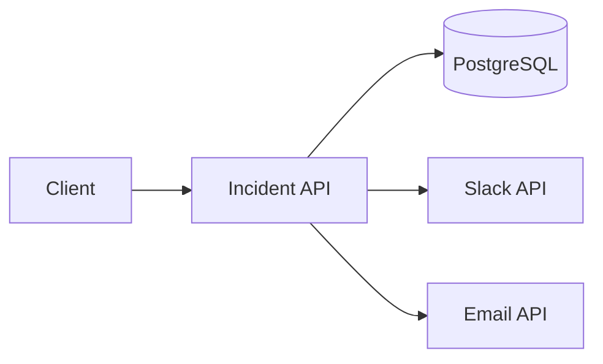
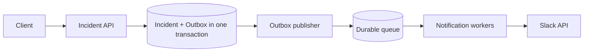
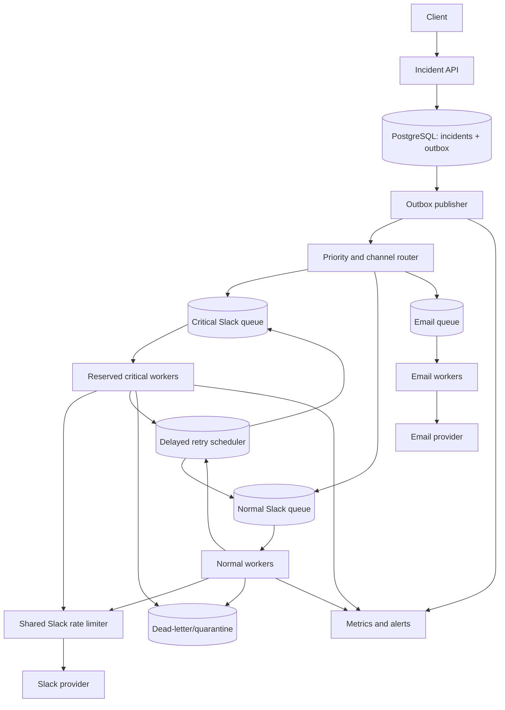
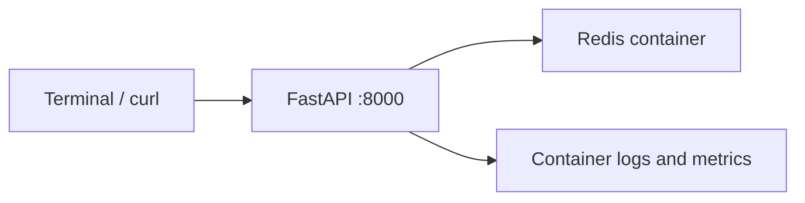

# Daily Architecture Incident Lab — Lesson 04

## Queue Backpressure, Retry Storms, and Recovery Capacity

**Date:** 2026-11-09  
**Time budget:** 20–25 minutes; optional lab 10–15 minutes  
**Level:** Experienced SRE → Platform/System Architect  
**Scenario:** All incident details, metrics, logs, and outputs below are **hypothetical simulations**, not observations from an actual production system.

> **Progression:** Lesson 02 introduced asynchronous notifications and ambiguous provider timeouts. Lesson 03 introduced durable intent with a transactional outbox and idempotent consumers. Lesson 04 asks a different question: *even when no messages are lost, can your system survive a slow downstream provider without collapsing under its own retries?*

## Learning outcomes and time plan

| Minutes | Activity | Outcome |
|---:|---|---|
| 0–4 | Define requirements and service boundaries | Separate accepted work from delivered work |
| 4–8 | Calculate arrival rate, service capacity, and backlog | Quantify overload before choosing a solution |
| 8–12 | Evolve the architecture | Design bounded retries, admission control, and isolation |
| 12–20 | Investigate a simulated incident | Use logs, metrics, broker, Linux, and SQL evidence |
| 20–25 | Decide mitigations and solve challenges | Make operational and architectural trade-offs |

## 1. The realistic problem

Your incident platform receives requests to notify on-call engineers through Slack and email. The API writes incident and outbox rows in PostgreSQL, then returns `201 Created` once the transaction commits. A publisher moves outbox events into a durable broker; workers call external providers. One morning, the Slack provider begins returning `429 Too Many Requests` and taking longer to respond. Workers retry aggressively. Critical notifications are delayed behind thousands of low-priority messages.

**Design question:** How do you preserve critical delivery, protect the database and broker, and recover predictably without violating the provider's rate limits?

### Functional requirements

1. Accept incident creation independently of Slack availability; return a stable incident ID.
2. Persist notification intent durably with a unique `event_id`.
3. Deliver Slack and email notifications, with per-channel delivery state.
4. Retry transient errors (`429`, selected `5xx`, network timeouts); do not endlessly retry permanent errors (`400`, invalid destination).
5. Prioritize Sev-1/Sev-2 notifications over informational messages.
6. Provide operators a way to inspect, replay, or quarantine failed deliveries with auditability.

### Non-functional requirements (design targets, not measured SLAs)

| Requirement | Target | Why it matters |
|---|---|---|
| API latency | p95 < 300 ms for accepted incident creation | Provider latency must not block creation |
| Durability | No acknowledged incident without committed notification intent | Avoid silent loss |
| Critical delivery | p95 < 60 s when provider is healthy | Operational usefulness |
| Recovery | Drain an ordinary 30-minute outage backlog within 45 minutes after recovery | Predictable catch-up |
| Isolation | Low-priority backlog must not block critical queue | Avoid head-of-line blocking |
| Safety | Never exceed agreed provider quotas | Avoid extending rate-limit incidents |
| Visibility | Age of oldest critical message, attempts, errors, outbox lag | Detect failure before customer reports |

**Scope clarification:** We cannot guarantee that Slack displays a message exactly once if Slack does not support an appropriate idempotency contract. We can guarantee durable intent and bounded attempts; we can deduplicate local effects and make external ambiguity visible.

## 2. Capacity estimation: do the arithmetic first

Assume **60,000 notifications/hour at peak** = `60,000 / 3,600 ≈ 16.7 events/s`. A single event can produce one Slack delivery and one email delivery, so channel-specific throughput must be sized independently. For this exercise, assume **Slack alone receives 16.7 deliveries/s**. Its negotiated provider limit is **20 requests/s**. A healthy worker completes 2 requests/s on average, so 10 workers could theoretically achieve 20/s *if provider limits allow it*.

A provider incident lowers successful Slack throughput to **5 deliveries/s** for 30 minutes while arrivals remain 16.7/s.

```text
Arrival rate λ                  = 16.7 messages/s
Successful service rate μ       = 5 messages/s
Net backlog growth              = λ - μ = 11.7 messages/s
Backlog after 30 minutes        = 11.7 × 1,800 ≈ 21,060 messages
```

After recovery, suppose the provider allows 20 successful deliveries/s and new traffic remains 16.7/s:

```text
Available catch-up capacity     = 20 - 16.7 = 3.3 messages/s
Estimated drain time            = 21,060 / 3.3 ≈ 6,382 s ≈ 106 minutes
```

**Architectural consequence:** The stated 45-minute recovery target is *not achievable* with a 20/s provider quota at this arrival rate. Adding 100 workers does not change that hard external constraint. To drain within 45 minutes, the required sustained capacity is `16.7 + 21,060/2,700 ≈ 24.5/s`. Options include renegotiating quotas, reducing/aggregating notifications, routing permitted channels independently, or changing the recovery objective. A queue is a buffer, not infinite capacity.

### Little's Law intuition

For a stable system, `L ≈ λ × W`, where `L` is average work in system, `λ` is throughput, and `W` is average time in system. Under sustained overload there is no stable equilibrium; backlog and waiting time keep increasing. Monitor **oldest-message age** as well as queue depth because queue depth alone hides the user-visible delay.

## 3. Architecture evolution

### Stage A — Synchronous (fragile)



**Problem:** Provider slowness increases API latency and ties up request workers. A client retry may create a second incident unless incident creation itself is idempotent.

### Stage B — Durable async (necessary, not sufficient)



**Improvement:** Provider outages do not directly block incident creation. **Remaining weakness:** Unlimited retries, undifferentiated priority, and no global rate control can create retry storms.

### Stage C — Bounded, priority-aware delivery



**Implementation note:** The diagram's retry arrows are conceptual. In a real implementation, preserve original priority and channel in message metadata; do not accidentally route normal retries into the critical queue. Delayed retries must not occupy active worker slots. Broker TTL/dead-letter configurations, delayed-message support, or a durable scheduled-retry table can implement this depending on broker and operational constraints.

### Component decisions and trade-offs

| Choice | Benefit | Cost/risk | Decision rule |
|---|---|---|---|
| RabbitMQ durable queues | Routing, acknowledgements, priority/isolation | Broker operations, redelivery semantics | Good for work queues; configure quorum/durability appropriately |
| PostgreSQL outbox | Atomic incident + intent | Polling/CDC load and cleanup | Use when no distributed transaction spans DB and broker |
| Shared token bucket | Enforces provider quota across workers | Coordination dependency | Required when replicas otherwise exceed shared quota |
| Critical queue with reserved capacity | Protects urgent notifications | Normal traffic may wait | Reserve critical capacity but prevent starvation with policy |
| Exponential backoff + jitter | Reduces synchronized retries | Longer tail latency | Honor provider `Retry-After` first; apply bounded jitter |
| Dead-letter/quarantine | Prevents poison-message loops | Manual remediation workflow | Use finite attempts, retention, ownership, and replay controls |
| Circuit breaker | Avoids hammering an unhealthy provider | Incorrect thresholds can block recovery | Probe cautiously and distinguish rate limiting from outage |
| Email fallback | Alternative channel during Slack outage | Duplicate alerting, different delivery semantics | Explicit policy, not automatic for every notification |

### Message state and idempotency

```text
PENDING -> IN_FLIGHT -> DELIVERED
                     -> RETRY_SCHEDULED -> IN_FLIGHT
                     -> QUARANTINED
```

A durable `notification_deliveries` row should include `delivery_id`, `event_id`, `channel`, `destination`, `priority`, `attempt_count`, `next_attempt_at`, `last_error`, `provider_message_id` (if returned), and timestamps. Use a unique constraint on `(event_id, channel, destination)` to avoid creating duplicate delivery intents. Claim work atomically (e.g., with `FOR UPDATE SKIP LOCKED` for DB-based work claiming). A broker ACK should occur only after the worker durably records the outcome. A crash after external success but before recording it can still lead to a duplicate; track that ambiguity explicitly.

## 4. Hypothetical production incident: retry storm

**Everything in this section is simulated.** Times are illustrative and use UTC. The objective is to form and test hypotheses rather than assume the first error message reveals the full cause.

### Incident timeline

| UTC | Event | Impact |
|---|---|---|
| 09:00 | Slack starts returning 429 with `Retry-After: 30` | Delivery success rate falls |
| 09:03 | Workers retry immediately with no jitter | Requests exceed quota; more 429s |
| 09:07 | Queue grows from 500 to 5,500 | Critical message age increases |
| 09:12 | Worker autoscaler adds replicas | Shared rate limit worsens; retry volume grows |
| 09:18 | Critical alerts delayed 11 minutes | On-call responsiveness compromised |
| 09:25 | SRE applies rate cap and pauses normal delivery | Critical latency starts recovering |

### Step 1 — Establish user impact and error-budget scope (2 min)

Start with questions: Are incidents still created? Is only Slack affected? Are emails healthy? What is the oldest *critical* delivery? Do not equate `201 Created` with successful notification.

Example metrics (illustrative):

```text
incident_api_http_201_rate             17/s
slack_delivery_success_rate             4.8/s
slack_provider_http_429_rate           45/s
slack_delivery_attempt_rate            51/s
slack_queue_ready                      12,400
slack_queue_unacked                       120
slack_critical_oldest_age_seconds         660
email_delivery_success_rate            16.5/s
```

**Interpretation:** API is accepting work and email is mostly healthy; Slack is degraded. Attempt rate greatly exceeds successful rate, consistent with retries amplifying load. A large `unacked` count suggests active workers are holding messages; `ready` measures waiting messages. Neither alone proves message loss.

### Step 2 — Inspect application and worker logs (2 min)

```bash
# On a Linux host running a systemd-managed worker:
sudo journalctl -u notification-worker --since '2026-11-09 09:00:00 UTC' --until '2026-11-09 09:20:00 UTC' --no-pager | tail -n 80
```

Expected illustrative lines:

```text
09:03:11 worker-07 delivery_id=d-902 attempt=3 provider=slack status=429 retry_after=30s
09:03:11 worker-07 delivery_id=d-902 scheduling_retry delay_ms=0
09:03:12 worker-07 delivery_id=d-902 attempt=4 provider=slack status=429
09:03:12 worker-07 delivery_id=d-902 scheduling_retry delay_ms=0
```

**Interpretation:** The provider requested a pause, but the worker ignored it. Verify that retry configuration and deployed version match what logs suggest. If running in containers, use the equivalent container logs instead of `journalctl`.

### Step 3 — Verify network and provider responses (2 min)

```bash
# On the worker host, check TCP connectivity to the approved provider endpoint.
# Replace example.invalid with the real approved hostname in your environment.
getent ahosts example.invalid
ss -tan state established | head

# Illustrative API call: use a controlled test endpoint and credentials,
# never post real incident content or tokens in a shared terminal recording.
curl -sS -D /tmp/provider-headers.txt -o /tmp/provider-body.json \
  --max-time 5 'https://example.invalid/test-endpoint'
cat /tmp/provider-headers.txt
```

Expected **provider-response example** (not output from `example.invalid`):

```http
HTTP/1.1 429 Too Many Requests
Retry-After: 30
X-Request-Id: req-77ab
```

**Interpretation:** HTTP 429 means an application-level quota response, not a TCP connection refusal. Capture the request ID and any scope-specific quota headers. The placeholder hostname intentionally cannot validate real connectivity; use only an authorized provider test endpoint. `Retry-After` may be a number of seconds **or an HTTP date**, so parsers must handle both.

### Step 4 — Inspect the broker (2 min)

For RabbitMQ, with authorized CLI access:

```bash
rabbitmqctl list_queues name messages_ready messages_unacknowledged consumers
rabbitmqctl list_connections name state channels
```

Illustrative output:

```text
slack.critical       2200    20    4
slack.normal        10200   100   20
email.normal          140    10    5
```

**Interpretation:** The critical queue is not isolated effectively if its age rises while normal workers generate most attempts. Compare arrival rate, ACK rate, redeliveries, and retry scheduling. If using RabbitMQ's management API, avoid exposing credentials in shell history or logs.

### Step 5 — Query delivery state in PostgreSQL (2 min)

The schema is illustrative; adapt column names before executing. Read-only queries are preferred during diagnosis.

```sql
SELECT channel, priority, status, COUNT(*) AS deliveries
FROM notification_deliveries
WHERE created_at > now() - interval '2 hours'
GROUP BY channel, priority, status
ORDER BY channel, priority, status;

SELECT delivery_id, event_id, priority, attempt_count,
       next_attempt_at, last_error
FROM notification_deliveries
WHERE channel = 'slack'
  AND status IN ('RETRY_SCHEDULED', 'PENDING')
ORDER BY created_at ASC
LIMIT 20;

SELECT state, COUNT(*)
FROM pg_stat_activity
WHERE datname = current_database()
GROUP BY state;
```

Illustrative result:

```text
channel | priority | status          | deliveries
slack   | critical | RETRY_SCHEDULED | 1800
slack   | normal   | RETRY_SCHEDULED | 9300
email   | normal   | DELIVERED       | 11000
```

**Interpretation:** Retries dominate Slack pending work. Check whether `attempt_count` grows rapidly for the same `delivery_id`; that distinguishes repeated attempts from fresh incident volume. `pg_stat_activity` helps rule out a database bottleneck, but alone does not prove database health.

### Step 6 — Inspect traces and causal ordering (1 min)

```text
trace_id=ab91  incident.create       42ms   201
trace_id=ab91  outbox.insert          5ms   committed
trace_id=ab91  broker.publish         9ms   confirmed
trace_id=ab91  slack.send attempt=1 180ms   HTTP 429
trace_id=ab91  slack.send attempt=2 160ms   HTTP 429 (0ms backoff)
```

**Interpretation:** The database and broker paths succeeded. The fault is in the delivery/retry boundary. In a real system, retries may be separate traces; propagate correlation IDs or trace links across asynchronous boundaries.

### Root cause vs design weakness

**Immediate trigger:** Slack began rate-limiting requests and responding with `Retry-After`.

**Root cause of the retry storm:** Worker retry logic ignored `Retry-After` and immediately retried; autoscaling increased concurrent requests without a shared quota limiter.

**Underlying architectural weaknesses:** No shared rate budget, no delayed retries, no priority isolation, no recovery-capacity objective, and alerting focused on queue depth instead of oldest critical-message age. The provider slowdown alone does not explain why our own attempt rate became 51/s against a 20/s quota.

## 5. Mitigation, recovery, and redesign

### Immediate mitigation (operator-controlled, reversible)

1. Confirm Slack 429 scope and quota; coordinate with provider owner.
2. **Stop immediate retries** and honor `Retry-After`; apply a shared global token bucket below the permitted quota.
3. Temporarily pause or throttle *normal* Slack deliveries; preserve a reserved budget for critical traffic.
4. Avoid blind worker scale-up; reduce concurrency if it worsens rate limiting.
5. Keep messages durable; do not purge queues or delete delivery rows. Quarantine poison messages separately.
6. Consider policy-approved alternate escalation (email/pager) for critical incidents; clearly mark it as a fallback to avoid confusing duplicate alerts.
7. Monitor success rate, critical oldest age, provider 429s, and backlog slope until recovery is sustained.

### Long-term redesign

- Implement a distributed token bucket per provider/workspace/tenant as appropriate. Do not assume one quota covers all endpoints.
- Parse `Retry-After` and use capped exponential backoff with full jitter for transient failures; apply retry budgets and maximum delivery age.
- Use separate critical and normal queues with reserved concurrency and fair scheduling.
- Make retry scheduling durable and delayed; never busy-loop on 429.
- Bound outbox publisher rate, queue storage growth, and in-flight requests; define what happens at capacity (admission control, degradation, or alternate channel).
- Record stable event/delivery IDs, provider IDs, and ambiguous timeout outcomes for operator review.
- Document backlog recovery math and negotiate quotas/targets that can actually be met.

### Observability and alerts

| Signal | Why | Suggested alert (illustrative) |
|---|---|---|
| `oldest_message_age_seconds{priority="critical"}` | User-visible staleness | > 60 s for 5 min |
| `delivery_attempts_total{status="429"}` | Provider quota pressure | Rate above baseline for 5 min |
| `delivery_success_total / delivery_attempts_total` | Retry efficiency | Success ratio < 70% |
| `queue_ready`, `queue_unacked`, `queue_redelivered` | Backlog and worker behavior | Rising slope for 10 min |
| `outbox_oldest_unpublished_age` | DB→broker lag | > 30 s for 5 min |
| `retry_attempts_per_delivery` | Retry amplification | p95 > 3 |
| `provider_request_latency_seconds` | Slowdown precursor | p95 > provider baseline |
| `dead_letter_count` | Exhausted/poison messages | Any critical message quarantined |

Avoid high-cardinality labels such as `incident_id` or `delivery_id` in Prometheus. Put IDs in logs/traces, and use aggregate dimensions (channel, priority, status, tenant only if bounded).

### Validation plan

Run a controlled staging test with a fake provider that returns 429 and `Retry-After: 30`:

1. Submit 100 critical and 1,000 normal messages with unique IDs.
2. Confirm API acknowledgements correspond to committed incident+outbox rows.
3. Assert no retry is attempted before the provider-specified delay, within clock/timing tolerance.
4. Verify the shared quota holds across multiple worker replicas, including after a worker restart.
5. Confirm critical delivery age remains bounded while normal traffic is throttled.
6. Crash a worker after external success but before ACK; verify local deduplication and document possible external duplicates.
7. Restore provider health; measure drain time and compare with the capacity model.
8. Verify DLQ retention, manual replay authorization, and audit logs; never replay blindly.

## 6. Optional hands-on lab: simulate overload without a real provider

**Environment:** Python 3.10+ standard library. No network calls or broker installation. This is a deterministic capacity model, not a real distributed load test.

Create `queue_capacity.py`:

```python
from dataclasses import dataclass

@dataclass
class Model:
    arrivals_per_sec: float
    service_per_sec: float
    backlog: float = 0.0

    def advance(self, seconds: int) -> None:
        self.backlog = max(
            0.0,
            self.backlog + (self.arrivals_per_sec - self.service_per_sec) * seconds,
        )

m = Model(arrivals_per_sec=16.7, service_per_sec=5.0)
m.advance(30 * 60)
print(f"Backlog after outage: {m.backlog:,.0f}")
m.service_per_sec = 20.0
m.advance(45 * 60)
print(f"Backlog after 45-minute recovery: {m.backlog:,.0f}")

required_service = 16.7 + (16.7 - 5.0) * 1800 / 2700
print(f"Required service for 45-minute drain: {required_service:.2f}/s")
```

Run:

```bash
python3 queue_capacity.py
```

Expected output:

```text
Backlog after outage: 21,060
Backlog after 45-minute recovery: 12,150
Required service for 45-minute drain: 24.50/s
```

**Interpretation:** A healthy 20/s service cannot meet the recovery objective under these assumptions. The model ignores stochastic arrival variation, per-message latency, burst quotas, and retry overhead, so real systems need safety margin.

**Extension:** Add a separate critical arrival rate of 1/s and reserve 3/s of provider capacity for critical delivery. Explain what happens if critical arrivals spike to 5/s for ten minutes. Do not implement a busy-loop retry.

## 7. Three independent architect challenges (do not look for a canned answer)

### Challenge 1 — Recovery math and an impossible SLO

The provider's sustained quota is 20/s; arrivals are 16.7/s; a 30-minute degradation leaves 21,060 messages. Management requires a 45-minute drain. Calculate the required throughput, then propose **two viable product or architectural changes** and identify who must approve them. Explain why adding workers alone is insufficient.

### Challenge 2 — Critical traffic isolation

Critical traffic is 1/s on average but can burst to 6/s for five minutes. Normal traffic is 15.7/s. The provider permits 20/s sustained with occasional short bursts. Design a scheduling/rate-limit policy that protects critical traffic, avoids permanent starvation of normal traffic, and handles a critical burst exceeding reserved capacity. State at least two metrics that would falsify your design assumptions.

### Challenge 3 — Ambiguous timeout and retries

A worker calls Slack, times out at 5 seconds, and receives no provider message ID. The provider may have accepted the message. The queue redelivers after the worker crashes. Describe what can and cannot be guaranteed. Propose a recovery policy with stable IDs, attempt records, optional provider-supported idempotency, and an operator workflow for unresolved ambiguity. Explain how you would test the policy without sending duplicate real alerts.

## 8. Further reading and existing Wiki connections

- [Your System Design Framework](../framework.md) — requirements, estimation, asynchronous design, trade-offs.
- [Your System Design Components](../components.md) — brokers, distributed patterns, backpressure.
- [Your SRE Observability Notes](../../sre/observability.md) — metrics and incident investigation.
- [Architecture Labs repository](https://github.com/samperay/sre-devops-architecture-labs) — hands-on implementation; use Project 01 async task processor as a conceptual starting point, not as a claim that this lesson is implemented there.
- [RabbitMQ Consumer Acknowledgements](https://www.rabbitmq.com/docs/confirms) — publisher confirms and consumer acknowledgements.
- [RabbitMQ Dead Letter Exchanges](https://www.rabbitmq.com/docs/dlx) — failure routing.
- [AWS Builders' Library: Timeouts, retries, and backoff with jitter](https://aws.amazon.com/builders-library/timeouts-retries-and-backoff-with-jitter/) — retry amplification and jitter.
- [Google SRE Book: Handling Overload](https://sre.google/sre-book/handling-overload/) — admission control and overload principles.

**Codemia.io connection:** This lesson practices capacity estimation, queueing, rate limits, failure isolation, and distributed-systems trade-offs commonly taught in system-design courses. It does not assume any particular Codemia lesson has been completed.

---

## Practical Labs

**LEARN → DESIGN → BUILD → BREAK → INVESTIGATE → FIX → VALIDATE**

> **Scope:** An additional runnable local exercise; the complete architecture lesson and original optional exercise above remain intact. Estimated hands-on time: 35–60 minutes. Run on **Mac Docker Desktop** (preferred for multi-container workloads) or **Ubuntu VM** with Docker Engine + Compose plugin installed. All services bind to loopback and use a dedicated Compose project. This is a disposable lab, never production.

### LEARN — Experiment and expected failure

**Scenario:** Queue backlog and worker capacity. Calculate arrival rate versus service rate and decide when to apply bounded queues, 429 admission control, and dead-letter policies.

### DESIGN — Local topology



Create a dedicated directory `architecture-lab-04`. Run all commands below from it on the **Mac terminal** or **Ubuntu VM shell**, whichever runs Docker. Do not run them inside another existing application container.

```bash
mkdir -p architecture-lab-04/app architecture-lab-04/tests
cd architecture-lab-04
touch app/__init__.py
docker compose version
```

### BUILD — Complete minimal application

Directory layout:

```text
architecture-lab-04/
├── app/
│   ├── __init__.py
│   └── main.py
├── tests/
│   └── test_health.py
├── requirements.txt
├── Dockerfile
└── compose.yaml
```

**File: `app/main.py`**

```python
import os,time
from fastapi import FastAPI,HTTPException
from redis import Redis
from pydantic import BaseModel
app=FastAPI()
r=Redis(host="redis",decode_responses=True)
class Job(BaseModel):
    id: str
@app.post("/jobs",status_code=202)
def submit(j:Job):
    r.rpush("jobs",j.id)
    return {"queued":j.id}
@app.post("/worker/once")
def work():
    item=r.lpop("jobs")
    if not item: return {"status":"empty"}
    delay=float(os.getenv("WORK_DELAY","0.05"))
    time.sleep(delay)
    r.incr("completed")
    return {"completed":item,"seconds":delay}
@app.get("/stats")
def stats():return {"backlog":r.llen("jobs"),"completed":int(r.get("completed") or 0)}
@app.get("/health")
def health():return {"status":"ok"}
```

**File: `requirements.txt`**

```text
fastapi==0.115.12
uvicorn==0.34.2
redis==5.2.1
httpx==0.28.1
pytest==8.3.5
```

**File: `Dockerfile`**

```dockerfile
FROM python:3.11-slim
WORKDIR /code
COPY requirements.txt .
RUN pip install --no-cache-dir -r requirements.txt
COPY app ./app
CMD ["uvicorn","app.main:app","--host","0.0.0.0","--port","8000"]
```

**File: `compose.yaml`**

```yaml
services:
  api:
    build: .
    ports: ["127.0.0.1:18004:8000"]
    environment:
      WORK_DELAY: "${WORK_DELAY:-0.05}"
    depends_on: [redis]
  redis:
    image: redis:7-alpine
```

**File: `tests/test_health.py`**

```python
def test_health():
    from fastapi.testclient import TestClient
    from app.main import app
    assert TestClient(app).get("/health").status_code == 200
```

Start the lab and wait for the API:

```bash
docker compose -p archlab04 up -d --build
docker compose -p archlab04 ps
curl -fsS http://127.0.0.1:18004/health
```

**Expected:** the API reports `{"status":"ok"}`. On the first startup, the image build may take a few minutes. If a dependency is not ready, wait a few seconds and retry; inspect `docker compose ... logs` rather than assuming a design fault.

### VALIDATE baseline — Prove healthy operation before injecting faults

```bash
for i in 1 2 3; do curl -s -X POST http://127.0.0.1:18004/jobs -H 'Content-Type: application/json' -d "{\"id\":\"job$i\"}"; done
curl -s -X POST http://127.0.0.1:18004/worker/once
curl -s http://127.0.0.1:18004/stats
```

**Expected observations:** Backlog increases while production exceeds service rate; slow worker call takes ~2 seconds. After reducing service time, backlog drains. This manual worker models capacity, not an autonomous production consumer.

### BREAK — Introduce ONE controlled failure

Only use the dedicated `archlab04` Compose project; do not target existing databases or application containers.

```bash
WORK_DELAY=2 docker compose -p archlab04 up -d --force-recreate api
for i in $(seq 4 20); do curl -s -o /dev/null -X POST http://127.0.0.1:18004/jobs -H 'Content-Type: application/json' -d "{\"id\":\"job$i\"}"; done
curl -s http://127.0.0.1:18004/stats
time curl -s -X POST http://127.0.0.1:18004/worker/once
```

### INVESTIGATE — Collect evidence before fixing

```bash
docker compose -p archlab04 ps
docker compose -p archlab04 logs --tail=25 api
curl -s http://127.0.0.1:18004/stats
```

**Reasoning checklist:** Which component is unavailable or slow? Is the error a connection refusal, timeout, invalid schema, queue backlog, or application exception? Which log or metric proves your hypothesis? What observation would disprove it? Separate trigger, root cause, and design weakness.

### FIX — Restore service and improve the design

```bash
WORK_DELAY=0.05 docker compose -p archlab04 up -d --force-recreate api
for i in $(seq 1 25); do curl -s -o /dev/null -X POST http://127.0.0.1:18004/worker/once; done
curl -s http://127.0.0.1:18004/stats
```

**Design discussion:** Calculate arrival rate versus service rate and decide when to apply bounded queues, 429 admission control, and dead-letter policies.

### VALIDATE — Automated checks and safe cleanup

To run the included lightweight API health test **inside the disposable API container**:

```bash
docker compose -p archlab04 exec api python -m pytest -q tests || true
```

**Note:** the Dockerfile above intentionally copies only `app/` into the image; to execute the test, run it on the host in a Python virtual environment instead, or copy the test directory into your local Dockerfile before rebuilding. The `|| true` command is a demonstration only; do not interpret it as a passing test. Recommended host test:

```bash
python3 -m venv .venv
. .venv/bin/activate
pip install -r requirements.txt
pytest -q tests
deactivate
```

Expected: `1 passed` (the test checks only the API health endpoint; the manual failure and recovery commands are the scenario-specific integration validation). Record actual output, not an assumed result.

Cleanup **only this lesson's project**. Use `down` to keep named data volumes; use `down -v` only if you intentionally want to delete this disposable lab's database state.

```bash
docker compose -p archlab04 down
# OPTIONAL destructive cleanup of ONLY this lab's named volumes:
# docker compose -p archlab04 down -v
```

**Your lab evidence:** baseline response: _..._; injected failure: _..._; commands and findings: _..._; root cause versus systemic weakness: _..._; recovery verification: _..._; improvement proposal: _..._.

## My Architecture Review — Solutions & Doubts

### 1. My Understanding

**In my own words:**

> [Write why a durable queue does not automatically guarantee acceptable delivery latency.]

**One new concept I learned:**

> [Your notes]

### 2. My Solutions to the Architect Challenges

**Challenge 1 — Recovery math and SLO:**

> Calculation: [Your calculation]  
> Proposed changes: [Your design and trade-offs]  
> Approval/constraints: [Your reasoning]

**Challenge 2 — Critical traffic isolation:**

> Scheduling and quota policy: [Your design]  
> Burst behavior: [Your reasoning]  
> Evidence/metrics: [Your proposed signals]

**Challenge 3 — Ambiguous timeout:**

> Delivery guarantees: [Your reasoning]  
> Recovery policy: [Your design]  
> Safe validation: [Your test plan]

### 3. My Troubleshooting Approach

**Initial hypotheses:**

- [ ] [Hypothesis 1]
- [ ] [Hypothesis 2]
- [ ] [Hypothesis 3]

**Commands/tools I would run and why:**

```bash
# Add your own diagnostic commands here.
```

**Evidence that confirms or rejects each hypothesis:**

> [Your notes]

### 4. My Proposed Architecture Improvements

| Change | Benefit | Trade-off / risk | Validation |
|---|---|---|---|
| [Your change] | [Benefit] | [Risk] | [Test] |

### 5. My Doubts / Questions

- [ ] [Question about capacity or recovery math]
- [ ] [Question about broker behavior or retries]
- [ ] [Question about delivery guarantees]
- [ ] [Another question]

### 6. Lessons Learned

**What I would do differently during a real incident:**

> [Your reflection]

**What I want to revisit in a later lab:**

> [Your reflection]

### 7. Mentor Review

<!-- Leave blank. Feedback, corrections, and next improvements will be added after review. -->
