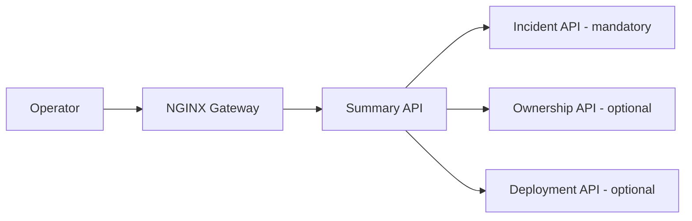
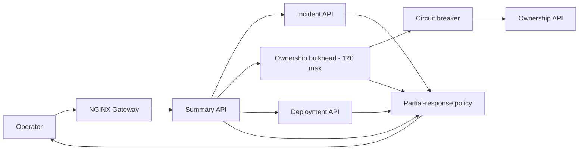
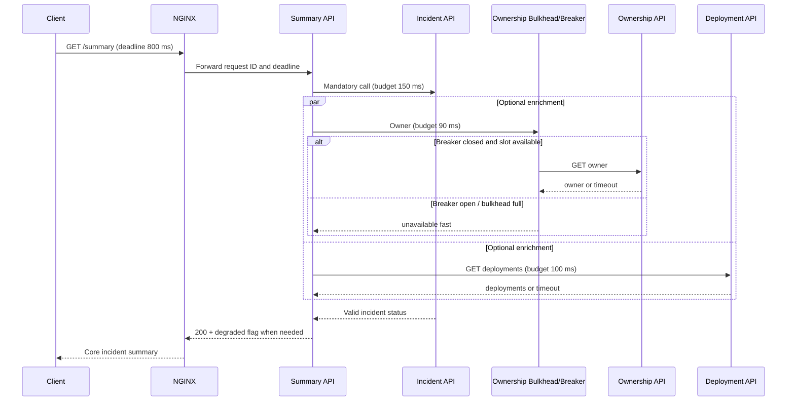
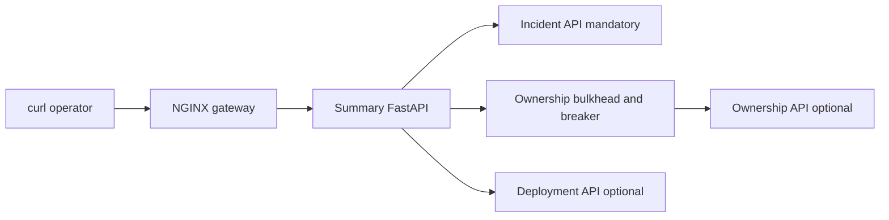

# Daily Architecture Incident Lab — Lesson 05

## Preventing Cascading Failures: API Gateway Timeouts, Retries, Bulkheads and Circuit Breakers

**Date:** 2026-11-10  
**Timebox:** 20–25 minutes (optional lab: 10–15 more)  
**Audience:** Experienced Python/Linux SRE progressing toward system/platform architecture  
**Scenario:** **Entirely hypothetical**. All services, numbers, timestamps, metrics and logs below are invented for training, not production observations.  
**Prerequisites:** Basic HTTP, NGINX reverse proxy, Python services, and latency percentiles. Prior lessons covered notifications, queues and retry storms; today focuses on **synchronous request-path failure propagation**, not queue delivery.

> **Learning outcome:** Given an overloaded dependency, you can calculate its concurrency demand, diagnose why apparently healthy upstream services fail, and design bounded latency, retry budgets, circuit breaking and resource isolation.

## 0. Session plan

| Minutes | Activity |
|---|---|
| 0–4 | Requirements and latency budget |
| 4–8 | Capacity math and architecture evolution |
| 8–17 | Hypothetical incident and chronological investigation |
| 17–21 | Mitigation, redesign and validation |
| 21–25 | Three architect challenges and your review notes |

## 1. Realistic problem: incident dashboard aggregation

An internal operations dashboard presents incident details and enriches them with owner, service health and recent deployments. An operator requests `GET /api/incidents/{id}/summary`.

The **Summary API** calls three services synchronously:

- **Incident DB/API** — mandatory incident status and severity.
- **Ownership API** — team and escalation contact; optional enrichment.
- **Deployment API** — recent changes; optional enrichment.

An NGINX gateway fronts the Summary API. A slow Ownership API should not prevent operators from seeing incident status. Assume internal service authentication, trace propagation and redaction are already available.

### Functional requirements

1. Return current incident status and severity for an authorized caller.
2. Enrich with owner and deployments when available.
3. Indicate partial data explicitly, rather than silently presenting stale enrichment as fresh.
4. Preserve request IDs for cross-service investigation.
5. Offer an authenticated health/readiness endpoint that does not rely on optional dependencies.

### Nonfunctional requirements and failure contract

| Property | Design target (hypothetical) |
|---|---|
| Summary API p95 latency | ≤ 300 ms in normal conditions |
| Summary API timeout budget | ≤ 800 ms end to end |
| Availability for **core incident status** | 99.9% monthly |
| Optional enrichment availability | Best effort; partial response permitted |
| Peak traffic | 1,000 requests/second |
| Max Ownership API concurrent requests | 120 across the deployment |
| Recovery | Core incident summary continues when Ownership API fails |

**Explicit product decision:** `200 OK` with `degraded: true` is acceptable *only if core incident data is valid*. If the mandatory Incident API fails, return a meaningful `503` with request ID; do not fabricate status. Security/authentication failures are never masked as partial success.

## 2. Quantitative sizing before choosing technology

Assume 1,000 requests/s at peak, and one Ownership API request per summary. With average Ownership API latency **40 ms**, Little's Law gives approximate in-flight concurrency:

```text
L = λ × W
L = 1,000 requests/s × 0.040 s = 40 concurrent requests
```

At 40 concurrent calls, a fleet-wide limit of 120 appears comfortable. But when Ownership latency increases to **500 ms**:

```text
L = 1,000 × 0.500 = 500 concurrent calls needed
```

Demand now exceeds the 120-call cap by **4.17×**. A worker pool of 120 with a 500 ms mean service time can complete at most ~240 calls/s (ignoring overhead). The remaining ~760 requests/s either wait, fail fast, or must be served without enrichment. This is a **capacity mismatch**, not necessarily a CPU problem.

**Caution:** Little's Law describes averages in a stable system. Tail latency, burstiness, queue limits, connection reuse, and timeout behavior affect actual peak concurrency. Do not size a pool solely from p95 latency.

### Latency budget example

```text
Gateway and network:      35 ms
Incident API:             80 ms (mandatory)
Ownership API:            90 ms (optional budget)
Deployment API:           70 ms (optional budget)
Application overhead:     25 ms
--------------------------------
Sequential total:        300 ms
```

Parallel optional calls can shorten the critical path, but only if they have independent timeouts, bounded concurrency and cancellation. A gateway timeout of 800 ms is **not** permission for every downstream call to take 800 ms.

## 3. Incremental architecture

### Version A — simple but tightly coupled



**Failure:** If the Summary API waits for Ownership and retries twice, a slow optional service can consume the entire request budget and occupy workers. A client retry can multiply downstream calls again.

### Version B — bounded dependency calls



**Design decisions:**

- **Deadline propagation:** A single end-to-end deadline, with shorter per-hop budgets.
- **Bulkhead:** Cap Ownership calls and queue length separately from Incident calls; overflow fails fast to partial response.
- **Circuit breaker:** Stop repeatedly calling a dependency during sustained failures; probe carefully during recovery.
- **Retry budget:** For this optional synchronous GET, default to *zero* retries on the interactive path. If retrying a transient connection error, allow at most one within the remaining deadline, with jitter and a fleet-wide budget. Never blindly retry non-idempotent operations.
- **Load shedding:** Reject excess low-priority enrichment work while protecting mandatory status reads.
- **Fallback:** Return `owner: null` plus an explicit `unavailable_components` field; use a cached owner only if freshness and authorization rules permit it.

**Trade-off:** A circuit breaker reduces pressure on a failing dependency but can temporarily reject requests after the service has recovered. Configure open/half-open/closed behavior and probe rates using measured failure patterns; do not treat a breaker as a replacement for timeouts or capacity planning.

### Example response contract

```json
{
  "incident_id": "INC-2048",
  "severity": 2,
  "status": "investigating",
  "owner": null,
  "recent_deployments": ["deploy-731"],
  "degraded": true,
  "unavailable_components": ["ownership"],
  "request_id": "req-4d19"
}
```

## 4. Failure-mode analysis

| Failure | Naive outcome | Designed behavior | Residual risk |
|---|---|---|---|
| Ownership API p99 jumps to 2 s | Summary timeouts | 90 ms optional-call deadline; partial response | Missing owner context |
| Ownership returns 503 | Repeated retries | Breaker opens after measured failures | Recovery probes must be controlled |
| Summary workers saturated | All requests stall | Dedicated concurrency budgets; reject enrichment | Mandatory API still needs its own capacity |
| Gateway retries POST | Duplicate side effect | Disable unsafe automatic retries | Client can still retry; use idempotency keys |
| DNS/TLS failures | Confusing 502/504 | Per-hop logging and metrics | Multiple failures may coexist |
| Deployment API degraded too | Cascading resource contention | Independent bulkheads and budgets | Compound partial data |
| Stale cache entry | Incorrect on-call owner | TTL and freshness indicator | Operational correctness risk |

## 5. Hypothetical production incident: 09:00–09:25 UTC

**This is a simulation, not a real outage.** At 09:00, Ownership API's database pool becomes saturated following a slow query regression. Ownership latency rises from 40 ms to 600 ms. Summary API waits for ownership and retries each timeout once. At 09:04, gateway 504s spike; by 09:08, operators cannot reliably view mandatory incident status even though Incident API is healthy.

### Chronological evidence

| UTC | Observation | Interpretation / next step |
|---|---|---|
| 09:00 | Ownership DB pool wait p95 rises to 450 ms | Investigate ownership database and query plan |
| 09:02 | Ownership API p95 reaches 650 ms | Dependency is slow; not yet proof of gateway fault |
| 09:04 | Summary active requests 800/800; 504 rate 18% | Worker saturation and latency budget exhaustion |
| 09:06 | Ownership receives 1,850 RPS against 1,000 summary RPS | Retries are amplifying traffic |
| 09:08 | Incident API p95 remains 65 ms | Core dependency healthy; optional dependency is blocking |
| 09:12 | Retries disabled; optional timeout reduced | Error rate falls; enrichment becomes partial |
| 09:25 | Ownership query fixed; circuit closes after probes | Recovery validated; observe residual backlog/connections |

### A. Establish customer impact and the failing hop

```bash
# From an authorized diagnostic host; replace host and token placeholders.
for i in 1 2 3; do
  curl -sS -o /dev/null \
    -w 'status=%{http_code} total=%{time_total}s connect=%{time_connect}s\n' \
    --max-time 2 \
    -H 'Authorization: Bearer <REDACTED_TOKEN>' \
    -H 'X-Request-ID: lab05-test-'"$i" \
    https://dashboard.example.internal/api/incidents/INC-2048/summary
done
```

**Illustrative output:**

```text
status=504 total=0.801s connect=0.014s
status=504 total=0.803s connect=0.012s
status=200 total=0.293s connect=0.013s
```

**Read it:** ~800 ms failures match the gateway deadline; fast connection setup argues against a basic client TCP-connect issue. It does **not** identify which backend is slow. Do not place credentials in shared logs or screenshots.

### B. Inspect NGINX access and error logs

Ensure access logs include `$request_id`, `$request_time`, `$upstream_response_time`, `$upstream_status` and upstream address. Without these fields, correlation is weaker.

```bash
sudo grep 'lab05-test' /var/log/nginx/access.log | tail -n 10
sudo grep -E 'upstream timed out|no live upstreams' /var/log/nginx/error.log | tail -n 10
```

**Illustrative access-log record (custom format):**

```text
2026-11-10T09:04:12Z request_id=lab05-test-1 status=504 request_time=0.801 upstream_status=504 upstream_response_time=0.800 upstream=10.0.2.14:8080
```

**Illustrative error-log record:**

```text
upstream timed out (110: Connection timed out) while reading response header from upstream
```

**Read it:** Gateway timed out waiting for Summary API. This is a **symptom**, not proof NGINX is misconfigured. A 502 would suggest a different class of upstream failure (e.g., reset or invalid response).

### C. Check network sockets and process saturation

Run on the **Summary API host/container**, not on your laptop:

```bash
ss -tan state established '( dport = :8443 or dport = :8080 )' | head
ps -eo pid,stat,%cpu,%mem,cmd --sort=-%cpu | head
# If systemd is used:
sudo journalctl -u summary-api --since '2026-11-10 09:00:00 UTC' --until '2026-11-10 09:15:00 UTC' --no-pager | tail -n 40
```

**Illustrative application log:**

```text
09:04:12 ERROR request_id=req-4d19 path=/api/incidents/INC-2048/summary
  dependency=ownership attempt=2 timeout_ms=350 elapsed_ms=744
  error=ReadTimeout active_requests=800 worker_limit=800
```

**Read it:** Two 350 ms attempts plus overhead exhaust the 800 ms request budget. `ss` alone cannot establish which dependency caused a timeout; correlate request IDs and traces.

### D. Follow one distributed trace

```text
trace_id=7f9e...  Summary GET /summary        801 ms
  ├─ Incident API GET /INC-2048          65 ms  OK
  ├─ Ownership GET /owner               352 ms  timeout
  ├─ Ownership GET /owner (retry)       351 ms  timeout
  └─ response serialization              12 ms
```

**Read it:** Optional Ownership consumes nearly all wall time. Retries occur within the user request. If calls run in parallel, use actual span start/end timestamps; do not add parallel span durations as if they were sequential.

### E. Check Ownership API and PostgreSQL

On an authorized Ownership DB session (read-only diagnostic SQL):

```sql
SELECT state, wait_event_type, wait_event, count(*) AS sessions
FROM pg_stat_activity
WHERE datname = current_database()
GROUP BY state, wait_event_type, wait_event
ORDER BY sessions DESC;

SELECT pid, now() - query_start AS running_for,
       wait_event_type, wait_event, left(query, 120) AS query_preview
FROM pg_stat_activity
WHERE state = 'active' AND pid <> pg_backend_pid()
ORDER BY query_start ASC
LIMIT 10;
```

**Illustrative output:**

```text
state   | wait_event_type | wait_event | sessions
active  | Lock            | relation   | 42
idle    |                 |            | 18
```

**Interpretation:** This example suggests lock contention, but **does not by itself prove** a slow query regression or a DB pool wait. PostgreSQL `pg_stat_activity` only shows sessions that reached PostgreSQL; an application connection-pool wait may be invisible there. Correlate SQLAlchemy pool checkout wait histograms, slow-query logs, locks, and `EXPLAIN (ANALYZE, BUFFERS)` on a safe staging replica before concluding root cause.

**Illustrative ownership application metric:**

```text
sqlalchemy_pool_checkout_wait_seconds_p95{service="ownership"} 0.45
ownership_http_request_duration_seconds_p95 0.65
summary_ownership_attempts_per_request_avg 1.85
```

### F. Separate trigger, root cause and design weakness

- **Trigger:** A hypothetical Ownership DB query/lock regression increases request latency.
- **Immediate root cause of dashboard 504s:** Summary API blocks on optional Ownership calls and repeats timeouts within a finite request deadline, saturating workers.
- **Architectural weaknesses:** No independent optional-dependency budget, unbounded or oversized retries, no bulkhead, no partial-response contract, and no protection of core incident reads.
- **Why this distinction matters:** Fixing the Ownership query restores service today; without containment, the next optional-service slowdown will cause the same outage.

## 6. Response plan: mitigate, recover, redesign

### Immediate mitigation (during incident)

1. Confirm Incident API and authentication remain healthy.
2. Disable synchronous Ownership retries; cap its call to ~90 ms **only if product owners accept reduced enrichment**.
3. Serve valid core status with explicit degraded fields; do not hide missing mandatory data.
4. Apply a conservative Ownership concurrency cap and fail-fast overflow.
5. Roll back the Ownership query regression or address confirmed lock contention using standard change controls.
6. Monitor core availability, error rate, in-flight requests, and partial-response rate for at least several recovery windows.

**Do not** simply raise gateway timeout to several seconds or add unlimited Summary workers. Both can increase pressure on the failing dependency and worsen user latency.

### Long-term architecture



Implementation caveat: Parallel calls and deadline propagation must be enforced by the application's HTTP client and task cancellation. NGINX does not automatically propagate a meaningful end-to-end deadline to Python code.

### Observability and alerting

| Signal | Example alert or dashboard question |
|---|---|
| `summary_requests_total{status}` | Is core incident availability below SLO? |
| Summary p50/p95/p99 | Are operators experiencing tail latency? |
| `summary_partial_response_total{dependency}` | Is enrichment silently becoming unavailable? |
| `dependency_request_duration_seconds{service}` | Which dependency is slow? |
| `dependency_retries_total{service}` | Is retry amplification growing? |
| `bulkhead_rejections_total{service}` | Are we shedding optional load? |
| `circuit_breaker_state{service}` | Is the breaker open or flapping? |
| SQLAlchemy pool wait / overflow | Are callers waiting before SQL reaches Postgres? |
| DB lock wait and slow-query metrics | Is the source of latency in SQL execution? |

Avoid paging solely on a breaker opening: page on **user impact** and use breaker state as supporting evidence. Preserve low-cardinality metric labels; put request IDs in logs/traces, not metric labels.

## 7. Validation plan: prove containment

Run in staging or a dedicated test environment, never inject failures into production without approval.

1. Establish baseline at 200, 500 and 1,000 RPS. Record p95, p99, core availability, dependency call volume and CPU/memory.
2. Add **600 ms latency** to Ownership only. Verify core summary still returns within 800 ms with `degraded: true`.
3. Return Ownership HTTP 503 for 60 seconds. Verify circuit opens, call volume falls and half-open probes are bounded.
4. Saturate Ownership's 120-slot bulkhead. Verify overflow is rejected promptly and Incident API remains healthy.
5. Recover Ownership. Verify breaker closes after controlled probes and normal enrichment resumes.
6. Test simultaneous Deployment degradation, missing auth, client cancellation, and Summary process restart.
7. Verify retries are not amplified: `ownership_attempts / summary_requests` should stay close to 1 during failures, ideally lower when breaker is open.

**Acceptance criteria:** ≥99.9% successful core incident reads during isolated Ownership failure; p95 of core reads ≤300 ms in baseline; failure-mode responses ≤800 ms; zero fabricated core status; trace IDs retained. These are proposed targets, not guaranteed results.

## 8. Optional hands-on lab (Python 3.10, standard library)

This miniature simulation demonstrates why retries magnify load. It does **not** implement a real circuit breaker or distributed bulkhead.

Create `lab05_retry_amplification.py`:

```python
from concurrent.futures import ThreadPoolExecutor, as_completed
import random
import time

random.seed(42)

def ownership_call():
    time.sleep(0.06)  # simulated dependency latency
    if random.random() < 0.65:
        raise TimeoutError("simulated ownership timeout")
    return "team-sre"

def run_batch(retries, requests=100):
    attempts = 0
    successes = 0

    def one_request():
        local_attempts = 0
        for _ in range(retries + 1):
            local_attempts += 1
            try:
                ownership_call()
                return local_attempts, True
            except TimeoutError:
                pass
        return local_attempts, False

    with ThreadPoolExecutor(max_workers=20) as pool:
        for future in as_completed([pool.submit(one_request) for _ in range(requests)]):
            used, ok = future.result()
            attempts += used
            successes += int(ok)
    return attempts, successes

for retries in (0, 1, 2):
    attempts, successes = run_batch(retries)
    print(f"retries={retries} requests=100 attempts={attempts} successes={successes}")
```

Run:

```bash
python3 lab05_retry_amplification.py
```

**Expected observation (not exact counts):** Increasing retries increases total dependency attempts and the probability of success in this *independent random failure* model. It also increases downstream work. Real overloaded systems have correlated failures, deadlines and contention, so retries may reduce overall success. Record the attempts-to-requests ratio and explain when retrying becomes harmful.

**Stretch experiment:** Modify the simulation to cap all Ownership attempts using a `threading.BoundedSemaphore(8)` and fail fast if a slot is unavailable. Compare total latency and success for mandatory versus optional work; do not treat the semaphore as a fleet-wide limit across processes.

## 9. Three independent architect challenges — do not read solutions elsewhere first

### Challenge 1 — Calculate concurrency and choose a limit

At 1,500 summary requests/s, Ownership's mean latency rises from 30 ms to 400 ms. You have 6 Summary instances with a local ownership bulkhead of 25 calls each.

**Tasks:** Calculate normal and degraded concurrency demand; determine the fleet-wide cap; estimate the maximum throughput of Ownership calls at 400 ms; explain how you would preserve core reads. Identify one assumption that makes your estimate unreliable.

### Challenge 2 — Design a timeout and retry budget

The gateway hard deadline is 700 ms. Mandatory Incident API p99 is 180 ms. Optional Ownership p99 is 900 ms; Deployment p99 is 140 ms. The Summary API requires 40 ms for application overhead.

**Tasks:** Propose per-hop budgets and whether calls should be sequential or parallel. State exactly when you would return partial data, when to return 503, and whether any retry is justified. Include cancellation and client disconnect behavior.

### Challenge 3 — Diagnose a misleading 504 spike

Gateway 504s rise to 20%. Summary CPU is 25%, Incident API is healthy, Ownership API has 95% success, but its p99 is 2.5 s. SQLAlchemy pool wait p95 is 700 ms. PostgreSQL CPU is 18%, and `pg_stat_activity` shows few active queries.

**Tasks:** Write a hypothesis tree, the first five commands/queries/metrics you would inspect, what evidence would falsify your leading hypothesis, immediate mitigation, and one permanent design change. Explain why low DB CPU does not rule out connection-pool contention.

## 10. Related knowledge and GitHub links

- [Wiki: System Design Framework](../framework.md)
- [Wiki: System Design Components](../components.md)
- [Wiki: SRE Observability](../../sre/observability.md)
- [Wiki: NGINX Load Balancer](../../nginx/load_balancer.md)
- [Hands-on SRE/DevOps Architecture Labs](https://github.com/samperay/sre-devops-architecture-labs) — compare this design with your existing NGINX API Gateway labs. Do not assume the lab already implements breakers.

**Optional reading:** Codemia.io system-design topics may help reinforce timeouts, scalability and reliability, but no paid-course material or course completion is assumed. Useful primary documentation: [NGINX proxy timeout directives](https://nginx.org/en/docs/http/ngx_http_proxy_module.html), [PostgreSQL pg_stat_activity](https://www.postgresql.org/docs/current/monitoring-stats.html#MONITORING-PG-STAT-ACTIVITY-VIEW), [OpenTelemetry traces](https://opentelemetry.io/docs/concepts/signals/traces/).

---

## Practical Labs

**LEARN → DESIGN → BUILD → BREAK → INVESTIGATE → FIX → VALIDATE**

This practical lab implements the **exact architecture described in Sections 1–7 above**: NGINX gateway, Summary API, mandatory Incident API, optional Ownership API and optional Deployment API. The earlier simplified two-service proxy example did not reproduce the lesson's partial-response design; this replaces it.

**Environment:** Mac Docker Desktop preferred (or Ubuntu VM with Docker Engine + Compose and sufficient RAM). Reading: 20–25 minutes; optional guided hands-on: 60–90 minutes. All commands run on the Docker host in a disposable project. Never inject these failures into production.

### LEARN — Map concepts to code

| Architecture requirement | Local implementation | Proof |
|---|---|---|
| NGINX gateway | gateway container, port 18005 | Access logs and HTTP status |
| Mandatory incident status | incident FastAPI service | Core status/severity retained |
| Optional ownership | ownership FastAPI service | Delay without losing core response |
| Optional deployments | deployment FastAPI service | Remains present during owner failure |
| Summary aggregator | summary FastAPI service | Full versus partial response |
| Timeout / retries | naive mode versus protected mode | 504 becomes 200 degraded |
| Bulkhead / circuit breaker | semaphore limit 2, 3-failure breaker | Metrics endpoint |

The architecture's 1,000 RPS and fleet-wide concurrency 120 are **hypothetical production design numbers**. This local exercise uses a limit of 2 per Summary process to reproduce overload safely; it is not a fleet-wide limiter.

### DESIGN — Actual lab topology



### BUILD — Create complete application

```bash
mkdir -p lesson05-api-gateway-lab/app lesson05-api-gateway-lab/nginx lesson05-api-gateway-lab/tests
cd lesson05-api-gateway-lab
touch app/__init__.py
docker compose version
```

**File layout:** requirements.txt, Dockerfile, compose.yaml, app/__init__.py, app/summary.py, app/incident.py, app/ownership.py, app/deployment.py, nginx/default.conf and tests/test_contract.py.

**File: requirements.txt**

```text
fastapi==0.115.12
uvicorn==0.34.2
httpx==0.28.1
pytest==8.3.5
```

**File: Dockerfile**

```dockerfile
FROM python:3.11-slim
WORKDIR /code
COPY requirements.txt .
RUN pip install --no-cache-dir -r requirements.txt
COPY app ./app
COPY tests ./tests
CMD ["uvicorn","app.summary:app","--host","0.0.0.0","--port","8000"]
```

**File: app/incident.py**

```python
from fastapi import FastAPI, HTTPException
app=FastAPI()
@app.get("/incidents/{id}")
async def incident(id:str):
    if id!="INC-2048": raise HTTPException(404,"not found")
    return {"incident_id":id,"severity":2,"status":"investigating"}
```

**File: app/ownership.py**

```python
import asyncio,os
from fastapi import FastAPI
app=FastAPI()
@app.get("/owners/{id}")
async def owner(id:str):
    await asyncio.sleep(float(os.getenv("OWNERSHIP_DELAY","0.04")))
    return {"owner":"team-sre"}
```

**File: app/deployment.py**

```python
from fastapi import FastAPI
app=FastAPI()
@app.get("/deployments/{id}")
async def deployments(id:str):
    return {"recent_deployments":["deploy-731"]}
```

**File: app/summary.py**

```python
import asyncio,os,time,logging
import httpx
from fastapi import FastAPI,HTTPException
app=FastAPI()
log=logging.getLogger("summary")
slots=asyncio.Semaphore(2)
failures=0
open_until=0.
stats={"ownership_timeouts":0,"breaker_open":0,"bulkhead_rejected":0}
async def get(client,url):
    r=await client.get(url)
    r.raise_for_status()
    return r.json()
async def protected_owner(client,id):
    global failures,open_until
    if time.monotonic()<open_until:
        stats["breaker_open"]+=1
        return None
    if slots.locked():
        stats["bulkhead_rejected"]+=1
        return None
    await slots.acquire()
    try:
        try:
            data=await get(client,f"http://ownership:8000/owners/{id}")
            failures=0
            return data
        except httpx.HTTPError as exc:
            failures+=1
            stats["ownership_timeouts"]+=1
            log.warning("ownership_failure=%s count=%s",type(exc).__name__,failures)
            if failures>=3: open_until=time.monotonic()+5
            return None
    finally:
        slots.release()
@app.get("/health")
async def health(): return {"status":"ok"}
@app.get("/metrics")
async def metrics(): return stats
@app.get("/api/incidents/{id}/summary")
async def summary(id:str):
    protected=os.getenv("PROTECTED_MODE","0")=="1"
    async with httpx.AsyncClient(timeout=0.09 if protected else 2.0) as client:
        try:
            incident=await get(client,f"http://incident:8000/incidents/{id}")
        except httpx.HTTPStatusError as exc:
            raise HTTPException(404 if exc.response.status_code==404 else 503,"incident unavailable")
        except httpx.HTTPError:
            raise HTTPException(503,"mandatory incident API unavailable")
        if protected:
            owner,deployment=await asyncio.gather(
                protected_owner(client,id),
                get(client,f"http://deployment:8000/deployments/{id}"),
                return_exceptions=True)
            if isinstance(deployment,Exception): deployment=None
        else:
            owner=None
            for attempt in range(2):
                try:
                    owner=await get(client,f"http://ownership:8000/owners/{id}")
                    break
                except httpx.HTTPError:
                    log.warning("naive_retry attempt=%s",attempt+1)
            try:
                deployment=await get(client,f"http://deployment:8000/deployments/{id}")
            except httpx.HTTPError: deployment=None
    missing=[]
    if owner is None: missing.append("ownership")
    if deployment is None: missing.append("deployment")
    return {**incident,"owner":owner["owner"] if owner else None,
            "recent_deployments":deployment["recent_deployments"] if deployment else [],
            "degraded":bool(missing),"unavailable_components":missing}
```

**File: nginx/default.conf**

```nginx
log_format lab '$time_iso8601 status=$status request_time=$request_time upstream_time=$upstream_response_time';
server {
  listen 80;
  access_log /var/log/nginx/access.log lab;
  location / {
    proxy_pass http://summary:8000;
    proxy_read_timeout 800ms;
    proxy_connect_timeout 1s;
  }
}
```

**File: compose.yaml**

```yaml
services:
  gateway:
    image: nginx:1.27-alpine
    ports: ["127.0.0.1:18005:80"]
    volumes: ["./nginx/default.conf:/etc/nginx/conf.d/default.conf:ro"]
    depends_on: [summary]
  summary:
    build: .
    environment:
      PROTECTED_MODE: "${PROTECTED_MODE:-0}"
    depends_on: [incident,ownership,deployment]
  incident:
    build: .
    command: ["uvicorn","app.incident:app","--host","0.0.0.0","--port","8000"]
  ownership:
    build: .
    command: ["uvicorn","app.ownership:app","--host","0.0.0.0","--port","8000"]
    environment:
      OWNERSHIP_DELAY: "${OWNERSHIP_DELAY:-0.04}"
  deployment:
    build: .
    command: ["uvicorn","app.deployment:app","--host","0.0.0.0","--port","8000"]
```

**File: tests/test_contract.py**

```python
from fastapi.testclient import TestClient
from app.incident import app as incident
from app.deployment import app as deployment
def test_incident():
    assert TestClient(incident).get("/incidents/INC-2048").json()["severity"]==2
def test_deployment():
    assert TestClient(deployment).get("/deployments/INC-2048").json()["recent_deployments"]==["deploy-731"]
```

Start everything and confirm the contract tests:

```bash
docker compose -p archlab05 up -d --build
docker compose -p archlab05 ps
docker compose -p archlab05 exec summary python -m pytest -q tests
curl -i http://127.0.0.1:18005/health
```

**Expected:** 2 tests pass; health HTTP 200. If services are still starting, wait a few seconds and retry. The tests verify service contracts, not the full incident behavior.

### VALIDATE baseline — Healthy incident dashboard

```bash
curl -i http://127.0.0.1:18005/api/incidents/INC-2048/summary
```

**Expected:** HTTP 200 with incident_id INC-2048, severity 2, status investigating, owner team-sre, recent_deployments containing deploy-731, and degraded false. This is the response contract from Section 3.

### BREAK — Reproduce the hypothetical 504 cascade

Slow **only** the optional Ownership service; do not stop Incident or Deployment.

```bash
OWNERSHIP_DELAY=1.2 docker compose -p archlab05 up -d --force-recreate ownership
curl -i -w 'total=%{time_total}s\n' http://127.0.0.1:18005/api/incidents/INC-2048/summary
```

**Expected:** NGINX 504 after approximately 0.8 seconds because naive Summary waits for Ownership longer than the gateway deadline. This is the same architectural weakness described in the incident timeline.

### INVESTIGATE — Follow the exact request path

```bash
docker compose -p archlab05 ps
docker compose -p archlab05 logs --tail=30 gateway
docker compose -p archlab05 logs --tail=30 summary
docker compose -p archlab05 logs --tail=30 ownership
docker compose -p archlab05 exec summary python -c 'import socket; print(socket.getaddrinfo("ownership",8000)[0][4])'
```

Look for gateway upstream timeout, Summary waiting for optional Ownership, and a healthy mandatory Incident API. DNS resolving does not prove Ownership is responsive. Distinguish **trigger** (slow Ownership), **root cause of 504** (blocking Summary) and **design weakness** (no optional dependency isolation).

### FIX — Implement the actual architecture redesign

Enable protected Summary mode: 90 ms optional timeout, a two-slot Ownership bulkhead, no synchronous retries, and a simple circuit breaker. The optional dependency now returns a partial response rather than blocking core incident status.

```bash
PROTECTED_MODE=1 docker compose -p archlab05 up -d --force-recreate summary
curl -i http://127.0.0.1:18005/api/incidents/INC-2048/summary
for i in 1 2 3 4 5; do curl -s -o /dev/null http://127.0.0.1:18005/api/incidents/INC-2048/summary; done
docker compose -p archlab05 exec summary python -c 'import httpx; print(httpx.get("http://127.0.0.1:8000/metrics").json())'
```

**Expected:** HTTP 200, owner null, degraded true, unavailable_components includes ownership, while status, severity and deployment remain present. Ownership timeout and breaker counters should rise. The educational breaker is per-process and has a 5-second cooldown, not a production-grade half-open state machine.

### VALIDATE — Restore, prove recovery and clean up

```bash
OWNERSHIP_DELAY=0.04 docker compose -p archlab05 up -d --force-recreate ownership
sleep 6
curl -i http://127.0.0.1:18005/api/incidents/INC-2048/summary
docker compose -p archlab05 exec summary python -m pytest -q tests
docker compose -p archlab05 down
```

**Expected:** HTTP 200 with owner restored, degraded false and 2 passing contract tests. The final down command stops only the isolated archlab05 Compose project.

**Architecture reflection:** Why is a process-local semaphore insufficient for a fleet-wide 120-call budget? What happens if mandatory Incident API fails? Why can an open circuit delay recovery detection? How should NGINX, Summary and optional-service deadlines fit within 800 ms?

**Record your lab evidence:** Healthy response _..._; observed 504 and timing _..._; investigation logs _..._; protected response _..._; metrics _..._; recovered response _..._; architectural improvements _..._.

## My Architecture Review — Solutions & Doubts

> **Instructions:** Write your answers in your own words. Include calculations, hypotheses, evidence and trade-offs. It is fine to leave doubts; this is a learning journal, not a pass/fail quiz.

### 1. My Understanding

**In 3–5 sentences, explain why a slow optional dependency can make a healthy mandatory service unavailable:**

> _My explanation:_

**The most important architectural principle I learned:**

> _My principle:_

### 2. My Solutions to the Architect Challenges

**Challenge 1 — Concurrency and bulkhead capacity**

- My calculations: _[show formula, units and assumptions]_
- My architectural decision: _[write here]_
- Why I chose it / trade-offs: _[write here]_

**Challenge 2 — Timeout and retry budget**

- My proposed timing diagram or budget: _[write here]_
- Partial response versus 503 decision: _[write here]_
- Retry and cancellation rationale: _[write here]_

**Challenge 3 — Misleading 504 incident**

- My leading hypotheses: _[write here]_
- First five checks and expected evidence: _[write here]_
- What would change my mind: _[write here]_
- Mitigation and redesign: _[write here]_

### 3. My Troubleshooting Approach

**Hypothesis tree:**

> _[gateway / app / network / dependency / DB / pool — fill in]_ 

**Commands, metrics or traces I would use:**

```bash
# My commands here
```

**Evidence and interpretation:**

> _[what I observed or expect, and what it proves / does not prove]_

### 4. My Proposed Architecture Improvements

**Change 1 and expected benefit:** _[write here]_

**Change 2 and expected benefit:** _[write here]_

**Trade-offs, costs, operational risks, rollback plan:** _[write here]_

### 5. My Doubts / Questions

- [ ] _Question 1: ..._
- [ ] _Question 2: ..._
- [ ] _Question 3: ..._

### 6. Lessons Learned

**What I can now explain to another engineer:** _[write here]_

**What I need to practise again:** _[write here]_

**Related hands-on lab or PR:** _[link when available]_

### 7. Mentor Review

<!-- Reserved for mentor feedback after you share your completed answers. -->

**Feedback:**

**Corrections:**

**Next improvements:**
