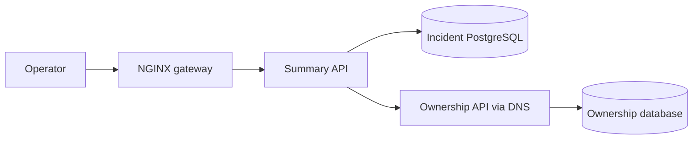
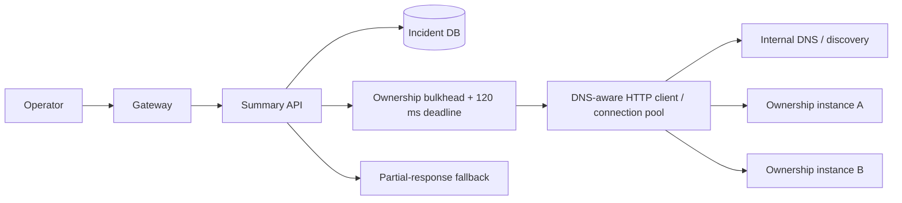
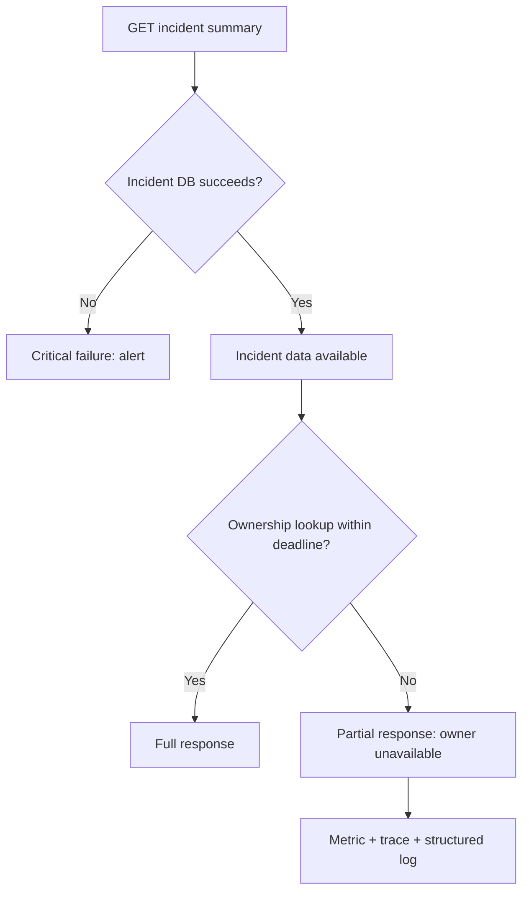
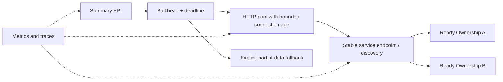

# Lesson 06 — Service Discovery, DNS Caching & Partial Outages

> **Daily Architecture Incident Lab | 11 November 2026 | 20–25 minutes**  
> **Level:** Experienced Python/Linux SRE moving toward system/platform architecture  
> **Status:** Guided lesson; architect challenges deliberately unanswered.

## Learning objectives and agenda

| Minutes | Activity |
|---|---|
| 0–4 | Problem, requirements, and failure domains |
| 4–8 | Capacity and incremental design |
| 8–17 | Hypothetical incident: evidence-led investigation |
| 17–21 | Mitigation, redesign, observability, validation |
| 21–25 | Three independent architect challenges |

**First principle:** A healthy caller and a healthy destination do not guarantee a healthy *path between them*. DNS resolution, caching, connection reuse, routing, and deployment draining are architectural dependencies. This lesson advances beyond previous topics of notification queues, idempotency, retry storms, and API gateway circuit breakers. It aligns with general public system-design themes (availability, DNS, load balancing) discussed at [Codemia](https://codemia.io/) without assuming course completion.

## 1. Realistic design problem

An incident dashboard's Summary API fetches incident data from PostgreSQL and optional on-call ownership details from `ownership.service.internal`. During an Ownership API rollout, the DNS record changes from `192.0.2.41` to `192.0.2.82`, but some Summary API processes continue contacting the retired IP. Operators see slow dashboards even though both the incident database and the new Ownership API instance are healthy.

### Functional requirements

1. Display incident ID, severity, and status even if ownership lookup fails.
2. Enrich the response with owner details when available.
3. Allow backend replacement without changing client configuration.
4. Support rolling deployment and rollback without widespread errors.
5. Explicitly identify partial responses rather than silently presenting missing ownership as an empty owner.

### Nonfunctional requirements

| Measure | Target | Rationale |
|---|---:|---|
| Summary API availability | 99.95% monthly | Operators need core incident data |
| p95 summary latency | <400 ms | Fast triage |
| Ownership dependency deadline | 120 ms | Optional dependency cannot dominate |
| Endpoint-change recovery | <60 s | Safe rollouts |
| Peak summary throughput | 600 requests/s | Capacity planning |
| Ownership lookup fraction | 80% | Realistic partial enrichment |
| Monthly error budget (30 days) | 21.6 minutes | 0.05% × 43,200 min |

**Architect's decision:** Ownership is an *optional* dependency. An explicit partial response is better than failing to show the incident itself.

## 2. Quantitative capacity estimation

At peak, ownership lookup rate = `600 × 0.80 = 480 requests/s`.

Using Little's Law (`concurrency = arrival rate × mean time in system`):

- At normal 30 ms mean lookup time: `480 × 0.030 = 14.4` concurrent lookups.
- At 120 ms timeout: `480 × 0.120 = 57.6` concurrent lookups, **before retries**.
- With one retry for every failed lookup, attempted request rate can approach `960/s`; in-flight attempts can approach `115` if each attempt occupies 120 ms.
- A 45-second stale-endpoint window could affect up to `480 × 45 = 21,600` lookup attempts, assuming every affected lookup contacts the old IP.

These are illustrative upper-bound planning calculations, not actual measurements. Connection reuse, distribution of stale clients, request mix, and retries change the result. **A low CPU percentage does not mean a dependency is healthy.**

## 3. Incremental architecture

### Stage A: naive hard dependency



**Failure:** If the Summary API requires both calls to succeed, a slow optional service causes full-page failures. No policy defines when the HTTP client re-resolves names or retires existing TCP connections.

### Stage B: discovery-aware graceful degradation



DNS supplies addresses, but the HTTP client controls *when* it resolves them and whether it reuses an already-established connection. A short DNS TTL **does not close existing TCP connections**. A Kubernetes ClusterIP Service gives a stable virtual endpoint; headless Services expose endpoint addresses to clients. Both still need proper timeouts and readiness handling.

### Stage C: explicit critical versus optional dependencies



### Technology and design tradeoffs

| Option | Benefit | Risk/cost | Good fit |
|---|---|---|---|
| DNS A/AAAA and client re-resolution | Simple, portable | Runtime and connection caches vary | VM-based services |
| Kubernetes ClusterIP Service | Stable virtual IP, endpoint routing | Cluster networking adds failure modes | Standard Kubernetes workloads |
| Headless Service | Direct endpoint discovery | Clients must handle churn | Stateful/client-side LB |
| Service mesh / Envoy | Central traffic policies, telemetry | Additional control/data-plane complexity | Large multi-service estates |
| HTTP connection pooling | Reduces handshakes | Old peer connections may survive rotation | High-throughput clients |
| Bulkhead + deadline + fallback | Limits blast radius | Incomplete owner information | Optional enrichment |

## 4. Failure-mode analysis

| Failure | Evidence | User impact | Design control |
|---|---|---|---|
| Resolver unavailable | DNS errors | Missing owner details | Resolver resilience, fallback |
| Stale cached address | Old peer IP | Timeouts/refused connections | Refresh and pool retirement |
| Existing TCP connection to retired host | `ss` old peer | Repeated errors | Graceful drain, connection age |
| New instance unready | 503/reset | Intermittent failure | Readiness gates |
| Routing/firewall failure | TCP timeout to *new* IP | Missing owner details | Network observability |
| Excess retries | Attempts/request > 1 | Dependency overload | Retry budget + jitter |
| Single-zone issue | Errors clustered by zone | Partial regional outage | Zone-aware diagnostics |

## 5. HYPOTHETICAL production incident

> **HYPOTHETICAL SIMULATION — NOT REAL PRODUCTION DATA.** All timestamps, IPs, metrics, logs, and traces are illustrative. `192.0.2.0/24` is a documentation address range. Substitute actual hostnames only in an authorized environment; do not run disruptive fixes without approval.

At 09:00 UTC, DNS changes `ownership.service.internal` from `192.0.2.41` to `192.0.2.82` with a 30-second TTL. Old instance A drains at 09:01. Some Summary API processes retain connections to A.

| Time UTC | Observation |
|---|---|
| 08:58 | Ownership instance B passes readiness |
| 09:00 | DNS updated; A begins draining |
| 09:01 | Summary p95 rises from 95 ms to 390 ms |
| 09:02 | Ownership timeout rate 12%; incident DB healthy |
| 09:04 | Some Summary processes still contact old peer |
| 09:06 | Controlled pool retirement; partial fallback enabled |
| 09:09 | Errors return to baseline; validation begins |

### Step 1 — establish the blast radius (09:02)

**Question:** Is the whole dashboard broken, or only optional ownership enrichment?

Illustrative metrics:

```text
summary_requests_total{status="200"} rate=580/s
summary_requests_total{status="504"} rate=20/s
ownership_requests_total{outcome="timeout"} rate=58/s
incident_db_query_duration_seconds p95=0.012
ownership_client_duration_seconds p95=0.120
summary_cpu_utilization=38%
```

**Interpretation:** Incident DB latency is low; ownership latency reaches its 120 ms deadline. Some instances may lack graceful fallback. CPU is not saturated, so a resource/connection-path problem is plausible.

### Step 2 — correlate logs and traces (09:03)

```bash
# Read-only; adapt the systemd unit and date for your environment.
sudo journalctl -u summary-api \
  --since '2026-11-11 09:00:00 UTC' \
  --until '2026-11-11 09:05:00 UTC' --no-pager | tail -n 30
```

Illustrative output:

```text
09:03:12 summary-api[4221]: WARN dependency=ownership peer=192.0.2.41:443 error=connect_timeout elapsed_ms=120 trace_id=abc123
09:03:12 summary-api[4221]: INFO incident_lookup=ok elapsed_ms=11 trace_id=abc123
09:03:12 summary-api[4221]: ERROR fallback=disabled response_status=504 trace_id=abc123
```

Illustrative distributed trace:

```text
trace abc123  GET /summary/INC-1042          124 ms
  postgres SELECT incident                   11 ms OK
  GET ownership.service.internal            120 ms TIMEOUT
    peer.ip=192.0.2.41
```

**Interpretation:** The optional Ownership API is the bottleneck. The old peer address is a clue, **not proof** of stale DNS; an established connection or proxy may explain it.

### Step 3 — compare DNS answers with actual TCP peers (09:04)

```bash
# Configured resolver; dig may require installation.
getent ahostsv4 ownership.service.internal
dig ownership.service.internal A +noall +answer

# Existing outbound TLS connections; use PID to identify the application.
sudo ss -tnp '( dport = :443 )' | head -n 20

# Force new IP while retaining hostname/SNI and certificate validation.
curl --connect-timeout 2 --max-time 4 \
  --resolve ownership.service.internal:443:192.0.2.82 \
  -sS -o /dev/null \
  -w 'HTTP %{http_code} connect=%{time_connect}s total=%{time_total}s\n' \
  https://ownership.service.internal/health
```

Illustrative output:

```text
ownership.service.internal. 18 IN A 192.0.2.82
ESTAB 0 0 10.1.0.12:49122 192.0.2.41:443 users:(("python3",pid=4221,fd=32))
HTTP 200 connect=0.009s total=0.021s
```

**Interpretation:** DNS now resolves to the new healthy endpoint, while an established client connection still targets the old peer. Reducing TTL alone cannot retire that connection. `curl --resolve` tests the selected IP while preserving hostname-based TLS validation; do **not** use `-k` to hide certificate problems.

### Step 4 — distinguish network and TLS failures (09:05)

```bash
ip route get 192.0.2.82
nc -vz -w 2 192.0.2.82 443
openssl s_client -connect 192.0.2.82:443 \
  -servername ownership.service.internal -brief </dev/null
```

Expected interpretations:

- `ip route get` shows selected route/interface; it **does not prove** reachability.
- `nc` success proves TCP connect, not HTTP health or TLS identity.
- `openssl s_client` exposes handshake/certificate details; separately verify hostname when required.
- Failure to connect to the **new** IP suggests routing, firewall, load balancer, or service readiness rather than stale connections alone.

### Step 5 — exclude database or application saturation (09:05)

```sql
-- Run with read-only PostgreSQL monitoring access.
SELECT state, wait_event_type, count(*)
FROM pg_stat_activity
WHERE datname = current_database()
GROUP BY state, wait_event_type
ORDER BY count(*) DESC;

SELECT now() - query_start AS running_for, state, wait_event_type,
       left(query, 120) AS query
FROM pg_stat_activity
WHERE state = 'active'
ORDER BY query_start
LIMIT 10;
```

Illustrative output:

```text
state  | wait_event_type | count
idle   | Client          | 12
active |                 |  2
```

**Interpretation:** No obvious DB pile-up; consistent with the observed 11 ms query. Still inspect application pool-wait and slow-query metrics before completely excluding database pressure.

```bash
ps -eo pid,etimes,%cpu,%mem,args | grep '[s]ummary-api'
sudo ss -s
# Only if your app exposes local metrics:
curl -fsS http://127.0.0.1:9090/metrics | \
  grep -E 'ownership_client|http_pool|fallback'
```

Illustrative metrics:

```text
ownership_client_active_connections 40
ownership_client_connections_to_draining_peer 17
ownership_client_retries_total 0
summary_partial_responses_total 0
```

**Interpretation:** Existing connections to a draining endpoint and missing fallback explain why an optional failure becomes a dashboard failure. These metric names are *proposed instrumentation*, not universal library defaults.

## 6. Root cause versus systemic design weakness

**Immediate root cause (hypothetical):** Long-lived HTTP client connections continued targeting the retired Ownership API IP after the old instance stopped serving traffic.

**Contributing deployment cause:** Endpoint drain duration was shorter than client connection lifetime.

**Design weaknesses:** No explicit contract between discovery and connection-pool lifetime; optional dependency treated as mandatory on some instances; no alert for stale peers after rollout; no endpoint-rotation chaos test.

**Why this is not automatically a DNS outage:** The observed DNS answer was correct. An old peer in `ss` is an existing TCP connection. Measure application resolver caching separately before blaming DNS.

## 7. Mitigation, redesign, and tradeoffs

### Immediate containment

1. Restore the Summary API's explicit partial-response fallback.
2. If possible, keep old Ownership instance available until in-flight connections drain.
3. Gracefully retire stale HTTP pools or roll Summary API instances **one at a time**; avoid fleet-wide restarts.
4. Keep ownership timeout at 120 ms and cap concurrent calls. Avoid aggressive retries.
5. Check all zones and application versions for recovery; preserve logs and traces.

**Rollback condition:** If the rollout introduced the problem and controlled pool retirement fails, consider rollback with standard change approval and monitored gates.

### Durable architecture



- Prefer platform-managed stable service endpoints when available.
- Configure connection lifetime and graceful termination together; DNS TTL alone is insufficient.
- Remove unready endpoints before new traffic, then drain in-flight requests.
- Bound retries by remaining deadline and global retry budget.
- A partial HTTP 200 is acceptable only when the API contract clearly signals `owner_status="unavailable"` and core incident data succeeded.
- Budget example: gateway/network 50 ms + ownership 120 ms + DB 50 ms + processing/headroom 80 ms = 300 ms, leaving 100 ms toward the 400 ms target. This is a design allocation, not a mathematically guaranteed p95.

### Observability

| Signal | Purpose |
|---|---|
| Ownership timeout/error rate by reason | Alert on dependency failures |
| Ownership latency p95/p99 | Detect approach to 120 ms deadline |
| Partial responses | Track degraded experience explicitly |
| Connection age and retired-peer count | Detect stale pools |
| DNS error rate and lookup latency | Separate DNS from TCP failures |
| Deployment marker and endpoint inventory | Correlate rollout with failures |
| Per-instance and per-zone error rates | Identify partial fleet failures |
| Trace attributes for resolved and connected IP | Explain endpoint selection |

Avoid incident IDs, trace IDs, and arbitrary peer IPs as unbounded metric labels; use logs/traces for high-cardinality evidence.

## 8. Validation checklist

1. Disable Ownership API: incident ID/severity still render with clear degraded-owner indicator.
2. Rotate DNS/service endpoints: measure time until all clients stop contacting old peers; target <60 s.
3. Hold keepalive connections open: validate graceful drain and connection expiry.
4. Drop old-endpoint traffic in staging: verify no retry storm.
5. Load test 600 Summary requests/s: measure p95 and ownership concurrency.
6. Deploy in 25% → 50% → 100% increments with readiness and rollback gates.
7. Verify recovery with error rates, partial-response rates, stale-peer connections, and user-visible results.
8. Record before/after graphs, commands, and a timeline.

## 9. Optional hands-on lab — simulate stale endpoint selection

This simplified Python 3.10+ simulation models endpoint caching; **real TCP keepalive pooling is a separate mechanism**.

Save as `lesson06_sim.py`:

```python
from dataclasses import dataclass

@dataclass
class Client:
    cached_ip: str
    max_age_seconds: int
    last_refresh: int = 0

    def destination(self, now: int, dns_ip: str) -> str:
        if now - self.last_refresh >= self.max_age_seconds:
            self.cached_ip = dns_ip
            self.last_refresh = now
        return self.cached_ip

def run(max_age: int) -> None:
    client = Client("192.0.2.41", max_age)
    failures = 0
    print(f"\nmax_age={max_age}s")
    for second in range(0, 91, 10):
        dns_ip = "192.0.2.41" if second < 30 else "192.0.2.82"
        old_alive = second < 40
        peer = client.destination(second, dns_ip)
        ok = peer == "192.0.2.82" or old_alive
        failures += not ok
        print(f"t={second:02d}s DNS={dns_ip} peer={peer} status={'OK' if ok else 'FAIL'}")
    print("failed samples:", failures)

for age in (60, 20):
    run(age)
```

Run:

```bash
python3 lesson06_sim.py
```

**Expected:** At a 60-second refresh interval, the client keeps the old peer after it drains at 40 seconds and fails at 40/50-second samples. At a 20-second interval, it refreshes to the new IP at 40 seconds and avoids those failures. Extend the lab with a configurable drain period, 120 ms deadline, and bounded retry budget.

## 10. Three independent architect challenges

**Challenge 1 — capacity and SLO.** At 900 Summary requests/s, 70% need ownership, timeout is 150 ms, and a stale-connection window lasts 75 seconds. Calculate (a) potentially affected lookup attempts without retries, (b) in-flight ownership calls at timeout, and (c) effect of one retry per failed attempt. State assumptions and recommend a concurrency cap.

**Challenge 2 — architecture tradeoff.** You migrate from Linux VMs to Kubernetes. Compare ClusterIP Service, headless Service with client-side discovery, and service mesh for a small team managing 12 services. Address readiness, draining, DNS/client caching, cost, operational complexity. Draw your recommendation in Mermaid.

**Challenge 3 — incident reasoning.** During rollout, `dig` returns the new IP, `ss` shows old-IP connections, and `curl --resolve` to the new IP returns HTTP 200. An engineer proposes reducing TTL from 30 seconds to 1 second. Is that sufficient? Give three alternative hypotheses, distinguishing commands/metrics, safe immediate mitigation, and a long-term validation test.

Do not look for an answer key; write assumptions, evidence, tradeoffs, and what would falsify your hypotheses.

## 11. Further reading

- [Codemia — public system-design topics](https://codemia.io/)
- [Kubernetes DNS for Services and Pods](https://kubernetes.io/docs/concepts/services-networking/dns-pod-service/)
- [Kubernetes Services](https://kubernetes.io/docs/concepts/services-networking/service/)
- [Python urllib3 connection pools](https://urllib3.readthedocs.io/en/stable/reference/urllib3.connectionpool.html)
- [Linux ss manual](https://man7.org/linux/man-pages/man8/ss.8.html)
- [Hands-on SRE/DevOps Architecture Labs](https://github.com/samperay/sre-devops-architecture-labs)

**Next suggested lesson:** PostgreSQL connection-pool exhaustion and head-of-line blocking; per-instance pool sizing versus database `max_connections`.

---

## My Architecture Review — Solutions & Doubts

### 1. My Understanding

> _Explain DNS resolution, stale connections, and why an optional dependency should not block critical incident data (5–8 sentences)._

### 2. My Solutions to the Architect Challenges

**Challenge 1 — Capacity and SLO**

- My assumptions: _..._
- My calculations with units: _..._
- My concurrency limit and reasoning: _..._

**Challenge 2 — Architecture tradeoff**

- My recommended approach and why: _..._
- My Mermaid diagram: _..._
- Alternatives and tradeoffs: _..._

**Challenge 3 — Incident reasoning**

- My hypotheses: _..._
- My commands and expected evidence: _..._
- My mitigation and long-term test: _..._

### 3. My Troubleshooting Approach

- First hypothesis: _..._
- Ordered commands/tools: _..._
- Evidence and interpretation: _..._
- What would disprove the hypothesis: _..._
- Rollback/escalation decision: _..._

### 4. My Proposed Architecture Improvements

- Changes: _..._
- Tradeoffs/risks: _..._
- Verification plan: _..._
- Observability: _..._

### 5. My Doubts / Questions

- [ ] _Question 1: ..._
- [ ] _Question 2: ..._
- [ ] _Question 3: ..._

### 6. Lessons Learned

- Most important insight: _..._
- Production mistake to avoid: _..._
- Application to my systems: _..._

### 7. Mentor Review