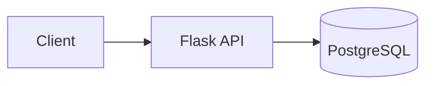
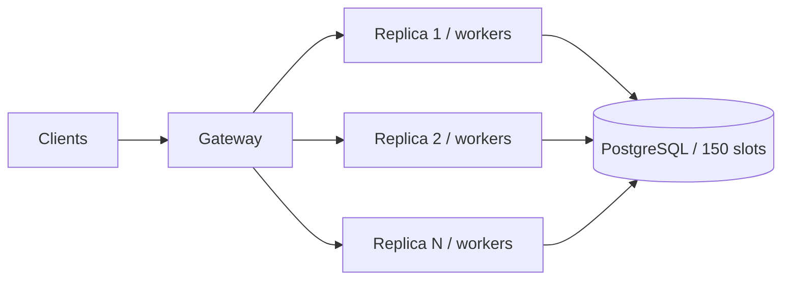
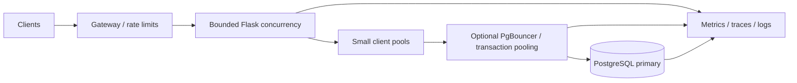

# Lesson 07 — Database Connection Pool Exhaustion and Admission Control

> **Daily Architecture Incident Lab | 12 November 2026 | 20–25 minutes**  
> For an experienced Python/Linux SRE moving toward system/platform architecture.  
> **All incident logs, metrics, traces, and outputs below are HYPOTHETICAL / SIMULATED**, not real production evidence.

## Learning objectives and 25-minute plan

| Time | Focus |
|---|---|
| 0–4 min | Requirements and failure domains |
| 4–8 min | Capacity and incremental architecture |
| 8–17 min | Chronological evidence-led incident investigation |
| 17–21 min | Mitigation, redesign, observability, validation |
| 21–25 min | Three independent architect challenges |

**First principle:** A PostgreSQL connection is a finite concurrency slot, not a throughput guarantee. Scaling API replicas can exhaust database capacity when each process owns an independent pool.

## 1. Realistic problem and requirements

A Python Flask incident-management API serves requests behind a gateway. The API reads incidents and appends updates to PostgreSQL. A rollout increases application replicas from 4 to 12; suddenly HTTP 5xx and latency increase despite low CPU.

**Functional requirements:** create incidents with stable IDs; read incident state; append audited updates with idempotency keys; authenticate callers; expose useful readiness signals.

**Nonfunctional requirements (design assumptions):**

| Requirement | Target |
|---|---|
| Availability | 99.9% monthly |
| Read p95 | Under 250 ms |
| Write p95 | Under 400 ms |
| Traffic | 300 RPS average; 900 RPS peak |
| Request mix | 80% reads / 20% writes |
| Durability | Acknowledged writes survive one API replica failure |
| Recovery | Restore steady state within 10 minutes |
| Security | TLS, least-privilege DB role, no credentials in logs |

**Architect question:** What resource is shared across replicas, and what is its global admission limit?

## 2. Quantitative capacity model

Assume 12 replicas, 2 worker processes per replica, SQLAlchemy `QueuePool(pool_size=8, max_overflow=4)` **per process**.

- Worst-case app sessions = `12 × 2 × (8 + 4) = 288`.
- Warm base pool potential = `12 × 2 × 8 = 192`.
- PostgreSQL `max_connections=150`; reserve 20 for admin/monitoring/other clients; **application budget = 130**.
- Worst-case oversubscription = `288 / 130 ≈ 2.22×`.
- Little's Law: at 900 RPS and 60 ms connection hold time, expected occupied connections `L=λW=900×0.060=54`, assuming steady state and representative workload.
- If locks raise hold time to 300 ms, demand becomes `900×0.300=270` concurrent checkouts. Headroom and uneven traffic matter.

**Distinguish:** request duration, time waiting for a connection, transaction duration, and SQL execution time are different measurements. The number 54 is not a sufficient pool-size recommendation.

**Mini-exercise:** For 8 replicas, 2 processes each, pool size 5, overflow 2, calculate worst-case sessions and leave space for rollout surge.

## 3. Evolve the architecture

### V0 — Simple synchronous access



One process is easy to understand but limits availability and scaling.

### V1 — Scale API replicas, accidentally multiply pools



Each worker process owns its own SQLAlchemy pool. Old and new replicas may coexist during a rollout. **Replica count is not a connection budget.**

### V2 — Budgeted admission and optional pooling



| Decision | Benefit | Cost or limitation |
|---|---|---|
| SQLAlchemy QueuePool | Local reuse and bounded checkout | Per-process multiplication |
| Small pool + admission control | Protects DB | May queue/reject traffic |
| PgBouncer transaction pooling | Multiplexes many clients onto fewer server sessions | Session-state compatibility; another failure domain |
| Read replica | Offloads eligible reads | Replication lag, read consistency |
| Cache | Removes repeated hot reads | Invalidation and freshness |
| Increase `max_connections` | Possible short-term relief | Backend memory, context switching, masks cause |

**PgBouncer is not a faster database.** Transaction pooling is unsuitable for some session-dependent behavior (session-level settings, temp tables, LISTEN/NOTIFY, prepared statements depending on versions/configuration). Validate real application behavior before adoption.

## 4. HYPOTHETICAL production incident: 09:00–09:24 UTC

| UTC | Simulated signal | Investigation significance |
|---|---|---|
| 09:00 | Scale-out 4 → 12 replicas | Correlation, not proof |
| 09:03 | HTTP 5xx 0.1% → 8% | User impact |
| 09:04 | API p95 180 ms → 3.8 s | Queueing/dependency delay |
| 09:06 | Pool checkout p95 8 ms → 1.9 s | Pool contention |
| 09:08 | DB sessions 148/150 | Server admission nearly exhausted |
| 09:10 | DB CPU 34%, normal disk latency | Not CPU-bound |
| 09:12 | Reporting transaction and blocked writes found | Connection hold times prolonged |
| 09:16 | Rollout frozen; safely reduce replicas and coordinate reporting cancellation | Controlled mitigation |
| 09:24 | 5xx and checkout waits recover | Immediate incident resolved, design weakness persists |

### Step 1 — Establish deployment scope

Run on an authorized Kubernetes operations workstation (adapt to your platform, e.g., Code Engine):

```bash
kubectl -n incident-api get deploy incident-api -o wide
kubectl -n incident-api rollout history deploy/incident-api
kubectl -n incident-api get pods -l app=incident-api -o wide
```

**Expected simulated result:** 12 ready pods, most created in the past five minutes. **Interpretation:** capacity changed at the same time as the outage; next prove whether database sessions rose.

```bash
kubectl -n incident-api logs deploy/incident-api --since=15m --all-containers=true \
  | grep -E 'QueuePool|OperationalError|request_id|status=5' | tail -30
```

**Simulated logs:**

```text
09:06:31Z ERROR request_id=6f12 route=/incidents/42 status=503 latency_ms=3011 error="QueuePool limit of size 8 overflow 4 reached, connection timed out, timeout 3.00"
09:07:02Z ERROR request_id=6f13 route=/incidents status=500 db_error="remaining connection slots are reserved"
```

**Interpretation:** the first is **local pool checkout exhaustion**; the second is **server-side session admission refusal**. They are different failure points.

### Step 2 — Form falsifiable hypotheses

| Hypothesis | Supporting evidence | Evidence against |
|---|---|---|
| H1: Too many app pools | Replica/process count and DB sessions rise together | Sessions unchanged |
| H2: Slow/blocked transactions | Old transactions, lock waits, pool hold time | Short transactions and no blocking |
| H3: DNS/TCP failure | Failed handshakes, resolution errors | Successful TCP and explicit pool errors |
| H4: DB CPU/I/O saturation | CPU, disk wait, query duration high | Low CPU and short SQL spans |

Investigate H1 and H2 together rather than assuming one explanation.

### Step 3 — Linux/network: distinguish reachability from admission

```bash
getent ahostsv4 postgres.internal.example
ss -tan '( dport = :5432 )' | head -20
nc -vz -w 2 postgres.internal.example 5432
pg_isready -h postgres.internal.example -p 5432 -t 2
```

**Simulated output:** DNS resolves `10.20.3.18`; TCP succeeds; many `ESTAB` sessions; `pg_isready` says `accepting connections`. **Interpretation:** network path exists, but this does not guarantee the app can acquire a DB session or execute SQL. Revisit H3 if TCP or DNS fails.

### Step 4 — Database evidence

Use a read-only authorized observability role. Visibility differs by PostgreSQL version and permissions.

```sql
SELECT application_name, state, count(*) AS sessions
FROM pg_stat_activity
WHERE backend_type = 'client backend'
GROUP BY application_name, state
ORDER BY sessions DESC;

SHOW max_connections;
SHOW superuser_reserved_connections;

SELECT pid, application_name, state, wait_event_type, wait_event,
       now() - xact_start AS transaction_age,
       left(query, 120) AS query_excerpt
FROM pg_stat_activity
WHERE pid <> pg_backend_pid() AND xact_start IS NOT NULL
ORDER BY xact_start NULLS LAST LIMIT 15;

SELECT a.pid AS blocked_pid, a.application_name,
       pg_blocking_pids(a.pid) AS blocking_pids,
       now() - a.query_start AS query_age
FROM pg_stat_activity a
WHERE cardinality(pg_blocking_pids(a.pid)) > 0
ORDER BY query_age DESC LIMIT 20;
```

**Simulated finding:** incident API 136 sessions, reporting 8, other 4; 148 total. Reporting PID 7421 has a five-minute transaction; several writes blocked by it. **Interpretation:** connection over-allocation combined with long-held transactions. An `idle` session consumes a connection; `idle in transaction` can additionally retain locks/snapshots. Do not cancel a production backend without identifying its owner and effects.

### Step 5 — Metrics and tracing

Illustrative **custom** metric names (not built-in SQLAlchemy metrics):

```promql
db_server_connections{service="incident-db"} / db_max_connections{service="incident-db"}
```

```promql
histogram_quantile(0.95,
  sum by (le) (rate(app_db_pool_checkout_wait_seconds_bucket[5m])))
```

```promql
sum(rate(http_requests_total{service="incident-api",status=~"5.."}[5m]))
/
sum(rate(http_requests_total{service="incident-api"}[5m]))
```

**Simulated readings:** connection utilization 98.7%, pool wait p95 1.9 s, 5xx 8%, CPU 34%. **Interpretation:** admission/lock contention, not necessarily compute exhaustion.

**Simulated distributed trace:**

```text
trace_id=4d88  GET /incidents/42      3812 ms
  auth.verify                      11 ms
  db.pool.checkout               2941 ms
  db.query.SELECT incident         38 ms
  serialize                         7 ms
  other/uninstrumented            815 ms
```

**Interpretation:** SQL execution is short; waiting for a connection dominates. Add pool checkout spans, not only SQL spans.

### Step 6 — Inspect effective Python pool settings

```python
from sqlalchemy import create_engine

engine = create_engine(
    DATABASE_URL,
    pool_size=8,
    max_overflow=4,
    pool_timeout=3,
    pool_pre_ping=True,
)
```

Ask how many **processes** instantiate this engine. In SQLAlchemy 1.4, pools are process-local. Do not share live pooled connections across fork boundaries; recreate/dispose in child processes as needed.

## 5. Root cause versus design weakness

**Hypothetical trigger:** scaling API processes from 4 to 12 replicas while a reporting transaction increased connection hold time.

**Technical root cause:** demand for concurrent database sessions exceeded usable server slots; application pool checkout and server admission failed.

**Architectural weakness:** no global DB connection budget, no deployment-surge allowance, insufficient isolation of reporting traffic, and no rollout guardrail on checkout wait or session utilization.

**Lesson:** low DB CPU is compatible with severe DB unavailability caused by connection limits or locks.

## 6. Immediate mitigation and rollback

1. Declare impact, freeze rollout/scale-out, capture deployment revisions, request IDs, and DB snapshots.
2. Reduce replicas **gradually if capacity permits**; avoid overloading the remaining pods.
3. Identify the blocking reporting transaction; coordinate with its owner before considering `pg_cancel_backend(pid)`. Termination is more disruptive.
4. Bound DB concurrency and apply fast, observable overload responses rather than unlimited request queueing.
5. Recalculate smaller per-process pools and overflow settings, ensuring that new wait times remain acceptable.
6. Do **not** reflexively increase `max_connections`, restart all pods, or retry every failure; these can intensify saturation.

**Rollback criteria:** worsening 5xx, increasing checkout waits, persistent write latency SLO breach, or insufficient serving capacity. Record before/after values.

## 7. Durable redesign, observability and validation

**Global budget example:** 130 usable DB sessions; reserve 20 for rollout surge and 20 for other clients; 90 API sessions remain. With 8 replicas × 2 processes, `pool_size=5, max_overflow=0` gives 80 possible API sessions. This is only a starting envelope; validate against actual transaction duration and traffic. With 12 replicas the configuration or surge limit must change.

**Controls:** CI/CD budget validation; bounded request admission; dedicated reporting role and budget; reviewed `statement_timeout` and `idle_in_transaction_session_timeout`; optional PgBouncer after session-state compatibility testing; sensible readiness that does not flap all replicas simultaneously.

| Signal | Illustrative review threshold | Purpose |
|---|---|---|
| DB sessions / usable cap | >80% 10 min; >90% 5 min | Headroom |
| Pool checkout wait p95 | >100 ms 5 min | Early contention |
| Pool timeout count | Sustained nonzero | Direct failure precursor |
| Old transactions | >60 s, workload-dependent | Locks and snapshots |
| Lock wait p95 | >200 ms 5 min | Blocking |
| HTTP error and latency | SLO burn-rate based | User impact |
| Max pool budget at surge | Must fit approved allocation | Prevent unsafe rollout |

**Validation matrix:**

| Scenario | Pass condition |
|---|---|
| Baseline 300 RPS | Healthy p95 and pool waits |
| Peak 900 RPS | SLO met or graceful, documented overload response |
| 12-replica rollout surge | No unexpected session cap breach |
| Staging 30-second row lock | Visible blocking and bounded impact |
| Forced connection refusal | Fast 503, no retry storm |
| Pooler restart if used | Recovery within budget, no write ambiguity |
| Load removed | Queue drains and sessions recover |

Collect dashboards, traces, query snapshots, configuration diffs, and rollback evidence. Run destructive tests only in staging.

## 8. Optional hands-on Python 3.10 lab

Use a **disposable local PostgreSQL database** and a virtual environment. Never lower production connection limits for practice.

```python
import concurrent.futures
import time
from sqlalchemy import create_engine, text
from sqlalchemy.exc import TimeoutError

engine = create_engine(DB_URL, pool_size=2, max_overflow=0, pool_timeout=1)

def task(i):
    start = time.monotonic()
    try:
        with engine.connect() as conn:
            wait = time.monotonic() - start
            conn.execute(text("SELECT 1"))
            time.sleep(2)  # SIMULATED hold; never do this in a real handler
            return i, "ok", round(wait, 3)
    except TimeoutError:
        return i, "pool_timeout", round(time.monotonic() - start, 3)

with concurrent.futures.ThreadPoolExecutor(max_workers=10) as executor:
    print(list(executor.map(task, range(10))))
```

**Expected:** only two concurrent checkouts; many of the other tasks time out after ~1 second, with exact results dependent on scheduling. Repeat with five threads, then two separate processes (each with its own engine) to demonstrate multiplication. Record the observed outcomes; close connections with context managers.

## 9. Three independent architect challenges

### Challenge A — Capacity and rollout surge

PostgreSQL permits 220 connections. Reserve 30 for administration/monitoring and 40 for other services. The API normally runs 10 replicas, 3 processes each; deployment allows 25% extra replicas, **round up**. Choose `pool_size` and `max_overflow` that fit the API budget **during rollout**. Show calculations. What changes when connection hold time increases from 40 to 200 ms at 600 RPS?

### Challenge B — Pooling technology tradeoffs

A Python API has 60 mostly idle processes. One workflow uses session-level `SET` and temporary tables. Compare direct small pools, PgBouncer **session** pooling, and PgBouncer **transaction** pooling. Recommend a strategy, compatibility tests, and an escape hatch. Explain what PgBouncer cannot solve.

### Challenge C — Incident command under uncertainty

HTTP 5xx is 9%, DB CPU 40%, session utilization 95%, and lock waits 800 ms. One engineer wants to increase `max_connections`; another wants to restart all API pods. Give your **first three actions**, evidence that would change your diagnosis, and rollback criteria. Distinguish symptom, trigger, technical root cause, and systemic weakness.

## 10. Further reading

- [PostgreSQL connection settings](https://www.postgresql.org/docs/current/runtime-config-connection.html)
- [PostgreSQL activity monitoring](https://www.postgresql.org/docs/current/monitoring-stats.html)
- [SQLAlchemy 1.4 connection pooling](https://docs.sqlalchemy.org/en/14/core/pooling.html)
- [PgBouncer features](https://www.pgbouncer.org/features.html)
- [Codemia system design topics](https://codemia.io/) — optional reference only; no course completion assumed.

---

## My Architecture Review — Solutions & Doubts

> Editable learning journal. Preserve your reasoning, including hypotheses later disproved.

### 1. My Understanding

**Problem in my own words:** _[Write here]_

**Important assumptions and capacity constraints:** _[Write here]_

**Why API scaling can overload the DB:** _[Write here]_

### 2. My Solutions to the Architect Challenges

**Challenge A — Budget and surge**

- Calculations: _[Show math]_
- Design: _[Write here]_
- Tradeoffs and reasoning: _[Write here]_

**Challenge B — Pooling choice**

- Recommendation: _[Write here]_
- Compatibility tests: _[Write here]_
- Why alternatives are weaker: _[Write here]_

**Challenge C — Incident leadership**

- First three actions: _[Write here]_
- Evidence that would change my mind: _[Write here]_
- Rollback criteria: _[Write here]_

### 3. My Troubleshooting Approach

| Hypothesis | Command / tool | Expected evidence | Observed evidence | Conclusion |
|---|---|---|---|---|
| _[H1]_ | _[Tool]_ | _[Expected]_ | _[Observed]_ | _[Keep/reject]_ |
| _[H2]_ | _[Tool]_ | _[Expected]_ | _[Observed]_ | _[Keep/reject]_ |

**My investigation order and reasoning:** _[Write here]_

### 4. My Proposed Architecture Improvements

| Change | Benefit | Tradeoff / risk | Validation |
|---|---|---|---|
| _[Proposal]_ | _[Benefit]_ | _[Risk]_ | _[Test]_ |

### 5. My Doubts / Questions

- [ ] _[Question 1]_
- [ ] _[Question 2]_
- [ ] _[Question 3]_

### 6. Lessons Learned

**Three insights:** _[Write here]_

**One anti-pattern I will avoid:** _[Write here]_

**Follow-up experiment:** _[Write here]_

### 7. Mentor Review

<!-- Leave blank for feedback, corrections, and next improvements. -->
