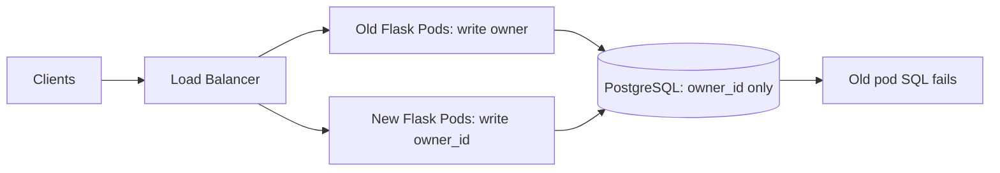
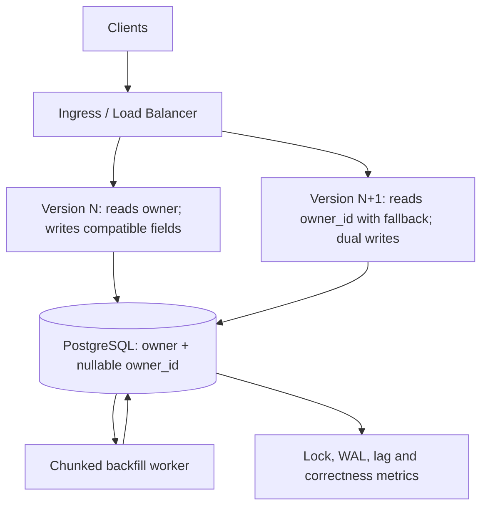
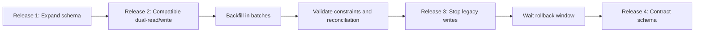
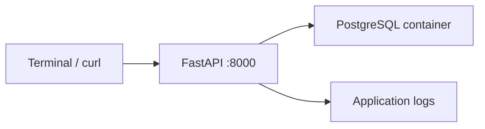

# Lesson 08 — Zero-Downtime Database Schema Migrations & Deployment Compatibility

> **Daily Architecture Incident Lab | 13 November 2026 | 20–25 minutes**  
> **Audience:** Experienced Python/Linux DevOps/SRE progressing toward system/platform architecture  
> **Scenario:** Entire incident and evidence below are **HYPOTHETICAL**, not a report of an actual outage.  
> **Prerequisites:** PostgreSQL basics, HTTP services, rolling deployments. No previous lesson completion is assumed.

## Learning objectives and timebox

| Time | Activity |
|---|---|
| 0–4 min | Define the problem, invariants, requirements and failure domains |
| 4–8 min | Estimate traffic, migration load and design deployment phases |
| 8–17 min | Investigate a hypothetical production incident chronologically |
| 17–21 min | Mitigate, redesign, instrument and validate |
| 21–25 min | Solve three independent architect challenges |

**First principle:** A rolling deployment is not zero downtime unless the *old application, new application and database schema can coexist* during the rollout and rollback window.

## 1. Realistic problem: an incident automation API

A Python Flask API receives incident updates and stores them in PostgreSQL. An upcoming release replaces `incidents.owner` (free-text username) with `owner_id` (foreign key to an `owners` table). The team wants richer ownership metadata and indexed joins.

Today the API writes `owner`. The proposed new release writes only `owner_id`. During a Kubernetes rolling update, old and new pods run concurrently. A direct `DROP COLUMN owner` can break the old pods even when every pod passes its own readiness probe.

### Functional requirements

1. Accept and retrieve incident updates without loss or duplication.
2. Resolve an incident's owner by stable ID; preserve existing owner data.
3. Support old and new application versions concurrently during rollout.
4. Permit safe rollback of application binaries without immediate database rollback.
5. Backfill legacy records and verify correctness before removing the old field.

### Nonfunctional requirements and invariants

| Dimension | Target / invariant |
|---|---|
| Availability | 99.95% monthly API availability (about 21.6 min/month for a 30-day month) |
| Latency | p95 update request below 250 ms under normal load |
| Durability | No acknowledged incident update is lost |
| Compatibility | N and N−1 app versions operate against the intermediate schema |
| Schema changes | Avoid long ACCESS EXCLUSIVE locks on hot tables |
| Backfill | Rate-limited, resumable, idempotent, measurable |
| Rollback | App rollback works without reversing destructive DDL |
| Data correctness | Every migrated row resolves to the expected owner |

**Clarify the boundary:** An application `/health` endpoint proves process liveness, not that its SQL statements are compatible with the current schema.

## 2. Quantitative capacity and migration budget

Assumptions for this exercise (not measured production values):

- 2,000,000 incident rows; 300 requests/second average; 900 requests/second peak.
- 40% of requests write incident updates, so **360 writes/second peak**.
- Existing `owner` is a 32-byte average text field; new `owner_id` is an 8-byte BIGINT.
- Backfill budget: 500 rows/second while serving normal traffic.
- 12 application replicas; rolling deployment uses `maxSurge=2`, `maxUnavailable=0`.

**Lower-bound backfill duration:** 2,000,000 / 500 = 4,000 seconds = **66.7 minutes**, excluding retries, pauses and verification. A 25% overhead allowance makes it about **83.3 minutes**.

**Backfill write rate:** At 500 rows/s × 8 bytes, new column payload alone is 4 KB/s; this is *not* the true disk cost. PostgreSQL MVCC creates new row versions and WAL, so benchmark WAL bytes/s, disk IOPS, replica lag and vacuum pressure instead of estimating from column size.

**Peak API write demand:** 900 × 0.4 = 360 writes/s. If a backfill also updates 500 rows/s, the database can see about **860 row updates/s** before index maintenance, replication and other queries. This is a workload model, not a claim that all updates cost the same.

**Availability budget:** 30 × 24 × 60 × (1 − 0.9995) = 21.6 minutes/month. A 10-minute deployment outage consumes nearly half the budget.

**Architect checkpoint:** Which measured resource—WAL generation, lock wait, CPU, replica replay lag or storage latency—should determine backfill throttling? Explain why a fixed rows/s limit alone is insufficient.

## 3. Incremental architecture

### Phase A — Fragile direct migration



Dropping `owner` before old pods are drained makes the old version incompatible. A successful new-pod readiness probe does not protect old requests.

### Phase B — Expand, migrate, contract



**Step 1 — Expand:** Add nullable `owner_id` without removing `owner`. Create `owners` lookup records and indexes with appropriate online techniques. For a large hot table, use `CREATE INDEX CONCURRENTLY` in a separate non-transactional migration step.

**Step 2 — Compatible application:** Deploy code that can read both representations. For new writes, use a transaction to keep both columns consistent while old pods remain. If the old app still writes only `owner`, the new app must tolerate temporarily missing `owner_id`, and a reconciliation/backfill process must cover those rows. Consider a database trigger only after evaluating complexity and failure behavior.

**Step 3 — Backfill:** Update bounded batches by primary key with checkpoints, throttling and retries. Never hold one transaction across millions of rows.

**Step 4 — Validate:** Verify row coverage, owner mapping correctness, read-path metrics, replicas and absence of old-version writers. Use constraints safely: `CHECK (owner_id IS NOT NULL) NOT VALID`, then `VALIDATE CONSTRAINT`; investigate PostgreSQL version-specific behavior before adding `NOT NULL`.

**Step 5 — Contract:** In a later release, after the rollback window and compatibility evidence, stop reading/writing `owner` and drop it during a separately approved migration.

### Technology and design tradeoffs

| Decision | Benefits | Costs / caveats |
|---|---|---|
| Expand–migrate–contract | Rolling deployment and app rollback compatibility | More releases, temporary dual representation |
| Dual writes in one DB transaction | Atomic within same database | Requires careful code path coverage and reconciliation for legacy writers |
| DB trigger to synchronize columns | Protects writers that do not know new column | Hidden behavior, trigger cost, recursive logic risk |
| Chunked backfill | Bounds locks, WAL and rollback size | Slower; requires checkpoint and observability |
| Logical replication / shadow table | Useful for major transformations | Operational complexity and cutover consistency |
| Immediate DROP / rename | Simple migration script | Breaks old code, often unsafe during rolling deploy |

**Rollback rule:** Roll back application traffic first; keep additive schema changes in place. Do not assume `DOWN` migration is safe after writes have begun using the new representation.

## 4. Failure modes and preventive controls

| Failure | Symptom | Preventive design |
|---|---|---|
| Old pod queries dropped column | SQLSTATE 42703, HTTP 500 | N/N−1 compatibility contract; contract later |
| DDL waits for lock | Requests block, rising p95 | Lock timeout; monitor blockers; schedule carefully |
| Backfill creates WAL surge | Replica lag, disk pressure | Batch/throttle using real DB metrics |
| Inconsistent dual writes | Old/new read paths disagree | Same-transaction writes, invariant tests, reconciliation |
| Long backfill transaction | Dead tuples, vacuum lag, locks | Small commits, checkpoints |
| Schema drift between environments | Migration works in staging, fails in prod | Migration CI against realistic PostgreSQL versions and schemas |
| Index build fails | Invalid index remains | Inspect `pg_index.indisvalid`, clean up and retry safely |

## 5. HYPOTHETICAL production incident — chronological investigation

**All timestamps, metrics, traces, logs and outputs in this section are simulated teaching examples.**

**09:00 UTC — Deployment begins.** A migration removes `incidents.owner` before old Flask replicas are terminated.

**09:01 UTC — Alert:** HTTP 5xx increases from 0.1% to 18%; p95 latency rises from 110 ms to 620 ms. Database CPU stays near 31%. Not every request fails because some traffic reaches new pods.

**09:02 UTC — Establish scope and timeline.**

```bash
kubectl -n incident-api get deploy incident-api -o wide
kubectl -n incident-api get pods -l app=incident-api -o custom-columns=NAME:.metadata.name,IMAGE:.spec.containers[0].image,READY:.status.containerStatuses[0].ready
kubectl -n incident-api rollout history deploy/incident-api
```

Expected simulated output:

```text
NAME           READY   UP-TO-DATE   AVAILABLE   AGE
incident-api   12/12   5            12          30d

NAME             IMAGE                 READY
incident-api-a   registry/api:v1.8     true
incident-api-b   registry/api:v1.8     true
incident-api-c   registry/api:v1.9     true
```

**Interpretation:** Old and new versions coexist. Readiness true does not rule out SQL incompatibility. Capture the deployment and migration timestamps.

**09:04 UTC — Correlate errors with version and SQLSTATE.**

```bash
kubectl -n incident-api logs deploy/incident-api --since=10m --all-containers=true --prefix=true | grep -E 'UndefinedColumn|42703|owner'
```

Simulated log:

```text
2026-11-13T09:01:12Z pod=incident-api-a version=v1.8 level=ERROR request_id=req-71 sqlstate=42703
psycopg2.errors.UndefinedColumn: column "owner" of relation "incidents" does not exist
statement="UPDATE incidents SET owner=$1 WHERE id=$2"
2026-11-13T09:01:13Z pod=incident-api-c version=v1.9 level=INFO request_id=req-72 status=200 duration_ms=86
```

**Interpretation:** SQLSTATE `42703` is an undefined-column error, not a connection pool timeout or database overload. Logs must avoid exposing personal incident data and query parameter values.

**09:06 UTC — Confirm schema and active sessions from a read-only DB session.**

```bash
psql "$DATABASE_URL" -X -v ON_ERROR_STOP=1 -c "\d+ public.incidents"
psql "$DATABASE_URL" -X -c "SELECT column_name, data_type FROM information_schema.columns WHERE table_schema='public' AND table_name='incidents' ORDER BY ordinal_position;"
psql "$DATABASE_URL" -X -c "SELECT state, wait_event_type, count(*) FROM pg_stat_activity WHERE datname=current_database() GROUP BY 1,2 ORDER BY 3 DESC;"
```

Simulated excerpt:

```text
column_name | data_type
------------+----------
id          | bigint
owner_id    | bigint
updated_at  | timestamp with time zone

state   | wait_event_type | count
idle    |                 | 62
active  |                 | 11
```

**Interpretation:** `owner` is absent, while connections and CPU are not saturated. Check the migration history before concluding *who* removed the column.

**09:08 UTC — Rule out transport and DNS failures.**

```bash
getent hosts postgres.internal
ss -tan '( dport = :5432 )' | head
curl -sS -o /dev/null -w 'status=%{http_code} total=%{time_total}\n' http://127.0.0.1:8080/health
```

Simulated output:

```text
10.42.8.21 postgres.internal
ESTAB 0 0 10.42.1.14:47722 10.42.8.21:5432
status=200 total=0.004
```

**Interpretation:** DNS and TCP connectivity work. The process health endpoint is insufficient to validate SQL compatibility. These commands must run in the relevant pod/network namespace; localhost refers to the execution environment.

**09:10 UTC — Trace the failing request.**

```text
trace_id=8a4f... HTTP PATCH /incidents/123
  gateway: 3ms
  flask-api v1.8: 27ms
    db UPDATE incidents SET owner=...: ERROR 42703
  HTTP response: 500
```

**Interpretation:** A deterministic query/schema mismatch is the dominant failure. Repeated retries will not fix it and may amplify load.

**09:12 UTC — Check whether a separate DDL lock is present.**

```sql
SELECT pid, state, wait_event_type, wait_event,
       pg_blocking_pids(pid) AS blockers,
       left(query, 120) AS query
FROM pg_stat_activity
WHERE datname = current_database()
  AND (wait_event_type = 'Lock' OR cardinality(pg_blocking_pids(pid)) > 0);
```

Expected simulated output: `(0 rows)`. **Interpretation:** This incident is schema incompatibility, not lock contention. If blockers exist, investigate them independently.

**09:14 UTC — Contain safely.** Pause the rollout and direct traffic only to compatible pods *if sufficient healthy capacity exists*. In this example the schema already dropped `owner`, so blindly rolling back to v1.8 makes the incident worse. Prefer rolling forward a verified compatible v1.9 hotfix or restoring the column through a reviewed additive migration that preserves data semantics. Do not restore a dropped column with empty values and declare success without data recovery checks.

```bash
kubectl -n incident-api rollout pause deploy/incident-api
kubectl -n incident-api get endpointslices -l kubernetes.io/service-name=incident-api
```

**09:20 UTC — Validate recovery.** Compare 5xx by app version, successful incident updates, error budget burn, schema version, and database health. Resume rollout only after a safe rollback/forward decision and canary verification.

## 6. Root cause versus architectural weakness

- **Trigger:** A destructive `DROP COLUMN owner` migration ran while v1.8 pods were still serving.
- **Technical root cause:** Old application SQL referenced a removed column; PostgreSQL returned SQLSTATE `42703`.
- **Systemic design weakness:** Deployment process treated database migration and application rollout as one atomic change, without an N/N−1 schema compatibility contract, staged deprecation, or SQL compatibility tests.
- **Not supported by evidence:** PostgreSQL CPU overload, DNS failure, pool exhaustion, or lock contention.

**Five-whys prompt:** Why did a destructive migration pass review? Why was it not gated on absence of old-version writers? Why didn't staging exercise mixed versions?

## 7. Mitigation, redesign and safe delivery runbook

### Immediate response

1. Declare incident and freeze destructive migrations.
2. Identify all running versions, migration revision and affected SQL statements.
3. Stop incompatible traffic safely; do not automatically roll back application code.
4. Apply a tested forward-compatible fix or additive restoration after checking data integrity.
5. Validate incident writes, reads, replicas and SLO metrics; document lost/failed requests and required replay.

### Durable redesign: staged release contract



Add CI gates: old app against expanded schema; new app against expanded schema; mixed-version integration test; backfill idempotence; rollback test; migration lock-timeout test; load test with replica lag. Record schema version in deployment metadata and traces.

### Observability design

| Signal | Example | Why it matters |
|---|---|---|
| API errors by version and SQLSTATE | `rate(http_requests_total{status=~"5.."}[5m])` with version label | Correlates failures with rollout |
| DB exception counter | `db_errors_total{sqlstate="42703",app_version="v1.8"}` | Detects incompatible SQL |
| PostgreSQL lock wait | `pg_stat_activity.wait_event_type='Lock'` | Detects blocking DDL |
| Backfill progress | `backfill_rows_completed / backfill_rows_total` | Measures ETA and stalls |
| WAL and replica lag | WAL bytes/s, replay lag seconds | Controls throttle |
| Data reconciliation | Missing or mismatched owner IDs | Measures correctness |
| Migration state | Applied revision + duration + failure count | Audit and rollout gate |

Avoid high-cardinality labels such as incident ID or request ID in Prometheus metrics; put identifiers in logs/traces.

### Validation checklist

- [ ] Old and new versions work with the expanded schema.
- [ ] Writes remain correct during mixed-version deployment.
- [ ] Backfill can stop/restart without double-processing.
- [ ] Data reconciliation reports zero unexplained mismatches.
- [ ] p95, error rate, WAL, disk, replica lag and lock waits remain within measured limits.
- [ ] Rollback uses compatible binaries and does not require reversing destructive DDL.
- [ ] Only after deprecation evidence and rollback window does the contract migration run.

## 8. Optional hands-on lab — PostgreSQL in a disposable Docker container

**Safety:** Run only against a disposable local database, never a shared or production database. Docker and `psql` are assumed available. The lab intentionally demonstrates a breaking migration and its safer alternative.

```bash
docker run --rm --name lab08-pg -e POSTGRES_PASSWORD=labonly -e POSTGRES_DB=lab08 -p 127.0.0.1:55432:5432 -d postgres:16
# Wait for readiness:
until docker exec lab08-pg pg_isready -U postgres -d lab08; do sleep 1; done

docker exec -i lab08-pg psql -U postgres -d lab08 <<'SQL'
CREATE TABLE incidents (id BIGINT PRIMARY KEY, owner TEXT NOT NULL);
INSERT INTO incidents VALUES (1, 'alice'), (2, 'bob');
ALTER TABLE incidents ADD COLUMN owner_id BIGINT;
SELECT * FROM incidents;
SQL
```

Expected: both rows retain `owner`; `owner_id` is null. Now demonstrate the old query remains valid, then why a destructive migration breaks it:

```bash
docker exec -i lab08-pg psql -U postgres -d lab08 <<'SQL'
UPDATE incidents SET owner='alice' WHERE id=1;
ALTER TABLE incidents DROP COLUMN owner;
-- This statement intentionally fails with SQLSTATE 42703:
UPDATE incidents SET owner='bob' WHERE id=2;
SQL
```

Expected: `ERROR: column "owner" of relation "incidents" does not exist`. **Observe:** DB is reachable, but SQL compatibility is broken.

Reset the lab to practice the safe sequence:

```bash
docker exec -i lab08-pg psql -U postgres -d lab08 <<'SQL'
DROP TABLE incidents;
CREATE TABLE incidents (id BIGINT PRIMARY KEY, owner TEXT NOT NULL);
INSERT INTO incidents VALUES (1,'alice'),(2,'bob');
ALTER TABLE incidents ADD COLUMN owner_id BIGINT;
CREATE TABLE owners (id BIGINT PRIMARY KEY, username TEXT UNIQUE NOT NULL);
INSERT INTO owners VALUES (101,'alice'),(102,'bob');
UPDATE incidents i SET owner_id=o.id FROM owners o WHERE i.owner=o.username AND i.owner_id IS NULL;
SELECT * FROM incidents ORDER BY id;
SQL
docker stop lab08-pg
```

Expected: `owner` and `owner_id` coexist with correct mappings. **Production differences:** This toy lab does not exercise large-table locks, concurrent index creation, backfill chunking, replicas or rollback; design those separately.

## 9. Three independent architect challenges — answer before seeking review

### Challenge 1 — Capacity and backfill budget

Your table has **18 million rows**. A pilot shows that 800 row updates/s generates 12 MB/s of WAL and causes 4 seconds of replica lag; your operational ceiling is 2 seconds of lag. Peak application demand is 500 writes/s. Propose a safe adaptive backfill controller: initial rate, feedback signals, pause conditions, ETA range and validation. Explicitly state why extrapolating linearly from one pilot may be misleading.

### Challenge 2 — Deployment compatibility contract

Three application versions may coexist for 30 minutes during rollout, and rollback to the previous release must remain possible for 48 hours. Design the release sequence for renaming `owner` to `owner_id`. Specify which version reads/writes which columns, when backfill runs, when constraints can be enforced, and the earliest safe time for `DROP COLUMN owner`. Consider a failed canary and a stale worker.

### Challenge 3 — Diagnose a different failure

A migration adds a column, and all SQL is compatible, but p99 latency rises to 8 seconds. `pg_stat_activity` shows many sessions waiting on `Lock`; `pg_blocking_pids` points to a session running `ALTER TABLE`. Give a chronological incident investigation, immediate safe containment, evidence to preserve, and the redesign that avoids a repeat. Explain why killing arbitrary database sessions is dangerous.

## 10. Public learning references

These are optional background references, not prerequisites or claims of completed coursework:

- [Codemia — system design practice](https://codemia.io/) — use publicly available distributed-system and database-design themes as prompts.
- [PostgreSQL: ALTER TABLE](https://www.postgresql.org/docs/current/sql-altertable.html) — lock levels and table rewrites vary by operation/version.
- [PostgreSQL: CREATE INDEX](https://www.postgresql.org/docs/current/sql-createindex.html) — concurrent index builds and limitations.
- [PostgreSQL: Monitoring Database Activity](https://www.postgresql.org/docs/current/monitoring-stats.html) — `pg_stat_activity`, wait events and statistics.
- [Kubernetes: Deployments](https://kubernetes.io/docs/concepts/workloads/controllers/deployment/) — rolling update behavior.
- [Martin Fowler: Parallel Change](https://martinfowler.com/bliki/ParallelChange.html) — expand/contract principle.

## Practical Labs

**LEARN → DESIGN → BUILD → BREAK → INVESTIGATE → FIX → VALIDATE**

> This is an ADDITION to the complete architecture lesson above, not a replacement. Reading/design: 20–25 minutes; hands-on: 35–60 minutes. **Environment:** Mac Docker Desktop is preferred for this multi-container lab; Ubuntu VM with Docker Engine and Compose plugin also works if resources permit. Use only a disposable lab project and loopback ports.

### LEARN — The experiment

**Scenario:** Breaking an old API with a destructive schema migration. Explain why the demonstration repair restores compatibility but not lost data, and why destructive migrations need backups and forward/backward compatible releases.

### DESIGN — Reproduce the architecture locally



Create and enter a dedicated folder in the **Mac terminal or Ubuntu VM shell where Docker runs**:

```bash
mkdir -p architecture-lab-08/app architecture-lab-08/tests
cd architecture-lab-08
touch app/__init__.py
docker compose version
```

### BUILD — End-to-end runnable application

```text
architecture-lab-08/
├── app/
│   ├── __init__.py
│   ├── main.py
├── tests/
│   └── test_health.py
├── requirements.txt
├── Dockerfile
└── compose.yaml
```

**File: `app/main.py`**

```python
import os
import psycopg
from fastapi import FastAPI,HTTPException
from pydantic import BaseModel
app=FastAPI()
class Incident(BaseModel):
    title: str
    owner: str
def db():return psycopg.connect(os.environ["DATABASE_URL"])
@app.on_event("startup")
def init():
    with db() as c:
        c.execute("CREATE TABLE IF NOT EXISTS incidents(id SERIAL PRIMARY KEY,title TEXT NOT NULL,owner TEXT NOT NULL)")
@app.get("/health")
def health():return {"status":"ok"}
@app.post("/incidents",status_code=201)
def create(i:Incident):
    with db() as c:
        row=c.execute("INSERT INTO incidents(title,owner) VALUES (%s,%s) RETURNING id",(i.title,i.owner)).fetchone()
    return {"id":row[0]}
@app.get("/incidents/{incident_id}")
def read(incident_id:int):
    try:
        with db() as c:
            row=c.execute("SELECT id,title,owner FROM incidents WHERE id=%s",(incident_id,)).fetchone()
    except psycopg.Error as exc:
        raise HTTPException(503,{"sqlstate":exc.sqlstate,"error":"schema incompatible"})
    if not row:raise HTTPException(404,"not found")
    return {"id":row[0],"title":row[1],"owner":row[2]}
```

**File: `requirements.txt`**

```text
fastapi==0.115.12
uvicorn==0.34.2
psycopg[binary]==3.2.6
pytest==8.3.5
httpx==0.28.1
```

**File: `Dockerfile`**

```dockerfile
FROM python:3.11-slim
WORKDIR /code
COPY requirements.txt .
RUN pip install --no-cache-dir -r requirements.txt
COPY app ./app
COPY tests ./tests
CMD ["uvicorn","app.main:app","--host","0.0.0.0","--port","8000"]
```

**File: `compose.yaml`**

```yaml
services:
  api:
    build: .
    ports: ["127.0.0.1:18008:8000"]
    environment:
      DATABASE_URL: postgresql://lab:lab@db:5432/lab
    depends_on:
      db: {condition: service_healthy}
  db:
    image: postgres:16-alpine
    environment:
      POSTGRES_USER: lab
      POSTGRES_PASSWORD: lab
      POSTGRES_DB: lab
    healthcheck:
      test: ["CMD-SHELL","pg_isready -U lab -d lab"]
      interval: 2s
      retries: 20
    volumes: ["pgdata:/var/lib/postgresql/data"]
volumes:
  pgdata: {}
```

**File: `tests/test_health.py`**

```python
from fastapi.testclient import TestClient
from app.main import app
def test_health():
    assert TestClient(app).get("/health").status_code == 200
```

Start containers and establish a baseline:

```bash
docker compose -p archlab08 up -d --build
docker compose -p archlab08 ps
curl -fsS http://127.0.0.1:18008/health
docker compose -p archlab08 exec api python -m pytest -q tests
```

**Expected:** API health is 200, and `1 passed`. If a service needs time to initialize, wait and retry; inspect logs before troubleshooting.

### VALIDATE baseline — Healthy behavior

```bash
curl -s -X POST http://127.0.0.1:18008/incidents -H 'Content-Type: application/json' -d '{"title":"API failure","owner":"sre"}'
curl -i http://127.0.0.1:18008/incidents/1
```

### BREAK — Controlled fault injection

Run only against `archlab08`, never an existing database or unrelated container.

```bash
docker compose -p archlab08 exec db psql -U lab -d lab -c 'ALTER TABLE incidents DROP COLUMN owner'
curl -i http://127.0.0.1:18008/incidents/1
```

### INVESTIGATE — Gather evidence and reject alternative hypotheses

```bash
docker compose -p archlab08 logs --tail=30 api
docker compose -p archlab08 exec db psql -U lab -d lab -c '\d incidents'
docker compose -p archlab08 exec db psql -U lab -d lab -c 'SELECT pid,state,wait_event_type,wait_event FROM pg_stat_activity'
```

**Expected behavior:** Before migration GET returns 200; dropping owner causes HTTP 503 with SQLSTATE 42703. Adding the compatibility column restores reads (old owner values are not recovered). In real deployments, expand first, backfill, then contract after rollback window.

Record response codes, exact error messages, timing, container state, and relevant DB/network evidence. Which evidence supports your hypothesis? What would falsify it? Distinguish the incident trigger, root cause, and systemic design weakness.

### FIX — Restore service and propose durable architecture

```bash
docker compose -p archlab08 exec db psql -U lab -d lab -c "ALTER TABLE incidents ADD COLUMN owner TEXT NOT NULL DEFAULT 'unknown'"
curl -i http://127.0.0.1:18008/incidents/1
```

**Architect decision:** Explain why the demonstration repair restores compatibility but not lost data, and why destructive migrations need backups and forward/backward compatible releases.

### VALIDATE — Prove recovery and clean up safely

```bash
curl -fsS http://127.0.0.1:18008/health
docker compose -p archlab08 exec api python -m pytest -q tests
docker compose -p archlab08 down
# OPTIONAL, destructive to this lab's data ONLY:
# docker compose -p archlab08 down -v
```

The health test is a smoke test, not a full integration suite; also verify the scenario-specific endpoint after repair. `down` leaves named volumes intact. Only use `down -v` if you deliberately want to remove this project's data.

**Lab evidence to fill:** baseline _..._; fault and response _..._; investigation commands and findings _..._; root cause _..._; durable improvement _..._; verified recovery _..._.

## My Architecture Review — Solutions & Doubts

> **Editable learner journal:** Replace the placeholders with your own reasoning. Do not mark tasks complete merely because this file was published.

### 1. My Understanding

- **Problem in my own words:** _[Write here]_
- **Key design invariants:** _[Write here]_
- **Why readiness did not prevent failure:** _[Write here]_

### 2. My Solutions to the Architect Challenges

**Challenge 1 — Capacity and adaptive backfill**

- **My assumptions:** _[Write here]_
- **Calculations and proposed controller:** _[Write here]_
- **Tradeoffs / uncertainty:** _[Write here]_

**Challenge 2 — Deployment compatibility**

- **Version/schema matrix:** _[Write here]_
- **Release and rollback sequence:** _[Write here]_
- **When contract is safe:** _[Write here]_

**Challenge 3 — Lock investigation**

- **Hypotheses and evidence:** _[Write here]_
- **Containment:** _[Write here]_
- **Preventive redesign:** _[Write here]_

### 3. My Troubleshooting Approach

- **Initial hypotheses:** _[Write here]_
- **Commands / dashboards / traces:** _[Write here]_
- **Expected evidence and falsification:** _[Write here]_
- **Timeline and decision points:** _[Write here]_

### 4. My Proposed Architecture Improvements

- **Changes:** _[Write here]_
- **Tradeoffs and risks:** _[Write here]_
- **Rollout / rollback validation:** _[Write here]_

### 5. My Doubts / Questions

- [ ] _[Question 1]_
- [ ] _[Question 2]_
- [ ] _[Question 3]_

### 6. Lessons Learned

- **What changed in my thinking:** _[Write here]_
- **One practice I would adopt in production:** _[Write here]_
- **Evidence / optional lab link:** _[Write here]_

### 7. Mentor Review

_[Leave blank for later feedback, corrections, and next improvements.]_
