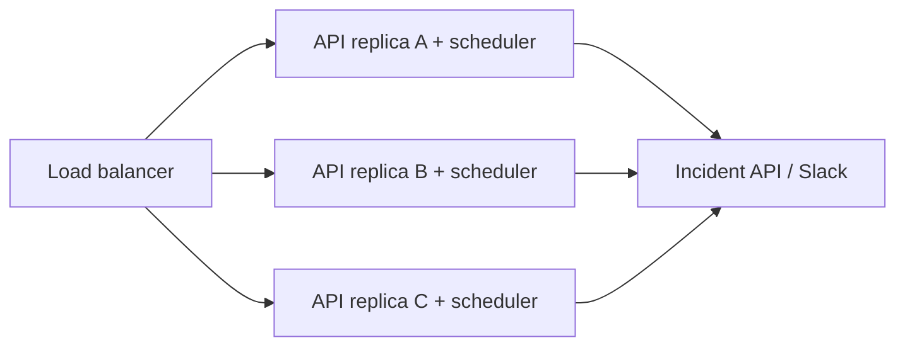
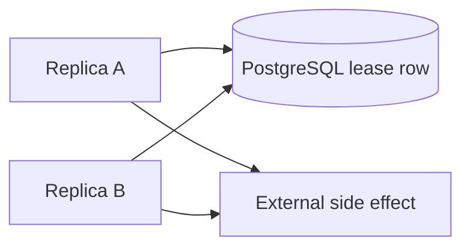
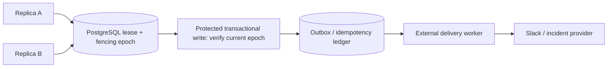

# Daily Architecture Incident Lab — Lesson 09

## Split-Brain Schedulers: Leader Election, Leases, and Fencing Tokens

**Date:** 14 November 2026  
**Audience:** Experienced Python/Linux SRE moving toward Platform/Infrastructure Architecture  
**Architecture reading and design:** 20–25 minutes. **Optional practical lab:** 50–75 minutes, separately.  
**Scenario status:** All organizations, incidents, timestamps, capacities, logs and metrics in the architecture section are **hypothetical training examples**, not production observations.

**LEARN → DESIGN → BUILD → BREAK → INVESTIGATE → FIX → VALIDATE**

**Outcome:** Explain why “only one scheduler is running” is a distributed-systems claim, not a deployment setting; reproduce an expired-lease split brain; and prove that a fencing check prevents a stale leader from committing work.

## 1. LEARN — Realistic problem and requirements (0–4 minutes)

An internal SRE automation platform runs on a horizontally scalable container service. It serves HTTP slash commands and performs periodic tasks: scan unresolved incidents, send shift handoff notifications, and reconcile change-request status. A second replica is desirable for HTTP availability, but **every replica starting its own scheduler** may send duplicate notifications or apply the same incident transition twice. A process-local lock or environment variable cannot coordinate independent containers.

**Analogy:** Two restaurant managers each believe they hold the only key to the nightly closing checklist. A timed key permit expires while Manager A is paused. Manager B obtains a new permit and completes closing. When A resumes, simply showing the old key is not proof of current authority. The accounting system must reject A's obsolete permit number.

### Functional requirements

1. Any healthy API replica may answer normal HTTP requests.
2. At most one **authorized** scheduler may commit a protected job effect at a time.
3. A failed leader must be replaceable without manual intervention.
4. A stale leader that resumes after lease expiry must not write an outdated result.
5. Operators can inspect current lease owner, token, expiration, job attempts and outcomes.
6. Business operations must also use idempotency keys: leadership alone does not prevent replay of a completed job.

### Nonfunctional requirements and assumptions

| Property | Hypothetical design target |
|---|---|
| API replicas | 3 across failure domains |
| Scheduled jobs | 12 types, with one or more runs per minute |
| Leader lease | 15 seconds |
| Renewal cadence | 5 seconds |
| Failover detection | Usually 15–20 seconds, plus scheduling jitter |
| Job execution | 2 seconds p95, 45 seconds p99 |
| Duplicate externally visible side effects | Zero for idempotent protected actions |
| Lease authority | PostgreSQL primary clock and transactional row |
| Recovery objective | Continue job processing after leader loss; no silent lost jobs |

**Key tension:** A 45-second job is longer than a 15-second lease. If the leader pauses or loses connectivity, another replica can acquire leadership while the old worker is still executing. The correct invariant is **not** “only one process is executing”; it is “only the current valid epoch can commit a protected effect.”

## 2. DESIGN — Quantify the coordination problem (4–8 minutes)

Assume 12 job types, one invocation per minute per job, and 3 replicas:

- Uncoordinated starts: `12 × 3 = 36` invocations/minute.
- Intended starts: `12 × 1 = 12` invocations/minute.
- Duplicate amplification: `3×`, or 24 excess invocations/minute.
- Over 24 hours: `24 × 60 = 1,440` excess invocations (assuming all replicas remain running).

At a 5-second renewal interval, a single leader performs `60/5 = 12` renewal writes/minute, or 720/hour. The coordination overhead is small compared with typical incident automation; correctness and failover are the harder problems.

If lease TTL is 15 seconds, renewal is 5 seconds, and a stop-the-world pause lasts 18 seconds, the lease can expire before the old leader wakes. Even if clocks are synchronized, network partitions and process pauses create this overlap. Use the **database clock** to evaluate expiry, not each container's local wall clock.

### Architecture A — Process-local scheduler (unsafe)



All three schedulers can execute the same cron event. Setting a process count to one only constrains one container, not the fleet.

### Architecture B — Distributed lease, but no fencing (incomplete)



A transactional lease chooses an owner, but a paused former leader may continue executing a job after its lease expires. Checking leadership **only before starting work** is insufficient.

### Architecture C — Lease + monotonic fencing + idempotent effect (recommended)



**Why monotonic fencing works:** Each successful acquisition advances a token (for example, 41 → 42). A downstream resource or transactional write accepts only the currently authorized token. Token 41 is rejected after token 42 takes ownership. For an external API that does not support fencing, write an authorized outbox event transactionally and deliver it using idempotency keys.

### Architectural alternatives and tradeoffs

| Option | Strength | Weakness / when not to use |
|---|---|---|
| Single dedicated scheduler replica | Operationally simple | Single point of scheduling availability; deployment drift can start a duplicate |
| PostgreSQL advisory lock held on one connection | Convenient mutual exclusion | Connection loss releases lock while prior external work may continue; not fencing |
| PostgreSQL lease row + fencing epoch | Durable authority and transactional check with business DB | DB primary dependency, row contention, careful failover semantics |
| Redis SET NX PX lease | Fast and simple lease acquisition | Expiry and failover do not automatically fence stale holders; requires a reliable monotonic epoch and downstream enforcement |
| Kubernetes Lease object | Native leader coordination | Lease ownership alone cannot fence stale external side effects |
| Managed queue with per-job idempotency | Strong separation of HTTP and job execution | More components, retries, DLQ and visibility design |

**Decision:** For a small automation platform already using PostgreSQL, a database-backed lease plus fencing and transactional outbox is a reasonable first design. For high-scale jobs, separate leader election from durable task scheduling, worker execution and business idempotency. Do not claim strict exactly-once delivery to a third-party API unless that API enforces it.

## 3. Hypothetical production incident — chronological evidence (8–17 minutes)

**09:00 UTC:** API replicas A and B run in separate containers. A holds token 41, TTL 15 seconds, and begins a notification reconciliation job. A experiences an 18-second process pause. The DB lease expires. B acquires token 42 and writes the reconciliation result. A resumes with token 41 and sends the same notification again because the downstream service does not validate authority.

| UTC | Evidence | Hypothesis / next investigation |
|---|---|---|
| 09:00:00 | A lease token=41, expires 09:00:15 | Normal leadership |
| 09:00:05 | A starts job run 882 | Job in progress |
| 09:00:06 | A heartbeat disappears | Pause, network loss, or scheduler thread stalled |
| 09:00:16 | B acquires token=42 | Valid failover after expiry |
| 09:00:18 | B marks job 882 complete | Check idempotency ledger |
| 09:00:24 | A resumes and sends notification | Stale leader side effect |
| 09:01:00 | Two messages share logical job id 882 | Duplicate business effect, not necessarily duplicate cron trigger |

### Evidence-led investigation: host, network, app, database

Run the following on **authorized diagnostic hosts**. Replace placeholders; these are production-style commands, **not** commands to run against real services without approval.

```bash
# On each container host / pod diagnostic shell:
date -u
ps -eo pid,stat,etime,%cpu,%mem,cmd | grep -E 'python|scheduler' | head
ss -tan state established '( dport = :5432 )' | head
# In Kubernetes, if applicable:
kubectl get pods -n <namespace> -o wide
kubectl logs -n <namespace> <pod-a> --since=20m | grep -E 'lease|token|job_id'
kubectl logs -n <namespace> <pod-b> --since=20m | grep -E 'lease|token|job_id'
```

**Illustrative logs:**

```text
09:00:00 INFO instance=A lease_acquired token=41 ttl_s=15
09:00:05 INFO instance=A job_id=882 started token=41
09:00:16 INFO instance=B lease_acquired token=42 ttl_s=15
09:00:18 INFO instance=B job_id=882 delivery_accepted
09:00:24 WARN instance=A job_id=882 delivery_accepted token=41
```

**Interpretation:** A and B both produced a side effect for the same logical job. Do not conclude “PostgreSQL allowed two leaders” without checking **when** each lease was valid. The real bug may be a stale worker continuing after leadership changed.

```sql
-- On the authoritative PostgreSQL primary, read-only:
SELECT name, owner, token, expires_at, now() AS db_now
FROM scheduler_leases WHERE name='incident-reconcile';
SELECT job_id, attempt_id, owner, fencing_token, status, created_at
FROM job_attempts WHERE job_id='882' ORDER BY created_at;
SELECT state, wait_event_type, wait_event, count(*)
FROM pg_stat_activity
WHERE datname=current_database()
GROUP BY 1,2,3 ORDER BY 4 DESC;
```

The SQL above describes **hypothetical production tables**; the local lab below uses a smaller `lease` and `protected_events` schema.

**Illustrative traces:**

```text
trace job-882-A: acquire(41) → reconcile(18s pause) → external_send(200)
trace job-882-B: acquire(42) → reconcile(120ms) → external_send(200)
metric scheduler_lease_acquire_total{instance="B",result="success"} += 1
metric scheduler_stale_commit_rejected_total{instance="A"} = 0  # missing protection
metric job_external_delivery_total{job_id="882"} = 2
```

Check time synchronization, process pauses, DB primary identity, network partition evidence, renewal latency, scheduler logs and whether every write path carries the fencing token. The database may be healthy while the application violates the lease contract.

### Separate trigger, immediate cause and systemic weakness

- **Trigger:** A pauses longer than the lease TTL; B legitimately takes over.
- **Immediate cause of duplicate notification:** A resumes and performs an external write using an expired leadership assumption.
- **Systemic design weakness:** Lease acquisition is mistaken for a permanent permission; no downstream fencing, durable job claim, or idempotent delivery contract.
- **Non-causes to avoid:** “Two containers” alone, an NGINX 502, or PostgreSQL CPU saturation without supporting evidence.

## 4. Mitigation, redesign and operational decisions (17–21 minutes)

**Immediate containment:** Temporarily disable the affected scheduled job on all but a designated instance, inspect the current lease, pause unsafe external delivery and deduplicate known logical job IDs. Keep normal HTTP service available. Record exactly which jobs may need replay; do not delete a queue or incident records to make metrics look clean.

**Durable redesign:** Store a monotonically increasing fencing token in a single authoritative transaction; check owner, token and expiry **inside the transaction that commits protected work**. Use PostgreSQL's server clock. Keep job runs in a durable table with unique logical job IDs. Write authorized outbox entries transactionally, then let a separate delivery worker retry using provider-supported idempotency keys. Add renewal failure handling, bounded takeover, graceful shutdown and database primary failover testing.

**Important nuance:** A transaction that holds a lease-row lock for the entire business write is simple and safe for a **short database-only effect**. Do **not** hold the lock while making slow external HTTP calls. Use outbox + provider idempotency instead.

### Observability and alerts

Instrument `leader_current{instance}` (exactly one valid holder), `lease_renewal_latency_seconds`, `lease_acquire_total{result}`, `lease_expiry_seconds`, `stale_commit_rejected_total`, `job_start_total`, `job_completion_total`, `job_run_duration_seconds`, `job_backlog_age_seconds` and `external_delivery_duplicate_total`. Include `job_id`, `instance_id`, `fencing_token`, `attempt_id` and `trace_id` in structured logs, but avoid high-cardinality job IDs as Prometheus labels.

Alert on missing leader beyond the failover objective, recurring fencing rejects, job backlog age above SLO, renewal latency approaching TTL, and duplicate side effects. A fencing rejection after failover can be **evidence the protection is working**; alert severity depends on frequency and impact.

### Validation matrix

| Experiment | Expected result | Failure interpretation |
|---|---|---|
| One leader starts | One valid token | Duplicate acquisition is a coordination defect |
| Leader pauses beyond TTL | B acquires larger token | Failover works; A may still run |
| Stale A commits | Rejected 409 / transaction rollback | If accepted, fencing is broken |
| Current B commits | Success | If rejected, lease validity/clock issue |
| DB unavailable | Fail closed; no unverified writes | Fail open risks corruption |
| Same logical job retried | One externally visible effect | Requires idempotency/outbox, not just lease |
| Leader restarts | New token; no stale state reused | Persistent state and recovery need review |

## 5. Three independent architect challenges (21–25 minutes)

1. **Lease vs fencing:** A owns token 100 and pauses for 30 seconds. B obtains 101 and finishes the job. A wakes. Describe the exact check that must reject A and where that check belongs when the final effect is an external Slack message.
2. **Capacity and availability:** With a 15-second TTL and 5-second renewal cadence, how would you choose a takeover alert threshold, renewal failure budget and retry behavior during a 12-second PostgreSQL primary failover? State your assumptions and tradeoffs.
3. **Design decision:** Compare a singleton scheduler, Kubernetes Lease plus outbox, and PostgreSQL lease plus outbox for a 3-replica Python API. Choose one, explain failure modes and operational cost, and specify how you prove no duplicate business effects.

**Do not fill these in automatically.** Submit your reasoning in the final review; the mentor should assess the decision process, not just the chosen technology.

## Practical Labs

**Optional 50–75 minutes, separate from the architecture reading.** This is a runnable, **small implementation of Architecture C**, not a generic FastAPI demo. Use **Mac Docker Desktop** (preferred) with 2 CPUs, roughly 1.5 GB free memory and 1 GB disk headroom; or Ubuntu VM with Docker Engine/Compose and comparable free resources. Avoid the previously constrained ~1.9 GiB Ubuntu VM if memory is already tight. The lab publishes only loopback ports and uses throwaway credentials.

### LEARN / DESIGN — Map the real architecture to lab files

| Design element | Implementation |
|---|---|
| Two independent API/scheduler replicas | `a` and `b` FastAPI containers |
| Authoritative lease and epoch | PostgreSQL `lease` table |
| Expiry and takeover | DB `now()`, 4-second lab TTL |
| Unsafe stale leader | `POST /unsafe-work` writes a separate **demonstration-only** ledger |
| Fenced commit | `POST /work` checks lease under `FOR UPDATE` in the same transaction |
| Evidence | `GET /lease`, `GET /events`, container logs and SQL |
| Automated check | Pytest source-contract smoke tests; HTTP acceptance commands below |

The lab uses a 4-second lease so failover is observable quickly. It intentionally does not run a background renewal loop: you manually acquire and perform work, then let the lease expire. This isolates the precise split-brain failure. The `unsafe_events` ledger is **separate** from `protected_events` so the demonstration cannot corrupt the protected data.

### BUILD — Exact file tree and creation commands

Run on **Mac Terminal** with Docker Desktop running, or on **Ubuntu VM terminal** after confirming Docker permissions. Do not use `sudo docker` unless your Ubuntu user lacks Docker group access; Docker group membership is root-equivalent.

```bash
docker version
docker compose version
mkdir -p ~/architecture-labs/lesson09-leader-election/app
mkdir -p ~/architecture-labs/lesson09-leader-election/tests
cd ~/architecture-labs/lesson09-leader-election
pwd
```

**Directory tree**

```text
lesson09-leader-election/
├── Dockerfile
├── requirements.txt
├── compose.yaml
├── app/
│   ├── __init__.py
│   └── main.py
└── tests/
    └── test_contract.py
```

Create each file exactly as labeled below, for example `cat > requirements.txt <<'EOF'`, paste the fenced contents, then enter `EOF` on its own line. Repeat with the named paths. This preserves the full code in this single Markdown reference.

**File: `requirements.txt`**

```text
fastapi==0.115.12
uvicorn==0.34.2
psycopg[binary]==3.2.6
httpx==0.28.1
pytest==8.3.5
```

**File: `Dockerfile`**

```dockerfile
FROM python:3.11-slim
WORKDIR /srv
COPY requirements.txt .
RUN pip install --no-cache-dir -r requirements.txt
COPY app ./app
COPY tests ./tests
CMD ["uvicorn","app.main:app","--host","0.0.0.0","--port","8000"]
```

**File: `compose.yaml`**

```yaml
services:
  db:
    image: postgres:16-alpine
    environment:
      POSTGRES_USER: lab
      POSTGRES_PASSWORD: lab_only
      POSTGRES_DB: election
    healthcheck:
      test: ["CMD-SHELL","pg_isready -U lab -d election"]
      interval: 2s
      timeout: 2s
      retries: 15
    volumes:
      - leaderlab09-db:/var/lib/postgresql/data
  a:
    build: .
    ports: ["127.0.0.1:18091:8000"]
    environment:
      INSTANCE_ID: a
      DATABASE_URL: postgresql://lab:lab_only@db:5432/election
    depends_on:
      db: {condition: service_healthy}
  b:
    build: .
    ports: ["127.0.0.1:18092:8000"]
    environment:
      INSTANCE_ID: b
      DATABASE_URL: postgresql://lab:lab_only@db:5432/election
    depends_on:
      db: {condition: service_healthy}
volumes:
  leaderlab09-db:
```

**File: `app/__init__.py`**

```python
# Package marker.
```

**File: `app/main.py`**

```python
import os
import time
import logging
from contextlib import asynccontextmanager
from fastapi import FastAPI, HTTPException
import psycopg
from psycopg.rows import dict_row

DSN = os.environ["DATABASE_URL"]
INSTANCE = os.environ["INSTANCE_ID"]
LEASE_SECONDS = 4
log = logging.getLogger("leaderlab")
# This process-local token deliberately survives lease expiry: it models a paused worker.
held_token = None

def connection():
    return psycopg.connect(DSN, row_factory=dict_row)

@asynccontextmanager
async def lifespan(app):
    with connection() as db:
        db.execute("""
          CREATE TABLE IF NOT EXISTS lease (
            name TEXT PRIMARY KEY,
            owner TEXT NOT NULL,
            token BIGINT NOT NULL,
            expires_at TIMESTAMPTZ NOT NULL
          )
        """)
        db.execute("""
          CREATE TABLE IF NOT EXISTS protected_events (
            id BIGSERIAL PRIMARY KEY, owner TEXT NOT NULL,
            token BIGINT NOT NULL, created_at TIMESTAMPTZ DEFAULT now()
          )
        """)
        db.execute("""
          CREATE TABLE IF NOT EXISTS unsafe_events (
            id BIGSERIAL PRIMARY KEY, owner TEXT NOT NULL,
            token BIGINT NOT NULL, created_at TIMESTAMPTZ DEFAULT now()
          )
        """)
        db.commit()
    yield

app = FastAPI(lifespan=lifespan)

@app.get("/health")
def health():
    with connection() as db:
        db.execute("SELECT 1").fetchone()
    return {"instance": INSTANCE, "db": "ok"}

@app.post("/acquire")
def acquire():
    global held_token
    with connection() as db:
        # Insert a free, already expired lease only if no row exists.
        db.execute("""
          INSERT INTO lease(name, owner, token, expires_at)
          VALUES ('scheduler', '', 0, now() - interval '1 second')
          ON CONFLICT (name) DO NOTHING
        """)
        row = db.execute(
            "SELECT owner,token,expires_at,now() AS db_now "
            "FROM lease WHERE name='scheduler' FOR UPDATE"
        ).fetchone()
        if row["expires_at"] > row["db_now"] and row["owner"] != INSTANCE:
            db.commit()
            return {"acquired": False, "owner": row["owner"],
                    "current_token": row["token"]}
        # Every acquisition, even by the same owner, advances the fencing token.
        token = row["token"] + 1
        db.execute("""
          UPDATE lease SET owner=%s, token=%s,
            expires_at=now() + (%s * interval '1 second')
          WHERE name='scheduler'
        """, (INSTANCE, token, LEASE_SECONDS))
        db.commit()
    held_token = token
    log.warning("lease_acquired owner=%s token=%s", INSTANCE, token)
    return {"acquired": True, "owner": INSTANCE, "token": token,
            "lease_seconds": LEASE_SECONDS}

@app.get("/lease")
def lease():
    with connection() as db:
        row = db.execute(
            "SELECT owner,token,expires_at,expires_at>now() AS valid "
            "FROM lease WHERE name='scheduler'"
        ).fetchone()
    return row or {"status": "not_initialized"}

@app.post("/unsafe-work")
def unsafe_work():
    # Intentionally wrong: it trusts the token cached in process memory.
    if held_token is None:
        raise HTTPException(409, "acquire a lease first")
    with connection() as db:
        db.execute("INSERT INTO unsafe_events(owner,token) VALUES (%s,%s)",
                   (INSTANCE, held_token))
        db.commit()
    log.error("UNSAFE_WRITE owner=%s stale_possible token=%s",
              INSTANCE, held_token)
    return {"unsafe_written": True, "owner": INSTANCE, "token": held_token}

@app.post("/work")
def protected_work():
    if held_token is None:
        raise HTTPException(409, "acquire a lease first")
    with connection() as db:
        # Lock the lease and check validity in the SAME DB transaction as the effect.
        row = db.execute("""
          SELECT owner,token,expires_at,now() AS db_now
          FROM lease WHERE name='scheduler' FOR UPDATE
        """).fetchone()
        if (row is None or row["owner"] != INSTANCE
                or row["token"] != held_token
                or row["expires_at"] <= row["db_now"]):
            db.rollback()
            log.warning("FENCED stale_owner=%s held_token=%s",
                        INSTANCE, held_token)
            raise HTTPException(409, "stale leader fenced")
        db.execute("INSERT INTO protected_events(owner,token) VALUES (%s,%s)",
                   (INSTANCE, held_token))
        db.commit()
    return {"written": True, "owner": INSTANCE, "token": held_token}

@app.get("/events")
def events():
    with connection() as db:
        safe = db.execute(
            "SELECT owner,token FROM protected_events ORDER BY id"
        ).fetchall()
        unsafe = db.execute(
            "SELECT owner,token FROM unsafe_events ORDER BY id"
        ).fetchall()
    return {"protected": safe, "unsafe": unsafe}
```

**File: `tests/test_contract.py`**

```python
import ast
from pathlib import Path

def test_required_endpoints_present():
    tree = ast.parse(Path("app/main.py").read_text())
    paths = set()
    for node in ast.walk(tree):
        if isinstance(node, ast.Call) and isinstance(node.func, ast.Attribute):
            if node.func.attr in {"get", "post"} and node.args:
                arg = node.args[0]
                if isinstance(arg, ast.Constant):
                    paths.add(arg.value)
    assert {"/health", "/acquire", "/lease", "/work",
            "/unsafe-work", "/events"} <= paths

def test_fencing_uses_transactional_lock():
    source = Path("app/main.py").read_text()
    assert "FOR UPDATE" in source
    assert "row[\"token\"] != held_token" in source
```

### BUILD / VALIDATE — Healthy startup and baseline

```bash
cd ~/architecture-labs/lesson09-leader-election
docker compose -p leaderlab09 up -d --build
docker compose -p leaderlab09 ps
docker compose -p leaderlab09 exec a python -m pytest -q tests
curl -sS http://127.0.0.1:18091/health
curl -sS http://127.0.0.1:18092/health
curl -sS -X POST http://127.0.0.1:18091/acquire
curl -sS -X POST http://127.0.0.1:18091/work
curl -sS http://127.0.0.1:18091/events
```

**Expected:** Two tests pass; both health endpoints report `db:ok`. A acquires token 1 and writes one protected event. Run the last three commands promptly (within 4 seconds of acquisition). If the lease expires before `/work`, reacquire A and retry. The first successful token may exceed 1 if you previously ran the lab.

**Stop here during guided practice:** Share the actual `ps`, test, acquire and event outputs before proceeding to the controlled fault.

### BREAK — One reversible fault: leader A stops making progress

No container or database is destroyed. Wait for A's lease to expire (simulating a paused process), let B take over, and then make A attempt stale work.

```bash
curl -sS -X POST http://127.0.0.1:18091/acquire
sleep 5
curl -sS -X POST http://127.0.0.1:18092/acquire
curl -sS http://127.0.0.1:18092/lease
curl -sS -X POST http://127.0.0.1:18091/unsafe-work
curl -i -X POST http://127.0.0.1:18091/work
```

**Expected:** B acquires a larger token; A's unsafe endpoint writes an event despite stale ownership; A's protected endpoint returns **409 stale leader fenced**. If B's lease also expires before inspection, reacquire B and immediately test A again. The unsafe endpoint is deliberately incorrect and must never be exposed in a real service.

### INVESTIGATE — Collect evidence and distinguish causes

```bash
docker compose -p leaderlab09 logs --tail=40 a b
docker compose -p leaderlab09 exec db psql -U lab -d election -c "SELECT owner,token,expires_at,expires_at>now() AS valid FROM lease;"
docker compose -p leaderlab09 exec db psql -U lab -d election -c "SELECT owner,token FROM unsafe_events ORDER BY id;"
docker compose -p leaderlab09 exec db psql -U lab -d election -c "SELECT owner,token FROM protected_events ORDER BY id;"
docker compose -p leaderlab09 exec db psql -U lab -d election -c "SELECT state,wait_event_type,wait_event,count(*) FROM pg_stat_activity GROUP BY 1,2,3;"
```

**Interpretation:** The lease row shows B's higher epoch, while the unsafe ledger proves A continued after expiry. The protected ledger should **not** contain A's stale token. `FENCED` in A's log proves the transactional check rejected stale authority. PostgreSQL health alone would not reveal this logical failure.

### FIX — Use fenced work and verify legitimate takeover

The repair is already implemented in `POST /work`: it locks the lease, checks current owner/token/expiry, and commits the protected event in the same transaction. Never use `/unsafe-work` in application logic.

```bash
curl -sS -X POST http://127.0.0.1:18092/acquire
curl -i -X POST http://127.0.0.1:18092/work
curl -sS http://127.0.0.1:18092/events
docker compose -p leaderlab09 exec a python -m pytest -q tests
```

**Expected:** B writes a protected event with its current token, and tests pass. Execute the acquire/work pair promptly within the 4-second lease. Compare B's token with A's earlier token and explain why token ordering matters.

### VALIDATE — Failure contract and safe cleanup

```bash
# After B has acquired, A must not write protected events:
curl -i -X POST http://127.0.0.1:18091/work
docker compose -p leaderlab09 ps
# Stop ONLY this project's containers/network. Named volume remains intact:
docker compose -p leaderlab09 down
# Verify the named volume was preserved:
docker volume ls --filter name=leaderlab09
```

**Expected:** A receives 409; no stale protected write. `down` without `-v` preserves the named PostgreSQL volume. If you later choose to delete only this disposable lab's data, first verify its exact volume name and obtain your own confirmation; never run global volume prune.

**Lab limitations and next production evolution:** The two processes keep their last token in memory; there is no automated renewal or takeover scheduler, and the protected effect is a short PostgreSQL transaction. Add a background renewal loop, cancellation, an outbox table with unique job IDs, a delivery worker and idempotent provider mock in a future version. For a real Slack or ServiceNow call, the transaction cannot atomically encompass the external side effect.

**Record actual evidence:** Baseline token _..._; B takeover token _..._; A unsafe result _..._; A fenced 409 _..._; protected ledger _..._; logs and SQL _..._; production design changes _..._.

## My Architecture Review — Solutions & Doubts

### 1. My Understanding

_Write the architecture in your own words; identify what lease expiry does and does not guarantee._

### 2. My Solutions to the Architect Challenges

_Challenge 1 reasoning:_  
_Challenge 2 reasoning:_  
_Challenge 3 reasoning:_

### 3. My Troubleshooting Approach

_List competing hypotheses, exact commands, decisive evidence and how you ruled alternatives out._

### 4. My Proposed Architecture Improvements

_Describe the minimum safe design, alternative choices, tradeoffs, rollback and validation._

### 5. My Doubts / Questions

_Record unresolved concepts, especially fencing at external providers._

### 6. Lessons Learned

_What changed in your thinking after seeing a stale leader resume?_

### 7. Mentor Review

_Pending your answers and actual lab evidence; do not mark completed merely because this lesson is published._
