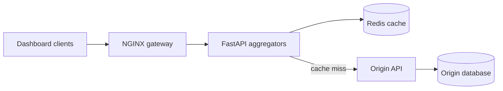
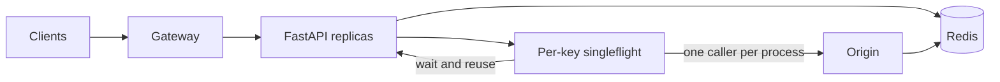
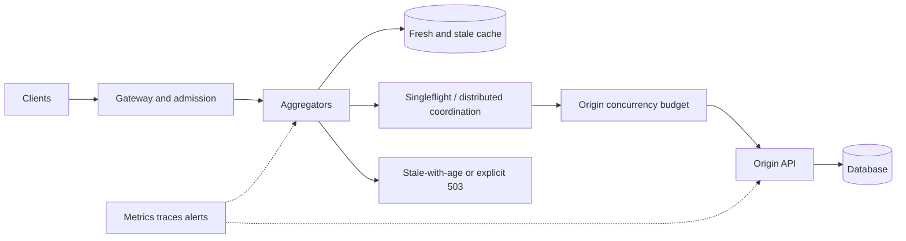

# Daily Architecture Incident Lab — Lesson 12: Cache Stampedes, Singleflight & Origin Protection

**Published:** 2026-11-17 · **Status:** Published (not completed) · **Architecture reading/design:** 20–25 minutes · **Optional hands-on:** 60–90 minutes

**LEARN → DESIGN → BUILD → BREAK → INVESTIGATE → FIX → VALIDATE**

> **Scenario disclosure:** All production events, companies, timings, metrics and traces below are hypothetical teaching data. The local lab is a separate reproducible simulation, not evidence of a real outage. Never flush a shared Redis instance.

## Learning outcomes and reading plan

| Time | Focus |
|---|---|
| 0–4 min | Requirements, cache semantics and failure contract |
| 4–8 min | Capacity math and incremental architecture |
| 8–17 min | Evidence-led incident and competing hypotheses |
| 17–21 min | Mitigation, redesign and operational verification |
| 21–25 min | Three independent architect challenges |

You will distinguish a cache miss from a cache outage, explain a thundering herd, calculate origin amplification, and decide when singleflight, jittered TTLs, stale data, admission limits or prewarming are appropriate.

## 1. LEARN — Realistic business problem and requirements

A platform operations dashboard fetches a shared service-health summary for every incident page. A FastAPI aggregation tier reads Redis before calling an expensive **Origin API** that computes the summary using a database and several internal calls. One highly popular key expires simultaneously across the fleet. Hundreds of concurrent cache misses then overload the origin, even though the origin's data has not changed.

**Functional requirements:** authorized users obtain a summary; freshness is explicit; no tenant's data leaks through a shared cache key; missing cache data can be regenerated; invalid or sensitive responses are not cached; a correlation ID identifies the failing hop; critical security decisions never rely on stale authorization.

**Nonfunctional requirements (hypothetical targets):**

| Property | Target |
|---|---|
| Peak aggregate requests | 2,000 RPS |
| Hot-key share | 40% (800 RPS) |
| Origin safe throughput | 100 requests/s |
| Origin mean compute latency | 250 ms |
| Redis hit rate target | ≥ 95% |
| Dashboard p95 | ≤ 200 ms for cached responses |
| Overall request deadline | 2 s |
| Stale tolerance | 30 s for noncritical health enrichment only |
| Availability | 99.9% monthly for core incident view |
| Security | Cache key includes tenant, permissions scope and data version |

**Failure contract:** A noncritical health summary may be marked stale if an authorized, age-bounded prior value exists. Mandatory incident state must not be fabricated. If no safe stale value exists and the origin cannot respond within the deadline, return 503 with a request ID and a clear degradation reason. Redis is a performance dependency, not the system of record.

## 2. DESIGN — Quantitative capacity and cache economics

At 2,000 RPS and 95% cache hits, origin receives about **100 RPS**: already at its safe limit. A hot key representing 40% of traffic receives 800 RPS. During a one-second miss burst, an unprotected origin can receive approximately 800 requests for identical data, **8× its throughput budget**. Little's Law estimates concurrency demand at 800 × 0.25 = **200 in-flight origin requests**, versus 100 × 0.25 = **25** at safe capacity. If latency rises to 1.5 seconds, concurrency demand becomes 1,200, creating a feedback loop.

For 20 independent application replicas, a **per-process** singleflight lock can still allow 20 origin calls per hot key; a **distributed** lease or fencing approach can reduce that further but adds coordination and lease-expiry risk. A TTL of 60 seconds is not inherently safe if many keys were populated at the same instant. Add randomized jitter (for example 45–75 seconds), early refresh and origin admission limits. Jitter reduces synchronization but does not guarantee prevention.

**Budget example:** NGINX/network 40 ms; cache lookup 10 ms; origin compute 250 ms; serialization 20 ms. Cold request ≈320 ms normally. A two-second gateway deadline is an upper bound, not a license for origin retries totaling two seconds. A 30-second stale window is a product/data-correctness decision, not a universal default.

## 3. Incremental architecture and alternatives

### Version A — cache-aside without miss coordination



Every cache miss independently calls Origin. During synchronized expiration, all replicas race to regenerate the same key.

### Version B — bounded per-key recomputation



**Invariant:** Recheck the cache *after* acquiring the per-key lock; otherwise waiting requests can still call Origin redundantly. Bound waiting time, key cardinality and lock-map growth. The lab uses a simple per-process dictionary and does not implement eviction; production should use a bounded lock registry.

### Version C — fleet-wide resilience and explicit stale policy



| Alternative | Strength | Tradeoff / failure mode |
|---|---|---|
| Per-process singleflight | Simple; no new infrastructure | Still one origin fetch per replica |
| Redis distributed lease | Cross-replica suppression | Lock expiry, owner crash and split-brain; must guard writes |
| Stale-while-revalidate | Fast response under regeneration | Incorrect for security-sensitive or strongly consistent data |
| TTL jitter | Reduces synchronized expirations | Doesn't prevent a single extremely hot key |
| Origin semaphore + 503 | Protects database from overload | Some callers lose enrichment |
| Background refresh/prewarm | Fewer foreground misses | Extra work, invalidation complexity |
| Negative caching | Avoids repeated not-found lookups | Can hide newly created objects; short TTL and scoping required |

**Security and correctness:** Include tenant, role/scope, locale and version in cache identity where relevant. Do not cache bearer tokens. Encrypt sensitive stored values where appropriate and never serve another tenant's stale data. For lease-based distributed refresh, require fencing/version checks before cache writes so a delayed former owner cannot overwrite newer data.

## 4. Failure-mode analysis

| Failure | Observable symptom | Evidence to distinguish it | Response |
|---|---|---|---|
| Hot key expires | Origin RPS spikes, Redis miss rate rises | Key-level miss counts, TTL sampling | Singleflight, refresh-ahead |
| Redis unreachable | Connection errors and fallback load | Redis ping, client timeout metrics | Fail fast; protect origin |
| Origin CPU saturated | Latency and queue length rise | CPU, thread pool, p95/p99, traces | Admission limit and load shedding |
| Origin DB pool exhausted | Checkout wait grows | Pool wait histogram vs DB active sessions | Pool budget and query tuning |
| Stale data served too long | Fast but incorrect dashboard | Cache age, source and version | Maximum staleness and purge |
| Lock holder crashes | Waiters stall or duplicate work | Lease age, lock wait duration | Bounded lease and safe takeover |

## 5. Explicitly HYPOTHETICAL production incident — chronological investigation

**Scenario only; all numbers and timestamps invented.** At 09:00 UTC a deployment repopulates popular cache keys together. At 09:01 a 60-second TTL expires for a popular health summary; Origin receives hundreds of duplicate recomputations. Users experience slow dashboard loads and intermittent 503s despite a healthy gateway process.

| UTC | Evidence | Working hypothesis / next check |
|---|---|---|
| 09:00 | Cache writes cluster within one second | Synchronized expiry risk |
| 09:01 | Redis hit rate drops 98% → 61% | Confirm which keys miss |
| 09:02 | Origin RPS jumps 80 → 740 | Duplicate recomputation likely |
| 09:03 | Origin p95 180 ms → 1,900 ms | Queueing/CPU/DB contention |
| 09:04 | Gateway 503 14%, 504 7% | Identify whether application rejects or times out |
| 09:07 | Per-key coordination enabled on canary | Compare origin calls per cache miss |
| 09:12 | Origin RPS falls to 105; p95 240 ms | Validate no correctness regression |
| 09:25 | TTL jitter + refresh policy deployed | Continue observation across multiple TTL cycles |

### A. Establish user impact and request timing

On an authorized diagnostic host:

```bash
for i in 1 2 3; do
  curl -sS -o /dev/null --max-time 3 \
    -w 'status=%{http_code} total=%{time_total}s connect=%{time_connect}s\n' \
    -H "X-Request-ID: cache-lab-$i" \
    https://dashboard.example.internal/api/health-summary
done
```

Illustrative result: 200 at 0.04 s, then 503 at 1.5 s, then 504 at 2.0 s. A fast TCP connection rules out some connect-path failures but does not establish why Origin is slow.

### B. Gateway and Linux investigation

```bash
sudo tail -n 40 /var/log/nginx/access.log
sudo grep -E 'upstream timed out|prematurely closed' /var/log/nginx/error.log | tail -n 20
ss -tan state established | head -n 20
ps -eo pid,stat,%cpu,%mem,cmd --sort=-%cpu | head -n 15
free -h
# If systemd manages the API:
sudo journalctl -u summary-api --since '2026-11-17 09:00:00 UTC' --no-pager | tail -n 40
```

Expected *hypothetical* access evidence: `status=504 request_time=2.001 upstream_response_time=2.000`. An upstream timeout identifies a blocked hop, not proof of NGINX misconfiguration. Socket counts show pressure, not causality; correlate with app traces and request IDs.

### C. Cache, application and origin evidence

```bash
# On an authorized Redis diagnostic host (avoid KEYS * in production):
redis-cli -h redis.example.internal INFO stats | grep -E 'keyspace_hits|keyspace_misses'
redis-cli -h redis.example.internal TTL 'tenant:demo:health:v3'
# On the API host:
grep -E 'cache_miss|origin_fetch|singleflight_wait' /var/log/summary-api.log | tail -n 30
# If Prometheus is available, inspect metrics for cache miss ratio,
# origin requests by key (with bounded labels), lock wait, and origin p95.
```

Illustrative app log: `request_id=req-42 key_hash=ab12 cache=MISS origin_fetch=1 elapsed_ms=1850`; similar lines from hundreds of requests for the same *hashed* key indicate stampede. Do not log raw sensitive cache keys. A Redis `INFO stats` counter is cumulative; compare rates over intervals, not one absolute value.

### D. Database and distributed trace correlation

```sql
SELECT state,wait_event_type,wait_event,count(*) AS sessions
FROM pg_stat_activity
WHERE datname=current_database()
GROUP BY state,wait_event_type,wait_event
ORDER BY sessions DESC;
SELECT pid,now()-query_start AS running_for,wait_event_type,
       left(query,100) AS query_preview
FROM pg_stat_activity
WHERE state='active' AND pid<>pg_backend_pid()
ORDER BY query_start LIMIT 10;
```

Hypothetical trace:

```text
trace req-42 total=2000ms
  gateway -> aggregator        1995ms
  redis GET (MISS)                4ms
  origin GET                   1800ms
    database checkout wait      750ms
    SQL execution               200ms
    origin queue wait           800ms
```

The trace is illustrative and spans may overlap; don't sum overlapping durations. Database pool checkout wait may be invisible to `pg_stat_activity`. Correlate connection-pool checkout histograms and PostgreSQL wait events before blaming database locks.

### E. Falsify alternatives

Check Redis availability and latency before assuming expiration. Compare origin request count to unique requested keys; a high ratio supports duplicate work. Check deploy times, CPU throttling, DNS errors and database lock waits as alternatives. A rise in origin RPS **after** misses, with many same-key calls, supports cache stampede more strongly than CPU alone.

## 6. Trigger, immediate cause and systemic weakness

**Trigger:** Synchronized hot-key TTL expiry after cache repopulation. **Immediate cause:** Hundreds of independent cache misses invoke expensive Origin recomputation simultaneously. **Systemic weakness:** No miss coalescing, jittered TTL, origin admission budget or bounded stale-data policy; insufficient key-level observability. A temporary cache warmup treats the symptom; architectural coordination prevents recurrence.

## 7. Mitigation, rollback and long-term redesign

**Immediate:** Identify the hot key safely; temporarily extend TTL for noncritical authorized data, reduce foreground recomputation concurrency, disable aggressive client retries and protect Origin with an admission limit. If data freshness matters more than availability, return explicit 503 rather than unsafe stale values. Avoid global Redis flush or database restarts.

**Durable:** Per-key singleflight; fleet-wide coordination only if per-replica amplification remains unsafe; TTL jitter; proactive refresh; cache-age metadata; independent origin bulkhead; idempotent regeneration; versioned writes/fencing; controlled retry budgets; and tenant-scoped keys. Prefer gradual rollout with feature flag and rollback to the last stable cache policy. Circuit breakers protect origin but do not replace cache correctness.

**Rollback criteria:** Stale-age violations, wrong-tenant response, unexpectedly elevated 503, lock contention, or p99 regression. Roll back the coordination feature independently of cache schema changes. Preserve old data format compatibility during the rollout.

## 8. Observability, SLOs and validation plan

Measure `cache_hit_total`, `cache_miss_total`, `origin_fetch_total`, `singleflight_wait_total`, `singleflight_wait_seconds`, `cache_age_seconds`, `origin_inflight`, `origin_rejected_total`, origin p95/p99 and gateway 5xx. Use bounded key-class labels rather than raw high-cardinality cache keys. Trace cache lookup, lock wait, origin request and database checkout with correlation IDs.

**Validation matrix:** cold cache; warm cache; 50 concurrent same-key requests; 50 distinct-key requests; Redis outage; Origin timeout; process crash during refresh; lease expiry; cross-tenant access; stale expiry; rollout rollback. A production readiness gate requires error rate, origin budget, freshness and tenant-isolation tests to pass for multiple TTL cycles. This local lab covers cold/warm and same-key bursts only; advanced cases are design extensions.

## 9. Three independent architect challenges

1. At 800 RPS for one hot key and 20 replicas, estimate the maximum Origin requests per second with naive cache-aside, per-process singleflight, and a correctly implemented distributed lease. Explain what changes if the lock holder crashes.
2. Would you serve a 20-second-old health enrichment during a Redis outage? Contrast noncritical status enrichment with access-control decisions and state the freshness/security contract.
3. A per-process singleflight change reduces Origin RPS but raises p99 latency during cache misses. How would you distinguish expected waiter latency from a lock leak, and what bounded waiting/admission policy would you propose?

## 10. Related learning and architecture connections

This builds on Lesson 01's URL-shortener cache, Lesson 05's dependency timeouts and bulkheads, Lesson 07's database pool budgeting, Lesson 09's fencing/leases and Lesson 10's tenant fairness. It adds a distinct failure mode: **cache misses that amplify identical work**. For further background see [Redis caching guidance](https://redis.io/docs/latest/develop/use/patterns/), [NGINX upstream timing variables](https://nginx.org/en/docs/http/ngx_http_log_module.html) and [FastAPI deployment documentation](https://fastapi.tiangolo.com/deployment/).

## Practical Labs

**Optional hands-on: 60–90 minutes, separate from the 20–25-minute architecture lesson.** Use Mac Docker Desktop (recommended, ~1 GB free RAM and ~1 GB disk) or an Ubuntu VM with Docker Engine + Compose (prefer ≥2 GB available memory). On Mac, run in Terminal; on Ubuntu, run in a shell with permission to use Docker. Published port 18112 binds to localhost; all other containers remain on the private Compose network. Do not reuse production Redis.

### LEARN / DESIGN — Map the real scenario to local services

| Architecture | Local code | Evidence |
|---|---|---|
| NGINX gateway | gateway:80 → host 18112 | Gateway request time |
| FastAPI aggregators | api:8000 | Cache hits, misses and coalescing |
| Redis cache | redis:6379 | Expiration and misses |
| Expensive Origin API | origin:8000 | Monotonic `origin_calls` |
| Singleflight | per-key `asyncio.Lock` in API | `coalesced` counter |

The lab intentionally uses one API process so a per-process lock demonstrates one Origin call per same-key burst. It does **not** implement distributed locks, stale-while-revalidate, database-backed Origin, tenant authentication or production tracing. Those remain explicitly identified architecture design extensions, not falsely claimed working features.

### BUILD — Create the entire project, file by file

```text
lesson12-cache-stampede/
├── requirements.txt
├── Dockerfile
├── compose.yaml
├── nginx/default.conf
├── app/__init__.py
├── app/main.py
├── app/origin.py
└── tests/test_contract.py
```

```bash
mkdir -p lesson12-cache-stampede/app lesson12-cache-stampede/nginx lesson12-cache-stampede/tests
cd lesson12-cache-stampede
touch app/__init__.py
docker compose version
docker info --format '{{.ServerVersion}}'
```

**Each block below is the full content of the named file.** Create the file at that relative path using your editor, paste its entire code block, then save. Run all later commands from `lesson12-cache-stampede/`.

**File: `requirements.txt`**

```text
fastapi==0.115.12
uvicorn==0.34.2
redis==5.2.1
httpx==0.28.1
pytest==8.3.5
```

**File: `Dockerfile`**

```dockerfile
FROM python:3.11-slim
WORKDIR /code
COPY requirements.txt .
RUN pip install --no-cache-dir -r requirements.txt
COPY app ./app
COPY tests ./tests
CMD ["uvicorn","app.main:app","--host","0.0.0.0","--port","8000"]
```

**File: `compose.yaml`**

```yaml
services:
  gateway:
    image: nginx:1.27-alpine
    ports: ["127.0.0.1:18112:80"]
    volumes: ["./nginx/default.conf:/etc/nginx/conf.d/default.conf:ro"]
    depends_on: [api]
  api:
    build: .
    environment:
      REDIS_URL: redis://redis:6379/0
      ORIGIN_URL: http://origin:8000
      MODE: "${MODE:-naive}"
    depends_on: [redis,origin]
  origin:
    build: .
    command: ["uvicorn","app.origin:app","--host","0.0.0.0","--port","8000"]
    environment:
      ORIGIN_DELAY: "${ORIGIN_DELAY:-0.25}"
  redis:
    image: redis:7.4-alpine
    command: ["redis-server","--save","","--appendonly","no"]
```

**File: `nginx/default.conf`**

```nginx
log_format incident '$time_iso8601 status=$status rt=$request_time upstream=$upstream_response_time';
server {
  listen 80;
  access_log /var/log/nginx/access.log incident;
  location / {
    proxy_pass http://api:8000;
    proxy_read_timeout 2s;
    proxy_set_header X-Request-ID $request_id;
  }
}
```

**File: `app/origin.py`**

```python
import asyncio,os
from fastapi import FastAPI
app=FastAPI()
calls=0
@app.get("/product/{key}")
async def product(key:str):
    global calls
    calls+=1
    await asyncio.sleep(float(os.getenv("ORIGIN_DELAY","0.25")))
    return {"product":key,"price":100,"origin_call":calls}
@app.get("/stats")
async def stats(): return {"origin_calls":calls}
@app.post("/reset")
async def reset():
    global calls
    calls=0
    return {"origin_calls":0}
```

**File: `app/main.py`**

```python
import asyncio,json,os,time
from contextlib import asynccontextmanager
from fastapi import FastAPI,HTTPException
import httpx
from redis.asyncio import Redis
redis=Redis.from_url(os.getenv("REDIS_URL","redis://redis:6379/0"),decode_responses=True)
origin=os.getenv("ORIGIN_URL","http://origin:8000")
mode=os.getenv("MODE","naive")
locks={}
metrics={"cache_hit":0,"cache_miss":0,"origin_fetch":0,"coalesced":0,"stale_served":0,"origin_errors":0}
@asynccontextmanager
async def lifespan(app):
    yield
    await redis.aclose()
app=FastAPI(lifespan=lifespan)
async def fetch(key):
    metrics["origin_fetch"]+=1
    async with httpx.AsyncClient(timeout=1.5) as client:
        r=await client.get(f"{origin}/product/{key}")
        r.raise_for_status()
        return r.json()
async def get_cached(key):
    try:
        raw=await redis.get("product:"+key)
        return json.loads(raw) if raw else None
    except Exception: return None
async def save(key,value):
    try:
        await redis.set("product:"+key,json.dumps(value),ex=60)
    except Exception: pass
@app.get("/health")
async def health(): return {"status":"ok"}
@app.get("/metrics")
async def stats(): return metrics
@app.post("/cache/clear")
async def clear():
    await redis.flushdb()
    return {"cleared":True}
@app.get("/product/{key}")
async def product(key:str):
    cached=await get_cached(key)
    if cached is not None:
        metrics["cache_hit"]+=1
        return {"data":cached,"source":"cache"}
    metrics["cache_miss"]+=1
    if mode=="protected":
        # Per-process singleflight: only one coroutine per key fetches origin.
        lock=locks.setdefault(key,asyncio.Lock())
        async with lock:
            cached=await get_cached(key)
            if cached is not None:
                metrics["coalesced"]+=1
                return {"data":cached,"source":"coalesced"}
            try:
                data=await fetch(key)
            except httpx.HTTPError:
                metrics["origin_errors"]+=1
                raise HTTPException(503,"origin unavailable")
            await save(key,data)
            return {"data":data,"source":"origin"}
    try:
        data=await fetch(key)
    except httpx.HTTPError:
        metrics["origin_errors"]+=1
        raise HTTPException(503,"origin unavailable")
    await save(key,data)
    return {"data":data,"source":"origin"}
```

**File: `tests/test_contract.py`**

```python
from fastapi.testclient import TestClient
from app.origin import app
def test_origin_contract():
    with TestClient(app) as c:
        r=c.get("/product/item-42")
        assert r.status_code==200
        assert r.json()["product"]=="item-42"
        assert r.json()["price"]==100
```

### BUILD / VALIDATE — Healthy baseline

```bash
docker compose -p archlab12 config
docker compose -p archlab12 up -d --build
docker compose -p archlab12 ps
docker compose -p archlab12 exec api python -m pytest -q tests
curl -sS http://127.0.0.1:18112/health
curl -sS http://127.0.0.1:18112/product/item-42
curl -sS http://127.0.0.1:18112/product/item-42
```

**Expected:** Compose config valid, 1 test passed, health `ok`; first request source `origin`, second `cache`. If an early 502 occurs, inspect startup logs and retry once containers are ready.

### BREAK 1 — Reproduce synchronized cache-miss stampede (naive mode)

Clear **only this disposable Redis DB**, then launch 20 requests simultaneously. Origin delay is 250 ms, making overlap visible.

```bash
curl -sS -X POST http://127.0.0.1:18112/cache/clear
docker compose -p archlab12 exec api python -c 'import httpx;print(httpx.post("http://origin:8000/reset").json())'
seq 1 20 | xargs -P 20 -I '{}' curl -sS -o /dev/null http://127.0.0.1:18112/product/item-42
docker compose -p archlab12 exec api python -c 'import httpx;print(httpx.get("http://origin:8000/stats").json())'
curl -sS http://127.0.0.1:18112/metrics
```

**Expected:** `origin_calls` significantly greater than 1, often close to 20 (scheduler timing can vary). This proves redundant work for one key. No production services are touched.

### INVESTIGATE — Collect evidence before applying the fix

```bash
docker compose -p archlab12 logs --tail=30 gateway api origin redis
docker compose -p archlab12 exec redis redis-cli INFO stats | grep -E 'keyspace_hits|keyspace_misses'
docker compose -p archlab12 exec redis redis-cli TTL product:item-42
docker compose -p archlab12 ps
```

Interpret: high `origin_fetch` and `origin_calls` with one requested key support stampede. Redis being up rules out a complete Redis outage. TTL indicates remaining expiry time, not proof of a synchronization mechanism. Record actual numbers and competing hypotheses.

### FIX — Enable per-key singleflight and repeat the SAME fault

```bash
MODE=protected docker compose -p archlab12 up -d --force-recreate api
curl -sS -X POST http://127.0.0.1:18112/cache/clear
docker compose -p archlab12 exec api python -c 'import httpx;print(httpx.post("http://origin:8000/reset").json())'
seq 1 20 | xargs -P 20 -I '{}' curl -sS -o /dev/null http://127.0.0.1:18112/product/item-42
docker compose -p archlab12 exec api python -c 'import httpx;print(httpx.get("http://origin:8000/stats").json())'
curl -sS http://127.0.0.1:18112/metrics
```

**Expected:** `origin_calls=1` and `coalesced` increases; waiting callers reuse the cached result after the first fetch. If more than one Origin call occurs, verify `MODE=protected` inside the API container and that the process count is one. This is a per-process experiment; scaling API replicas changes the outcome.

### VALIDATE — Automated checks, recovery and safe cleanup

```bash
docker compose -p archlab12 exec api python -m pytest -q tests
curl -sS http://127.0.0.1:18112/product/item-42
docker compose -p archlab12 logs --tail=15 gateway api origin
docker compose -p archlab12 down
```

**Expected:** contract test passes, warm response source `cache`, and no lab containers remain. `down` does **not** use `-v`; no unrelated Docker volumes, networks or containers are deleted. This Compose project defines no persistent volume.

**Operational caveats:** `cache/clear` is intentionally unsafe for production and accessible only through localhost in this isolated lab; do not expose this demo as a public service. The lab has no origin concurrency cap, no Redis-failure fallback, no stale cache, no authentication and no multi-replica coordination. Those are production improvements to propose, not implemented guarantees.

**Work one step at a time:** Execute BUILD, share the actual terminal output, then move to BREAK 1. Keep this full Markdown as a reference; do not introduce a second failure until the baseline and evidence are recorded.

**Evidence journal:** Baseline _..._; naive origin calls _..._; cache and gateway logs _..._; protected origin calls _..._; automated test _..._; production design changes _..._.

## My Architecture Review — Solutions & Doubts

### 1. My Understanding

_Explain the cache-aside architecture, hot-key TTL expiry and the difference between miss, outage and stale value._

### 2. My Solutions to the Architect Challenges

_Answer all three independently, including assumptions, calculations, alternatives and reasoning._

### 3. My Troubleshooting Approach

_Record initial hypothesis, commands, actual evidence, rejected alternatives and the failing hop._

### 4. My Proposed Architecture Improvements

_Propose and justify fleet-wide coordination, budgets, TTL policy, tenant isolation and rollback._

### 5. My Doubts / Questions

_What remains unclear? Record exact code lines, observations and tradeoffs._

### 6. Lessons Learned

_Explain how you would prevent, detect and recover from this class of incident._

### 7. Mentor Review

_Pending: share your reasoning and lab evidence for technical feedback; publication is not completion._
