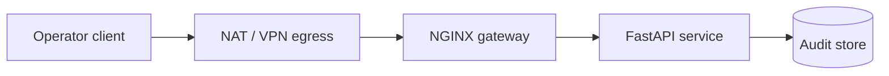
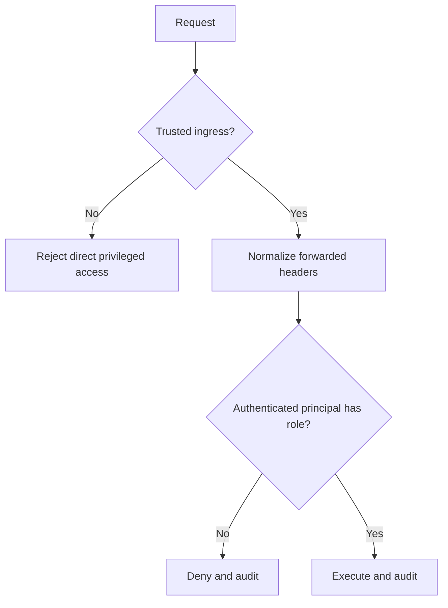
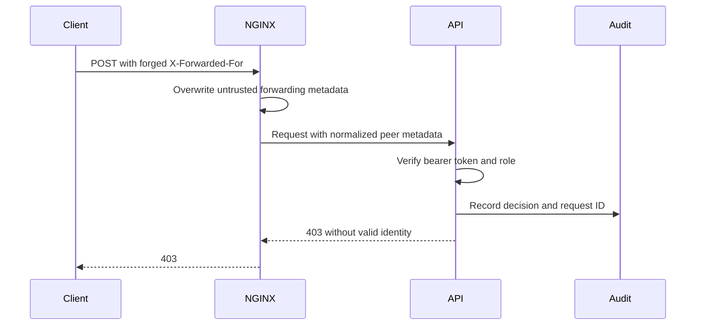

# Lesson 15 — Proxy Header Spoofing and Authorization Trust Boundaries

**Reading and design: 20–25 minutes. Optional practical lab: 45–70 minutes; not locally verified. Status: Published.**

**LEARN → DESIGN → BUILD → BREAK → INVESTIGATE → FIX → VALIDATE**

**Networking revision:** [NAT, Reverse Proxies and Trustworthy Client Identity](../../networking/security/nat-proxies-source-addresses.md) is the canonical fundamentals reference. This lesson extends it into an incident architecture, not a duplicate.

## 1. Problem and requirements

A maintenance API behind NGINX allows privileged incident operations. A developer uses an internal-IP allowlist by reading the `X-Forwarded-For` request header. Clients may send this header themselves. NAT, load balancers and reverse proxies change the observed network peer, but do not authenticate an operator. The design must prevent forged headers from granting privilege, including when an API is accidentally reachable directly.

**Functional:** health endpoint, read-only diagnostics, authenticated maintenance operation, request IDs, audit decisions and safe denial. **Nonfunctional:** 99.95% monthly availability; p95 under 150 ms, p99 under 400 ms; zero unauthorized privileged actions; credential secrecy; 100% audit coverage for privileged decisions; safe key rotation and rollback.

**Capacity assumptions:** 1,500 RPS normal, 3,000 RPS burst; 2% privileged = 30 privileged RPS normal. At mean service time 100 ms, Little's Law estimates 150 in-flight requests; 400 ms gives 600 in-flight at sustained load. Four replicas rated ~500 RPS each provide normal headroom but need autoscaling or load shedding at burst. A hypothetical 10-minute bypass at 30 privileged RPS exposes up to 18,000 attempted privileged requests; this is a *bound*, not proof of compromise. A 99.95% SLO allows approximately 21.6 minutes of downtime per 30-day month; a security violation is not excused by meeting that SLO.

## 2. Incremental architecture

### Stage 1 — Actual network path



A backend TCP peer commonly identifies the reverse proxy, not the user. A forwarding header may describe prior hops, but a direct client can forge it.

### Stage 2 — Two independent trust decisions



**Invariant:** source IP and forwarding metadata may support diagnostics or abuse detection; authorization requires an authenticated principal and explicit privilege. Gateway sanitization alone cannot guarantee authorization if a backend is directly exposed.

### Stage 3 — Defense in depth



Production upgrades include TLS, OIDC scoped tokens, network policies, service-to-service mTLS, short-lived credentials and durable audit storage. The lab intentionally uses a static demo token to isolate one failure mode.

## 3. Architecture alternatives and tradeoffs

| Approach | Advantage | Weakness / cost | Decision |
| --- | --- | --- | --- |
| Trust arbitrary XFF | Minimal implementation | Client can spoof identity | Reject |
| Overwrite XFF at edge | Reliable proxy diagnostics | Must identify every trusted hop | Required |
| Restrict backend networking | Reduces direct bypass | Misconfiguration and lateral access remain | Defense in depth |
| Shared bearer token | Simple lab | Poor attribution and rotation | Lab only |
| OIDC scoped tokens | User identity and role claims | IdP, token/JWKS lifecycle | Preferred production |
| mTLS service identity + user RBAC | Authenticated service hop | Certificate management | Strong option |

A proxy's source IP must not become the user's identity. If the identity provider fails, deny privileged actions; preserve health and authorized read-only diagnostics when safe.

## 4. Hypothetical production incident

This is an **invented teaching scenario**, not an observed customer incident.

- **09:02:** Security reports a privileged maintenance operation with no authenticated operator.
- **09:05:** API audit shows `X-Forwarded-For: 10.0.0.10`, matching an allowlisted IP.
- **09:08:** Gateway access log shows an external NAT peer, not that internal address.
- **09:12:** Source review finds `if forwarded_ip == TRUSTED_IP: allow`.
- **09:16:** A test from an authorized sandbox reproduces HTTP 200 without a token by sending a forged header directly to the backend.
- **09:21:** Privileged operation is temporarily disabled; evidence retained.
- **09:34:** Authenticated authorization patch and gateway header normalization are validated.

**Immediate cause:** trusting unverified HTTP forwarding metadata for authorization. **Trigger:** crafted XFF header. **Systemic weakness:** no authenticated role check, incomplete gateway trust policy, missing direct-backend network controls and no negative spoof tests. Scope the audit before asserting which operations succeeded.

## 5. Chronological, evidence-led investigation

**Step 1 — Scope:** identify route, status, timestamps, request IDs, caller networks and release changes. On NGINX host: `grep maintenance /var/log/nginx/access.log | tail -30`. Expected: successful privileged response without an authenticated principal.

**Step 2 — Verify path:** on Linux `ss -tnp` and, only where authorized, `sudo tcpdump -ni any 'tcp port 80'`. On macOS `lsof -nP -iTCP:18095`. Compare actual TCP peer to request-supplied XFF. NAT can rewrite peer addresses; neither establishes a human identity.

**Step 3 — Reproduce carefully:** `curl -si -X POST -H 'X-Forwarded-For: 10.0.0.10' http://127.0.0.1:18095/admin/maintenance` in a disposable environment. A secure gateway should normalize the header; direct backend exposure is tested separately.

**Step 4 — Inspect code and telemetry:** search for `x-forwarded-for`, `x-real-ip`, `request.client.host`, auth middleware and trusted-proxy configuration. Compare ingress `remote_addr` and raw `http_x_forwarded_for` to API `auth.result` and `principal.role`. Trace spans: `ingress → authorize → maintenance → audit`; omit secrets.

**Step 5 — Database evidence:** if PostgreSQL backs audit, inspect `SELECT request_id, principal, action, decision, created_at FROM audit_events WHERE action='maintenance' ORDER BY created_at DESC LIMIT 20;`. A 200 with missing principal indicates a serious invariant violation, not necessarily proof of a malicious actor.

**Step 6 — Competing hypotheses:** DNS errors prevent lookup; TCP resets interrupt transport; HTTP 502 suggests upstream failure; 401/403 suggests auth denial; **HTTP 200 with no principal** strongly suggests authorization logic failure. A network capture cannot prove RBAC correctness.

**Step 7 — Confirm repair from real path:** test spoofed header with no token, invalid token, valid scoped token, and direct backend access. Inspect both audit and gateway logs, not only curl status.

| Evidence | Supports | Does not establish |
| --- | --- | --- |
| Raw XFF differs from TCP peer | Caller-controlled metadata | Human attacker identity |
| 200 without token | Auth bypass | Whether durable operation succeeded |
| 403 after repair | This spoof is denied | Every endpoint is safe |
| p99 under target | Performance headroom | Authorization correctness |

## 6. Mitigation and long-term redesign

**Minutes:** disable or gateway-block privileged route, preserve logs, identify potentially executed actions, and rotate exposed credentials if warranted. **Hours:** require bearer authentication and scoped role, overwrite incoming forwarding metadata, restrict direct API access, and add denial regression tests. **Weeks:** migrate to OIDC or workload identity, separate break-glass approval, use immutable durable audit, validate trusted-proxy hop chains, threat-model ingress, and test credential rotation.

**Rollout:** canary deny-by-default policy, test both operator and anonymous traffic, monitor decision counts, roll out gradually, and keep a rollback that does *not* re-enable IP-based authorization. A gateway outage should not silently downgrade security.

## 7. Observability and validation

Metrics: `auth_decisions_total{route,result}`, `privileged_actions_total{result}`, `http_requests_total{status,route}`, p95/p99, `audit_write_failures_total`, gateway 4xx/5xx. Avoid raw user IDs, IPs or tokens as metric labels. Logs should contain UTC timestamp, request ID, transport peer, normalized forwarding chain with restricted access, principal reference, action and allow/deny reason. Critical alert: any privileged allow with no verified principal.

Validate 1,500 RPS and 3,000 RPS burst separately from security tests; test spoofing, direct backend denial, gateway restart, identity outage, invalid/expired credentials, audit sink outage, canary and rollback. Record actual outputs and unexpected observations.

## 8. Three independent architect challenges

1. **Multi-proxy chain:** A partner proxy sits before your NGINX ingress. Which hop can set forwarding metadata, how do you prevent spoofing, and which identity authorizes maintenance?
2. **Break glass:** The IdP fails during a Sev-1. Design a time-limited, approved, audited emergency path without accepting spoofable IP headers.
3. **Evidence and scale:** Privileged requests peak at 50 RPS for 10 minutes; 20% of audit writes fail. Estimate the maximum potentially affected operations, describe uncertainty, and design reliable audit delivery without making authorization fail open.

## Practical Labs

**Optional 45–70 minutes, independent of the 20–25-minute reading.** Recommended **Mac M4 Docker Desktop**; Ubuntu VM with Docker Engine and Compose v2 also works (1 CPU, ~1.9 GiB RAM). This small FastAPI + NGINX lab needs no database: the bug is at the HTTP identity boundary. PostgreSQL audit is an architectural production consideration; local audit is structured stdout. **Only use loopback and disposable containers.**

### A. Prerequisites and exact files

```bash
docker version
docker compose version
mkdir -p ~/architecture-lab15/app ~/architecture-lab15/nginx
cd ~/architecture-lab15
```

```text
architecture-lab15/
├── compose.yaml
├── Dockerfile
├── requirements.txt
├── app/
│   ├── main.py
│   └── test_main.py
└── nginx/
    └── default.conf
```

Create each file with `cat > filename <<'EOF'`, paste the corresponding content below, and finish with `EOF`.

**File: `requirements.txt`**

```text
fastapi==0.115.12
uvicorn==0.34.2
httpx==0.28.1
pytest==8.3.5
```

**File: `Dockerfile`**

```dockerfile
FROM python:3.12-slim
WORKDIR /code
COPY requirements.txt .
RUN pip install --no-cache-dir -r requirements.txt
COPY app ./app
CMD ["uvicorn", "app.main:app", "--host", "0.0.0.0", "--port", "8000"]
```

**File: `compose.yaml`**

```yaml
services:
  api:
    build: .
    environment:
      LAB_MODE: vulnerable
      OPERATOR_TOKEN: local-demo-token
      TRUSTED_IP: 10.0.0.10
    expose:
      - "8000"
  gateway:
    image: nginx:1.27-alpine
    ports:
      - "127.0.0.1:18095:80"
    volumes:
      - ./nginx/default.conf:/etc/nginx/conf.d/default.conf:ro
    depends_on:
      - api
```

**File: `nginx/default.conf`**

```nginx
log_format lab15 'peer=$remote_addr raw_xff="$http_x_forwarded_for" status=$status request_id=$request_id';
server {
    listen 80;
    access_log /var/log/nginx/access.log lab15;
    location / {
        proxy_pass http://api:8000;
        proxy_set_header Host $host;
        proxy_set_header X-Request-ID $request_id;
        proxy_set_header X-Forwarded-For $remote_addr;
        proxy_set_header X-Real-IP $remote_addr;
    }
}
```

**File: `app/main.py`**

```python
import logging
import os
from fastapi import FastAPI, Header, HTTPException, Request

app = FastAPI()
logging.basicConfig(level=logging.INFO, format="%(message)s")
log = logging.getLogger("audit")
MODE = os.getenv("LAB_MODE", "vulnerable")
TOKEN = os.getenv("OPERATOR_TOKEN", "local-demo-token")
TRUSTED_IP = os.getenv("TRUSTED_IP", "10.0.0.10")

@app.get("/health")
def health():
    return {"status": "ok", "mode": MODE}

@app.get("/whoami")
def whoami(request: Request, x_forwarded_for: str | None = Header(None)):
    return {"peer": request.client.host if request.client else None,
            "forwarded_for": x_forwarded_for}

@app.post("/admin/maintenance")
def maintenance(request: Request, authorization: str | None = Header(None),
                x_forwarded_for: str | None = Header(None),
                x_request_id: str | None = Header(None)):
    spoofed = (x_forwarded_for or "").split(",")[0].strip()
    if MODE == "vulnerable":
        allowed = spoofed == TRUSTED_IP
        reason = "spoofable_header"
    else:
        allowed = authorization == "Bearer " + TOKEN
        reason = "verified_token" if allowed else "invalid_token"
    log.info("request_id=%s peer=%s decision=%s reason=%s",
             x_request_id, request.client.host if request.client else "unknown",
             "allow" if allowed else "deny", reason)
    if not allowed:
        raise HTTPException(status_code=403, detail="not authorized")
    return {"result": "accepted", "reason": reason}
```

**File: `app/test_main.py`**

```python
from fastapi.testclient import TestClient
import app.main as module

client = TestClient(module.app)

def test_health():
    assert client.get("/health").status_code == 200

def test_spoofed_header_denied_when_secure(monkeypatch):
    monkeypatch.setattr(module, "MODE", "secure")
    assert client.post("/admin/maintenance",
                       headers={"X-Forwarded-For": "10.0.0.10"}).status_code == 403

def test_valid_token_allowed_when_secure(monkeypatch):
    monkeypatch.setattr(module, "MODE", "secure")
    assert client.post("/admin/maintenance",
                       headers={"Authorization": "Bearer local-demo-token"}).status_code == 200

def test_vulnerable_mode_demonstrates_bug(monkeypatch):
    monkeypatch.setattr(module, "MODE", "vulnerable")
    assert client.post("/admin/maintenance",
                       headers={"X-Forwarded-For": "10.0.0.10"}).status_code == 200
```

### B. BUILD and baseline

```bash
docker compose up -d --build
docker compose ps
curl -si http://127.0.0.1:18095/health
curl -s http://127.0.0.1:18095/whoami
docker compose exec api pytest -q
```

**Expected:** 200 health, both services up, four passing tests. The tests intentionally show that vulnerable mode is exploitable, not that it is safe.

### C. BREAK 1 — Controlled direct-backend spoof

NGINX already overwrites the untrusted header. Simulate a **misconfigured direct backend route** from within the disposable API container; no API port is published on the host.

```bash
docker compose exec api python -c 'import httpx; r=httpx.post("http://127.0.0.1:8000/admin/maintenance",headers={"X-Forwarded-For":"10.0.0.10"}); print(r.status_code,r.text)'
curl -si -X POST -H 'X-Forwarded-For: 10.0.0.10' http://127.0.0.1:18095/admin/maintenance
docker compose logs --tail=25 api gateway
```

**Expected:** direct internal request 200 without token; gateway request 403 because NGINX replaces XFF with its real peer. If results differ, inspect container environment and gateway configuration before proceeding. **Interpretation:** a sanitized gateway is insufficient if backend authorization itself trusts headers.

### D. INVESTIGATE — Evidence

```bash
docker compose ps
docker compose logs --tail=50 api gateway
curl -si http://127.0.0.1:18095/whoami
```

Look for `decision=allow reason=spoofable_header` on the direct request and denial on the gateway request. The API can be healthy while authorization is broken; this is not a DNS, TCP or database outage.

### E. FIX — Change one configuration value

For this isolated project, change **only** the `LAB_MODE` value in `compose.yaml` from `vulnerable` to `secure`, then recreate the API:

```bash
docker compose up -d --force-recreate api
docker compose exec api python -c 'import httpx; r=httpx.post("http://127.0.0.1:8000/admin/maintenance",headers={"X-Forwarded-For":"10.0.0.10"}); print(r.status_code,r.text)'
curl -si -X POST -H 'X-Forwarded-For: 10.0.0.10' http://127.0.0.1:18095/admin/maintenance
curl -si -X POST -H 'Authorization: Bearer local-demo-token' http://127.0.0.1:18095/admin/maintenance
```

**Expected:** 403 for direct spoof, 403 for gateway spoof, 200 with demo token. The token is a local teaching aid only; real production uses scoped, rotated credentials.

### F. VALIDATE — Tests and second reversible fault

```bash
docker compose exec api pytest -q
curl -si -X POST -H 'Authorization: Bearer wrong' http://127.0.0.1:18095/admin/maintenance
curl -si http://127.0.0.1:18095/health
docker compose logs --tail=30 api gateway
```

**Expected:** four passing tests, invalid token 403, health 200. This second fault is performed **only after** the first is fixed. The production-grade redesign still needs user-scoped RBAC, secure gateway-to-backend connectivity and durable audit.

### G. Cleanup and evidence journal

```bash
docker compose down
```

This removes this project's containers and network, not unrelated named volumes. **Never use** `docker compose down -v`, `docker volume prune` or `docker system prune`. Keep the source files and record observed results, competing hypotheses, and your design decision. Run one step, share actual outputs, then proceed to the next fault.

## My Architecture Review — Solutions & Doubts

### 1. My Understanding

_Explain the difference between network peer, forwarding metadata and authenticated principal._

### 2. My Solutions to the Architect Challenges

_Challenge 1:_

_Challenge 2:_

_Challenge 3:_

### 3. My Troubleshooting Approach

_Hypotheses, commands, observed evidence, revised conclusion._

### 4. My Proposed Architecture Improvements

_Tradeoffs and rollout plan._

### 5. My Doubts / Questions

_Questions for mentor review._

### 6. Lessons Learned

_What would you change in a production architecture?_

### 7. Mentor Review

_Pending: evaluate reasoning and actual lab evidence, not answer matching._
